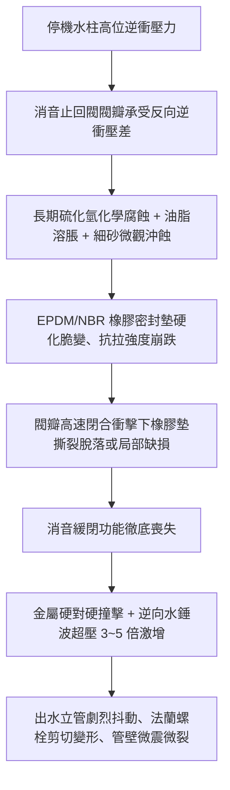
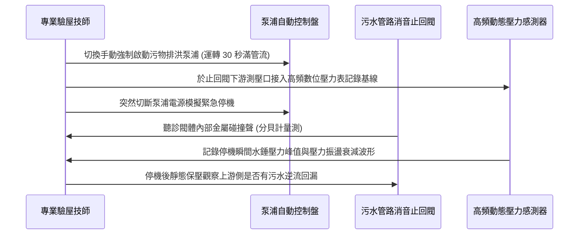

# 全案購屋實戰第九百八十六部：中古大樓社區地下室生活污水下水道沉水式污物排洪泵浦出水全不銹鋼多功能消音止回閥橡膠緩閉密封墊撕裂逆流水錘衝擊體檢工序全書

## 導言：地下室防洪生命線之逆流防禦閥門關鍵體檢

在中古大樓地下室防汛排洪與生活污水下水道深井動力系統中，沉水式污物排洪泵浦（Submersible Sewage Pumps）肩負著將全社區高濃度生活污水與暴雨地表逕流水強制揚升至市政污水下水道重力放流管的關鍵任務。當排洪泵浦於大流量、高揚程（通常達 12m 至 20m 垂直揚程）啟動與停機瞬間，管網內部承受著極為劇烈的動態流體動量轉換。

為防止停機時垂直立管內重達數噸的直立污水柱瞬間逆流回沖衝毀泵浦葉輪與引發高破壞性破壞性水錘（Water Hammer），出水管路上均強制配置「全不銹鋼多功能消音止回閥（Stainless Steel Silent / Non-Slam Check Valve）」或「橡膠瓣緩閉逆止閥」。然而，在長期遭受污水中高濃度硫化氫（H₂S）、各類洗滌劑強鹼、油脂硬脂酸及細砂粒的高頻衝擊下，止回閥內部的三元乙丙（EPDM）或丁腈橡膠（NBR）緩閉密封墊極易發生疲勞老化、硬化撕裂、局部缺損或密封面微粒夾渣。一旦密封墊失效，閥瓣在停機瞬間無法實現緩衝消音閉合，將爆發震耳欲聾的剛性金屬撞擊聲與高達工作壓力 3~5 倍的超壓逆流水錘，重擊整座地下室機房管道間，甚至造成管道法蘭撕裂、膨脹螺栓拔出及污水深井滿溢淹沒昂貴變電配電與發電機設備。

本全書深入解構該消音止回閥橡膠緩閉墊撕裂之微觀成因、高靈敏度現場體檢檢測工序、物理修復工藝與中古屋實戰殺價談判策略。

---

## 一、消音止回閥構造原理與橡膠密封墊撕裂失效機制

### 1. 閥體核心結構與水力動態平衡
典型消音止回閥由閥體（SCS13/SUS304 不銹鋼）、導向軸套、不銹鋼壓縮彈簧、閥瓣（Disc）以及硫化包覆或螺釘鎖固的橡膠密封墊（Resilient Seat）組成：
- **消音彈簧預緊設計**：利用精準校驗的不銹鋼彈簧，在水流倒流前瞬間（即流速歸零瞬間）先驅動閥瓣貼合閥座，消除流體倒衝行程。
- **橡膠微觀密封與衝擊吸收**：橡膠密封墊在彈簧貼合及水柱靜壓作用下產生彈性微形變，完全密封污水且吸收閥瓣動能，實現「無撞擊（Non-slam）」靜音閉合。

### 2. 橡膠墊撕裂之三重致命誘因
- **化學溶脹與硫化交聯斷裂**：地下室污水池為厭氧環境，硫化氫與有機酸氣體長期積聚，使橡膠彈性體分子鏈發生氧化斷鏈；廚房排放之油脂（動植物油、洗碗精表面活性劑）更會引起橡膠溶脹（Swelling），使其邵氏硬度（Shore A）從標準的 70° 劇降至 45° 以下，抗撕裂強度喪失逾 70%。
- **水流攜砂的微觀剪切**：暴雨期地表逕流水夾帶大量細石英砂與泥沙，在污水以 1.5~2.5 m/s 高速衝刷閥門時，砂粒在橡膠密封面形成微觀劃痕。停機時，劃痕處產生高應力集中，成為微裂紋擴展源。
- **彈簧疲勞導致閥瓣滯後劇烈撞擊**：當內部不銹鋼彈簧因長期往復壓縮產生塑性變形彈力衰退時，閥瓣無法在零流速時就位，必須等待強烈倒流污水將其硬生生推回閥座，此時橡膠墊遭受數噸水流衝擊力直擊，產生瞬間剪切撕裂。

---

## 二、現場深度專業體檢工序與數據量化標準

在陪同家庭買方前往候選中古大樓進行地下室防汛公設驗收時，必須遵循以下標準化體檢程序：

### 1. 聲學診斷與分貝量化
- **檢測儀器**：手持式工業聲級計（Class 1 精度）與管道接觸式聽診器。
- **測試流程**：在深井泵浦運轉達到額定轉速、管流穩定後按下停止按鈕。
- **判定標準**：
  - **優良（綠燈）**：停機時僅有平緩沉悶之水流微響，閥門撞擊聲小於 65 dB(A)。
  - **隱患（黃燈）**：聽聞明顯「咚」聲金屬碰擊音，聲壓級在 70~80 dB(A) 之間，代表彈簧彈力微弱或橡膠墊開始變形。
  - **危急（紅燈）**：傳出清脆尖銳「噹！喀！」金屬硬碰硬巨響，伴隨管道強烈震動，聲壓級超過 85 dB(A)，證實橡膠緩閉墊已完全撕裂脫落或移位。

### 2. 水錘動態壓力峰值採樣
- **檢測方法**：於消音止回閥前、後端安裝響應時間低於 1ms 之動態壓阻式感測器。
- **數據極限值判定**：
  - 正常緩閉水錘超壓應控制在工作壓力之 **1.15 倍以內**。
  - 若採樣到停機瞬間壓力衝擊峰值達到工作壓力的 **1.8 至 3.0 倍以上**，且壓力波震盪往復衰減超過 5 個週期，代表緩閉機能徹底崩潰，立管法蘭與膨脹螺栓處於極限疲勞破壞風險中。

### 3. 靜態逆流洩漏性試驗
- 停機後，關閉深井所有進水閥門，觀察止回閥下側（泵浦側）洩水孔或檢修旁通閥。
- 若 10 分鐘內持續有污水自下游高位管段倒灌逆流而出，證明止回閥橡膠密封面已撕裂或被硬物墊起，逆止密封完全失效。

---

## 三、故障修復、更換標準工藝與防護對策

一旦確認止回閥橡膠密封墊撕裂破損，絕不可單純依賴調緊螺栓，必須立即實施標準修復工藝：

| 檢修環節 | 規範工序與技術要求 | 劣質工法之後遺症與二次風險 |
| :--- | :--- | :--- |
| **拆卸與清洗** | 關閉維修閘閥，徹底排空管內污水，將止回閥總成拆下進行高壓除垢與中和清洗。 | 未徹底清除油脂硬塊直接安裝，導致密封面再次墊起洩漏。 |
| **密封墊更換** | 選用專用 **氟橡膠（FKM/Viton）** 或高抗拉改性 **EPDM** 原廠緩閉密封墊，硬度 Shore A 75°±5。 | 採用普通廉價再生丁腈橡膠（NBR），數月內即在硫化氫環境下再度溶脹脆裂。 |
| **彈簧疲勞校驗** | 更換為 **SUS316 超耐腐蝕高疲勞壽命不銹鋼彈簧**，預緊力嚴格校驗至零流速閉合標準。 | 延用舊有疲勞彈簧，導致閥瓣關閉滯後再度引發衝擊撞裂新橡膠墊。 |
| **導向軸套潤滑** | 導向軸套清理乾淨，塗敷食品級抗水耐酸氟素潤滑脂，確保滑動無阻滯。 | 未潤滑或軸套磨損偏心，導致閥瓣卡滯無法完全回位閉合。 |
| **安裝與水壓測試** | 更換全新聚四氟乙烯（PTFE）金屬纏繞法蘭墊片，對角均勻鎖固螺栓至規定扭矩；實施 1.5 倍額定工作壓力試壓 15 分鐘無滲漏。 | 沿用舊石棉墊片或單邊死鎖，造成法蘭應力集中拉裂或管網微振漏水。 |

---

## 四、四大主力候選物件實戰關聯評估與議價攻防

在實地踏勘四大主力候選大樓時，此項公設機電直接牽動社區維護基金支出與居住安寧：

### 1. 大安紫金城 13 樓 (`PROP_10`)
- **實地重點**：大安紫金城樓層達 13 樓，地下室開挖深，污水沉水泵排洪垂直揚程大。且地下二樓為頂級獨立平面車位所在，若排洪立管消音止回閥失效破壞，水錘共振聲音將沿著管道間向上傳導，同時若爆管外溢將直接威脅地下室昂貴豪車。
- **談判籌碼**：驗收地下室污水泵浦運轉時，若止回閥有水錘巨響與閥體滲滴，即以此向管委會調閱公設機電保養紀錄，向賣方出示管網老化檢修報價單，作為堅守起手價 720 萬、鎖定 768~788 萬目標價之強力談判理由。

### 2. 長億南園 8 樓 (`PROP_106`)
- **實地重點**：長億南園雖擁有 32 坪超大空間，但社區屋齡與公共機電相對老舊。其排污泵浦止回閥若長年未換，啟動時地下室常伴隨重擊聲。
- **殺價攻防**：結合其機械車位限重 1.6 噸、門廳高差等硬傷，將地下室公共機電閥件更新費用計入整體整修折讓中，強勢爭取開價 998 萬砍至 745~760 萬之大幅讓利。

---

## 五、全案總結與買方自保查核清單

1. **聽其聲**：停機瞬間絕不能有金屬撞擊巨響，必須呈現平緩沉悶之水流消音閉合。
2. **觀其震**：手觸排污立管，停機水柱回壓時立管震動位移量應在 0.5mm 以內，嚴禁整支管路劇烈晃動。
3. **查其漏**：止回閥法蘭接縫處與閥體導向軸套蓋板嚴禁有黑色污水水漬、結晶鹽或滴漏痕跡。
4. **閱其單**：要求房仲調閱最近 2 年管委會機電維保合約與單項更換紀錄，確認消音止回閥與止回橡膠墊更換年份。
