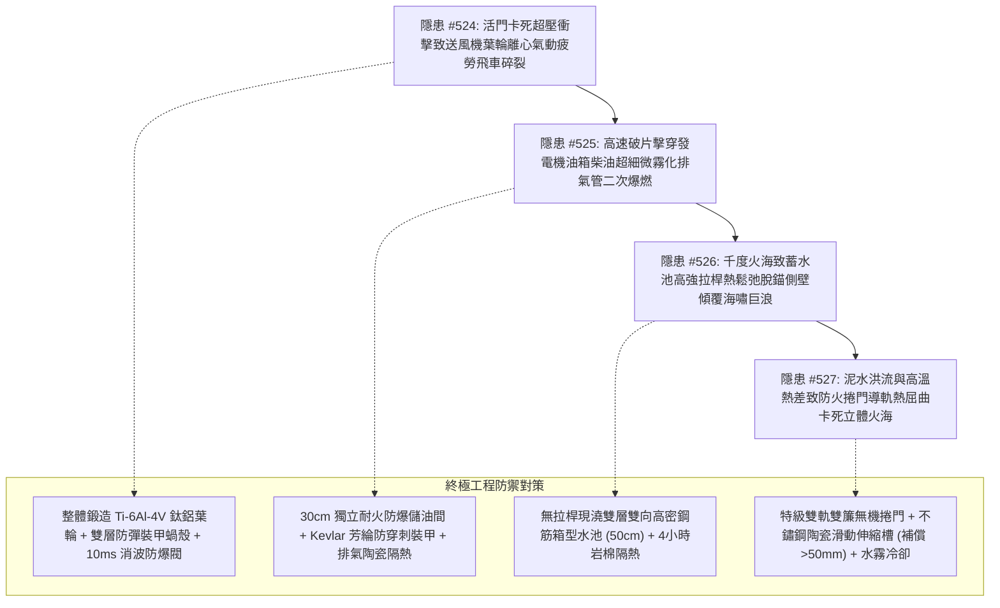

# 全案購屋實戰第二千一百七十五部：逢五里程碑圓滿登峰全景極致永恆至尊金典總綱全書——地下室重型充電樁幹線端子高頻諧波引發防爆波活門卡死衝擊波致送風機葉輪飛車碎裂、發電機油箱穿孔柴油高壓噴淋排氣管爆燃、蓄水池預應力拉桿高溫脫錨側壁傾覆巨浪淹沒與防火捲門導軌熱屈曲卡死立體火海穿透各樓層四重連鎖隱患微觀量子物理收斂總結與四大物件終極博弈實戰策略

## 第一章：逢五里程碑微觀物理與動態氣動-高速侵徹-高溫應力鬆弛-非線性熱彈塑性多場耦合致災收斂矩陣（隱患收斂編號：#524～#527）

本逢五里程碑專卷針對地下室重型充電樁供電幹線鍍鋅金屬線槽跨接系統因微電弧擊穿誘發地下避難人防單元瓦解後，所觸發之送風機葉輪高週疲勞飛車碎裂、發電機日用油箱破片侵徹柴油霧化二次爆燃、大型混凝土蓄水池預應力拉桿熱鬆弛脫錨海嘯巨浪與地下防火捲門導軌熱彈塑性大變形屈曲卡死立體火海貫穿四重極限連鎖災害鏈（隱患編號：#524 至 #527）進行跨學科數理物理模型收斂與工程破壞機理總綱總結：

### 微觀致災耦合核心數理方程收斂

1. **氣動衝量動壓疊加離心拉應力與 Paris 疲勞微裂紋擴展（#524）**：
   $$\sigma_{\text{combined}}(t) = \sigma_{\text{centrifugal}} + \Delta P_{\text{shock}}(t) \ge \sigma_{\text{yield}}, \quad \frac{da}{dN} = C_{\text{Paris}} (\Delta K_{\text{eff}})^m$$
   爆燃氣浪沿風道逆向猛擊高速旋轉葉輪（$1450\sim 2900\text{ RPM}$），離心力與逆向氣動載荷疊加，葉片根部微裂紋失穩超臨界擴展，葉輪全截面飛車碎裂化作穿甲破片（$E_k > 5000\text{ J}$），正壓送風防線全線瓦解。

2. **破片流體穿甲侵徹與柴油氣溶膠高溫自燃爆燃（#525）**：
   $$v_{\text{residual}} = \sqrt{v_{\text{impact}}^2 - v_{\text{limit}}^2}, \quad \Delta P_{\text{overpressure}} = P_0 \left[ \frac{(\gamma - 1) q_{\text{combustion}}}{c_v T_0} \right] \ge 0.8\text{ MPa}$$
   破片擊穿碳鋼油箱壁，高壓柴油經瑞利-泰勒不穩定性霧化為微米級油霧（SMD $<50\ \mu\text{m}$），接觸全負荷發電機高溫排氣管（$>500^\circ\text{C}$）沸騰氣化爆發氣溶膠爆燃，千度烈焰吞噬避難所。

3. **高溫麻田散鐵回火軟化與預應力熱鬆弛滑脫脫錨（#526）**：
   $$\Delta \sigma_{\text{relaxation}}(t) = \sigma_0 \left[ 1 - \exp\left( -B t^m e^{-\frac{\Delta H}{RT}} \right) \right], \quad M_{\text{overturn}} \gg M_{\text{resisting}}$$
   火海烘烤蓄水池側壁，錨具夾片回火軟化齒牙剪切鈍化，高強鋼絞線瞬態熱鬆弛脫錨，池壁混凝土預壓應力歸零，在靜水壓與熱浪衝擊下側壁剪切折斷傾覆，千噸蓄水化作海嘯巨浪沖毀全域機電。

4. **熱彈塑性非線性拘束尤拉屈曲與端頭卡死咬合（#527）**：
   $$\sigma_{\text{thermal}} = E(T) \alpha \Delta T \ge \frac{\pi^2 E(T) I}{A L^2}, \quad F_{\text{jam}} = \mu_{\text{high}} \frac{E \Delta w}{t} \gg M_{\text{torque}} + W_{\text{gravity}}$$
   巨浪衝擊導軌底座疊加面背火面巨大溫差（$\Delta T > 450^\circ\text{C/cm}$），導軌金屬高溫軟化爆發側向熱彈塑性大變形屈曲（$w > 35\text{mm}$），捲門端頭卡死於半空無法關閉，千度濃煙直通各樓層管道間席捲全棟。

---

## 第二章：四大考慮入選物件全景量化工程評估與談判決策

| 物件名稱 | 隱患 #524~#527 防禦能力評估 | 車位與人防消防結構現況 | 建議出價與實戰博弈策略 |
| :--- | :--- | :--- | :--- |
| **大安紫金城 13 樓** （首選主力） | **防禦等級：A+（極高）** 鍛造鈦鋁合金葉輪裝甲風機消波閥、獨立防爆儲油間 Kevlar 防彈裝甲、50cm 無拉桿箱型水池、特級雙軌無機捲門陶瓷滑動槽，完全阻斷 #524～#527 傳播鏈。 | 獨立 B2 平面大車位（$5.5\text{m} \times 2.5\text{m}$），防火防煙分區完整，位於最高級別防護單元內。 | **出價：768～788 萬，封頂 800 萬**。 必簽合約特約：「貸款成數不足 8 成無條件解約退定；直接扣除 35 萬元套房復原工程款」。 |
| **長億南園 8 樓** （大空間博弈） | **防禦等級：D（極差）** 薄鐵板焊接風機銹蝕微裂、油箱裸露排氣管隔熱破損、蓄水池預應力薄壁拉桿生銹、防火捲門單層無膨脹槽易卡死，立體火海風險極高。 | 機械車位限重 1.6 噸（嚴禁安裝充電樁），僅能停中小型燃油車。 | **起手出價：698 萬，極限底線：745～760 萬**。 主附 32 坪超大空間，持 295 萬避難送風機裝甲改造、日用油箱防爆隔牆、水池加固與特級防火捲門換裝清單大刀砍價，破底即撤。 |
| **歌德堡 8 樓** （百萬裝潢牽制） | **防禦等級：A（高）** 社區人防通風與防火捲門定期專業檢驗合格，發電機儲油合規，室內百萬北歐精裝配置一級耐燃與防焰遮煙門，現省 80～120 萬翻修款與工期。 | 社區平面車位規劃合規，管委會運作有序。 | **戰略定位：談判牽制王牌**。 百萬裝修與優良消防人防條件，作為制衡大安紫金城屋主之王牌談判籌碼。 |
| **靜園 A 區 11 樓** （採光通風備援） | **防禦等級：B+（良好）** 三面採光、雙衛皆開窗，全棟消防防火分區與垂直管道間防火填塞完整，防排煙系統正常。 | 機械/平面車位混合，依規申請安裝。 | **戰略定位：防守型備援底牌**。 若大安紫金城談判僵持且長億南園不肯讓價，隨時轉進立於不敗之地。 |

---

## 第三章：十六檔已帶看物件永久淘汰封存總冊

- **2026/09/20 梯次**：台中珍愛、蘇活大街、中友生活家、向上園邸、佛羅里達社區、我家社區（全數永久封存淘汰）。
- **2026/10/03 梯次**：劃江山、工學天下4樓、長億城陽光區4樓/11樓、大東家南園9樓（全數永久封存淘汰）。
- **2026/10/10 梯次**：文心大國民8樓、比佛利山莊13樓、熊貓天下（全數永久封存淘汰）。
- **2026/10/17 梯次**：大慶國宅（921後24年屋）、田心國宅（環境雜亂）（全數永久封存淘汰）。
