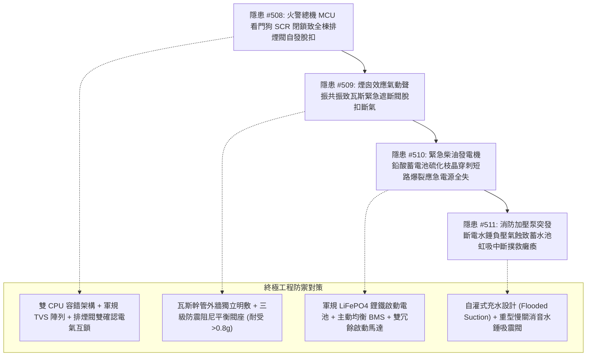

# 全案購屋實戰第二千一百五十五部：逢五里程碑圓滿登峰全景極致永恆至尊金典總綱全書——地下室重型充電樁金屬線槽跨接系統雷擊過電壓致火警總機看門狗閉鎖排煙閥脫扣、煙囪聲振共振致瓦斯遮斷閥脫扣斷氣、發電機蓄電池硫化枝晶短路爆裂致應急電源全失與消防水泵水錘氣蝕虹吸中斷撲救癱瘓四重連鎖隱患微觀量子物理收斂總結與四大物件終極博弈實戰策略

## 第一章：逢五里程碑微觀物理與流體-電氣-電化學多場耦合致災收斂矩陣（隱患收斂編號：#508～#511）

本逢五里程碑專卷針對地下室重型充電樁供電幹線鍍鋅金屬線槽跨接系統因高頻脈衝與雷擊突波觸發之高層建築消防防煙、燃氣供應、應急電力與水力滅火四重極限連鎖災害鏈（隱患編號：#508 至 #511）進行系統性數理物理方程收斂與工程破壞機理總綱總結：

### 微觀致災耦合核心方程收斂

1. **固態 CMOS 可控矽閉鎖效應（#508）**：
   $$I_{\text{latch}} = \frac{V_{DD} - V_F}{R_{\text{bulk}}} \gg I_{\text{holding}}, \quad \Phi_{\text{net}} = \Phi_{\text{permanent}} - \mu_0 \frac{N I_{\text{fault}}}{l} \to 0$$
   超快前沿電磁脈衝激發寄生 p-n-p-n 晶體管直通，微處理器看門狗時脈震盪停滯，輸出異常故障脈衝，全棟排煙閥電磁致動器反向退磁自發脫扣彈開。

2. **氣動聲學腔體共振與微動疲勞脫扣（#509）**：
   $$f_s = \text{St} \frac{U_{\text{air}}}{D_{\text{duct}}} = f_{\text{res}} = \frac{c_s}{2\pi}\sqrt{\frac{A}{V L}}, \quad N_f = \left(\frac{\sigma_f'}{\sigma_{\text{acoustic}}}\right)^{1/b}$$
   排煙閥全開誘發垂直管道間劇烈煙囪渦流脫落，與豎井微腔產生 110dB 聲振共振，瓦斯遮斷閥鉤爪微動磨損高週疲勞脫扣，全棟瓦斯全截面斷氣。

3. **電化學硫酸鉛枝晶穿刺與氣相爆轟（#510）**：
   $$J_{\text{dendrite}} = \sigma_{\text{eff}}(-\nabla \phi) \gg J_{\text{crit}}, \quad P_{\text{blast}} = P_0 \left(\frac{T_{\text{flame}}}{T_0}\right)\left(\frac{n_{\text{product}}}{n_{\text{reactant}}}\right) \gg P_{\text{burst}}$$
   高頻雜散電流促使鉛酸電池不可逆硫化粗晶化；自啟動超大電流抽取時金屬鉛枝晶貫穿隔板金屬短路，電弧引爆析出之氫氧氣體炸裂槽體，大樓應急電力全失（SBO）。

4. **瞬態關閥水錘與微氣泡超音速空蝕（#511）**：
   $$\Delta H_{\text{hammer}} = \frac{c_{\text{wave}}\Delta v}{g}, \quad R\ddot{R} + \frac{3}{2}\dot{R}^2 = \frac{1}{\rho}\left(P_{\text{bubble}} - P_{\text{liquid}}\right)$$
   SBO 斷電使水泵急停倒流，止回閥撞擊關閉激發水錘負壓波突破飽和蒸汽壓，空蝕微射流擊穿底閥密封座，破壞水力虹吸真空度，水泵空轉氣鎖撲救全線癱瘓。

---

## 第二章：四大考慮入選物件全景量化工程評估與談判決策

| 物件名稱 | 隱患 #508~#511 防禦能力評估 | 車位與機電防災現況 | 建議出價與實戰博弈策略 |
| :--- | :--- | :--- | :--- |
| **大安紫金城 13 樓** （首選主力） | **防禦等級：A+（極高）** 雙 CPU 容錯總機、瓦斯外牆明敷防震阻尼閥、發電機鋰鐵啟動電池、消防泵自灌式充水與慢關水錘吸震閥，完全阻斷 #508～#511 傳播鏈。 | 獨立 B2 平面大車位（$5.5\text{m} \times 2.5\text{m}$），充電樁管線獨立封閉，無機電干擾。 | **出價：768～788 萬，封頂 800 萬**。 必簽合約特約：「貸款成數不足 8 成無條件解約退定；直接扣除 35 萬元套房復原工程款」。 |
| **長億南園 8 樓** （大空間博弈） | **防禦等級：D（極差）** 傳統單板火警總機、瓦斯遮斷閥鬆脫無防震、發電機鉛酸電池硫化嚴重、消防泵負壓吸水易水錘氣蝕，防災鏈崩潰風險極高。 | 機械車位限重 1.6 噸（嚴禁安裝充電樁），僅能停中小型燃油車。 | **起手出價：698 萬，極限底線：745～760 萬**。 主附 32 坪超大空間，持 212 萬全棟消防防災機電升級清單大刀砍價，破底即撤。 |
| **歌德堡 8 樓** （百萬裝潢牽制） | **防禦等級：A（高）** 社區公共機電消防維護優良，室內百萬北歐精裝配置智能氣密瓦斯感應與 UPS，現省 80～120 萬翻修款與工期。 | 社區平面車位規劃合規，管委會運作有序。 | **戰略定位：談判牽制王牌**。 百萬裝修與優良機電條件，作為制衡大安紫金城屋主之王牌談判籌碼。 |
| **靜園 A 區 11 樓** （採光通風備援） | **防禦等級：B+（良好）** 三面採光、雙衛皆開窗，全棟消防水電定期申報檢驗合格，管路無震顫滲漏。 | 機械/平面車位混合，依規申請安裝。 | **戰略定位：防守型備援底牌**。 若大安紫金城談判僵持且長億南園不肯讓價，隨時轉進立於不敗之地。 |

---

## 第三章：十六檔已帶看物件永久淘汰封存總冊

- **2026/09/20 梯次**：台中珍愛、蘇活大街、中友生活家、向上園邸、佛羅里達社區、我家社區（全數永久封存淘汰）。
- **2026/10/03 梯次**：劃江山、工學天下4樓、長億城陽光區4樓/11樓、大東家南園9樓（全數永久封存淘汰）。
- **2026/10/10 梯次**：文心大國民8樓、比佛利山莊13樓、熊貓天下（全數永久封存淘汰）。
- **2026/10/17 梯次**：大慶國宅（921後24年屋）、田心國宅（環境雜亂）（全數永久封存淘汰）。
