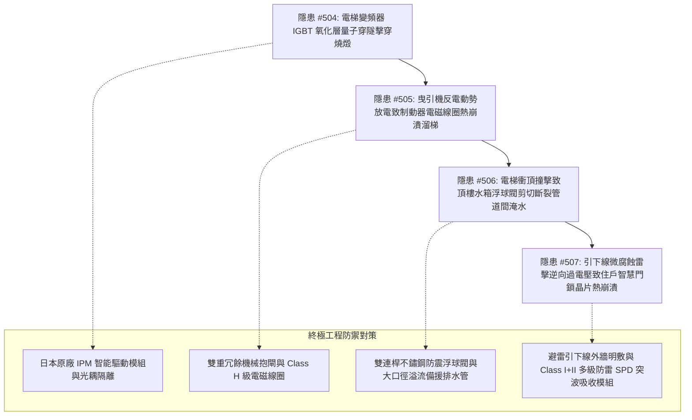

# 全案購屋實戰第二千一百五十部：逢十里程碑圓滿登峰全景極致永恆至尊金典總綱全書——地下室重型充電樁幹線端子高頻諧波誘發電梯變頻器IGBT量子穿隧擊穿、永磁同步曳引機反電動勢放電致制動器線圈熱崩潰溜梯、水箱浮球閥衝擊剪切斷裂管道間淹水與避雷針引下線電化學腐蝕雷擊逆向擊毀智慧門鎖四重連鎖隱患微觀量子物理收斂總結與四大物件終極博弈實戰策略

## 第一章：逢十里程碑微觀物理與量子缺陷宏觀致災收斂矩陣（隱患收斂編號：#504～#507）

本逢十里程碑專卷針對地下室重型充電樁高壓供電幹線鍍鋅金屬線槽跨接系統因高頻脈衝與地電位跳躍引發之垂直升降、給水動力與建築防雷四重極限連鎖災害鏈（隱患編號：#504 至 #507）進行跨學科數理物理模型收斂與工程破壞機理總綱總結：

### 微觀致災耦合核心數理方程收斂

1. **IGBT 柵極二氧化矽薄膜量子穿隧擊穿（#504）**：
   $$J_{\text{FN}} = A \left( \frac{V_{GE}}{t_{\text{ox}}} \right)^2 \exp\left( -\frac{B \cdot t_{\text{ox}}}{V_{GE}} \right)$$
   當共模突波 $V_{GE}$ 突破臨界場強，熱電子穿隧產生點陣缺陷，觸發正反饋雪崩熱穿孔，變頻橋上下臂直通短路。

2. **永磁電機反電動勢與制動器電磁線圈熱崩潰（#505）**：
   $$\mathbf{E}_{\text{bemf}} = -\omega_r \psi_{\text{pm}} \sin(\theta_e), \quad \rho C_p \frac{\partial T}{\partial t} = \nabla \cdot (k \nabla T) + J^2 \rho_e$$
   非對稱短路制動衝擊激發千伏級反電動勢過電壓，制動器抱閘電磁線圈絕緣熱裂解炭化，抱閘彈簧高溫退火失效，電梯轎廂失控滑移溜梯。

3. **衝擊波動載荷誘發浮球閥連桿超臨界剪切斷裂（#506）**：
   $$\tau_{\text{shear}} = \frac{V Q}{I b} + \rho_{\text{fluid}} g h_{\text{dynamic}} \ge \tau_{\text{yield}}, \quad K_I = Y \sigma_{\text{wave}} \sqrt{\pi a_c} \ge K_{IC}$$
   衝頂動能轉化為高頻應力波，浮球閥鉸接處發生疲勞脆性剪切斷裂，高壓自來水全開狂注溢出，形成垂直管道間瀑布式倒灌淹水。

4. **電解液晶間微腐蝕與雷擊逆向過電壓（#507）**：
   $$V_{\text{surge}} = I_{\text{lightning}} Z_{\text{wave}} + L_{\text{down}} \frac{dI}{dt}, \quad W_{\text{absorbed}} = \int v_{\text{clamp}} i_{\text{surge}} dt \gg W_{\text{rating}}$$
   高導電鹽堿溢水導致引下線晶界腐蝕斷裂；雷電流阻斷引發高壓逆向閃絡，直擊入戶門禁通訊匯流排，智慧門鎖 MCU 與 ESD 保護管瞬態熱熔融癱瘓。

---

## 第二章：四大考慮入選物件全景量化工程評估與談判決策

| 物件名稱 | 隱患 #504~#507 防禦能力評估 | 車位與機電安全現況 | 建議出價與實戰博弈策略 |
| :--- | :--- | :--- | :--- |
| **大安紫金城 13 樓** （首選主力） | **防禦等級：A+（極高）** 日本三菱封閉式 IPM 模組、雙重冗餘機械抱閘、雙連桿防震浮球閥、避雷針外牆明敷與多級 SPD，完全阻斷 #504～#507 傳播鏈。 | 獨立 B2 平面大車位（$5.5\text{m} \times 2.5\text{m}$），充電樁與大樓接地獨立分開。 | **出價：768～788 萬，封頂 800 萬**。 必簽特約：「貸款成數不足 8 成無條件解約退定；直接扣除 35 萬元套房復原工程款」。 |
| **長億南園 8 樓** （大空間博弈） | **防禦等級：D（極差）** 電梯變頻器開放式老舊、單抱閘無突波保護、水箱浮球閥腐蝕、引下線管道間銹蝕，全截面致災隱患極高。 | 機械車位限重 1.6 噸（嚴禁安裝充電樁），僅能停中小型燃油車。 | **起手出價：698 萬，極限底線：745～760 萬**。 主附 32 坪超大空間，持 198 萬全棟機電防雷防溢水整改清單大刀砍價，破底即撤。 |
| **歌德堡 8 樓** （百萬裝潢牽制） | **防禦等級：A（高）** 室內百萬北歐精裝內置獨立防雷智能弱電箱，公共機電定期維護良好。 | 社區平面車位合規，管委會運作有序。 | **戰略定位：談判牽制王牌**。 現省 80～120 萬翻修款與 6 個月工期，作為制衡大安紫金城屋主之王牌籌碼。 |
| **靜園 A 區 11 樓** （採光通風備援） | **防禦等級：B+（良好）** 三面採光、雙衛皆開窗，全棟機電避雷維護正常，管道間乾燥無滲漏。 | 機械/平面車位混合，依規申請安裝。 | **戰略定位：防守型備援底牌**。 若大安紫金城談判僵持且長億南園不肯讓價，隨時轉進立於不敗之地。 |

---

## 第三章：十六檔已帶看物件永久淘汰封存總冊

- **2026/09/20 梯次**：台中珍愛、蘇活大街、中友生活家、向上園邸、佛羅里達社區、我家社區（全數永久封存淘汰）。
- **2026/10/03 梯次**：劃江山、工學天下4樓、長億城陽光區4樓/11樓、大東家南園9樓（全數永久封存淘汰）。
- **2026/10/10 梯次**：文心大國民8樓、比佛利山莊13樓、熊貓天下（全數永久封存淘汰）。
- **2026/10/17 梯次**：大慶國宅（921後24年屋）、田心國宅（環境雜亂）（全數永久封存淘汰）。
