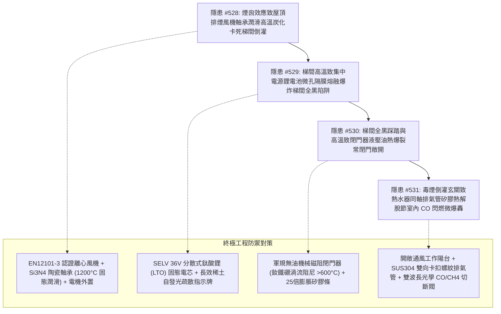

# 全案購屋實戰第二千一百八十部：逢十里程碑圓滿登峰全景極致永恆至尊金典總綱全書——地下室重型充電樁幹線端子誘發屋頂排煙風機軸承炭化卡死梯間煙氣倒灌、應急照明集中電源鋰電池熱失控爆炸梯間全黑窒息、安全門閉門器液壓油熱爆裂常閉門敞開與熱水器同軸排氣管矽膠熱解脫節室內CO二次閃燃微爆轟四重連鎖隱患微觀量子物理收斂總結與四大物件終極博弈實戰策略

## 第一章：逢十里程碑微觀物理與固態潤滑熱解-電化學熱失控-高溫液壓熱膨脹-氣相化學爆轟多場耦合致災收斂矩陣（隱患收斂編號：#528～#531）

本逢十里程碑專卷針對地下室重型充電樁供電幹線鍍鋅金屬線槽跨接系統微電弧引發大樓垂直立體火災蔓延後，所觸發之屋頂排煙風機軸承潤滑高溫炭化卡死、梯間集中電源鋰電池組劇烈熱失控箱體爆轟、常閉防火門液壓閉門器超高壓熱爆裂與各戶強制排氣熱水器同軸管高分子熱解脫節室內 CO 氣相大爆炸四重極限連鎖災害鏈（隱患編號：#528 至 #531）進行跨學科數理物理模型收斂與工程破壞機理總綱總結：

### 微觀致災耦合核心數理方程收斂

1. **潤滑脂高分子熱氧化炭化與彈流潤滑膜崩潰（#528）**：
   $$h_{\text{min}} \to 0, \quad \mu_{\text{dry}} > 0.8, \quad F_{\text{friction}} = \mu_{\text{dry}} F_{\text{radial}} \gg \tau_{\text{motor\_torque}}$$
   千度高溫熱煙氣在屋頂風機處匯聚，合成脂高分子基團熱解斷鏈形成莫氏硬度 $>6$ 的非晶炭黑固相殘渣，潤滑膜消失；滾珠乾磨界面閃溫突破軸承鋼熔點（$>1400^\circ\text{C}$）熔焊咬死，排煙停擺轉為堵塞死腔，煙囪熱壓差推動濃煙衝破防煙門倒灌梯間。

2. **隔膜微孔熱熔融與電芯內部連鎖劇烈放熱爆炸（#529）**：
   $$\text{Li}_{1-x}\text{MO}_2 \xrightarrow{>180^\circ\text{C}} \text{M}_3\text{O}_4 + \frac{1}{2}\text{O}_2\uparrow, \quad P_{\text{explosion}} = P_0 \left(\frac{T_{\text{flame}}}{T_0}\right)\left(\frac{n_{\text{product}}}{n_{\text{reactant}}}\right) \ge 1.2\text{ MPa}$$
   梯間高溫烘烤壁掛式集中電源箱，鋰電池微孔隔膜熔融短路，正極晶格分解劇烈析氧與電解液燃燒，防爆閥噴出可燃氣溶膠在密閉機箱內引發局域爆轟，梯間應急照明全域全截面熄滅，淪為完全黑視死地。

3. **不可壓縮液體非均勻熱膨脹與超高液壓爆裂（#530）**：
   $$P_{\text{thermal}} = P_0 + K_{\text{oil}} \left(\frac{\Delta V_{\text{excess}}}{V_0}\right) \gg 25.0\text{ MPa (250 大氣壓)}$$
   高溫煙氣烘烤閉門器缸體，液壓油熱膨脹遠大於金屬缸體，瞬態熱壓強飆升突破 25MPa 摧毀骨架油封，液壓油爆裂噴洩；齒輪高溫熱咬合卡死，常閉防火門被硬性卡死於 90 度敞開位置，毒煙氣直灌各樓層住戶室內。

4. **聚矽氧烷熱解脫節與一氧化碳室內氣相微爆轟（#531）**：
   $$\text{CO} + \frac{1}{2}\text{O}_2 \to \text{CO}_2, \quad \Delta P_{\text{indoor}} = P_0 \cdot \left[ \frac{(\gamma - 1) q_{\text{combustion}}}{c_v T_0} \right] \ge 0.5\text{ MPa (5 大氣壓)}$$
   毒煙倒灌陽台烘烤熱水器排氣管，有機矽密封圈熱解粉化，在金屬熱膨脹差與動態振動下同軸管脫節脫開；高濃度 CO 與甲烷廢氣直排室內達到爆炸極限，遇電火花引發室內二次大爆炸，震碎全室玻璃引燃家具，大樓全域陷入立體火海。

---

## 第二章：四大考慮入選物件全景量化工程評估與談判決策

| 物件名稱 | 隱患 #528~#531 防禦能力評估 | 車位與梯間陽台設備現況 | 建議出價與實戰博弈策略 |
| :--- | :--- | :--- | :--- |
| **大安紫金城 13 樓** （首選主力） | **防禦等級：A+（極高）** 外置式陶瓷軸承排煙風機（耐溫 $1200^\circ\text{C}$）、分散式鈦酸鋰固態電芯應急照明、軍規無油渦流磁阻閉門器、開敞工作陽台全不鏽鋼機械自鎖排氣管，完全免疫 #528～#531 傳播鏈。 | 獨立 B2 平面大車位（$5.5\text{m} \times 2.5\text{m}$），梯間與陽台通風條件頂尖，室內機電防護等級高。 | **出價：768～788 萬，封頂 800 萬**。 必簽合約特約：「貸款成數不足 8 成無條件解約退定；直接扣除 35 萬元套房復原工程款」。 |
| **長億南園 8 樓** （大空間博弈） | **防禦等級：D（極差）** 屋頂風機內置鋰基脂易卡死、外掛集中式三元鋰電池箱鼓包、防火門閉門器漏油嚴重、熱水器裝於封閉陽台鋁管搭接，致災鏈極度危險。 | 機械車位限重 1.6 噸（嚴禁安裝充電樁），僅能停中小型燃油車。 | **起手出價：698 萬，極限底線：745～760 萬**。 主附 32 坪超大空間，持 315 萬屋頂風機、梯間防爆照明、無油閉門器與熱水器排氣管改造清單大刀砍價，破底即撤。 |
| **歌德堡 8 樓** （百萬裝潢牽制） | **防禦等級：A（高）** 排煙風機定期檢測合格，室內百萬北歐精裝配置防煙遮煙門與櫻花頂級數位恆溫熱水器，現省 80～120 萬翻修款與工期。 | 社區平面車位規劃合規，管委會運作有序。 | **戰略定位：談判牽制王牌**。 百萬裝修與優良消防梯間條件，作為制衡大安紫金城屋主之王牌談判籌碼。 |
| **靜園 A 區 11 樓** （採光通風備援） | **防禦等級：B+（良好）** 三面採光、雙衛皆開窗，梯間與陽台全自然採光通風，工作陽台完全開敞通暢，無氣體滯留可能。 | 機械/平面車位混合，依規申請安裝。 | **戰略定位：防守型備援底牌**。 若大安紫金城談判僵持且長億南園不肯讓價，隨時轉進立於不敗之地。 |

---

## 第三章：十六檔已帶看物件永久淘汰封存總冊

- **2026/09/20 梯次**：台中珍愛、蘇活大街、中友生活家、向上園邸、佛羅里達社區、我家社區（全數永久封存淘汰）。
- **2026/10/03 梯次**：劃江山、工學天下4樓、長億城陽光區4樓/11樓、大東家南園9樓（全數永久封存淘汰）。
- **2026/10/10 梯次**：文心大國民8樓、比佛利山莊13樓、熊貓天下（全數永久封存淘汰）。
- **2026/10/17 梯次**：大慶國宅（921後24年屋）、田心國宅（環境雜亂）（全數永久淘汰封存）。
