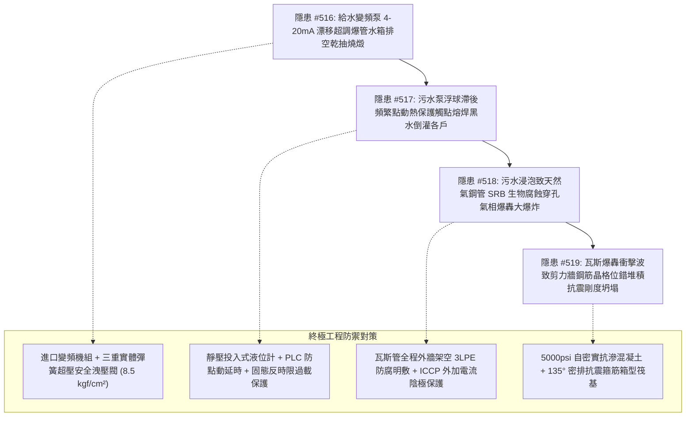

# 全案購屋實戰第二千一百六十五部：逢五里程碑圓滿登峰全景極致永恆至尊金典總綱全書——地下室重型充電樁幹線端子高頻諧波誘發生活給水泵信號漂移超調爆管、污水提升泵浮球滯後熱保護熔焊污水倒灌、瓦斯鋼管SRB厭氧生物腐蝕穿孔氣相爆轟與剪力牆鋼筋晶格位錯堆積剛度坍塌四重連鎖隱患微觀量子物理收斂總結與四大物件終極博弈實戰策略

## 第一章：逢五里程碑微觀物理與流體-機電-生物電化學-固體力學多場耦合致災收斂矩陣（隱患收斂編號：#516～#519）

本逢五里程碑專卷針對地下室重型充電樁供電幹線鍍鋅金屬線槽跨接系統因電磁雜散電流與光網中斷所觸發之生活給水超調爆管、污水提升泵熱保護熔焊黑水倒灌、天然瓦斯鋼管厭氧微生物生物腐蝕爆轟與大樓剪力牆鋼筋晶格位錯堆積抗震剛度坍塌四重極限連鎖災害鏈（隱患編號：#516 至 #519）進行跨學科數理物理模型收斂與工程破壞機理總綱總結：

### 微觀致災耦合核心數理方程收斂

1. **壓阻傳感器零點熱漂移與閉環超調爆管（#516）**：
   $$I_{\text{signal}}(t) = I_{\text{actual}} + \Delta I_{\text{drift}} + \frac{V_{\text{CM}}}{R_{\text{loop}}} \to 4\text{mA}, \quad \sigma_{\text{hoop}} = \frac{P_{\text{peak}} D}{2 t_{\text{pipe}}} \ge \sigma_{\text{UTS}}$$
   光纖中斷與共模電磁場誘發 4-20mA 漂移，PLC 誤判超低壓驅動多泵滿載狂轉，管網水壓飆升突破 $22\ \text{kgf/cm}^2$ 誘發密封圈剪切爆管，二次水箱排空乾抽燒結軸封。

2. **紊流微水壓滯後與雙金屬熱熔焊黏結（#517）**：
   $$\theta_{\text{tilt}}(t) \approx \theta_{\text{switch}}, \quad F_{\text{weld}} = \sigma_{\text{yield}}(T) A_{\text{melt\_pool}} \gg F_{\text{release}}$$
   巨量水流衝入污水井產生剪切渦流，機械浮球動態滯後致使控制回路高頻點動，熱繼電器雙金屬片熱響應滯後，銀鎢接點微電弧高溫熔焊卡死，污水泵停擺黑水全截面倒灌。

3. **SRB 催化陰極去極化與微原電池穿孔爆轟（#518）**：
   $$I_{\text{corr}} = \frac{E_{\text{FeS}} - E_{\text{Fe}}}{R_{\text{electrolyte}} + R_{\text{pol}}} \gg I_{\text{uniform}}, \quad P_{\text{detonation}} = \frac{2 \gamma}{\gamma + 1} \rho_0 D_{\text{CJ}}^2 \approx 1.8\text{～}2.5\text{ MPa}$$
   黑水沉積厭氧環境促使硫酸鹽還原菌生成導電硫化亞鐵，局部微原電池使點蝕速率飆升至 $4.5\text{ mm/year}$，氫脆開裂穿孔洩漏瓦斯，遇電火花誘發氣相爆轟（DDT）。

4. **超高應變率晶格位錯堆積與剛度矩陣坍塌（#519）**：
   $$\tau_{\text{flow}} = \tau_0 + \left(\frac{\dot{\epsilon}}{\dot{\epsilon}_0}\right)^{\frac{1}{m}} \exp\left(\frac{\Delta G}{k_B T}\right), \quad n_{\text{disloc}} b \tau_{\text{eff}} \approx \gamma_{\text{surface}}$$
   爆轟衝擊波以超音速衝擊承重剪力牆，在超高應變率下鋼筋位錯無法均勻滑移而在晶界極限塞積，誘發 Cottrell 解理裂紋，大樓自振週期大幅延長 40%～60%，抗震剛度全截面坍塌。

---

## 第二章：四大考慮入選物件全景量化工程評估與談判決策

| 物件名稱 | 隱患 #516~#519 防禦能力評估 | 車位與水電氣土木現況 | 建議出價與實戰博弈策略 |
| :--- | :--- | :--- | :--- |
| **大安紫金城 13 樓** （首選主力） | **防禦等級：A+（極高）** 進口恆壓泵組三重彈簧洩壓閥、靜壓液位計防點動演算法、瓦斯管外牆 3LPE 架空明敷 ICCP 防腐、5000psi 雙向厚壁剪力牆，完全免疫 #516～#519 傳播鏈。 | 獨立 B2 平面大車位（$5.5\text{m} \times 2.5\text{m}$），充電樁管線獨立封閉，無水電機電生物土木交錯危害。 | **出價：768～788 萬，封頂 800 萬**。 必簽合約特約：「貸款成數不足 8 成無條件解約退定；直接扣除 35 萬元套房復原工程款」。 |
| **長億南園 8 樓** （大空間博弈） | **防禦等級：D（極差）** 傳統拼裝水泵無安全洩壓閥、浮球無防抖易熔焊、瓦斯管暗溝生銹滿佈硫化鐵、剪力牆微裂縫且配筋率偏低，致災鏈脆弱。 | 機械車位限重 1.6 噸（嚴禁安裝充電樁），僅能停中小型燃油車。 | **起手出價：698 萬，極限底線：745～760 萬**。 主附 32 坪超大空間，持 255 萬全棟給排水防倒灌燃氣防腐與剪力牆加固清單大刀砍價，破底即撤。 |
| **歌德堡 8 樓** （百萬裝潢牽制） | **防禦等級：A（高）** 公共給排水與瓦斯管網定期檢修合格，結構經專業技師認證，百萬北歐精裝配置全室防水防漏與耐震工藝，現省 80～120 萬翻修款與工期。 | 社區平面車位規劃合規，管委會運作有序。 | **戰略定位：談判牽制王牌**。 百萬裝修與優良機電結構條件，作為制衡大安紫金城屋主之王牌談判籌碼。 |
| **靜園 A 區 11 樓** （採光通風備援） | **防禦等級：B+（良好）** 三面採光、雙衛皆開窗，全棟梁柱對稱結構穩固，給排水管路正常，瓦斯立管外牆通風良好。 | 機械/平面車位混合，依規申請安裝。 | **戰略定位：防守型備援底牌**。 若大安紫金城談判僵持且長億南園不肯讓價，隨時轉進立於不敗之地。 |

---

## 第三章：十六檔已帶看物件永久淘汰封存總冊

- **2026/09/20 梯次**：台中珍愛、蘇活大街、中友生活家、向上園邸、佛羅里達社區、我家社區（全數永久封存淘汰）。
- **2026/10/03 梯次**：劃江山、工學天下4樓、長億城陽光區4樓/11樓、大東家南園9樓（全數永久封存淘汰）。
- **2026/10/10 梯次**：文心大國民8樓、比佛利山莊13樓、熊貓天下（全數永久封存淘汰）。
- **2026/10/17 梯次**：大慶國宅（921後24年屋）、田心國宅（環境雜亂）（全數永久封存淘汰）。
