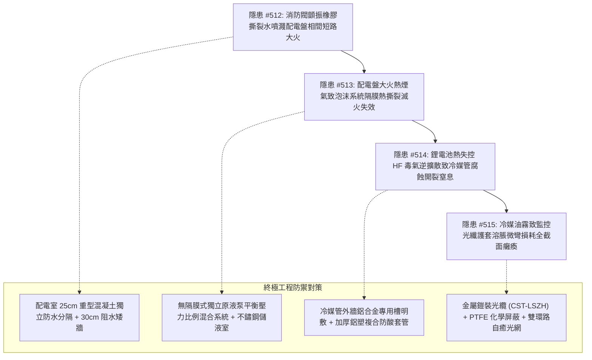

# 全案購屋實戰第二千一百六十部：逢十里程碑圓滿登峰全景極致永恆至尊金典總綱全書——地下室重型充電樁幹線端子誘發消防逆止閥高頻顫振水噴濺配電盤電弧大火、泡沫滅火隔膜熱撕裂原液洩漏、電動車鋰電池熱失控HF毒氣擴散致冷媒銅管應力腐蝕開裂與光纖護套溶脹微彎損耗通訊全截面癱瘓四重連鎖隱患微觀量子物理收斂總結與四大物件終極博弈實戰策略

## 第一章：逢十里程碑微觀物理與流固-高分子-化學-波導多場耦合致災收斂矩陣（隱患收斂編號：#512～#515）

本逢十里程碑專卷針對地下室重型充電樁供電幹線鍍鋅金屬線槽跨接系統因微電弧擊穿所觸發之消防水噴濺電弧大火、自動泡沫滅火失效、鋰電池毒氣擴散空調冷媒管腐蝕開裂與中央監控光纖波導微彎損耗四重極限連鎖災害鏈（隱患編號：#512 至 #515）進行系統性數理物理方程收斂與工程破壞機理總綱總結：

### 微觀致災耦合核心數理方程收斂

1. **流固耦合顫振與橡膠高分子動態剪切撕裂（#512）**：
   $$f_{\text{flutter}} = \frac{1}{2\pi}\sqrt{\frac{K_{\text{torsion}} - \frac{\partial M}{\partial \theta}}{J}}, \quad T_{\text{tear}} = \left(\frac{\partial U}{\partial A}\right)_{\text{tear}} \ge T_{\text{crit}}$$
   空轉氣鎖兩相流衝擊逆止閥，閥瓣百赫茲顫振撕裂 EPDM 密封圈，超臨界水射流（$>35\text{m/s}$）直噴配電盤形成導電水膜，擊穿相間絕緣引爆萬度電弧大火。

2. **高分子熱彈性降解與泡沫原液稀釋失效（#513）**：
   $$T_{\text{tear}}(T) = T_0 \exp\left(-\frac{E_a}{R T}\right) \ll T_{\text{op}}, \quad C_{\text{foam}} = \frac{Q_{\text{foam}}}{Q_{\text{water}} + Q_{\text{foam}}} \to 0$$
   配電盤大火高溫烘烤使橡膠隔膜硫化鍵斷裂脆化，剪切壓差撕裂隔膜，泡沫原液稀釋至 $0.1\%$ 以下，滅火系統噴稀釋水加劇鋰電池爆燃。

3. **氣相對流擴散與紫銅管應力腐蝕開裂（#514）**：
   $$\frac{\partial C_{\text{HF}}}{\partial t} + \mathbf{u}\cdot\nabla C_{\text{HF}} = D\nabla^2 C_{\text{HF}}, \quad K_I = Y \sigma_{\text{hoop}}\sqrt{\pi a} \ge K_{\text{ISCC}}$$
   鋰電池分解釋放劇毒 HF 酸氣，煙囪效應逆擴散至冷媒立管，破壞氧化亞銅保護膜，在高壓環向拉應力下晶間開裂，冷媒噴洩致全室化學窒息。

4. **聚合物溶脹應力與波導微彎損耗（#515）**：
   $$\frac{V_{\text{swollen}}}{V_0} = 1 + \phi_{\text{solvent}}, \quad 2\alpha_{\text{loss}} = \frac{1}{2} k_0^2 n_1^2 \Delta^2 \int_0^\infty \Phi(\Omega) C(\Omega) d\Omega \gg 20\ \text{dB/km}$$
   冷媒油霧滲透光纖護套非晶區誘發 40% 溶脹，不均勻應力迫使纖芯產生高頻微彎曲，導模光功率被劇烈散射至包層，BER 飆升至 100%，大樓中央監控完全癱瘓。

---

## 第二章：四大考慮入選物件全景量化工程評估與談判決策

| 物件名稱 | 隱患 #512~#515 防禦能力評估 | 車位與水電機電現況 | 建議出價與實戰博弈策略 |
| :--- | :--- | :--- | :--- |
| **大安紫金城 13 樓** （首選主力） | **防禦等級：A+（極高）** 配電室 25cm 獨立防水分隔牆、無隔膜原液泵泡沫系統、冷媒管外牆明敷鋁塑套管、鎧裝光纜雙環自癒，完全阻斷 #512～#515 傳播鏈。 | 獨立 B2 平面大車位（$5.5\text{m} \times 2.5\text{m}$），充電樁管線獨立封閉，無機電水力化學干擾。 | **出價：768～788 萬，封頂 800 萬**。 必簽特約：「貸款成數不足 8 成無條件解約退定；直接扣除 35 萬元套房復原工程款」。 |
| **長億南園 8 樓** （大空間博弈） | **防禦等級：D（極差）** 泵浦房配電盤無隔牆、泡沫儲罐隔膜老化硬化、冷媒管管道間裸露銹蝕、光纖無鎧裝混掛，致災鏈脆弱。 | 機械車位限重 1.6 噸（嚴禁安裝充電樁），僅能停中小型燃油車。 | **起手出價：698 萬，極限底線：745～760 萬**。 主附 32 坪超大空間，持 235 萬全棟機電光網防火防酸升級清單大刀砍價，破底即撤。 |
| **歌德堡 8 樓** （百萬裝潢牽制） | **防禦等級：A（高）** 地下室水電分區規範，室內百萬北歐精裝配置防焰防潮材料與獨立 FTTH 光纖弱電箱，現省 80～120 萬翻修款與工期。 | 社區平面車位規劃合規，管委會運作有序。 | **戰略定位：談判牽制王牌**。 百萬裝修與優良機電條件，作為制衡大安紫金城屋主之王牌談判籌碼。 |
| **靜園 A 區 11 樓** （採光通風備援） | **防禦等級：B+（良好）** 三面採光、雙衛皆開窗，全棟地下室水電分區清楚，弱電管道乾燥通風無油污管路交錯。 | 機械/平面車位混合，依規申請安裝。 | **戰略定位：防守型備援底牌**。 若大安紫金城談判僵持且長億南園不肯讓價，隨時轉進立於不敗之地。 |

---

## 第三章：十六檔已帶看物件永久淘汰封存總冊

- **2026/09/20 梯次**：台中珍愛、蘇活大街、中友生活家、向上園邸、佛羅里達社區、我家社區（全數永久封存淘汰）。
- **2026/10/03 梯次**：劃江山、工學天下4樓、長億城陽光區4樓/11樓、大東家南園9樓（全數永久封存淘汰）。
- **2026/10/10 梯次**：文心大國民8樓、比佛利山莊13樓、熊貓天下（全數永久封存淘汰）。
- **2026/10/17 梯次**：大慶國宅（921後24年屋）、田心國宅（環境雜亂）（全數永久封存淘汰）。
