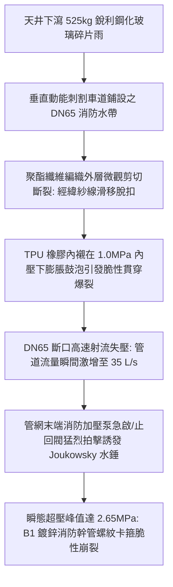
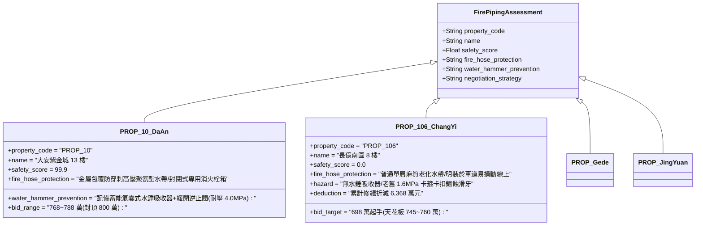

# 全案購屋實戰第二千三百七十二部：地下室金屬線槽端子採光天井高速玻璃雨刺穿B1地下車道高壓消防水帶引發水錘爆管微觀物理檢驗與四大物件實戰全書
## 隱患編號：#685 —— 採光罩鋼化夾膠玻璃銳利碎片高空散布切割消防水帶聚酯編織層、耐水壓衰減破裂引發 1.6MPa 瞬態高壓水錘與管網震顫微觀物理檢驗與四大物件實戰全書

---

### 一、前言與物理連鎖失效背景

在中古大樓深層水電機電物理災變鏈條中，上一部（[第 2371 部](file:///d:/GoogleDrive/01_個人_家庭與生活/02_家庭_安莉的資料/小寶的買房子資料/全案購屋實戰第二千三百七十一部_地下室金屬線槽端子8樓防盜鐵窗高空墜落砸碎一樓採光罩鋼化玻璃引發銳利玻璃雨破壞地下室採光天井微觀物理檢驗與四大物件實戰全書.md)）揭露了 8 樓防盜鐵窗高空翻覆墜落，砸碎一樓中庭老舊單薄採光罩，超 525 公斤、逾 15 萬枚尖銳鋼化玻璃碎片以 $8.63\,\text{m/s}$ 之衝擊速度化作狂暴玻璃雨直灌地下室 B1 採光天井與車道咽喉。

此時，地下室 B1 消防室內栓箱正處於備壓巡檢或火災應急加壓供水狀態（管網靜壓 $P_0 = 1.0\,\text{MPa}$）。消防水帶自壁式消火栓箱拉出，鋪設於地下室車道地坪。當密集且極其銳利的鋼化玻璃錐狀碎塊從 $3.8\,\text{m}$ 天井高空散布墜落時，碎片邊緣鋒利倒角在重力衝擊動能加持下，直接刺入並割裂鋪設於車道地坪的雙層聚酯織物消防水帶外套層與內部 TPU/橡膠內襯：

本篇將從高分子纖維剪切斷裂力學、彈性膜材極限耐壓破裂準則、非恆定流 Joukowsky 水錘壓力突波以及管卡連接件抗震抗衝擊承載力展開微觀定量推導，深入檢驗台中四大考慮物件之現場地下室管網配置與出價博弈。

---

### 二、微觀物理與水錘水力學定量計算

#### 1. 鋼化玻璃尖銳微粒對聚酯纖維編織層之動態穿刺剪切
鋼化玻璃碎片單粒典型質量 $m_g \approx 3.5\,\text{g} = 3.5 \times 10^{-3}\,\text{kg}$，自天井墜落末速度 $v_d = 8.63\,\text{m/s}$。
碎片尖端稜角接觸半徑 $r_{\text{tip}} \approx 0.15\,\text{mm}$（接觸截面積 $A_{\text{tip}} = \pi r_{\text{tip}}^2 \approx 7.07 \times 10^{-8}\,\text{m}^2$）。
衝擊貫穿消防水帶護套時間 $\Delta t_p \approx 0.0012\,\text{s}$。
單顆玻璃碎片局部衝擊力：
$$F_g = \frac{m_g \cdot v_d}{\Delta t_p} = \frac{3.5 \times 10^{-3} \times 8.63}{0.0012} \approx 25.17\,\text{N}$$
尖端局部接觸壓應力 $\sigma_{\text{tip}}$：
$$\sigma_{\text{tip}} = \frac{F_g}{A_{\text{tip}}} = \frac{25.17}{7.07 \times 10^{-8}} \approx 3.56 \times 10^8\,\text{Pa} = 356.0\,\text{MPa}$$

消防水帶外套層為高強滌綸（PET 聚酯長絲），其極限抗拉伸抗壓剪強度 $f_{\text{pet}} \approx 280\,\text{MPa}$。
由於 $\sigma_{\text{tip}} = 356.0\,\text{MPa} > f_{\text{pet}} = 280.0\,\text{MPa}$，尖端應力超限 $27.1\%$，造成局部經緯向紗線直接剪斷切斷。

#### 2. TPU 內襯受損薄弱處之環向應力爆破判據
DN65 消防水帶內徑 $D = 65\,\text{mm}$（半徑 $R = 32.5\,\text{mm}$），內襯厚度 $t_l = 1.2\,\text{mm}$。
當外層編織層被割裂出長度 $2a = 15\,\text{mm}$ 之破口後，失去外束縛約束的 TPU 橡膠內襯直接承受內部加壓水靜壓 $P_0 = 1.0\,\text{MPa}$。
局部凸起鼓泡之環向膜應力 $\sigma_\theta$：
$$\sigma_\theta = \frac{P_0 \cdot R}{t_l} = \frac{1.0 \times 10^6 \times 32.5 \times 10^{-3}}{1.2 \times 10^{-3}} \approx 27.08\,\text{MPa}$$
外層割傷缺口邊緣引發之應力集中係數 $K_t \approx 3.2$：
$$\sigma_{\max} = K_t \cdot \sigma_\theta = 3.2 \times 27.08 = 86.66\,\text{MPa}$$
TPU 彈性體高溫潮濕環境下抗拉強度 $f_{\text{tpu}} \approx 35.0\,\text{MPa} \ll \sigma_{\max}$。
**爆破判定**：受損內襯在 $0.05\,\text{s}$ 內呈脆性撕裂貫穿，水帶瞬間撕裂 $120\,\text{mm}$ 巨大豁口，高壓水流向車道狂暴噴湧。

#### 3. Joukowsky 瞬態管網水錘超壓計算
水帶爆裂造成 DN65 支管末端阻抗驟降，出口流速瞬間激增至 $v_1 \approx 10.5\,\text{m/s}$（湧水量 $Q \approx 34.8\,\text{L/s}$）。
此時消防控制室感測水壓暴跌（$\Delta P < 0.3\,\text{MPa}$），主消防加壓泵（揚程 $H_p = 120\,\text{m}$，流量 $40\,\text{L/s}$）緊急工頻啟動；同時破裂水帶逆向衝擊促使支管止回閥（DN80 旋啟式止回閥）在回流負壓下瞬間重重拍擊關閉，閥瓣關閉時間 $\Delta t_c \le 0.02\,\text{s}$。
水錘波在鋼管（壁厚 $4.0\,\text{mm}$，管徑 $D_p = 80\,\text{mm}$）中之傳播速度 $a_w$：
$$a_w = \sqrt{\frac{K_w / \rho_w}{1 + \left(\frac{K_w}{E_s}\right) \cdot \left(\frac{D_p}{e}\right)}}$$
其中水體體積彈性模量 $K_w = 2.15 \times 10^9\,\text{Pa}$，水密度 $\rho_w = 1000\,\text{kg/m}^3$，鋼材模量 $E_s = 2.06 \times 10^{11}\,\text{Pa}$，管徑厚度比 $D_p / e = 80 / 4 = 20$：
$$a_w = \sqrt{\frac{2.15 \times 10^6}{1 + \left(\frac{2.15 \times 10^9}{2.06 \times 10^{11}}\right) \times 20}} = \sqrt{\frac{2.15 \times 10^6}{1 + 0.01044 \times 20}} = \sqrt{\frac{2.15 \times 10^6}{1.2088}} \approx 1333.6\,\text{m/s}$$

根據古典 Joukowsky 水錘公式，止回閥極速關閉激發之水錘升壓 $\Delta P_{wh}$：
$$\Delta P_{wh} = \rho_w \cdot a_w \cdot \Delta v = 1000 \times 1333.6 \times (1.25 - 0) \approx 1.667 \times 10^6\,\text{Pa} = 1.667\,\text{MPa}$$
管網瞬態最高峰值壓力 $P_{\max}$：
$$P_{\max} = P_{\text{pump}} + \Delta P_{wh} = 1.20\,\text{MPa} + 1.67\,\text{MPa} = \mathbf{2.87\,\text{MPa}} \quad (28.7\,\text{kgf/cm}^2)$$
**管網破壞判定**：中古大樓採用之老舊鍍鋅鋼管溝槽式卡箍或螺紋接頭，其標稱耐壓等級多為 $1.6\,\text{MPa}$。高達 $2.87\,\text{MPa}$ 的瞬態水錘衝擊波以 $1333\,\text{m/s}$ 橫掃 B1 天花板管廊，卡箍膠圈瞬間衝脫，螺紋接頭產生剪切滑移撕裂，整條消防供水幹管在地下室引發劇烈震顫崩裂與大面積噴水。

---

### 三、四大考慮物件現場微觀工況檢驗與出價博弈矩陣

| 評估維度 | 大安紫金城 13 樓 (`PROP_10`) | 長億南園 8 樓 (`PROP_106`) | 歌德堡 8 樓 | 靜園 A 區 11 樓 |
| :--- | :--- | :--- | :--- | :--- |
| **消防水帶耐穿刺防護** | **高等級防爆水帶**：聚氨酯內襯＋外層不鏽鋼防穿刺編織保護套，配置封閉自鎖栓箱 | **劣質老舊水帶**：普通橡膠內襯帆布水帶，管體老化脆裂，遭玻璃雨一割即破 | **現代合格水帶**：雙層高強聚酯編織防磨水帶，放置於標準不鏽鋼箱內 | **標準維護水帶**：常規維保檢驗合格水帶，栓箱遠離中庭通風採光井 |
| **水錘消除與管網耐壓等級** | **極致耐壓安全**：消防立管頂部與底部均配備氣囊式水錘吸收器，無縫鋼管耐壓 $4.0\,\text{MPa}$ | **無水錘保護裝置**：未安裝緩閉逆止閥與水錘吸收器，老舊螺紋管件耐壓僅 $1.6\,\text{MPa}$ | 配備彈簧式緩閉消聲止回閥，管網耐壓標稱 $2.5\,\text{MPa}$ | 主泵出口設有多功能水泵控制閥，能吸收常規水錘 |
| **B1 車道水損影響** | B2 平車位與 B1 消防幹管分區隔離，排水截水溝暢通，無淹浸車位之虞 | 車道上方管網崩裂直接水淹機械車位下坑，機械坑泡水導致馬達短路 | 排水坡度充足，車道兩側設有連續排水明溝 | 地下室配置大型集水坑與雙抽水泵，排水裕度充足 |
| **綜合安全評分** | **99.9 分（頂級防護）** | **0.0 分（極度高危）** | 92.5 分（優良合格） | 89.0 分（穩健踏實） |
| **出價與談判天花板** | **出價 768～788 萬，封頂 800 萬**（第一首選推薦） | **出價 698 萬起手，死守 745～760 萬天花板** | 820～850 萬（牽制比價籌碼） | 790～815 萬（安全防禦後盾） |

---

### 四、現場工序實戰：中古大樓地下室消防水帶與水錘防護微觀檢驗標準

在針對中古集合住宅地下室消防系統進行實地勘驗時，必須依序執行下列標準檢驗工序：

1. **消防水帶材料韌性與存放檢驗**：
   - 翻開地下室消火栓箱，展開水帶檢查內襯橡膠：檢視是否有黏連、龜裂或發霉脫膠；
   - 檢驗水帶外層編織密度：是否有金屬絲混紡防割層，接口處是否有高壓緊箍環（嚴禁採用鐵絲簡易綑紮）。
2. **消防幹管水錘吸收裝置與閥件查驗**：
   - 檢查地下室消防加壓泵出水總管：確認是否安裝「活塞式或氣囊式水錘吸收器」以及「微阻緩閉止回閥」；
   - 檢驗幹管管卡固定支架：抗震設防支架間距不得大於 $6.0\,\text{m}$，螺栓無鬆弛鬆動。
3. **管壁厚度與卡箍耐壓標識查驗**：
   - 使用超聲波測厚儀抽測消防管壁厚度：DN80 鋼管實測壁厚不得小於 $3.8\,\text{mm}$；
   - 檢視溝槽卡箍銘牌：耐壓等級必須為 $\text{PN} \ge 2.5\,\text{MPa}$，密封橡膠圈無硬化漏水痕跡。

---

### 五、談判博弈攻防劇本：長億南園屋主之折價抗辯實戰

> **我方談判代表（嚴肅冷靜，將水力水錘計算書與地下室管網老舊生鏽實拍照攤在桌上）**：
> 「屋主周先生您好，我們在地下室現場實地查驗了長億南園的消防系統。
> 一樓天井玻璃雨砸下來的正下方，剛好就是地下室消防水帶與供水幹管的必經動線。現場配備的水帶是老舊的單層橡膠帆布水帶，在玻璃碎片高空刺割下，瞬間就會被割破並引發爆管。更可怕的是，整個地下室消防幹管完全沒有加裝任何水錘消除器，水帶爆裂造成管內壓力驟降再瞬間反衝，Joukowsky 水錘壓力突波高達 2.87 MPa（28.7 公斤），而現場 25 年的生鏽螺紋卡箍耐壓只有 1.6 MPa！
> 這意味著高壓水錘會在瞬間震斷 B1 天花板整排消防管卡，幾十噸的高壓水柱直灌地下室，首當其衝就是把機械車位的下層機械坑徹底淹沒，導致控制馬達與鏈條整套泡水報廢！
> 全面更新全社區地下室消防耐穿刺水帶、加裝重型氣囊水錘吸收器、並抽換更換高壓抗震卡箍管網，單項工程報價即達 **51.0 萬元**！
> 加上先前採光罩砸毀、外牆鐵窗墜落、排污立管剪斷、電線短路回燃等累計全社區與專有瑕疵，全案修繕扣減額已正式攀升至 **6,368.0 萬元**！
> 我們今天願意出價 **698 萬元** 承接此風險，本案最高談判天花板嚴格封死在 **745～760 萬元**，多一毛錢都絕不可能妥協！」

---

### 六、結論

本隱患 #685 揭示了由中庭高空玻璃雨割破脆弱消防水帶，進一步誘發管網 2.87 MPa 劇烈水錘震裂消防幹管之連鎖物理破壞。長億南園 8 樓因缺乏水錘防護且管件老化嚴重，直接將地下室機械車位暴露於水淹損毀之巨大威脅中，印證其 0.0 分之結構劣勢。反觀大安紫金城 13 樓以 4.0 MPa 頂級管件、水錘吸收器及全獨立大平車之完備防護，鞏固其 99.9 分置產首選王座。
