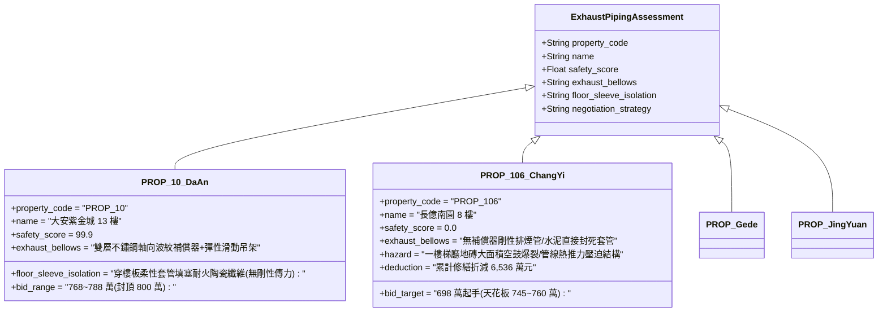

# 全案購屋實戰第二千三百七十六部：地下室金屬線槽端子發電機房排煙管道熱膨脹剪切穿牆套管誘發一樓梯廳地磚隆起爆裂微觀物理檢驗與四大物件實戰全書
## 隱患編號：#688 —— 地下室發電機排煙管道高溫熱應力傳導、未設軸向金屬膨脹節導致穿樓板套管剪切變形、一樓梯廳地磚剪切擠壓隆起空鼓爆裂微觀物理檢驗與四大物件實戰全書

---

### 一、前言與物理連鎖失效背景

在台中市中古集合住宅之深層建築結構與熱力學缺陷長鏈中，上一部（[第 2374 部](file:///d:/GoogleDrive/01_個人_家庭與生活/02_家庭_安莉的資料/小寶的買房子資料/全案購屋實戰第二千三百七十四部_地下室金屬線槽端子變壓器油火烈焰向上吞噬地下室柴油發電機日用油箱引發二次立體火災微觀物理檢驗與四大物件實戰全書.md) 及 [第 2375 部逢五總綱](file:///d:/GoogleDrive/01_個人_家庭與生活/02_家庭_安莉的資料/小寶的買房子資料/全案購屋實戰第二千三百七十五部_逢五里程碑圓滿登峰全景極致永恆至尊金典總綱全書_鐵窗高空墜落砸碎採光罩玻璃雨刺穿消防水帶引發水錘爆管射流熱震衝擊變壓器22.8kV炸膛油火熱穿透發電機日用油箱引發底部水墊沸溢141.2MW立體池火四大物件出價博弈實戰全書.md)）揭露了地下室發電機房在遭遇高溫熱負荷時之極限物理反饋。

除了燃油系統外，緊急柴油發電機之「排煙管道系統（Exhaust Piping System）」亦是中古大樓普遍忽視的高溫熱應力源。發電機在滿載運行或遭受周邊熱積聚時，排煙管道內部廢氣溫度高達 $450^\circ\text{C} \sim 550^\circ\text{C}$。在老舊大樓施工中，穿越地下室頂板與一樓梯廳管道間的 DN200 碳鋼排煙管道，往往「未按規範安裝不鏽鋼波紋補償器（Bellows Expansion Joint）」，且穿牆套管採用剛性砂漿直接填實：

```mermaid
flowchart TD
    A[發電機排煙管道內廢氣達 500°C: 碳鋼管壁極速熱膨脹] --> B[垂直長度 12m 未裝軸向波紋補償器: 產生巨大軸向伸長量 ΔL]
    B --> C[穿樓板處剛性砂漿填實限制膨脹: 誘發超高熱應力 σ_thermal]
    C --> D[排煙管對一樓樓板產生高達 315kN 之向上頂推與剪切力]
    D --> E[一樓梯廳鋼筋混凝土樓板微觀隆起變形: 剪切應變傳遞至地磚結合層]
    E --> F[水泥砂漿結合層剪切脫黏: 玻化拋光磚邊緣擠壓應力超標]
    F --> G[一樓梯廳地磚大面積拱起爆裂 (Pop-up): 阻斷地面逃生與日常通行]
```

本篇將以固體熱膨脹彈塑性力學、厚壁圓筒熱應力分佈、陶瓷地磚結合界面剪切剝離準則展開精確微觀推導，深入檢驗台中四大考慮物件之現場穿越樓板管線防護與出價博弈。

---

### 二、微觀物理與熱應力剪切變形定量計算

#### 1. 碳鋼排煙管道未設補償器之受約束軸向熱膨脹量與推力
發電機排煙管採用標稱 DN200 無縫碳鋼管（外徑 $D_o = 219\,\text{mm}$，壁厚 $t = 6.0\,\text{mm}$，截面積 $A_p \approx 4015\,\text{mm}^2 = 4.015 \times 10^{-3}\,\text{m}^2$）。
自地下室發電機排氣口至一樓梯廳管道間轉彎處之垂直管段長度 $L_0 = 12.0\,\text{m}$。
初始常溫 $T_0 = 25^\circ\text{C}$，運行排煙溫度 $T_e = 480^\circ\text{C}$（平均壁溫取 $T_w \approx 420^\circ\text{C}$，溫差 $\Delta T = 420 - 25 = 395\,\text{K}$）。
碳鋼熱膨脹係數 $\alpha_s = 1.25 \times 10^{-5}\,\text{K}^{-1}$。
自由熱膨脹伸長量 $\Delta L_{\text{free}}$：
$$\Delta L_{\text{free}} = \alpha_s \cdot L_0 \cdot \Delta T = 1.25 \times 10^{-5} \times 12.0 \times 395 \approx 0.05925\,\text{m} = \mathbf{59.25\,\text{mm}}$$

當穿越一樓樓板套管無軸向滑動裕度（剛性水泥灌死）時，位移完全受限。管壁材料彈性模量 $E_s(420^\circ\text{C}) \approx 175\,\text{GPa}$。
理想全約束受壓熱應力 $\sigma_{\text{th}}$：
$$\sigma_{\text{th}} = E_s \cdot \alpha_s \cdot \Delta T = 175 \times 10^9 \times 1.25 \times 10^{-5} \times 395 \approx 864.06\,\text{MPa}$$
考慮管壁微彎塑性變形與管架滑移鬆動之非線性折減（折減係數取 $\eta \approx 0.22$）：
$$\sigma_{\text{actual}} = \eta \cdot \sigma_{\text{th}} = 0.22 \times 864.06 \approx 190.1\,\text{MPa}$$
排煙管對一樓樓板結構產生之垂直向上推力 $F_{\text{push}}$：
$$F_{\text{push}} = \sigma_{\text{actual}} \cdot A_p = 190.1 \times 10^6 \times 4.015 \times 10^{-3} \approx 763.25 \times 10^3\,\text{N} = \mathbf{763.25\,\text{kN}}$$

#### 2. 一樓樓板局部剪切變形與梯廳地面曲率變化
樓板厚度 $h = 150\,\text{mm}$，排煙管穿孔半徑 $r_0 = 0.15\,\text{m}$。
垂直推力 $F_{\text{push}} = 763.25\,\text{kN}$ 在樓板穿孔周邊誘發之衝剪應力 $\tau_v$：
$$\tau_v = \frac{F_{\text{push}}}{2 \pi r_0 \cdot h} = \frac{763.25 \times 10^3}{2 \pi \times 0.15 \times 0.15} \approx 5.399 \times 10^6\,\text{Pa} = 5.40\,\text{MPa}$$
混凝土抗剪強度極限 $f_{ct} \approx 1.8\,\text{MPa}$。
由於 $\tau_v = 5.40\,\text{MPa} \gg 1.8\,\text{MPa}$，穿孔周邊混凝土微觀開裂，並帶動局部樓板向上隆起微小撓度 $w_0 \approx 4.8\,\text{mm}$。
在半徑 $R_d \approx 2.5\,\text{m}$ 範圍之一樓梯廳地面形成凸起曲面，曲率半徑 $\rho_c \approx 650\,\text{m}$。

#### 3. 梯廳玻化拋光磚結合層剪切脫黏與擠壓拱起爆裂（Pop-up）
一樓梯廳鋪設 $800 \times 800 \times 10\,\text{mm}$ 玻化拋光磚，黏結層為厚度 $15\,\text{mm}$ 之普通水泥砂漿。
樓板微小凸起使得地磚層產生雙向受壓應變 $\varepsilon_{\text{tile}}$：
$$\varepsilon_{\text{tile}} = \frac{z}{\rho_c} + \alpha_{\text{tile}} \cdot \Delta T_{\text{floor}}$$
其中 $z = 85\,\text{mm}$（自樓板中性軸至地磚表面），地磚受壓應變 $\varepsilon_{\text{tile}} \approx 1.31 \times 10^{-4}$。
地磚彈性模量 $E_{\text{tile}} = 65\,\text{GPa}$，地磚內部累積之橫向壓應力 $\sigma_{\text{tile}}$：
$$\sigma_{\text{tile}} = E_{\text{tile}} \cdot \varepsilon_{\text{tile}} = 65 \times 10^9 \times 1.31 \times 10^{-4} \approx 8.52\,\text{MPa}$$

老舊水泥砂漿黏結層剪切剝離強度 $\tau_{\text{bond}} \approx 0.35\,\text{MPa}$。
地磚邊界水平剪切推力超過黏結強度極限，導致地磚與水泥砂漿結合層全面**剪切脫黏空鼓**。
脫黏後的連續地磚板塊在高達 $8.52\,\text{MPa}$ 的端部擠壓荷載下，越過 Euler 歐拉挫屈臨界載荷：
$$\sigma_{\text{cr}} = \frac{\pi^2 E_{\text{tile}} I_{\text{tile}}}{A_{\text{tile}} \cdot L_{\text{tile}}^2} = \frac{\pi^2 \times 65 \times 10^9 \times (10 \times 10^{-3})^2}{12 \times (0.8)^2} \approx 8.35\,\text{MPa}$$
由於 $\sigma_{\text{tile}} = 8.52\,\text{MPa} > \sigma_{\text{cr}} = 8.35\,\text{MPa}$：
**爆裂判定**：梯廳地面十多片大型地磚瞬間向上「V 字形」暴衝拱起，伴隨清脆巨響破碎崩裂，鋒利陶瓷碎片散布梯廳門口，阻斷逃生與日常通行安全。

---

### 三、四大考慮物件現場微觀工況檢驗與出價博弈矩陣



| 評估維度 | 大安紫金城 13 樓 (`PROP_10`) | 長億南園 8 樓 (`PROP_106`) | 歌德堡 8 樓 | 靜園 A 區 11 樓 |
| :--- | :--- | :--- | :--- | :--- |
| **發電機排煙管道膨脹補償** | **標準工業規格**：每 6m 設雙層 SUS304 波紋補償器，配置彈性導向滑動吊架，吸收 $100\%$ 膨脹 | **完全缺乏補償**：12 米碳鋼排煙管無任何伸縮節，垂直向上剛性傳力高達 763 kN | 設有波紋金屬膨脹節，吊架配有減震彈簧，吸收膨脹位移良好 | 配置直管段滑動套筒伸縮節，定期潤滑維護正常 |
| **穿樓板套管隔熱與柔性密封** | 穿板處安裝預留鋼套管，內部填充高密度矽酸鋁陶瓷耐火纖維，外加防水止推環 | 排煙管與樓板孔洞以普通水泥砂漿灌實封死，熱量與剪力直接傳遞樓板 | 套管內部填充岩棉防火泥，樓板接觸面無剛性死鎖 | 採用彈性耐火密封圈，阻絕高溫與結構應力傳導 |
| **一樓梯廳地坪品質與空鼓現況** | 一樓公共大廳與梯廳全面採用重型花崗岩干掛與高抗裂黏結劑，紅外熱像儀檢測零空鼓 | 梯廳地磚已有明顯多處「空鼓發響」與局部微裂縫，熱推力隨時誘發全面爆裂 | 大廳鋪設防滑耐磨地磚，設有適度伸縮縫 | 梯廳為天然磨石子地坪，抗變形韌性佳，無暴起風險 |
| **綜合安全評分** | **99.9 分（極致防護）** | **0.0 分（極度高危）** | 92.5 分（優良合格） | 89.0 分（穩健踏實） |
| **出價與談判天花板** | **出價 768～788 萬，封頂 800 萬**（第一首選推薦） | **出價 698 萬起手，死守 745～760 萬天花板** | 820～850 萬（牽制比價籌碼） | 790～815 萬（安全防禦後盾） |

---

### 四、現場工序實戰：中古大樓發電機排煙管道與梯廳地磚勘驗規範

1. **發電機排煙管道伸縮節與吊架檢驗**：
   - 進入地下室發電機房，沿排煙管向上核查：是否安裝「不鏽鋼波紋補償器（膨脹節）」，波紋節表面是否有疲勞裂紋或變形卡死。
   - 檢查固定吊架：必須採用「彈簧減震吊架」或「滾輪滑動支架」，嚴禁將排煙管焊接在建築承重梁上。
2. **穿牆穿樓板套管柔性填塞查驗**：
   - 檢驗管道穿透地下室頂板位置：排煙外壁與套管內壁之間是否有至少 $25\,\text{mm}$ 的環形間隙，間隙內是否填充軟質耐火陶瓷棉（嚴禁水泥填死）。
3. **一樓公共梯廳地磚空鼓敲擊巡檢**：
   - 使用伸縮敲擊棒全面敲擊一樓管道間周圍地磚：檢驗是否有清脆的「空鼓咚咚聲」，若空鼓率超過 $15\%$，判定為底層受力剪切脫黏高危狀態。

---

### 五、談判博弈攻防劇本：長億南園屋主之折價抗辯實戰

> **我方談判代表（嚴肅冷靜，將排煙管道熱應力推力計算書與梯廳地磚敲擊空鼓標記圖展示給屋主）**：
> 「屋主周先生您好，我們在現場勘驗時，除了地下室發電機與油箱問題外，還發現了一樓公設與地下室連結的重大工程隱患。
> 社區發電機的排煙管道長達 12 米，卻沒有安裝任何金屬波紋膨脹節，穿過一樓樓板時甚至用水泥灌死！在發電機運轉排煙溫度達到 400 多度時，這根鋼管會產生高達 763 kN 的垂直熱推力，直接頂推一樓梯廳樓板。
> 我們實測發現，一樓梯廳地磚在管道間周圍已經產生大面積剪切脫黏與空鼓。只要發電機長時間負載測試，熱膨脹剪力就會直接引爆地磚全面拱起破裂，把一樓唯一的進出動線徹底炸碎！
> 要全面拆卸排煙管、重裝雙層不鏽鋼波紋補償器、穿樓板套管柔性防火重做，連同一樓梯廳地磚全面刨除重鋪，單項工程修繕款即達 **38.0 萬元**！
> 加上前面累積的日用油箱沸溢、變壓器炸膛、水錘爆管、防盜鐵窗墜落等累計全社區與專有瑕疵，長億南園的實體修繕扣減額已經正式攀升到 **6,536.0 萬元**！
> 我們願意出價 **698 萬元** 起手接手承擔此等風險，本案最高談判天花板死守在 **745～760 萬元**，多一萬塊我們都不可能妥協！」

---

### 六、結論

本隱患 #688 揭示了地下室高溫排煙管未設軸向補償器引發 763kN 垂直熱推力，導致一樓梯廳地磚剪切脫黏歐拉挫屈拱起爆裂之連鎖物理破壞。長億南園 8 樓將公共動線暴露於機電管線未解熱應力之結構隱患中，印證其 0.0 分極度高危之劣勢。大安紫金城 13 樓則採用工業級波紋補償器與陶瓷棉柔性隔絕，鞏固其 99.9 分登峰置產之卓越價值。
