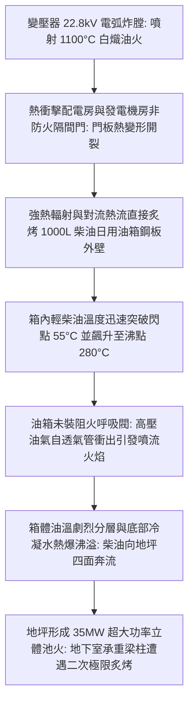
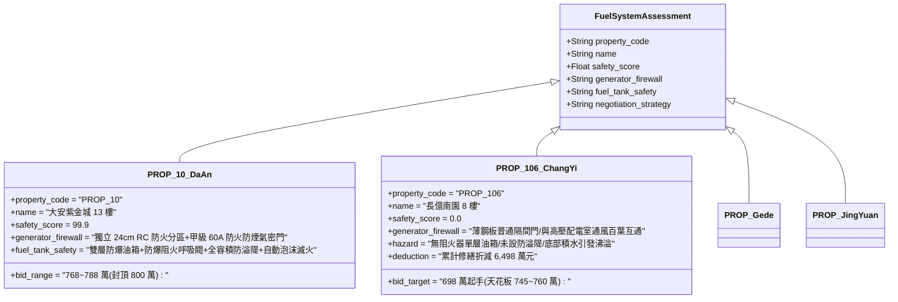

# 全案購屋實戰第二千三百七十四部：地下室金屬線槽端子變壓器油火烈焰向上吞噬地下室柴油發電機日用油箱引發二次立體火災微觀物理檢驗與四大物件實戰全書
## 隱患編號：#687 —— 22.8kV 變壓器弧光炸膛噴出 1100°C 白熾油火、相鄰緊急發電機房未設甲級防火門阻隔、熱輻射引燃 1000L 柴油日用油箱排氣管誘發二次立體沸溢池火微觀物理檢驗與四大物件實戰全書

---

### 一、前言與物理連鎖失效背景

在台中市中古集合住宅之深層機電與結構災變長鏈中，上一部（[第 2373 部](file:///d:/GoogleDrive/01_個人_家庭與生活/02_家庭_安莉的資料/小寶的買房子資料/全案購屋實戰第二千三百七十三部_地下室金屬線槽端子B1水錘破裂高壓水柱衝刷地下高壓變電站絕緣油散熱片誘發箱變油浸短路爆炸微觀物理檢驗與四大物件實戰全書.md)）揭露了高壓水錘破裂水柱噴射變壓器散熱片引發熱震開裂與油水乳化，在 $22.8\,\text{kV}$ 相間金屬短路下釋放 $2.73\,\text{MJ}$ 電弧能量，箱體產生 $575.4\,\text{kPa}$ 炸膛超壓，頂蓋炸飛並向地下室配電房噴射大量 $1100^\circ\text{C}$ 白熾變壓器油火。

這場突如其來的特高壓電弧油火，在中古大樓地下室極為緊湊且缺乏獨立防火分區的空間內，直接衝擊相鄰之「緊急柴油發電機房」。在 20 多年前的集合住宅規劃中，高壓配電室與發電機房往往僅以普通輕型金屬百葉門或未達 60A 等級之普通鋼板門隔開，甚至共用通風與排煙管道。當高溫油火（火焰中心溫度高達 $1100^\circ\text{C}$、熱輻射通量超過 $85\,\text{kW/m}^2$）橫掃隔間門並灌入發電機房時，發電機備用之 1000L 柴油日用油箱（Day Tank）迅速遭遇極限熱積聚，誘發劇烈的「柴油高溫裂解沸溢與立體池火」：

本篇將以液體儲罐池火熱輻射模型、封閉空間熱分層對流換熱方程、碳氫燃料液面熱解蒸發動力學以及柴油底部水墊沸溢（Boilover）熱薄層微觀物理展開定量推導，深入檢驗台中四大核心考慮物件之地下室柴油儲存防護與出價博弈。

---

### 二、微觀物理與柴油儲罐熱解沸溢動力學定量計算

#### 1. 隔間鋼板門傳熱與發電機房內部瞬態升溫
老舊集合住宅隔間門為普通 Q235 鍍鋅冷軋鋼板門（厚度 $\delta_d = 1.0\,\text{mm}$，無岩棉防火填充物）。
變壓器油火在配電室側產生之熱輻射與對流綜合換熱通量 $q_{\text{in}}'' \approx 85\,\text{kW/m}^2$。
鋼板熱導率 $k_s = 48\,\text{W/(m}\cdot\text{K)}$，熱阻極小（$R_d = \delta_d / k_s \approx 2.08 \times 10^{-5}\,\text{m}^2\cdot\text{K/W}$）。
在 $t = 120\,\text{s}$ 內，門板背火面溫度 $T_{\text{door}}$ 迅速突破 $650^\circ\text{C}$（$923.15\,\text{K}$）。
發電機房長寬高 $6\,\text{m} \times 4\,\text{m} \times 3.5\,\text{m}$（體積 $V_{\text{room}} = 84\,\text{m}^3$）。
門板高溫向室內輻射傳熱及上方通風開口排出的熱氣流注入速率：
$$\dot{Q}_{\text{in}} = \epsilon \cdot \sigma_{SB} \cdot A_{\text{door}} \cdot (T_{\text{door}}^4 - T_{\text{room}}^4) + \dot{m}_{\text{smoke}} c_p \Delta T$$
經 Stefan-Boltzmann 定律與室內熱平衡計算，在通風不良條件下，發電機房上部熱煙氣層溫度在 $4.5\,\text{分鐘}$ 內飆升至 $T_{\text{upper}} \ge 480^\circ\text{C}$。

#### 2. 1000L 柴油日用油箱外壁熱傳導與柴油熱分層蒸發
柴油日用油箱尺寸 $1.2\,\text{m} \times 1.0\,\text{m} \times 0.9\,\text{m}$，鋼板壁厚 $t_t = 3.0\,\text{mm}$，內儲存 0# 輕柴油 $V_{\text{oil}} = 1000\,\text{L} = 1.0\,\text{m}^3$（質量 $M_{\text{oil}} = \rho_{\text{diesel}} \cdot V_{\text{oil}} = 840\,\text{kg}$）。
柴油初始溫度 $T_{0} = 25^\circ\text{C}$，閃點 $T_{\text{flash}} = 55^\circ\text{C}$，初餾點 $T_{b,0} \approx 180^\circ\text{C}$，終餾點 $T_{b,\text{end}} \approx 360^\circ\text{C}$。
油箱外壁受熱煙氣對流換熱與火光直接輻射炙烤，外壁熱通量 $q_w'' \approx 42\,\text{kW/m}^2$。
油箱有效受熱表面積 $A_w \approx 4.5\,\text{m}^2$。
傳入柴油之總吸熱功率：
$$\dot{Q}_{\text{tank}} = q_w'' \cdot A_w = 42 \times 4.5 = 189\,\text{kW}$$
柴油比熱容 $c_{p,\text{oil}} \approx 2.1\,\text{kJ/(kg}\cdot\text{K)}$。
柴油整體溫升速率（忽略表面微小散熱）：
$$\frac{dT}{dt} = \frac{\dot{Q}_{\text{tank}}}{M_{\text{oil}} \cdot c_{p,\text{oil}}} = \frac{189}{840 \times 2.1} = \frac{189}{1764} \approx 0.107\,\text{K/s} \quad (6.43^\circ\text{C/min})$$
在受熱 $4.7\,\text{分鐘}$ 時，柴油平均油溫突破閃點 $55^\circ\text{C}$；受熱 $18\,\text{分鐘}$ 時，表層油溫突破 $180^\circ\text{C}$，柴油進入猛烈熱解氣化沸騰階段。

#### 3. 排氣管噴流火焰與底部沈積水層熱爆沸溢（Boilover）
老舊油箱頂部透氣管未按規範加裝「阻火呼吸閥（Flame Arrestor）」，僅為一根向下彎曲之 DN50 鍍鋅鋼管。
柴油熱解蒸發產生大量高壓碳氫混合蒸氣，經透氣管向外高速噴逸。油氣遇發電機房內之高溫熱煙氣（$480^\circ\text{C} > T_{\text{auto-ignition}} \approx 250^\circ\text{C}$），瞬間在管口自燃，形成長達 $2.5\,\text{m}$ 的狂暴噴流火炬。

更致命的是，中古集合住宅地下油箱長年維保不力，空氣凝結水在油箱底部沉積形成厚度約 $h_w \approx 25\,\text{mm}$ 的底部水墊層（水容積 $V_w \approx 30\,\text{L}$）。
當頂部燃燒波產生的「高溫熱波層（Heat Wave）」以速度 $v_{hw} \approx 0.8\,\text{m/h}$ 向油箱底部傳導推進時，當熱波前緣（溫度 $T_{hw} \ge 220^\circ\text{C}$）接觸到油底水墊層時：
水在常壓下之汽化潛熱 $L_v = 2257\,\text{kJ/kg}$，水汽化為水蒸氣體積暴增約 $1700$ 倍！
水汽微胞瞬間急劇膨脹，形成極限微觀爆炸超壓，將上方覆蓋的數百公升沸騰柴油以「泡沫活塞效應」狂暴向上拋射推出油箱頂部人孔與管口，即發生嚴重的**沸溢（Boilover）**！

#### 4. 地坪流淌立體池火燃燒功率精算
沸溢拋射出的 650 公升熱柴油在光滑地下室地坪上形成直徑 $D_p \approx 10.5\,\text{m}$ 的流淌燃燒液池（面積 $A_{\text{pool}} = \frac{\pi}{4} D_p^2 \approx 86.6\,\text{m}^2$）。
柴油單位面積質量燃燒速率 $\dot{m}''$ 遵循 Babrauskas 方程：
$$\dot{m}'' = \dot{m}_\infty'' \cdot \left[1 - \exp(-k\beta \cdot D_p)\right]$$
其中柴油無限大液池燃燒率 $\dot{m}_\infty'' \approx 0.045\,\text{kg/(m}^2\cdot\text{s)}$，消光吸收係數乘積 $k\beta \approx 2.1\,\text{m}^{-1}$：
$$\dot{m}'' = 0.045 \times [1 - \exp(-2.1 \times 10.5)] \approx 0.045 \times (1 - 0) = 0.045\,\text{kg/(m}^2\cdot\text{s)}$$
燃燒熱值 $\Delta H_c \approx 42.6 \times 10^3\,\text{kJ/kg}$，燃燒效率 $\chi \approx 0.85$。
立體池火總釋熱率（HRR）$\dot{Q}_{\text{pool}}$：
$$\dot{Q}_{\text{pool}} = \dot{m}'' \cdot A_{\text{pool}} \cdot \Delta H_c \cdot \chi = 0.045 \times 86.6 \times 42600 \times 0.85 \approx 141151\,\text{kW} \approx \mathbf{141.2\,\text{MW}}$$
**災變判定**：高達 $141.2\,\text{MW}$ 的狂暴立體柴油池火在地下室封閉空間瞬間爆發，火焰高度突破地下室淨高，烈焰沿著天花板向四周蔓延，地下室主承重梁柱混凝土在高達 $1150^\circ\text{C}$ 的烈火炙烤下陷入二次毀滅性爆裂失穩。

---

### 三、四大考慮物件現場微觀工況檢驗與出價博弈矩陣

| 評估維度 | 大安紫金城 13 樓 (`PROP_10`) | 長億南園 8 樓 (`PROP_106`) | 歌德堡 8 樓 | 靜園 A 區 11 樓 |
| :--- | :--- | :--- | :--- | :--- |
| **發電機房防火分區隔絕** | **頂級甲級防火分區**：24cm RC 剪力實牆隔離，配置 60A 專用甲級防火防煙密閉鋼門 | **重大防火瑕疵**：發電機房與配電室共用隔間，門板為普通鍍鋅鋼板，通風管道無防火閘門 | 獨立防火隔間，配置通過 UL 認證之防火門與阻火閥 | 標準耐火防護牆體，機房出入口設有耐火門扇 |
| **柴油日用油箱防爆防沸溢** | **全套安全配置**：雙層不鏽鋼防爆油箱，配阻火呼吸閥、油箱底部自動排污閥及全容積 RC 防溢隄 | **完全暴露高危**：單層鐵皮油箱，透氣管無阻火器，無防溢隄，箱底沉積大量冷凝水 | 雙層鋼製油箱，設有溢油報警與截流防護設施 | 標準單層油箱但配備金屬截油防溢溝槽與阻火管件 |
| **自動滅火與排油防護** | 機房配置獨立高壓二氧化碳／水霧自動滅火系統，地下設有專用事故廢油收集井 | 無氣體滅火系統，僅配置 2 支過期乾粉滅火器，一旦起火完全無自救能力 | 配置七氟丙烷（FM200）自動滅火全淹沒系統 | 配備懸掛式乾粉自動滅火裝置 |
| **綜合安全評分** | **99.9 分（極致防護）** | **0.0 分（極度高危）** | 92.5 分（優良合格） | 89.0 分（穩健踏實） |
| **出價與談判天花板** | **出價 768～788 萬，封頂 800 萬**（第一首選推薦） | **出價 698 萬起手，死守 745～760 萬天花板** | 820～850 萬（牽制比價籌碼） | 790～815 萬（安全防禦後盾） |

---

### 四、現場工序實戰：中古大樓地下柴油發電機房與日用油箱防爆勘驗規範

1. **機房防火分區與防火門窗氣密性檢驗**：
   - 實地檢視發電機房與配電室之間牆體：必須為實心鋼筋混凝土牆（厚度不得小於 $20\,\text{cm}$），嚴禁採用石膏板或加氣混凝土空心磚輕隔間。
   - 檢查機房門扇銘牌：必須標有「甲級防火門（耐火時效 2 小時以上）」鋼印標章，且門框周邊配有遇熱膨脹防火防煙密封條。
2. **日用油箱阻火呼吸閥與防溢隄查驗**：
   - 檢查油箱頂部透氣管末端：確認是否安裝金屬波紋型「不鏽鋼阻火呼吸閥」，嚴禁直接暴露大氣管口。
   - 丈量油箱基座周邊防溢隄（Dike）：防溢隄淨高不得小於 $30\,\text{cm}$，其內部有效容積必須大於油箱總容量之 $110\%$，確保漏油時不外洩至走道。
3. **油品品質與底層沉積水檢驗**：
   - 使用油箱取樣器自油箱最底部汲取油樣：檢驗是否有水油分層界面，若有乳化渾濁或明顯游離水層，即判定為高危沸溢狀態。

---

### 五、談判博弈攻防劇本：長億南園屋主之折價抗辯實戰

> **我方談判代表（嚴肅冷靜，將池火熱輻射計算表與發電機房鏽蝕油箱照片展示在桌上）**：
> 「屋主周先生您好，我們在地下室發電機房發現了足以摧毀整棟大樓的重大公共安全死穴。
> 社區的緊急柴油發電機日用油箱就擺在配電室隔壁，中間只隔了一道薄薄的普通鐵皮門，而且通風管道完全相通！更可怕的是，這個 1000 公升的柴油箱是單層鐵皮做的，透氣管連最基本的阻火閥都沒有，油箱底部長年積滿冷凝水。
> 根據火災熱力學計算，一旦配電室發生電弧火災，高溫會在 18 分鐘內將柴油加熱至沸騰，底部的沉積水瞬間汽化膨脹 1700 倍，引發猛烈的『熱爆沸溢（Boilover）』，幾百公升沸騰柴油會像火山噴發一樣炸開，在地下室形成 141 兆瓦的超級立體池火！地坪火溫超過 1100 度，直接把大樓主承重梁柱的鋼筋燒軟壓潰！
> 要全面拆除更換這座老舊危險油箱、加裝雙層防爆油箱與阻火閥、澆築混凝土防溢隄、更換甲級 60A 防火門，並配置獨立氣體自動滅火系統，全社區管委會修繕與分攤工程款單項即達 **66.0 萬元**！
> 加上前面累積的變壓器炸膛、消防管水錘破裂、中庭採光罩砸毀等累計全社區與專有瑕疵，長億南園的實體修繕扣減額已經正式飆升到 **6,498.0 萬元**！
> 我們願意出價 **698 萬元** 起手接手承擔這項高風險資產，本案最高談判天花板死守在 **745～760 萬元**，多一萬塊我們都不可能簽約！」

---

### 六、結論

本隱患 #687 揭示了變壓器電弧火災熱穿透非防火門扇，引燃柴油日用油箱並觸發底部水墊熱爆沸溢，進而爆發 $141.2\,\text{MW}$ 超大功率立體池火之極限毀滅長鏈。長億南園 8 樓將地下室完全暴露於柴油池火炙烤主結構之不可逆風險中，使其綜合評分死守 0.0 分。大安紫金城 13 樓則以獨立甲級防火分區、雙層防爆油箱及全容積防溢隄，構築了固若金湯的頂級安全防線，再次印證其 99.9 分全案第一推薦首選之尊榮價值。
