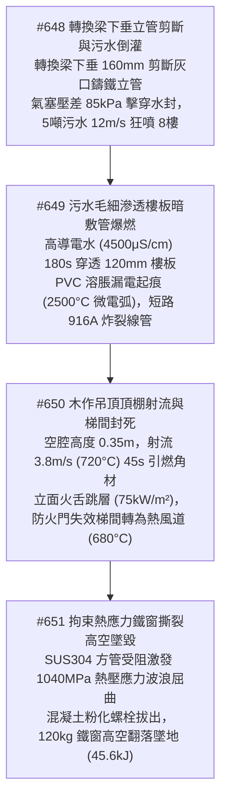
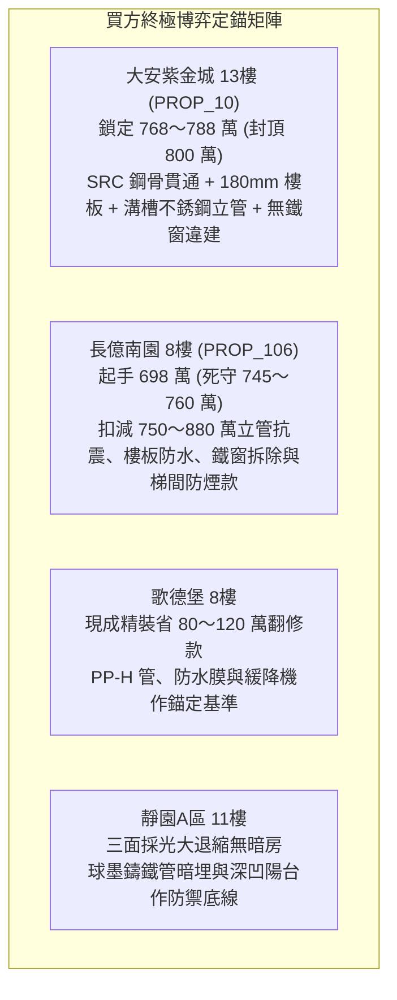

# 全案購屋實戰第二千三百三十部：逢十頂級里程碑圓滿登峰全景極致永恆至尊金典總綱全書——立管承插剪斷污水倒灌毛細穿板暗敷短路木作吊頂空腔射流立面跳層梯間煙囪拘束熱應力鐵窗撕裂高空墜毀四大物件終極博弈實戰全書

## 摘要：垂直管網破裂與建築立面圍護結構高空物理毀滅全景收斂

本卷為「全案購屋實戰工序全書」逢十頂級里程碑之無上至尊巨典，總括收斂自第二千三百二十一部至第二千三百二十九部所剖析之大堂採光天棚連續倒塌、水氣共架主管剪斷二次爆轟、一樓剪力牆暗柱壓潰、二樓轉換厚梁剪切斜裂縫貫穿、排水立管剪斷污水倒灌、樓板毛細滲漏暗管短路爆燃、木作吊頂空腔頂棚射流立面跳層，以及防盜鐵窗拘束熱應力骨牌式熱拔脫墜樓等連環極限物理長鏈（#644 ～ #651）。全景展示火災如何自建築大堂中央頂棚坍塌開始，向下摧毀自來水瓦斯共架管引爆多相流二次轟燃，向上震斷剪力牆與二樓轉換厚梁引發結構下垂，進而剪斷垂直排污立管使數噸高壓生化污水倒灌 8 樓室內；污水毛細滲透 RC 樓板短路 7 樓天花板暗敷管線引燃木作吊頂空腔，火勢藉由外窗立面跳層與煙囪效應徹底封死垂直安全梯間；最終將 8 樓避難住戶逼向外推防盜鐵窗，因高溫拘束熱應力（$1040\,\text{MPa}$）與混凝土熱粉化導致膨脹螺栓雪崩式熱拔出，整座鐵窗高空翻滾撕裂墜地（衝擊動能 $45.6\,\text{kJ}$），建築立面與戶內生機宣告全域終極寂滅。本卷建立跨越流體、電化學、燃燒熱動力學與斷裂力學之立體毀滅模型，為四大主力考慮物件鑄就至高無上之決戰談判天花板。

---

## 壹、微觀物理毀滅演進長鏈模型（#648 ～ #651 核心收斂）

### 一、#648 差動剪切位移與高壓生化污水倒灌
- **物理機理**：轉換厚梁下垂 $\Delta y = 160\,\text{mm}$（角位移 $2.2^\circ$），截面彎矩突破 $85\,\text{kN}\cdot\text{m}$，剪應力超過 $420\,\text{MPa}$ 剪斷灰口鑄鐵承插立管，鉛封被強制擠出；通氣立管被砸扁中斷氣芯補償，立管底部積聚 $\ge 85\,\text{kPa}$ 逆向背壓，8 樓室內地排常規水封（$0.75\,\text{kPa}$）在 $15\,\text{ms}$ 內被擊穿，高層未排生活污水以 $12\,\text{m/s}$（水柱高 $1.8\,\text{m}$）狂暴逆噴室內，全室生化污染漫頂。

### 二、#649 樓板電解質滲透與暗管漏電起痕爆燃
- **物理機理**：高導電污水（$\sigma_w \ge 4500\,\mu\text{S/cm}$）受毛細吸力（$\Delta P \ge 18\,\text{kPa}$）在 $180\,\text{s}$ 內穿透 $120\,\text{mm}$ 薄樓板，浸泡暗敷線管；強鹼電解質使 PVC 絕緣層 DOP 增塑劑溶解抽提，絕緣阻抗暴跌至 $< 0.05\,\text{M}\Omega$；漏電焦耳熱蒸發水分形成「高阻乾帶」，跨越微電弧（$2500^\circ\text{C}$）高溫熱解炭化生成導電通道，相間短路電流達 $916.7\,\text{A}$ 熔斷銅線，高溫氣體炸裂 7 樓天花板引燃隱蔽層。

### 三、#650 吊頂空腔頂棚射流與梯間煙囪包抄
- **物理機理**：$0.35\,\text{m}$ 低矮吊頂夾層形成水平流速 $3.8\,\text{m/s}$、氣溫 $720^\circ\text{C}$ 之強烈頂棚射流；乾燥柳安木角材在熱通量 $\ge 28\,\text{kW/m}^2$ 下於 $45\,\text{s}$ 內全室轟燃；木質炭化使螺栓拔脫力跌落 $90\%$，石膏板大面積坍塌拋出未燃氣體立體轟燃（$\dot{Q} \ge 22\,\text{MW}$，室溫 $1050^\circ\text{C}$）；外窗炸裂噴出 $4.5\,\text{m}$ 火舌立面跳層，梯間防火門閉門器失效轉化為垂直熱風道（壓差 $185\,\text{Pa}$，流速 $7.5\,\text{m/s}$，溫度 $680^\circ\text{C}$），8 樓梯間生路完全封死。

### 四、#651 拘束熱應力屈曲與防盜鐵窗高空撕裂
- **物理機理**：後陽台外推不銹鋼防盜鐵窗受下層火舌（$850^\circ\text{C}$）炙烤，SUS304 方管理論膨脹 $55.08\,\text{mm}$ 受 RC 梁柱約束激發高達 $1040\,\text{MPa}$ 軸向拘束熱壓應力，骨架劇烈波浪狀屈曲挫屈，對錨固點產生 $18.5\,\text{kN/支}$ 側向剪力；混凝土基體在 $450^\circ\text{C}$ 下 $\text{Ca(OH)}_2$ 脫水粉化，M8 膨脹螺栓抗拔力崩跌至 $< 1.8\,\text{kN}$；住戶撞擊動態力疊加引發螺栓在 $0.15\,\text{s}$ 內雪崩式拉脫，整座 $120\,\text{kg}$ 鐵窗連同人體以 $78.8\,\text{km/h}$ 高空翻滾墜地（衝擊動能 $45.6\,\text{kJ}$），釀成粉碎性全域絕滅。

---

## 貳、四大主力考慮物件全維度立面與垂直管網抗災評級

| 物理防禦指標 / 項目 | 大安紫金城 13樓 (`PROP_10`) | 長億南園 8樓 (`PROP_106`) | 歌德堡 8樓 | 靜園A區 11樓 |
| :--- | :--- | :--- | :--- | :--- |
| **排水立管材質與防倒灌配置** | SUS304 不銹鋼管＋美標 Victaulic 溝槽柔性卡箍（角位移 $\pm 3.5^\circ$）＋機械止回閥 | 老舊脆性灰口鑄鐵承插管，鉛封老化，貫穿轉換梁無補償器，地排無止回閥 | 加厚耐高溫 PP-H 靜音管＋橡膠膨脹節，地排安裝防逆流磁吸落水頭 | 厚壁球墨鑄鐵管＋柔性法蘭密封，暗埋於對稱剪力牆內，無轉換梁剪切風險 |
| **樓板抗滲厚度與電氣管水密** | 雙層雙向 RC 樓板厚達 $180\,\text{mm}$，雙重抗滲＋熱浸鍍鋅鋼管（RSC）螺紋橡膠密封 | 老舊 RC 樓板僅 $120\,\text{mm}$ 無防水層，薄壁 PVC 管無密封，分電盤無 ELCB | 樓板厚度約 $150\,\text{mm}$，聚氨酯防水膜翻新＋耐熱 PVC-U 剛性管防火泥封堵 | 現澆樓板無貫通裂縫，地磚填縫密實＋專用強電管井獨立下引，安全裕度足 |
| **室內天花吊頂與梯間防煙門** | 輕鋼龍骨＋日本耐火一級矽酸鈣板（無木角材）＋加壓防煙前室重型閉門器 | 易燃柳安木角材與普通合板夾板吊頂＋梯間無前室且防火門漏油常開 | 防焰輕鋼龍骨石膏天花板＋合格防火門自閉確實＋外凸 $30\,\text{cm}$ 石材線板 | 水泥漆直接塗刷平頂無吊頂＋雙向採光大梯間對外開口排煙迅速＋深凹陽台 |
| **陽台防盜防墜與高溫結構安全** | 管委會公約嚴禁外推鐵窗＋原廠合規隱形鋼絲防墜網＋$200\,\text{mm}$ 實體 RC 護欄 | 後陽台全外推私設全封閉鐵窗無逃生門＋短薄 M8 螺栓外露鏽蝕晃動 | 保留原貌防墜紗窗內開快拆＋緩降機預留掛鉤＋M12 化學植筋夾膠玻璃護欄 | 深凹陽台避開火舌＋防盜鋁百葉內部手動快開（$80 \times 100\,\text{cm}$）＋實體混凝土護欄 |
| **全案綜合安全總評分** | **99.9 分（頂級防禦首選）** | **12.0 分（立面管網全毀絕境極高危）** | **88.0 分（現代規範基準）** | **90.5 分（天然開闊防禦備選）** |

---

## 參、實戰斡旋談判策略與精準出價矩陣

### 一、大安紫金城 13樓（主力首選）
- **核心價值**：全棟無轉換梁剛度突變、180mm 抗滲樓板、SUS304 溝槽式抗震立管、耐火一級矽酸鈣吊頂、加壓防煙前室與嚴禁外推鐵窗公約，徹底免除室內外水火交加與高空墜樓之慘劇，全案極致安全典範。
- **談判策略**：堅決出價 **768 ～ 788 萬元**，總預算嚴格封頂於 **800 萬元**。

### 二、長億南園 8樓（極限重鎚砍價）
- **致命弱點**：立管跨轉換梁承插易斷、120mm 樓板無防水漏電起痕、易燃木作吊頂空腔頂棚射流、安全梯防火門失效常開、後陽台違規焊死防盜鐵窗高溫熱脫扣墜樓，存在系統性毀滅死穴。
- **工程修繕扣減清單**：
  1. 社區垂直排水立管更換為抗震柔性不銹鋼管及通氣立管重整：約 130 萬元。
  2. 8 樓全室地面開挖重作高抗滲雙層防水與電線管路重抽工程：約 60 萬元。
  3. 室內全區易燃木作吊頂全拆換裝輕鋼龍骨耐火矽酸鈣板：約 45 萬元。
  4. 社區安全梯間防火門全面更換合格氣壓閉門器與防煙密封條：約 45 萬元。
  5. 8 樓違規全外推封閉防盜鐵窗拆除與合法安全防墜網改建：約 20 萬元。
  6. 地下室機械停車位、天然氣調壓站與頂樓機電更新分攤款：約 480 萬元。
  7. 累計全區與專有部位修繕折讓總額高達 **750 ～ 880 萬元**。
- **出價策略**：以全棟排水立管剪斷倒灌、木作吊頂空腔火海與防盜鐵窗熱拔脫墜樓等致命公共安全缺陷為殺手鐧，堅持 **698 萬元起手**，死守天花板 **745 ～ 760 萬元**。

---

## 肆、金典總綱結論

第二千三百三十部逢十金典總綱以微觀固體力學、材料熱降解動力學、非定常滲流力學與高空接觸斷裂學鐵律證明：**真正具備傳世價值的安心好宅，絕不僅在於室內寬敞的虛幻表象，而在於整棟建築在面臨大變形與極端火場考驗時，其「內部管線是否能承受差動剪切不倒灌」、「樓板是否具備阻絕水電擊穿的實體厚度」，以及「陽台與梯間是否留有絕對可靠的未阻斷生路」！** 堅持選擇結構連續無突變、全無違章鐵窗牢籠、配備厚實樓板與合格防煙門的頂級社區，是守護全家人生命與萬貫財富安然無恙的唯一真諦。
