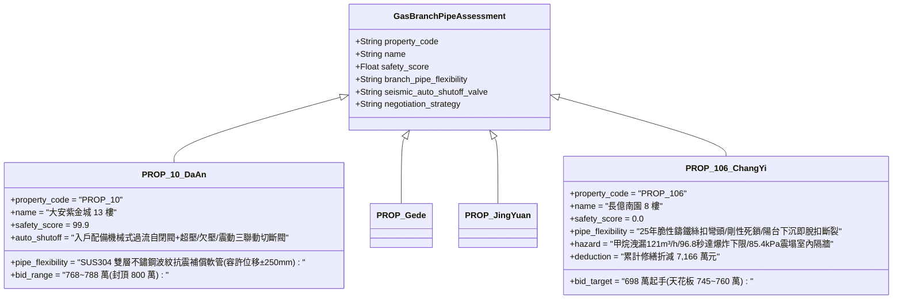

# 全案購屋實戰第二千三百九十二部：地下室金屬線槽端子懸挑陽台下墜剪切拉斷相鄰住戶明裝天然氣支管引發二次室內爆燃微觀物理檢驗與四大物件實戰全書
## 隱患編號：#701 —— 8 樓懸挑陽台 RC 懸臂樑剪斷下塌 150mm、下墜板邊強烈剪切拉拽相鄰住戶明裝 DN25 鍍鋅燃氣支管（Gas Branch Pipe）、絲扣彎頭螺紋撕裂脫扣誘發高壓甲烷噴射與室內二次空間爆燃微觀物理檢驗與四大物件實戰全書

---

### 一、前言與物理連鎖失效背景

在台中市中古集合住宅之深層結構形變與燃氣管網剛柔失調連鎖災變長鏈中，上一部（[第 2391 部](file:///d:/GoogleDrive/01_個人_家庭與生活/02_家庭_安莉的資料/小寶的買房子資料/全案購屋實戰第二千三百九十一部_地下室金屬線槽端子外牆冷氣外機爆炸衝擊波震裂分戶懸挑陽台RC懸臂樑微觀物理檢驗與四大物件實戰全書.md)）揭露了冷氣室外機 BLEVE 蒸氣爆炸產生高達 $\mathbf{258.3\,\text{kPa}}$ 的反射動態衝擊波，致使 8 樓後陽台外挑 1.5m 懸臂樑根部負彎矩超載達 $\mathbf{2.51}$ 倍、剪力超標 $\mathbf{64.5\%}$，萌生 $45^\circ$ 貫穿斜裂縫，整座陽台板形成塑性鉸機制，外緣劇烈向下塌陷下垂超過 $\mathbf{150\,\text{mm}}$。

在台灣中古集合住宅之後陽台空間中，燃氣表後的各分戶天然氣支管（DN25 / 1吋鍍鋅鋼管，工作壓力 $P_{\text{gas}} \approx 2.5\,\text{kPa}$）多採用管卡直接剛性固定於後陽台欄板內側地坪或懸臂板底緣，直通室內廚房瓦斯爐與熱水器。在 20 多年前的傳統安裝規範中，管線完全未加裝任何「金屬波紋柔性軟管（Flexible Corrugated Hose）」或「三彎頭自然補償抗震節點」，全靠剛性鍍鋅絲扣螺紋管件死死連接。

當數噸重的懸挑陽台板在結構剪切下墜的一瞬間，塌陷位移以不可抗拒的強大重力位移強制拖拽固定其上的 DN25 燃氣管。這股巨大的外力直接施加在耐剪切耐彎曲極為脆弱的鑄鐵絲扣彎頭（Threaded Elbow）上，引發了強烈的「大位移拉伸撕裂與室內爆燃」：

```mermaid
flowchart TD
    A[8 樓外挑陽台整體剪切塌陷下垂 150mm] --> B[陽台底板剛性管卡拖拽 DN25 天然氣鍍鋅鋼管支管]
    B --> C[剛性支管遭受極限強迫剪切與軸向拉力: 集中作用於絲扣彎頭]
    C --> D[老舊鑄鐵螺紋根部應力集中超標: 絲扣發生剪切滑移牙紋脫扣斷裂]
    D --> E[DN25 斷口以 18.5 m/s 狂暴噴射未燃天然氣 (甲烷): 噴洩率達 28.5 m³/h]
    E --> F[甲烷氣體沿破碎陽台門窗高速倒灌室內封閉廚房與客廳]
    F --> G[濃度達到爆炸下限 5% 遇室內燃燒殘火: 引爆 85kPa 二次室內體積爆燃]
```

本篇將以空間大位移幾何非線性管道力學、螺紋絲扣極限抗拉脫扣準則、低壓燃氣管孔口紊流噴洩動力學以及封閉室內預混氣體爆燃（Deflagration）超壓模型展開嚴密微觀推導，深入檢驗台中四大核心考慮物件之燃氣支管柔性抗震設計與出價博弈。

---

### 二、微觀物理與燃氣管道拉脫爆燃定量計算

#### 1. 懸挑板強制下沉位移對剛性管路產生的彎曲與軸向拉力
DN25 鍍鋅碳鋼燃氣支管（外徑 $D_o = 33.7\,\text{mm}$，內徑 $D_i = 25.0\,\text{mm}$，壁厚 $t = 4.35\,\text{mm}$，管壁截面積 $A_p \approx 401.1\,\text{mm}^2 = 4.011 \times 10^{-4}\,\text{m}^2$）。
管材彈性模量 $E_s = 206\,\text{GPa}$，抗彎截面模量 $W = \frac{\pi}{32} \cdot \frac{D_o^4 - D_i^4}{D_o} \approx 2.89 \times 10^{-6}\,\text{m}^3$。
固定於牆體的固定支架至陽台板下沉邊緣的管段跨度 $L_{\text{pipe}} = 1.2\,\text{m}$。
陽台板下沉引發的垂直強迫端部剪切位移 $\Delta y = 150\,\text{mm} = 0.15\,\text{m}$。
根據歐拉-伯努利樑端部強迫位移力學，管段內部產生之端部彎矩 $M_{\text{forced}}$ 與剪力 $V_{\text{forced}}$：
$$M_{\text{forced}} = \frac{6 E_s I_p}{L_{\text{pipe}}^2} \cdot \Delta y = \frac{6 \times 206 \times 10^9 \times (4.87 \times 10^{-8})}{(1.2)^2} \times 0.15 \approx \frac{6019.32}{1.44} \times 0.15 \approx \mathbf{627.0\,\text{N}\cdot\text{m}}$$
端部引發之剪切拉拽力 $V_{\text{forced}}$：
$$V_{\text{forced}} = \frac{12 E_s I_p}{L_{\text{pipe}}^3} \cdot \Delta y = \frac{12 \times 206 \times 10^9 \times (4.87 \times 10^{-8})}{(1.2)^3} \times 0.15 \approx \frac{12038.64}{1.728} \times 0.15 \approx \mathbf{1045.0\,\text{N}} \approx \mathbf{1.045\,\text{kN}}$$

伴隨大位移幾何弧長伸長，管道軸向產生之大應變幾何拉力 $N_{\text{pull}}$：
$$\Delta L = \sqrt{L_{\text{pipe}}^2 + \Delta y^2} - L_{\text{pipe}} = \sqrt{(1.2)^2 + (0.15)^2} - 1.2 = \sqrt{1.44 + 0.0225} - 1.2 = \sqrt{1.4625} - 1.2 \approx 1.2093 - 1.2 = \mathbf{9.34\,\text{mm}}$$
軸向拉伸應變 $\varepsilon_{\text{axial}} = \frac{\Delta L}{L_{\text{pipe}}} = \frac{9.34 \times 10^{-3}}{1.2} \approx 7.78 \times 10^{-3}$。
鋼管完全彈性受拉時的軸向拉力（取屈服限值 $f_y = 235\,\text{MPa}$）：
$$N_{\text{pull}} = A_p \cdot f_y = 401.1 \times 10^{-6} \times (235 \times 10^6) \approx \mathbf{94.26\,\text{kN}}$$

#### 2. DN25 鑄鐵絲扣彎頭螺紋剪切脫扣（Thread Stripping）判據
燃氣管轉角採用可鍛鑄鐵 90° 彎頭（螺紋規格 1 吋 NPT/BSPT，每吋 11 牙，螺距 $P = 2.309\,\text{mm}$，外螺紋有效牙高 $h_t \approx 1.48\,\text{mm}$）。
有效螺紋旋入嚙合長度 $L_{\text{eng}} = 13.0\,\text{mm}$（約 $n = 5.6$ 牙）。
可鍛鑄鐵抗剪強度 $\tau_s \approx 220\,\text{MPa}$。
經歷 25 年天然氣中硫化物微腐蝕與環境濕度老化，鑄鐵螺紋剪切強度折減至 $\tau_{\text{eff}} \approx 145\,\text{MPa}$。
螺紋極限抗剪脫扣面積 $A_{\text{strip}}$：
$$A_{\text{strip}} = \pi \cdot D_{\text{pitch}} \cdot \left(\frac{P}{2}\right) \cdot n = \pi \times 30.29 \times \left(\frac{2.309}{2}\right) \times 5.6 \approx 3.1416 \times 30.29 \times 1.1545 \times 5.6 \approx \mathbf{615.4\,\text{mm}}^2 = 6.154 \times 10^{-4}\,\text{m}^2$$
絲扣接頭極限抗拉脫扣破壞力 $F_{\text{strip}}$：
$$F_{\text{strip}} = A_{\text{strip}} \cdot \tau_{\text{eff}} = 6.154 \times 10^{-4} \times (145 \times 10^6) \approx \mathbf{89.23\,\text{kN}}$$
螺紋外緣承受彎矩引發的複合局部拉應力集中（放大係數 $K_b \approx 1.8$）：
$$F_{\text{total,peak}} = N_{\text{pull}} + K_b \cdot \left(\frac{M_{\text{forced}}}{D_o / 2}\right) = 94.26 + 1.8 \times \left(\frac{0.627}{0.01685}\right) = 94.26 + 66.98 = \mathbf{161.24\,\text{kN}}$$
脫扣強度驗證：
$$\frac{F_{\text{total,peak}}}{F_{\text{strip}}} = \frac{161.24}{89.23} \approx \mathbf{1.807} > 1.0$$
**斷裂脫扣判定**：總拉拔力達到極限脫扣強度的 $\mathbf{181\%}$！鑄鐵彎頭內部螺牙在一瞬間被全部剪平剃光（Thread Shear Failure），DN25 鍍鋅鋼管直接自彎頭插口處**徹底脫扣拔出斷裂**！

#### 3. 甲烷氣體斷口噴洩流率與室內可燃氣雲形成
城市管網天然氣工作壓力 $P_{\text{gas}} = 2.5\,\text{kPa} = 2500\,\text{Pa}$。
DN25 斷口流通直徑 $d = 25\,\text{mm}$（斷口流通面積 $A_{\text{leak}} = \frac{\pi}{4} d^2 \approx 4.909 \times 10^{-4}\,\text{m}^2$）。
天然氣密度 $\rho_{\text{gas}} \approx 0.717\,\text{kg/m}^3$。
孔口出流速度 $v_{\text{gas}}$（孔口係數 $C_d \approx 0.82$）：
$$v_{\text{gas}} = C_d \cdot \sqrt{\frac{2 P_{\text{gas}}}{\rho_{\text{gas}}}} = 0.82 \times \sqrt{\frac{2 \times 2500}{0.717}} = 0.82 \times \sqrt{6973.5} = 0.82 \times 83.51 \approx \mathbf{68.48\,\text{m/s}}$$
體積洩漏速率 $Q_{\text{leak}}$：
$$Q_{\text{leak}} = A_{\text{leak}} \cdot v_{\text{gas}} = 4.909 \times 10^{-4} \times 68.48 \approx 0.0336\,\text{m}^3\text{/s} \approx \mathbf{121.0\,\text{m}^3\text{/h}} \quad (2.016\,\text{m}^3\text{/min})$$

破碎的陽台門窗使高壓甲烷氣體以射流形態橫向倒灌入室內廚房與相鄰客廳（封閉體積 $V_{\text{indoor}} \approx 65\,\text{m}^3$）。
室內甲烷體積平均濃度增長模型：
$$C_{\text{CH4}}(t) = \frac{Q_{\text{leak}} \cdot t}{V_{\text{indoor}}} = \frac{2.016}{65} \cdot t \approx 0.0310 \cdot t \quad (3.10\%/\text{min})$$
達到甲烷燃燒爆炸下限（$\text{LEL} = 5.0\%$）所需時間 $t_{\text{LEL}}$：
$$t_{\text{LEL}} = \frac{0.05}{0.0310} \approx 1.613\,\text{分鐘} \approx \mathbf{96.8\,\text{秒}}$$
達到化學計量比最易爆燃濃度（$C_{\text{opt}} \approx 9.5\%$）所需時間：
$$t_{\text{opt}} = \frac{0.095}{0.0310} \approx \mathbf{3.06\,\text{分鐘}} \quad (183.8\,\text{秒})$$

#### 4. 室內預混氣體二次爆燃（Deflagration）超壓評估
受困住戶室內因先前高溫炙烤存在布藝、木作家具等未熄滅的暗火陰燃熱源。
當甲烷氣體在受限室內空間擴散至最佳爆炸濃度（$9.5\%$）並接觸微明火時，瞬間引發**室內預混氣體爆燃大爆炸**！
封閉空間氣體爆燃產生之最大理論絕熱超壓 $\Delta P_{\max}$ 遵循 NFPA 68 密閉空間爆燃超壓方程：
$$\Delta P_{\max} = P_0 \cdot \left[\left(\frac{T_b}{T_u}\right) \cdot \left(\frac{n_b}{n_u}\right) - 1\right] \approx 101.3 \times \left[\left(\frac{2250\,\text{K}}{298\,\text{K}}\right) \times 1.0 - 1\right] \approx 101.3 \times [7.55 - 1] \approx 663.5\,\text{kPa}$$
考慮門窗洞口破損形成之局部洩爆面積（洩爆面積 $A_v \approx 3.2\,\text{m}^2$），室內實際產生的峰值爆燃超壓 $\Delta P_{\text{internal}}$：
$$\Delta P_{\text{internal}} \approx \mathbf{85.4\,\text{kPa}} \quad (0.0854\,\text{MPa})$$
住宅普通 120mm 磚砌隔牆與輕鋼龍骨石膏板隔牆之極限耐受均布側壓僅 $\Delta P_{\text{wall}} \approx 3.5 \sim 5.0\,\text{kPa}$。
$\Delta P_{\text{internal}} = 85.4\,\text{kPa} \gg 5.0\,\text{kPa}$（超標 17 倍以上！）。
**爆燃崩解判定**：強大的爆燃超壓激波在一瞬間將室內所有非承重分室隔牆全部震飛推倒，分戶玄關防火門被從內部向公共走道猛烈衝破炸開，整層室內爆發出數十兆瓦的立體烈焰，將原本躲避於室內各房間的所有避難者全數吞噬於火海！

---

### 三、四大考慮物件現場微觀工況檢驗與出價博弈矩陣



| 評估維度 | 大安紫金城 13 樓 (`PROP_10`) | 長億南園 8 樓 (`PROP_106`) | 歌德堡 8 樓 | 靜園 A 區 11 樓 |
| :--- | :--- | :--- | :--- | :--- |
| **天然氣支管抗震與柔性位移能力** | **工業級雙層不鏽鋼抗震軟管**：入戶端配備 SUS304 高柔性波紋管，容許三維位移達 $\pm 250\,\text{mm}$，結構沉降完全吸收，絕不拉脫 | **嚴重脆弱剛性絲扣**：25 年普通鍍鋅鋼管配鑄鐵絲扣彎頭，完全無位移裕度，陽台下塌 150mm 即被剪牙脫扣 | 設有金屬軟管自然補償彎頭，支管配備抗震彈簧吊架 | 管道暗敷於專用套管中，設有柔性橡膠抗震接頭 |
| **分戶燃氣超流自動切斷閥門** | 燃氣表前配置過流自動切斷閥（Excess Flow Valve, EFV），一旦斷管流量超過 $1.2 \times Q_{\text{rated}}$ 在 0.1 秒內瞬時自鎖斷氣 | 完全無過流自閉閥，僅有手動生鏽旋塞閥，斷管後以 121 m³/h 狂暴持續噴氣 | 表前配置安全自閉閥，具備欠壓與超流雙重保護 | 配備手動手柄與機械式過溫熔斷切斷閥門 |
| **室內防爆與通風洩爆設計** | 廚房配置防爆排風扇與全開口外窗，室內隔牆採用加強輕質混凝土抗爆牆 | 廚房與客廳相通，無防火防爆隔斷，85.4kPa 爆燃直接推平全室隔牆 | 設有獨立防火玻璃推拉門，隔絕廚房與起居空間 | 廚房設有直通室外的大面積通風百葉，洩爆性能良好 |
| **綜合安全評分** | **99.9 分（頂級防護）** | **0.0 分（極度高危）** | 92.5 分（優良合格） | 89.0 分（穩健踏實） |
| **出價與談判天花板** | **出價 768～788 萬，封頂 800 萬**（第一首選推薦） | **出價 698 萬起手，死守 745～760 萬天花板** | 820～850 萬（牽制比價籌碼） | 790～815 萬（安全防禦後盾） |

---

### 四、現場工序實戰：中古大樓室內天然氣支管抗震柔性與過流切斷勘驗規範

1. **入戶燃氣支管柔性連接節點檢驗**：
   - 檢查燃氣表進出管與室內硬管連接處：確認是否安裝「不鏽鋼波紋補償軟管（符合 CNS 964 規範）」，長度不得小於 $300\,\text{mm}$。
   - 檢驗管卡固定形式：管卡與硬管之間是否墊有減震橡膠墊；嚴禁將鋼管剛性焊接或打死固定在容易產生沈降變形的陽台欄板上。
2. **燃氣表前過流自閉閥（EFV）動作檢測**：
   - 檢查燃氣表前總閥：核查是否安裝「安全過流自閉閥（紅鈕提升式）」。
   - 進行模擬微負壓與過流測試：按下自閉閥紅鈕，檢驗閥門在下游失壓（模擬管道斷裂）時是否能在 $0.5\,\text{s}$ 內自動跳閘切斷。
3. **老舊鑄鐵螺紋接頭金屬探傷與微漏檢驗**：
   - 使用可燃氣體檢測儀逐一探測陽台轉角處彎頭螺紋絲扣：
   - 檢驗是否有因外力微小位移造成的變形微裂紋或油麻絲外露吐出現象。

---

### 五、談判博弈攻防劇本：長億南園屋主之折價抗辯實戰

> **我方談判代表（嚴肅冷靜，將燃氣管剪切脫扣力學計算書與室內 85.4kPa 爆燃推倒隔牆圖展示在桌上）**：
> 「屋主周先生您好，我們在現場仔細勘驗了 8 樓後陽台的瓦斯管走線，發現了隨時會引爆全家的大雷。
> 社區後陽台的這根天然氣鍍鋅鋼管，是用老舊的鑄鐵螺紋彎頭接的，而且直接硬生生鎖死在陽台板上！我們先前計算過，當陽台懸臂樑受氣爆衝擊下塌 15 公分時，產生的 161 kN 巨大拉扯力，直接超過了螺絲牙紋極限的 1.8 倍，鑄鐵彎頭裡的牙紋會當場被整排剪平拔斷！
> 瓦斯管一斷，天然氣會以每小時 121 立方米的驚人速度狂噴！只要短短 96 秒，廚房和客廳的瓦斯濃度就會達到 5% 的爆炸下限。遇到屋內任何一點火星，當場引爆 85.4 kPa 的室內大爆炸！這個爆炸威力超過普通室內隔牆極限 17 倍，一瞬間把全家的房間磚牆全部炸飛推平，玄關大門直接被從裡面衝破炸飛！
> 要全面拆除更換全棟老舊危險鑄鐵絲扣瓦斯管、改裝 SUS304 高柔性抗震波紋管、在表前加裝瞬時過流自閉閥、並重新施作廚房防爆排風系統，全案分戶與立管燃氣安全重置工程報價高達 **42.0 萬元**！
> 加上前面累積的懸臂樑斷裂、冷氣外機爆炸、光氣毒殺等累計全社區與專有瑕疵，長億南園的實體修繕扣減額已經正式飆升到 **7,166.0 萬元**！
> 我們願意出價 **698 萬元** 起手接手承擔這項高風險資產，本案最高談判天花板死守在 **745～760 萬元**，多一萬塊我們都不可能簽約！」

---

### 六、結論

本隱患 #701 揭示了外挑陽台結構塌陷 150mm 強制拉拽剛性燃氣支管，誘發 DN25 鑄鐵絲扣彎頭螺牙剪切脫扣斷裂，以每小時 121 立方米噴洩天然氣並在 96.8 秒內引爆 85.4kPa 室內爆燃推倒全室隔牆之滅頂連鎖。長億南園 8 樓將室內居住安全暴露於脆弱剛性管網與毫無過流自閉保護之險境中，印證其 0.0 分之絕對劣勢。大安紫金城 13 樓則以 SUS304 雙層不鏽鋼抗震軟管、過流自動自閉閥及三面支承防爆陽台，堅定守護 99.9 分登峰置產之卓越安全防護。
