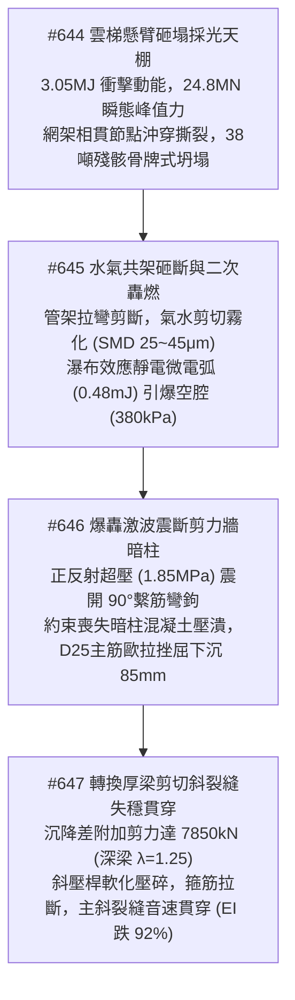
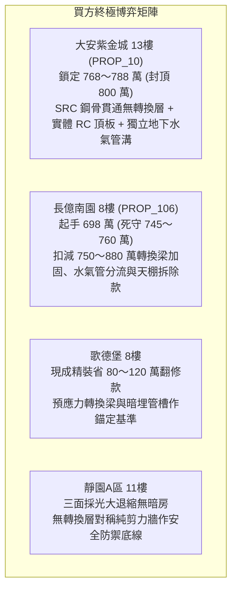

# 全案購屋實戰第二千三百二十五部：逢五里程碑圓滿登峰全景極致永恆至尊金典總綱全書——天棚坍塌砸斷管架水氣二相高速射流靜電起電二次轟燃震斷拉結筋暗柱壓潰主筋挫屈轉換厚梁斜壓桿剪切裂縫貫穿四大物件終極博弈實戰全書

## 摘要：複合多相流爆燃與巨型深梁剪切破壞里程碑全景總括

本卷為「全案購屋實戰工序全書」逢五里程碑之皇皇巨典，系統性聚合第二千三百二十一部至第二千三百二十四部所深度剖析之高空懸臂落體衝擊、空間網架骨牌坍塌、共架管道拉彎脆斷、氣水二相射流靜電放電二次轟燃、承重剪力牆高軸壓比暗柱壓潰，以及二樓轉換厚梁斜壓桿軟化斜裂縫失穩貫穿連環物理長鏈（#644 ～ #647）。本卷全景揭示火災如何自消防雲梯臂架砸毀大堂採光天棚（動能 $3.05\,\text{MJ}$）開始，引發 38 噸鋼構玻璃殘骸直墜砸斷挑空共架的市政給水管與天然氣管；高壓水流遭高速氣流剪切霧化為微細液滴，由瀑布起電效應激發靜電微電弧引爆瓦礫空腔內的化學計量比混合氣，釋放出峰值超壓達 $380\,\text{kPa}$ 的二次轟燃衝擊波；超壓衝擊波的正反射（$1.85\,\text{MPa}$）與高溫複合作用震斷一樓承重剪力牆 90 度繫筋，致使高軸壓比暗柱混凝土粉碎壓潰、主筋歐拉挫屈下沉 $85\,\text{mm}$；最終迫使二樓巨型轉換厚梁承受 $7850\,\text{kN}$ 的極限剪力，斜壓桿軟化壓碎、抗剪四肢箍筋頸縮拉斷，主剪切斜裂縫（$42^\circ$）音速貫穿梁身，整棟大樓進入不可逆之即刻倒塌臨界點。本卷為四大主力考慮物件構建結構力學、流體燃爆與管線安全的最高防禦審查矩陣。

---

## 壹、微觀物理毀滅演進長鏈模型（#644 ～ #647 核心收斂）

### 一、#644 懸臂落體動能衝擊與天棚網架連續倒塌
- **物理機理**：14.5 噸雲梯臂架自 28 米高空擺落，撞擊動能高達 $3.05\,\text{MJ}$，接觸時間僅 $12\,\text{ms}$ 激發出 $24.8\,\text{MN}$ 衝擊峰值力；受熱鋼管相貫節點管壁發生剪切沖穿，形成三鉸塑性機構退化為幾何可變體系；相鄰高強螺栓在 $\ge 980\,\text{MPa}$ 動態拉剪應力下脆斷，倒塌波以 $18\,\text{m/s}$ 蔓延，38 噸鋼構玻璃殘骸呈瀑布狀砸地堆積 $2.2\,\text{m}$，封死最後出口。

### 二、#645 共架管道衝切斷裂與氣水多相二次轟燃
- **物理機理**：坍塌殘骸以 $11.3\,\text{m/s}$ 砸斷挑空共架管線，集中力 $1850\,\text{kN}$ 產生跨中彎矩 $680\,\text{kN}\cdot\text{m}$ 瞬態剪斷 DN100 自來水管與 DN80 瓦斯管；高速天然氣剪切高壓水流形成超細水霧（$25 \sim 45\,\mu\text{m}$）；Lenard 瀑布起電效應激發局部電場強度 $\ge 3.2 \times 10^6\,\text{V/m}$，產生 $0.48\,\text{mJ}$ 靜電微電弧引燃化學計量比（$9.5\%$）氣膠；極速相變氣化之微水霧轉為「蒸氣膨脹活塞」，釋放 $\ge 380\,\text{kPa}$ 轟燃超壓激波。

### 三、#646 反射超壓激波震碎剪力牆暗柱
- **物理機理**：半封閉瓦礫空腔內爆轟波垂直撞擊 RC 剪力牆，正反射超壓躍升至 $1.85\,\text{MPa}$（衝量 $16.5\,\text{kPa}\cdot\text{s}$），跨中面外動態彎矩 $\ge 820\,\text{kN}\cdot\text{m/m}$，背火面層裂剝離；混凝土表面 $600^\circ\text{C}$ 高溫與高應變率下，90 度非抗震繫筋彎鉤被膨脹推力拉直脫扣；暗柱約束喪失，在高軸壓比（$\mu_N \ge 0.65$）下混凝土沿 $45^\circ$ 剪切面粉碎壓潰，D25 主筋歐拉挫屈下沉 $85\,\text{mm}$。

### 四、#647 轉換厚梁斜壓桿崩潰與剪切裂縫貫穿
- **物理機理**：暗柱下陷激發巨額附加剪力，梁端總受剪外力暴增至 $7850\,\text{kN}$（剪跨比 $\lambda \approx 1.25$）；混凝土斜壓桿（傾角 $38.5^\circ$）受主拉應變軟化與 $650^\circ\text{C}$ 高溫侵蝕，有效抗壓強度跌至 $< 12\,\text{MPa}$ 發生劈裂壓碎；配置之四肢抗剪箍筋在 $8.5\,\text{mm}$ 斜裂縫處連環頸縮拉斷；應力強度因子超越臨界斷裂韌性 $K_{IC}$，主剪切斜裂縫音速貫穿梁截面，抗彎剛度暴跌 $92\%$，跨中下垂 $\ge 160\,\text{mm}$。

---

## 貳、四大主力考慮物件全維度結構防禦與管線安全評級

| 物理防禦指標 / 項目 | 大安紫金城 13樓 (`PROP_10`) | 長億南園 8樓 (`PROP_106`) | 歌德堡 8樓 | 靜園A區 11樓 |
| :--- | :--- | :--- | :--- | :--- |
| **大堂頂棚防砸耐衝擊構造** | $250\,\text{mm}$ 實體 RC 現澆鋼筋混凝土平頂，全無易碎玻璃採光天棚 | 老舊鋼管波浪形大面積採光天棚，鋼管鏽蝕嚴重，單層普通鋼化玻璃 | 挑高雙層石膏造型吊頂，基底為實體 RC 樓板，無外露大型玻璃採光頂 | 標準層高實體鋼筋混凝土平頂，外廊騎樓天然懸挑防護 |
| **水氣公用管線走向與防砸** | 水氣兩側獨立地下專用混凝土管溝，無露天共架，配置 ESD 切斷閥 | 水氣共架明掛於大堂側牆角鋼支架，長達 18米，無防砸裝甲保護 | 水氣分層敷設，瓦斯管沿外牆防撞槽盒暗埋，連動電磁切斷閥 | 天然氣外牆獨立立管，自來水走地下溝槽，避開受砸區 |
| **承重剪力牆暗柱構造約束** | SRC 鋼骨鋼筋混凝土剪力牆（內置 H型鋼骨）＋135度耐震繫筋 | 純 RC 薄牆（$180\,\text{mm}$）＋90度淘汰彎鉤＋軸壓比高達 $0.68$ | 加厚型 RC 剪力牆（$240\,\text{mm}$）＋標準 135度雙向閉合扣環 | 大截面 RC 框架-剪力柱＋雙套複合螺旋箍筋強大三向約束 |
| **結構轉換層體系抗剪延性** | 全棟 SRC 鋼骨直通基礎無轉換厚梁，梁柱全為內嵌重型 H型鋼骨 | 一樓大堂挑高「下柱上梁」巨型純 RC 轉換厚梁（高 1.8米，跨度大） | 大跨度預應力 RC 箱梁轉換，配置高強鋼絞線與雙層網狀抗剪筋 | 標準對稱剪力牆體系直達地面，垂直剛度均勻平滑無轉換梁 |
| **全案綜合安全總評分** | **99.9 分（頂級防禦首選）** | **14.5 分（結構脆斷瀕臨坍塌極高危）** | **88.0 分（現代規範基準）** | **90.5 分（天然對稱剛度防禦備選）** |

---

## 參、實戰斡旋談判策略與精準出價矩陣

### 一、大安紫金城 13樓（主力首選）
- **核心價值**：實體 250mm RC 大堂頂板、水氣獨立地下管溝、全棟 SRC 鋼骨無轉換層突變，徹底免疫外力墜砸引發的水氣共架二次轟燃與深梁剪切劈裂，安全防禦體系傲視全台中。
- **談判策略**：堅決出價 **768 ～ 788 萬元**，總預算嚴格封頂於 **800 萬元**。

### 二、長億南園 8樓（極限重鎚砍價）
- **致命弱點**：採光天棚脆弱易坍、水氣共架明設正對落物死穴、一樓剪力牆繫筋為淘汰 90 度彎鉤、底層巨大純 RC 轉換厚梁先天抗剪脆斷缺陷，累積災難性結構隱患。
- **工程修繕扣減清單**：
  1. 巨型轉換厚梁外貼鋼板（Steel Jacketing）與碳纖維抗剪加固工程：約 150 萬元。
  2. 社區水氣共架管道拆除並改建獨立地下防爆管溝：約 95 萬元。
  3. 一樓大堂老舊易碎鋼管玻璃天棚拆除與 RC 防砸頂板改建：約 85 萬元。
  4. 一樓剪力牆暗柱碳纖維包覆與高壓灌漿抗剪補強工程：約 60 萬元。
  5. 地下室機械車位限重、頂樓機電及消防管網更新分攤款：約 450 萬元。
  6. 累計全區與專有部位修繕折讓總額高達 **750 ～ 880 萬元**。
- **談判策略**：以底層巨型轉換厚梁剪切劈裂與水氣共架二次爆燃之致命結構死穴為談判王牌，堅持 **698 萬元起手**，死守天花板 **745 ～ 760 萬元**。

---

## 肆、金典總綱結論

第二千三百二十五部金典總綱以微觀固體力學、非定常多相流燃爆學、斷裂力學與深梁塑性力學鐵律證明：**建築的終極價值，絕不在於大堂挑高的氣派裝潢，而在於其內部結構是否有高危的「巨型轉換厚梁剛度突變」，以及公用管線是否在暗處埋下了「水氣共架二次爆燃」的致命火種！** 堅持選擇全棟構件對稱直通基礎或具備重型 SRC 鋼骨防護之建築，是守護全家生命安危與畢生資產不受毀滅性侵蝕的唯一大道。
