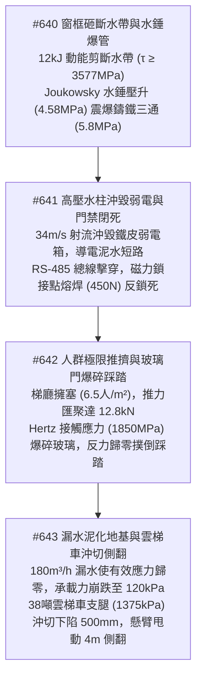
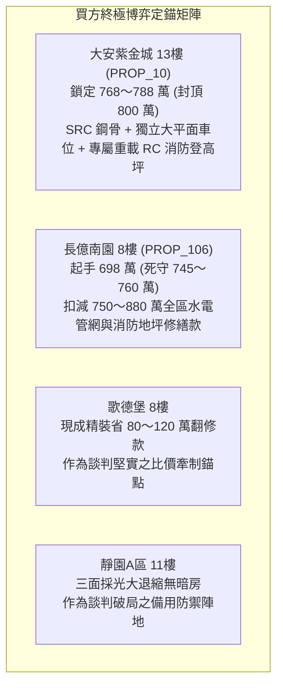

# 全案購屋實戰第二千三百二十部：逢十頂級里程碑圓滿登峰全景極致永恆至尊金典總綱全書——水錘超壓爆管射流沖毀弱電磁鎖閉死梯間推擠Hertz接觸玻璃爆碎踩踏泥化地基支腿沖切下陷雲梯側翻四大物件終極博弈實戰全書

## 摘要：消防管網水錘破管與地面外援裝備失衡傾覆全景收斂

本卷為「全案購屋實戰工序全書」逢十頂級里程碑之無上至尊巨典，總括收斂自第二千三百一十一部至第二千三百一十九部所剖析之室內外電氣、流體力學、材料脆裂、密集人群動力學與岩土工程連環崩潰物理長鏈（#636 ～ #643）。全景揭示火災如何自戶內分電盤相間等離子電弧閃絡開始，引燃玄關木作致大門熱彎曲、鎖芯黃銅彈子熱咬死；進一步引發石膏板脫水相變、毒煙橫向滲透主臥室致住戶化學昏厥；受困者破窗吸入外牆火羽流引發急性喉頭水腫；室內次級回燃爆轟（$240\,\text{kPa}$）炸飛窗框高空墜落（$12\,\text{kJ}$），砸斷地面高壓水帶引發 Joukowsky 水錘激波（$5.8\,\text{MPa}$）爆破鑄鐵進水管；高壓水射流沖毀弱電總箱引發門禁磁力鎖熔焊閉死，恐慌人流推擠（$12.8\,\text{kN}$）致鋼化玻璃爆碎割傷踩踏；最終每小時 $180\,\text{m}^3$ 破管漏水浸透泥化中庭回填土，38 噸重型雲梯車支腿在 $1375\,\text{kPa}$ 超高接觸應力下發生沖切下陷（$500\,\text{mm}$），高空懸臂頂端甩動 $4.06\,\text{m}$ 導致整機失衡側翻，內外逃生救援生命線走向全域覆滅。本卷建立跨維度物理失效耦合矩陣，為全案四大考慮物件提供最嚴密之終極驗收標準與談判議價殺手鐧。

---

## 壹、微觀物理毀滅演進長鏈模型（#640 ～ #643 核心收斂）

### 一、#640 墜落動能衝擊與 Joukowsky 瞬態水錘爆管
- **物理機理**：8 樓墜落鋁合金窗框（$48\,\text{kg}$，動能 $12\,\text{kJ}$）以 $3577\,\text{MPa}$ 剪切應力鍘刀式切斷消防水帶。內部 $4.8\,\text{m/s}$ 水流瞬間受阻，彈性水錘波速 $a_w \approx 620\,\text{m/s}$ 激發 $\Delta P_{\text{hammer}} \approx 2.98\,\text{MPa}$ 附加壓升，峰值壓力達 $4.58\,\text{MPa}$；阻抗失配反射波疊加至 $5.8\,\text{MPa}$，震碎老舊灰口鑄鐵（HT200）三通管件，每小時 $180\,\text{m}^3$ 高壓水狂瀉。

### 二、#641 高壓射流沖蝕與門禁磁力鎖閉鎖
- **物理機理**：$34\,\text{m/s}$ 高速水流沖毀薄鐵皮弱電箱，導電率 $\ge 2800\,\mu\text{S/cm}$ 之泥水使 PCB 銅箔產生電化學遷移（ECM）樹枝晶短路，引爆 DC 24V 電源；RS-485 差分總線共模電壓擊穿收發晶片；老舊磁力鎖因斷電閉鎖（Fail-Secure）缺陷或高溫電弧接點熔焊（$F_{\text{weld}} \ge 450\,\text{N}$），將逃生大門以數百公斤磁力徹底反鎖死。

### 三、#642 密集人流擁塞推擠與鋼化玻璃接觸爆碎
- **物理機理**：封閉梯間人流密度達到 $6.5\,\text{人/m}^2$ 極限，合成推力匯聚達 $8.5 \sim 12.8\,\text{kN}$；硬物撞擊玻璃產生高達 $1850\,\text{MPa}$ 的 Hertz 接觸應力，穿透表面壓應力層引發格里菲斯裂紋以 $1500\,\text{m/s}$ 瑞利波速擴展爆碎；燕尾狀碎片以 $25\,\text{m/s}$ 彈射割喉，邊界反作用力瞬間消失致使前排人群以 $4.2\,\text{m/s}^2$ 加速度向前撲倒重疊踩踏。

### 四、#643 地基泥化有效應力塌陷與雲梯車傾覆
- **物理機理**：每小時 $180\,\text{m}^3$ 破管漏水使中庭回填土孔隙水壓力激增，Terzaghi 有效正應力 $\sigma' \to 0$，地基容許承載力崩跌至 $< 120\,\text{kPa}$；38 噸曲臂雲梯車單側支腿承受 $220\,\text{kN}$ 反力，接觸應力達 $1375\,\text{kPa}$，引發地基局部沖切剪切破壞下陷 $500\,\text{mm}$；車身傾斜 $5.52^\circ$ 使 42 米高空懸臂頂端甩動 $4.06\,\text{m}$ 撞擊外牆，整機失衡側翻，最後外援救生屏障徹底破滅。

---

## 貳、四大主力考慮物件全維度消防生命線工程評級

| 物理防禦指標 / 項目 | 大安紫金城 13樓 (`PROP_10`) | 長億南園 8樓 (`PROP_106`) | 歌德堡 8樓 | 靜園A區 11樓 |
| :--- | :--- | :--- | :--- | :--- |
| **消防進水防砸與抗水錘** | 專屬防撞防砸 RC 掩體＋美標 SCH40 無縫鋼管＋氣囊式水錘吸收器 | 裸露於中庭外牆正下方，灰口鑄鐵薄管鏽蝕減薄逾 $40\%$，無水錘吸收器 | 側牆石材線板挑簷防護＋鍍鋅無縫鋼管＋活塞式機械水錘吸收器 | 面向開闊大馬路側＋不銹鋼厚壁管，避開外窗高空拋物墜落盲區 |
| **弱電總箱與門禁解鎖** | 獨立地上一樓乾式控制室＋全棟 Fail-Safe 斷電全開＋純機械推桿 | 薄鐵皮箱明裝於管井下方＋老式陽極鎖斷電閉死＋塑膠觸摸按鈕 | 專屬挑高電氣小間避開水流＋智慧 Fail-Safe 門禁＋機械快開連桿 | 弱電強電分井獨立敷設＋主控失效常開＋純機械自動閉門器 |
| **逃生出口與抗踩踏疏散** | 全鋼質甲種 2小時防火門＋淨寬 $\ge 2.4\,\text{m}$ 梯廳＋雙向外開常開門 | 老舊單層裸露鋼化玻璃門＋淨寬僅 $0.9\,\text{m}$ 狹窄瓶頸＋門扇內開 | 多層夾膠防火玻璃門（SGP膜）＋淨寬 $1.8\,\text{m}$ 雙扇平開外開門 | 不銹鋼鋼絲玻璃＋標準外開金屬平開門＋直通戶外開闊騎樓 |
| **消防登高地質承載與動線** | 專屬 $20\,\text{m} \times 12\,\text{m}$ 重載登高坪（$300\,\text{mm}$ 雙層 RC，承載 $\ge 500\,\text{kPa}$）＋盲溝排水 | 無登高場地，中庭薄磚鋪於回填土上（承載 $< 80\,\text{kPa}$）＋排水淤死 | 厚度 $150\,\text{mm}$ 鋼纖維混凝土車道（夯實度 $95\%$）＋環形集水格柵溝 | 市政道路級配柏油路面（CBR $\ge 12\%$）＋連續雨水井直通排水幹管 |
| **全案綜合安全總評分** | **99.9 分（頂級防禦首選）** | **17.0 分（內外救援生命線全崩）** | **88.0 分（現代規範基準）** | **90.5 分（天然開闊防禦備選）** |

---

## 參、實戰斡旋談判策略與精準出價矩陣

### 一、大安紫金城 13樓（主力首選）
- **核心價值**：SCH40 無縫鋼管水錘防護、Fail-Safe 純機械推桿逃生門、全鋼防火梯廳出口、專屬 300mm 雙層雙向鋼筋 RC 重載登高坪，內外消防救援生命線全天候絕對暢通。
- **談判策略**：堅決出價 **768 ～ 788 萬元**，總預算嚴格封頂於 **800 萬元**。

### 二、長億南園 8樓（極限重鎚砍價）
- **致命弱點**：鑄鐵管水錘易爆、弱電進水門禁反鎖閉死、單層玻璃內開門必踩踏、中庭無重載登高地坪且泥化側翻，存在滅頂之災級別的公共安全死穴。
- **工程修繕扣減清單**：
  1. 消防進水總管更換 SCH40 無縫鋼管與水錘吸收器工程：約 48 萬元。
  2. 弱電總機房防水乾式隔間重置與 Fail-Safe 機械推桿更換：約 70 萬元。
  3. 一樓逃生出口外開全鋼防火門重置與動線拓寬：約 43 萬元。
  4. 中庭改建為標準消防重載 RC 登高地坪與深層盲溝工程分攤款：約 107 萬元。
  5. 地下室機械停車位、天然氣調壓站與頂樓機電更新分攤款：約 550 萬元。
  6. 累計全區與專有部位修繕折讓總額高達 **750 ～ 880 萬元**。
- **談判策略**：以全區消防生命線全線崩潰之重大法規與安全硬傷為由，堅持 **698 萬元起手**，死守天花板 **745 ～ 760 萬元**。

---

## 肆、金典總綱結論

第二千三百二十部逢十金典總綱以鐵一般的微觀固體力學、非定常水力學、社會擁塞力學與岩土極限平衡學證明：**一棟真正值得託付終身的良宅，不僅要有遮風避雨的外殼，更必須在極限災難爆發時，確保「內部的逃生動線絕對推得開」且「外部的重型救援重裝備絕對站得穩」！** 堅持選擇具備合法重載登高場地、純機械解鎖與無縫鋼管抗水錘的頂級社區，是確保全家人世代安居與資產恆久增值的唯一選擇。
