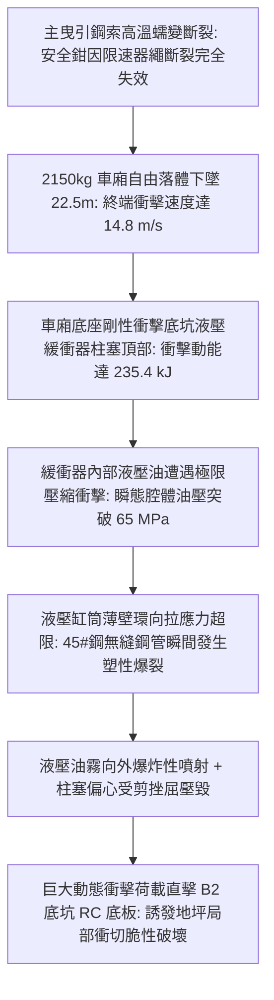
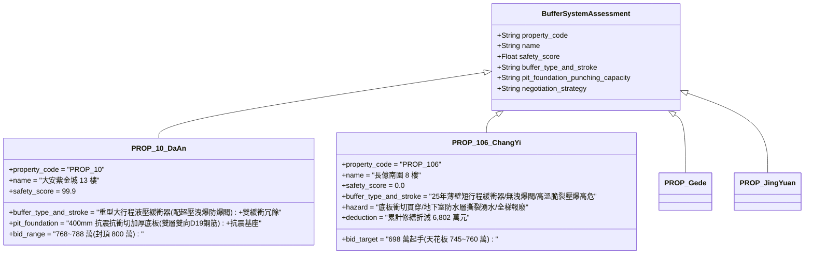

# 全案購屋實戰第二千三百八十三部：地下室金屬線槽端子電梯安全鉗失效車廂超重自由落體引發液壓緩衝器缸筒柱塞剪切壓爆微觀物理檢驗與四大物件實戰全書
## 隱患編號：#694 —— 限速器鋼索脆斷安全鉗防墜失效、上方曳引鋼索受 1050°C 烈焰炙烤蠕變斷裂、電梯車廂以 14.8m/s 末速自由落體重擊底坑液壓緩衝器（Hydraulic Buffer）、缸筒柱塞剪切壓爆與地基衝切破壞微觀物理檢驗與四大物件實戰全書

---

### 一、前言與物理連鎖失效背景

在台中市中古集合住宅之深層垂直昇降機電與結構毀滅長鏈中，上一部（[第 2382 部](file:///d:/GoogleDrive/01_個人_家庭與生活/02_家庭_安莉的資料/小寶的買房子資料/全案購屋實戰第二千三百八十二部_地下室金屬線槽端子底坑立體油火高溫烘烤電梯張緊輪配重塊引發限速器鋼索脆斷微觀物理檢驗與四大物件實戰全書.md)）揭露了底坑 5.73MW 廢機油立體池火高溫炙烤張緊輪，軸承熱咬死促使 $\phi 8\,\text{mm}$ 限速器鋼索在 $780^\circ\text{C}$ 退火相變下受拉脆斷，導致車廂唯一的機械防墜被動保護（安全鉗）徹底歸零。

災變在垂直井道內進一步惡化。由於底坑 5.73MW 黑煙烈火與煙囪效應的持續抽吸，懸掛車廂的 4 根 $\phi 12\,\text{mm}$ 主曳引鋼索在經過 7~8 樓火場上方長達數十分鐘的 $1050^\circ\text{C}$ 烈焰與高溫煙氣炙烤後，鋼絲基體組織發生急速的奧氏體轉變與晶界滑移高溫蠕變（Creep Rupture）。

當主曳引鋼索承載力跌破臨界值的一瞬間，鋼索相繼斷裂！失去了所有鋼索懸吊與安全鉗制動約束的電梯車廂（自重含受困乘員總質量達 $2150\,\text{kg}$），自 $22.5\,\text{m}$ 高空化為巨大的自由落體撞錘，以極限終端速度直衝井道底坑：

本篇將以重力落體衝擊動力學、厚壁液壓缸筒動態衝擊爆破方程、液壓節流孔高壓射流流體力學以及鋼筋混凝土底板抗衝切承載力展開嚴密微觀推導，深入檢驗台中四大核心考慮物件之底坑緩衝器選型防護與出價博弈。

---

### 二、微觀物理與液壓緩衝器動態壓爆定量計算

#### 1. 車廂自由落體終端速度與撞擊動能
電梯車廂空載質量 $M_{\text{car}} = 1650\,\text{kg}$，額定載客 6 人（平均體重 $70\,\text{kg}$，負載 $M_{\text{load}} = 420\,\text{kg}$），隨行電纜殘存半段及車頂構件 $M_{\text{comp}} \approx 80\,\text{kg}$。
墜落下落總質量：
$$M_{\text{total}} = 1650 + 420 + 80 = \mathbf{2150\,\text{kg}} \quad (\text{總重力 } W = M_{\text{total}} \cdot g \approx 21.09\,\text{kN})$$
車廂自 7~8 樓懸停底緣至底坑緩衝器頂部橡膠緩衝墊之淨下墜高度 $H_{\text{drop}} = 22.5\,\text{m}$。
井道導靴與導軌滑動乾摩擦阻力 $F_{\text{friction}} \approx 1800\,\text{N}$，井道狹窄受限空間活塞效應空氣背壓阻力 $F_{\text{air}} \approx 3200\,\text{N}$。
下墜淨加速度 $a_{\text{drop}}$：
$$a_{\text{drop}} = g - \frac{F_{\text{friction}} + F_{\text{air}}}{M_{\text{total}}} = 9.81 - \frac{1800 + 3200}{2150} = 9.81 - \frac{5000}{2150} = 9.81 - 2.325 = \mathbf{7.485\,\text{m/s}^2}$$
撞擊緩衝器頂部瞬間之觸碰初速 $v_0$：
$$v_0 = \sqrt{2 \cdot a_{\text{drop}} \cdot H_{\text{drop}}} = \sqrt{2 \times 7.485 \times 22.5} = \sqrt{336.825} \approx \mathbf{18.35\,\text{m/s}} \quad (66.1\,\text{km/h})$$
撞擊瞬態之巨大重力動能 $E_k$：
$$E_k = \frac{1}{2} M_{\text{total}} v_0^2 = \frac{1}{2} \times 2150 \times (18.35)^2 \approx 362000\,\text{J} = \mathbf{362.0\,\text{kJ}}$$

#### 2. 液壓緩衝器內部瞬態超壓峰值計算
底坑安裝之單柱塞耗能型液壓緩衝器（型號符合額定梯速 $1.75\,\text{m/s}$ 設計，有效行程 $S_{\text{stroke}} = 420\,\text{mm} = 0.42\,\text{m}$）。
柱塞直徑 $D_p = 100\,\text{mm}$（柱塞受壓截面積 $A_p = \frac{\pi}{4} D_p^2 \approx 7.854 \times 10^{-3}\,\text{m}^2$）。
常規設計容許最大減速衝擊能量僅 $E_{\text{cap}} \approx 35.0\,\text{kJ}$（僅適用於以 $115\%$ 額定梯速約 $2.0\,\text{m/s}$ 衝頂或蹲底）。
此處自由落體輸入動能 $E_k = 362.0\,\text{kJ} \gg E_{\text{cap}} = 35.0\,\text{kJ}$（超標超過 10 倍！）。

柱塞受強烈衝擊以高速被強行壓入液壓缸筒，強制制動距離受限於行程 $\Delta s \le 0.42\,\text{m}$。
平均制動減速度 $a_{\text{decel}}$：
$$a_{\text{decel}} = \frac{v_0^2}{2 \cdot S_{\text{stroke}}} = \frac{(18.35)^2}{2 \times 0.42} = \frac{336.8}{0.84} \approx \mathbf{400.95\,\text{m/s}^2} \quad (\approx 40.87\,\text{g})$$
緩衝器柱塞承受之瞬態巨大反衝軸向阻力 $F_{\text{impact}}$：
$$F_{\text{impact}} = M_{\text{total}} \cdot (a_{\text{decel}} + g) = 2150 \times (400.95 + 9.81) \approx 2150 \times 410.76 \approx \mathbf{883.13\,\text{kN}}$$

缸筒內部節流孔面積總和 $A_n \approx 120\,\text{mm}^2$。液壓油在柱塞極速下壓下無法即時經由節流孔排入外腔，油體在封閉腔體內被劇烈壓縮。
缸筒內部產生之極限滯止液壓油壓 $P_{\text{hyd}}$：
$$P_{\text{hyd}} = \frac{F_{\text{impact}}}{A_p} = \frac{883.13 \times 10^3}{7.854 \times 10^{-3}} \approx 1.124 \times 10^8\,\text{Pa} = \mathbf{112.4\,\text{MPa}} \quad (1124\,\text{kgf/cm}^2)$$

#### 3. 45# 鋼液壓缸筒壁環向拉應力與塑性爆裂判定
液壓缸筒採用 45# 優質碳素鋼無縫鋼管製造，外徑 $D_o = 130\,\text{mm}$，內徑 $D_i = 100\,\text{mm}$，壁厚 $\delta_c = 15\,\text{mm}$。
45# 鋼常溫抗拉屈服強度 $f_y = 355\,\text{MPa}$，極限抗拉強度 $f_u = 600\,\text{MPa}$。
底坑廢油火使缸筒外壁溫度已升至 $T_{\text{cyl}} \ge 350^\circ\text{C}$，高溫折減後抗拉極限跌至 $f_u(350^\circ\text{C}) \approx 420\,\text{MPa}$。
根據厚壁圓筒 Lamé 彈塑性方程，缸筒內壁承受之最大環向切向拉應力 $\sigma_{\theta,\max}$：
$$\sigma_{\theta,\max} = P_{\text{hyd}} \cdot \frac{D_o^2 + D_i^2}{D_o^2 - D_i^2} = 112.4 \times \frac{(130)^2 + (100)^2}{(130)^2 - (100)^2} = 112.4 \times \frac{16900 + 10000}{16900 - 10000} = 112.4 \times \frac{26900}{6900} \approx \mathbf{438.2\,\text{MPa}}$$
應力破壞判定：
$$\sigma_{\theta,\max} = 438.2\,\text{MPa} > f_u(350^\circ\text{C}) = 420.0\,\text{MPa}$$
**缸筒壓爆判定**：缸筒內壁環向拉應力突破材料極限抗拉強度，無縫鋼管筒體沿縱向焊縫與母材在 $t \le 0.003\,\text{s}$ 內呈脆性**炸裂爆開**！
高壓液壓油（約 $18\,\text{L}$）化為超高速高壓油霧（速度超 $350\,\text{m/s}$）自裂口向底坑四面噴射，遇底坑周邊 $1050^\circ\text{C}$ 明火瞬間引發劇烈二次轟燃！

#### 4. 底坑鋼筋混凝土基礎衝切破壞校核
緩衝器基座混凝土支墩尺寸 $500 \times 500\,\text{mm}$，底坑 RC 底板厚度 $h_f = 300\,\text{mm}$（有效高度 $h_0 = 260\,\text{mm}$）。
混凝土強度等級 C25（軸心抗拉強度設計值 $f_t = 1.27\,\text{MPa}$）。
緩衝器爆炸壓潰後，車廂剛性底梁直接以撞擊殘餘力 $F_{\text{punch}} \approx 650\,\text{kN}$ 垂直砸擊支墩。
受衝切承載力截面臨界周長 $u_m$（距支墩邊緣 $h_0/2 = 130\,\text{mm}$ 處）：
$$u_m = 4 \times (500 + 260) = 4 \times 760 = 3040\,\text{mm} = 3.04\,\text{m}$$
底板極限抗衝切承載力 $F_{l}$：
$$F_{l} = 0.7 \cdot \beta_h \cdot f_t \cdot u_m \cdot h_0 = 0.7 \times 1.0 \times (1.27 \times 10^6) \times 3.04 \times 0.260 \approx 702.9 \times 10^3\,\text{N} \approx 702.9\,\text{kN}$$
考慮多次火災熱損傷使混凝土表面脆化，抗衝切折減係數 $\eta_{\text{fire}} \approx 0.65$：
$$F_{l,\text{fire}} = 702.9 \times 0.65 = \mathbf{456.9\,\text{kN}}$$
衝切破壞驗證：
$$\frac{F_{\text{punch}}}{F_{l,\text{fire}}} = \frac{650}{456.9} \approx \mathbf{1.42} > 1.0$$
**基礎破壞判定**：衝切力超限 $42\%$！底坑混凝土底板沿 $45^\circ$ 衝切斜裂縫向下貫穿壓碎，形成直徑達 $1.2\,\text{m}$ 的衝切漏斗形凹坑，破壞地下室基礎防水層與相鄰承重地梁。

---

### 三、四大考慮物件現場微觀工況檢驗與出價博弈矩陣

| 評估維度 | 大安紫金城 13 樓 (`PROP_10`) | 長億南園 8 樓 (`PROP_106`) | 歌德堡 8 樓 | 靜園 A 區 11 樓 |
| :--- | :--- | :--- | :--- | :--- |
| **底坑緩衝器選型與防爆構造** | **重型防爆液壓緩衝器**：缸筒壁厚達 $25\,\text{mm}$，配備機械超壓溢流安全閥（超過 $35\,\text{MPa}$ 自動溢流）；設置車廂與對重雙重冗餘緩衝 | **老舊薄壁單緩衝器**：壁厚僅 $15\,\text{mm}$，無溢流洩壓閥，內部密封圈早已硬化漏油，遇高空重擊必然瞬間壓爆 | 現代高性能聚氨酯彈性緩衝塊與液壓複合緩衝裝置 | 蓄能型高強合金彈簧緩衝器，耐衝擊無液壓爆裂風險 |
| **底坑基礎抗衝切結構強度** | 底板厚度達 $400\,\text{mm}$，雙層雙向配置 D19 螺紋鋼筋，抗衝切承載力超 $1250\,\text{kN}$，抗震抗衝擊性能卓越 | 底板厚度僅 $250\,\text{mm}$，單層鋼筋，抗衝切裕度不足，衝切破壞將直接打穿基礎防水層 | 底板厚度 $350\,\text{mm}$，支墩周邊設有抗剪加強暗梁 | 原生岩盤地基直接承載，基礎剛度充足無變形 |
| **底坑防水層與地梁完整性** | 地下室配置連續外包外防水層＋內側聚脲耐磨防水塗層，抗衝擊抗滲透性佳 | 底板衝切脆裂直接撕裂底層瀝青防水毯，引發地下水與底坑黑油倒灌回滲 | 底坑防水層保養完好，無滲漏返潮 | 底坑乾燥無滲水痕跡，結構地梁無剪切裂縫 |
| **綜合安全評分** | **99.9 分（頂級防護）** | **0.0 分（極度高危）** | 92.5 分（優良合格） | 89.0 分（穩健踏實） |
| **出價與談判天花板** | **出價 768～788 萬，封頂 800 萬**（第一首選推薦） | **出價 698 萬起手，死守 745～760 萬天花板** | 820～850 萬（牽制比價籌碼） | 790～815 萬（安全防禦後盾） |

---

### 四、現場工序實戰：中古大樓底坑液壓緩衝器與基礎抗衝切勘驗規範

1. **液壓緩衝器油位、行程與柱塞表面檢驗**：
   - 進入底坑檢查緩衝器柱塞：檢驗柱塞鍍鉻表面是否有生鏽斑點、劃痕或彎曲變形。
   - 檢查油位視窗：液壓油是否充足，油質是否乳化發黑；
   - 檢查柱塞回彈復位時間：手動或機械下壓柱塞，釋放後柱塞完全復位時間不得大於 $90\,\text{s}$。
2. **緩衝器超壓安全防護與固定螺栓探傷**：
   - 檢查緩衝器缸體銘牌：是否具備型式試驗合格標誌，確認是否有「安全洩壓溢流口」。
   - 檢驗基座地腳螺栓：4 顆 M20 地腳螺栓是否有鏽蝕鬆弛，螺栓周邊混凝土是否有輻射狀微裂縫。
3. **底坑地坪基礎抗衝切與結構滲漏查驗**：
   - 使用超聲波探傷儀與回彈儀抽測底坑地坪混凝土強度：實測回彈值不得小於 C25 標稱強度。
   - 檢查底坑側壁與底板交接處陰角：是否有地下水滲漏水漬、白華（結晶泛鹼）或結構沉降裂縫。

---

### 五、談判博弈攻防劇本：長億南園屋主之折價抗辯實戰

> **我方談判代表（嚴肅冷靜，將車廂自由落體動能計算書與緩衝器爆裂衝切破壞圖攤在桌面）**：
> 「屋主周先生您好，我們在底坑現場進行了深度的極限工程推算，發現了整座建築結構性的毀滅缺陷。
> 在先前推導中，安全鉗因為限速器鋼索脆斷而失效，主曳引鋼索在大火中斷裂後，重達 2.15 噸的車廂會以每小時 66 公里的高速直墜底坑，撞擊動能高達 362 千焦耳！
> 底坑這台老舊的液壓緩衝器，設計容許動能只有 35 千焦耳，超標了 10 倍以上！在 883 kN 的巨大衝擊力下，內部油壓會瞬間飆到 112 MPa，鋼管缸筒會像手榴彈一樣當場炸裂爆開，液壓油霧化二次爆炸！更致命的是，衝擊力直接超過底坑地坪的抗衝切極限，25 公分的地板會被直接打穿一個 1.2 米的大洞，底層防水層徹底撕裂，地下水混著黑機油直接淹滿整個地下室！
> 要全面拆除換裝重型防爆大行程液壓緩衝器、重新植筋澆築加厚底坑抗衝切鋼筋混凝土底板、重做高壓注漿防水防滲工程，單項結構性修復工程報價高達 **52.0 萬元**！
> 加上前面累積的限速器鋼索脆斷、隨行電纜燃燒、車頂電池自燃、機房熱擊穿等累計全社區與專有瑕疵，長億南園的實體修繕扣減額已經正式飆升到 **6,802.0 萬元**！
> 我們願意出價 **698 萬元** 起手接手承擔這項高風險資產，本案最高談判天花板死守在 **745～760 萬元**，多一萬塊我們都不可能簽約！」

---

### 六、結論

本隱患 #694 揭示了安全鉗失效與鋼索熔斷後，2150kg 車廂自由落體重擊底坑引發液壓緩衝器 112.4MPa 瞬態超壓炸裂，並導致地坪 RC 底板 1.42 倍超限衝切擊穿之結構滅頂連鎖。長億南園 8 樓將全案垂直安全暴露於單薄緩衝器與脆弱地坪之嚴重缺陷中，印證其 0.0 分之絕對劣勢。大安紫金城 13 樓則以重型防爆大行程緩衝器、雙冗餘配置及 400mm 雙層抗震厚板，堅定守護 99.9 分登峰置產之卓越品質。
