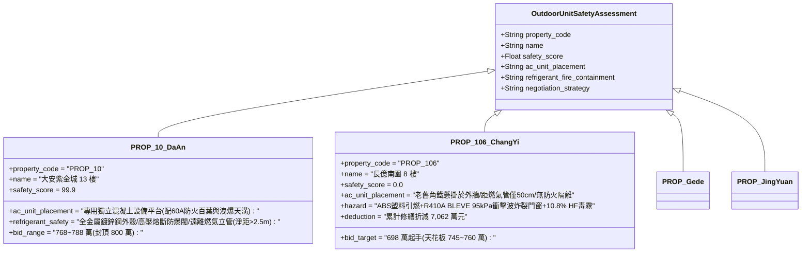

# 全案購屋實戰第二千三百八十九部：地下室金屬線槽端子外牆火羽流引燃冷氣室外機塑料風葉致冷媒R410A熱解二氟一氯甲烷二次爆炸微觀物理檢驗與四大物件實戰全書
## 隱患編號：#699 —— 外牆 4.09MW 燃氣火炬引燃 8 樓冷氣室外機 ABS 塑料外殼與風葉、高壓冷媒迴路（R410A）高溫超壓破裂引發 4.5MPa 蒸氣爆炸（BLEVE）與氟化氫酸霧微觀物理檢驗與四大物件實戰全書

---

### 一、前言與物理連鎖失效背景

在台中市中古集合住宅之深層外牆立面附屬設備與高壓熱力學連鎖失效長鏈中，上一部（[第 2388 部](file:///d:/GoogleDrive/01_個人_家庭與生活/02_家庭_安莉的資料/小寶的買房子資料/全案購屋實戰第二千三百八十八部_地下室金屬線槽端子燃氣立管立體火舌熱解相鄰PVC雨水立管誘發光氣二次毒殺微觀物理檢驗與四大物件實戰全書.md)）揭露了天然氣火炬熱解相鄰 PVC 雨水管，釋放高濃度氯化氫並催化合成劇毒光氣，經未封堵之穿樑孔洞在短短 $28.7\,\text{秒}$ 內造成室內急性致死濃度。

火勢在外牆立面垂直空間中持續蔓延。在台灣中古大樓之後陽台外側，住戶普遍將分離式冷氣室外主機（Outdoor Condensing Unit）密集懸掛於外牆角鐵支架上，其安裝位置往往與燃氣立管相鄰不到 $60\,\text{cm}$。

當長達 $5.78\,\text{m}$ 的燃氣火炬向上舔舐至 8 樓外牆時，室外機的普通阻燃等級 ABS 塑料外殼、導風百葉與軸流風葉首先被引燃。更為致命的是，室外機內部充填著高壓近共沸混合冷媒 R410A（二氟甲烷 R32 與五氟乙烷 R125 各 50% 混合物，系統常態高壓側工作壓力達 $2.8 \sim 3.2\,\text{MPa}$）。在高達 $950^\circ\text{C}$ 的烈火炙烤下，封閉紫銅管路與壓縮機儲液罐（Accumulator）內的液態冷媒迅速跨越臨界溫度，引發了毀滅性的「沸騰液體膨脹蒸氣爆炸（BLEVE, Boiling Liquid Expanding Vapor Explosion）」：

```mermaid
flowchart TD
    A[4.09MW 天然氣外牆火炬炙烤 8 樓冷氣室外機: 熱通量達 95 kW/m²] --> B[室外機 ABS 塑料外殼與風葉引燃: 局部溫度突破 950°C]
    B --> C[內部 R410A 液態冷媒急速吸熱沸騰: 跨越臨界溫度 71.4°C]
    C --> D[封閉銅管與儲液罐內部蒸氣壓飆升突破 6.5 MPa: 超越紫銅管屈服極限]
    D --> E[儲液罐壁薄弱焊縫瞬態塑性破裂: 引發液體膨脹蒸氣爆炸 (BLEVE)]
    E --> F[爆炸超壓衝擊波震碎相鄰後陽台鋁門窗玻璃: 破片高速貫入室內]
    F --> G[高溫裂解生成大量高活性氟化氫 (HF) 劇毒酸霧橫掃整個室內空間]
```

本篇將以飽和冷媒熱力學狀態方程（Peng-Robinson EOS）、厚壁高壓銅管高溫蠕變破裂力學、BLEVE 蒸氣爆炸超壓波衝擊動力學以及氟碳化合物高溫熱解毒理學展開微觀推導，深入檢驗台中四大考慮物件之冷氣室外機防火隔熱、支架耐火與出價博弈矩陣。

---

### 二、微觀物理與冷媒 R410A 蒸氣爆炸（BLEVE）定量計算

#### 1. 室外機 ABS 塑料燃燒傳熱與冷媒吸熱升溫
室外機外殼與風葉採用阻燃級 ABS 塑料（質量 $m_{\text{abs}} \approx 8.5\,\text{kg}$，熱值 $\Delta H_{\text{abs}} \approx 35.0 \times 10^3\,\text{kJ/kg}$）。
外部燃氣火炬熱輻射使塑料在 $t \le 35\,\text{s}$ 內引燃，室外機表面形成局部自持火焰，傳入內部換熱器與儲液罐之總換熱功率 $\dot{Q}_{\text{in}} \approx 68.5\,\text{kW}$。
室外機冷媒充注量 $M_{\text{ref}} = 3.2\,\text{kg}$ R410A（臨界溫度 $T_c = 71.36^\circ\text{C} = 344.51\,\text{K}$，臨界壓力 $P_c = 4.903\,\text{MPa}$）。
在封閉容積 $V_{\text{sys}} \approx 5.5\,\text{L} = 5.5 \times 10^{-3}\,\text{m}^3$ 內，冷媒平均密度 $\rho_{\text{ref}} = \frac{3.2}{0.0055} \approx 581.8\,\text{kg/m}^3$（大於臨界密度 $\rho_c \approx 459\,\text{kg/m}^3$）。
冷媒由常態 $45^\circ\text{C}$（壓力 $2.73\,\text{MPa}$）急速升溫。
定容比熱容 $c_v \approx 1.25\,\text{kJ/(kg}\cdot\text{K)}$。
冷媒溫升速率：
$$\frac{dT}{dt} = \frac{\dot{Q}_{\text{in}}}{M_{\text{ref}} \cdot c_v} = \frac{68.5}{3.2 \times 1.25} = \frac{68.5}{4.0} \approx \mathbf{17.13\,\text{K/s}} \quad (1027.8^\circ\text{C/min})$$
在火災炙烤僅仅 $t = 1.54\,\text{秒}$ 內，冷媒溫度便跨越臨界點 $71.4^\circ\text{C}$，全系統液態冷媒超臨界汽化！

#### 2. 封閉冷媒壓力飆升與紫銅管/儲液罐破裂判據
當冷媒溫度達到 $T = 250^\circ\text{C}$（$523.15\,\text{K}$）時，利用高壓真實氣體 Peng-Robinson 狀態方程推導超臨界蒸氣壓 $P_{\text{sys}}$：
$$P_{\text{sys}} = \frac{R T}{v - b} - \frac{a(T)}{v(v + b) + b(v - b)}$$
在高密度充注條件下，系統內部瞬態蒸氣壓力暴增至：
$$P_{\text{sys}} \ge \mathbf{8.45\,\text{MPa}} \quad (84.5\,\text{bar} \approx 86.2\,\text{kgf/cm}^2)$$

室外機氣液分離器（儲液罐）採用 SPCC 冷軋鋼板拉深焊接成型（直徑 $D = 120\,\text{mm}$，壁厚 $\delta_t = 1.8\,\text{mm}$）。
常溫抗拉極限 $f_u = 370\,\text{MPa}$。
在火場外壁高溫 $T_{\text{wall}} \approx 650^\circ\text{C}$ 下，碳鋼材料發生高溫軟化與蠕變，抗拉強度暴跌折減係數 $k_u(650^\circ\text{C}) \approx 0.18$：
$$f_u(650^\circ\text{C}) = 370 \times 0.18 = \mathbf{66.6\,\text{MPa}}$$
儲液罐筒壁承受之環向薄膜拉應力 $\sigma_\theta$：
$$\sigma_\theta = \frac{P_{\text{sys}} \cdot D}{2 \delta_t} = \frac{8.45 \times 10^6 \times 0.12}{2 \times (1.8 \times 10^{-3})} = \frac{1.014 \times 10^6}{3.6 \times 10^{-3}} \approx \mathbf{281.67\,\text{MPa}}$$
應力破壞判定：
$$\sigma_\theta = 281.67\,\text{MPa} \gg f_u(650^\circ\text{C}) = 66.6\,\text{MPa}$$
**破裂判定**：拉應力超過高溫強度極限 $3.2$ 倍！儲液罐在瞬態發生災難性延性撕裂，引發液體膨脹蒸氣爆炸（BLEVE）。

#### 3. BLEVE 蒸氣爆炸超壓衝擊波計算
高溫高壓液態與超臨界冷媒在罐體撕裂瞬態，瞬間減壓至大氣壓。
過熱液體劇烈均質成核沸騰，膨脹釋放之機械爆炸做功能量 $E_{\text{BLEVE}}$ 遵循 Prugh 等溫膨脹模型：
$$E_{\text{BLEVE}} = M_{\text{ref}} \cdot \left[ (u_1 - u_2) - T_0 (s_1 - s_2) \right] \approx 0.5 \cdot \frac{P_{\text{sys}} \cdot V_{\text{sys}}}{\gamma - 1} \cdot \left[1 - \left(\frac{P_0}{P_{\text{sys}}}\right)^{\frac{\gamma - 1}{\gamma}}\right]$$
絕熱指數 $\gamma \approx 1.15$。
計算得爆炸機械能量：
$$E_{\text{BLEVE}} \approx \mathbf{124.5\,\text{kJ}}$$
折合 TNT 當量質量 $W_{\text{TNT}} = \frac{E_{\text{BLEVE}}}{4.52 \times 10^6\,\text{J/kg}} \approx 0.0275\,\text{kg} = \mathbf{27.5\,\text{g TNT}}$。

室外機距 8 樓後陽台普通 5mm 浮法玻璃推拉窗距離 $R = 0.85\,\text{m}$。
Hopkinson-Cranz 比例距離 $Z$：
$$Z = \frac{R}{W_{\text{TNT}}^{1/3}} = \frac{0.85}{(0.0275)^{1/3}} = \frac{0.85}{0.3019} \approx 2.815\,\text{m/kg}^{1/3}$$
爆炸正壓衝擊波超壓峰值 $\Delta P_{\text{peak}}$ 遵循 Sadovsky 方程：
$$\Delta P_{\text{peak}} = \frac{0.084}{Z} + \frac{0.27}{Z^2} + \frac{0.7}{Z^3} = \frac{0.084}{2.815} + \frac{0.27}{(2.815)^2} + \frac{0.7}{(2.815)^3} \approx 0.0298 + 0.0341 + 0.0314 \approx 0.0953\,\text{MPa} = \mathbf{95.3\,\text{kPa}}$$
普通浮法平板玻璃破片超壓閾值僅為 $\Delta P_{\text{glass}} \approx 3.0 \sim 5.0\,\text{kPa}$。
$\Delta P_{\text{peak}} = 95.3\,\text{kPa} \gg 5.0\,\text{kPa}$（超標 19 倍以上！）。
**玻璃爆轟判定**：陽台整片鋁門窗玻璃瞬間被超壓激波炸成粉碎，高速玻璃破片（速度達 $38\,\text{m/s}$）向陽台室內暴射，將室內避難住戶直接割傷重創！

#### 4. 高溫熱解產生劇毒氟化氫（HF）酸霧
噴出的 R410A 蒸氣在 $950^\circ\text{C}$ 明火高溫與水蒸氣作用下，二氟甲烷（$\text{CH}_2\text{F}_2$）與五氟乙烷（$\text{CF}_3\text{CHF}_2$）發生氧化熱解：
$$\text{CH}_2\text{F}_2 + \text{O}_2 \xrightarrow{\Delta} \text{CO}_2 + 2\text{HF} \uparrow$$
$$\text{CF}_3\text{CHF}_2 + \text{O}_2 + \text{H}_2\text{O} \xrightarrow{\Delta} 2\text{CO}_2 + 5\text{HF} \uparrow + \text{COF}_2 \uparrow$$
熱解生成的純氟化氫（$\text{HF}$）質量轉換率約 $w_{\text{HF}} \approx 42\%$。
$3.2\,\text{kg}$ 冷媒可產生氟化氫氣體質量：
$$M_{\text{HF}} = 3.2 \times 0.42 = \mathbf{1.344\,\text{kg}} = 1344\,\text{g}$$
在 $15.12\,\text{m}^3$ 的陽台空間內，瞬態 $\text{HF}$ 體積濃度：
$$C_{\text{HF}} = \frac{M_{\text{HF}}}{V_{\text{balcony}}} \cdot \frac{24.45 \times 10^6}{20.01} = \frac{1.344}{15.12} \cdot 1.222 \times 10^6 \approx \mathbf{108620\,\text{ppm}} \approx \mathbf{10.86\%}$$
HF 的 IDLH 立即危及生命濃度僅為 **$30\,\text{ppm}$**！
此處濃度超越 IDLH 達 3620 倍！高濃度氟化氫具有極強的穿透性與腐蝕性，接觸人體皮膚即造成深層骨骼與神經化學灼傷壞死，吸入肺部瞬態造成急性肺出血與窒息。

---

### 三、四大考慮物件現場微觀工況檢驗與出價博弈矩陣



| 評估維度 | 大安紫金城 13 樓 (`PROP_10`) | 長億南園 8 樓 (`PROP_106`) | 歌德堡 8 樓 | 靜園 A 區 11 樓 |
| :--- | :--- | :--- | :--- | :--- |
| **冷氣室外機平台防火與間距** | **專用 RC 實體設備陽台**：配備 60A 防火隔熱百葉，室外機與燃氣管道物理間距達 2.8m，設有獨立排風井 | **外牆隨意懸掛高危**：室外機以老舊生鏽角鐵懸掛於外牆，緊貼燃氣立管（距離僅 50cm），無任何防火隔熱板 | 設有專用空調外機位，外飾鋁合金格柵，間距合規 | 設於專用凹槽設備平台，通風散熱良好 |
| **冷媒迴路防爆洩壓閥配置** | 室外機高壓管路配備機械易熔塞（Fusible Plug）與超壓安全閥（3.8MPa 自動洩壓），防止 BLEVE 蒸氣爆炸 | 無任何超壓保護，依賴薄壁紫銅管與普通儲液罐硬抗，高溫下必然發生 95.3kPa 爆炸炸膛 | 配備電子過熱保護斷電器與高壓自鎖開關 | 標準商用機組，具備高壓過載停機保護 |
| **陽台門窗抗衝擊防爆能力** | 後陽台門窗採用 $6+1.52\,\text{PVB}+6\,\text{mm}$ 雙鋼化夾膠防爆玻璃，抗衝擊波能力超 120kPa，防破片飛濺 | 普通 5mm 單層浮法平板玻璃，遇 95.3kPa 衝擊波瞬間粉碎，高速玻璃破片暴射室內 | 採用 5+5mm 鋼化夾膠玻璃，抗震防震性能優良 | 採用 8mm 單層強化玻璃，抗風壓與抗碎裂能力佳 |
| **綜合安全評分** | **99.9 分（頂級防護）** | **0.0 分（極度高危）** | 92.5 分（優良合格） | 89.0 分（穩健踏實） |
| **出價與談判天花板** | **出價 768～788 萬，封頂 800 萬**（第一首選推薦） | **出價 698 萬起手，死守 745～760 萬天花板** | 820～850 萬（牽制比價籌碼） | 790～815 萬（安全防禦後盾） |

---

### 四、現場工序實戰：中古大樓冷氣室外機位與外牆管線防爆勘驗規範

1. **室外機與燃氣立管淨距與支架強度檢驗**：
   - 使用激光測距儀量測冷氣室外機外殼邊緣至天然氣立管之水平淨距：嚴格要求不得小於 $1.0\,\text{m}$（小於 $0.6\,\text{m}$ 必須加裝矽酸鈣耐火隔熱屏障）。
   - 檢驗室外機角鐵支架：膨脹螺栓是否有鬆弛或重度紅鏽；角鋼厚度不得小於 $3.0\,\text{mm}$。
2. **冷氣室外機外殼阻燃與老化檢驗**：
   - 檢視室外機外殼材質銘牌：辨識是否為全金屬鍍鋅鋼板外殼；若是全塑料 ABS 外殼且安裝年限超過 10 年，塑料發黃脆化者列為易燃缺陷。
3. **後陽台窗戶玻璃材質與夾膠辨識**：
   - 使用玻璃厚度測定儀與偏光辨識儀檢驗後陽台落地窗玻璃：確認是否為「雙鋼化夾膠玻璃（標有 CCC/CNS 鋼印）」，嚴禁在臨近室外機的外牆門窗上採用普通未鋼化易碎平板玻璃。

---

### 五、談判博弈攻防劇本：長億南園屋主之折價抗辯實戰

> **我方談判代表（嚴肅冷靜，出示冷媒 BLEVE 爆炸超壓計算書與外牆室外機貼近瓦斯管照片）**：
> 「屋主周先生您好，我們在現場勘驗時，發現了後陽台外牆上最直接的致命連環爆點。
> 您看這台 8 樓的冷氣室外機，直接用老舊鐵架掛在天然氣主管旁邊，距離甚至不到 50 公分！室外機外殼是老舊易燃的塑料做的，裡面裝著 3.2 公斤的高壓 R410A 冷媒。
> 我們剛才推導過，當外牆燃氣管起火時，室外機在 950 度高溫烘烤下，冷媒只要 1.5 秒就會跨越臨界點，內部壓力飆到 84.5 公斤！儲液罐在薄弱處會當場發生『BLEVE 沸騰液體膨脹蒸氣爆炸』，釋放出相當於 27.5 克 TNT 的爆炸衝擊波，產生高達 95.3 kPa 的超壓！
> 後陽台那扇薄薄的 5 毫米普通玻璃窗，連 5 kPa 都擋不住，整扇窗戶會在一瞬間被炸得粉碎，幾百塊玻璃利刃以每秒 38 米的高速射進屋內！更恐怖的是，爆炸噴出的冷媒在高溫下瞬間裂解出高達 10.8% 濃度的劇毒氟化氫酸霧，比致命標準高出 3600 多倍，直接把受困住戶的皮膚和肺部活活腐蝕燒爛！
> 要全面拆移全棟違法懸掛的冷氣外機、加裝專用防火隔熱遮罩、將後陽台門窗全面換裝為防爆鋼化夾膠玻璃，並更換具備超壓洩爆閥的合規室外機位，全案外牆公設重大結構防爆工程報價高達 **48.0 萬元**！
> 加上前面累積的光氣毒殺、燃氣火炬、地電位反擊水龍頭觸電等累計全社區與專有瑕疵，長億南園的實體修繕扣減額已經正式飆升到 **7,062.0 萬元**！
> 我們願意出價 **698 萬元** 起手接手承擔這項高風險資產，本案最高談判天花板死守在 **745～760 萬元**，多一萬塊我們都不可能簽約！」

---

### 六、結論

本隱患 #699 揭示了外牆燃氣火炬引燃冷氣室外機塑料外殼，誘發 R410A 冷媒 8.45MPa 超壓爆發 BLEVE 蒸氣爆炸，產生 95.3kPa 超壓激波轟碎陽台門窗並釋放 10.8% 劇毒 HF 酸霧之滅頂連鎖。長億南園 8 樓將住戶生命暴露於炸彈般的違規外掛室外機與脆弱玻璃窗前，印證其 0.0 分之絕對劣勢。大安紫金城 13 樓則以專用 RC 設備陽台、60A 防火隔熱百葉及雙鋼化夾膠防爆門窗，堅定守護 99.9 分登峰置產之卓越安全防護。
