# 全案購屋實戰第二千三百部：逢十頂級里程碑圓滿登峰全景極致永恆至尊金典總綱全書——地下室線槽端子瓦斯微爆分戶牆震碎水帶砸斷電箱弧閃地庫油漫水面流淌主柱挫屈轉換梁沉旋轉門卡死玻璃爆碎大堂屠場四大物件終極博弈實戰全書

## 執行摘要與十部合龍總綱旨要

本總綱全書為購屋實戰工序之「逢十頂級里程碑圓滿大成」（系統性彙整第 2291 部至第 2299 部，接續第 2290 部逢十里程碑）。本卷系統性收斂由**8 樓室內毒煙酸蝕膜式燃氣表皮膜引發廚房二次甲烷微爆轟（#620）**開始，衝擊波震裂薄紅磚分戶牆引爆隔壁相鄰戶主臥室貫穿性火海（#621）；外窗大火烘烤外掛冷氣鋁合金百葉熱熔脫落、自 25 米高空墜落如鍘刀砸斷地面 DN65 高壓消防水帶（#622）；斷裂水帶狂暴高壓射流沖毀一樓中庭埋地配電箱、引爆相間金屬蒸氣強電弧閃絡與超壓爆轟、全區公設動力電源越級跳脫（#623）；全區跳電使地下排污泵停擺、地庫積水反湧漫過地埋發電機油槽人孔蓋置換出數千公升柴油浮於水面（#624）；水面油膜受殘存電弧引燃爆發全地下室 85MW 立體流淌火、千度火海包覆 24 根承重主柱誘發混凝土保護層爆發性剝落露筋、主筋歐拉挫屈承載力崩潰引發地基不均勻沉陷（#625）；主柱沉陷致使一樓大堂 12 米挑高轉換深梁剪切開裂下垂、剛性壓死唯一四翼旋轉門推力軸承封閉主要疏散動線（#626）；最終被困人群在門前極限推擠產生 28.5kN 集中力、整面近十平方米單層落地鋼化大玻璃微秒級微爆彈射、尖銳燕尾刀片狀高速玻璃碎片橫向割裂頸動脈引發大堂血腥屠場（#627）之**八重大連鎖微觀物理災難鏈**。

本金典總綱建立了具備絕對約束力的高分子酸蝕熱解動力學、非加勁砌體面外破壞力學、高空落體衝擊剪切穿甲模型、相間電弧電漿熱力學、多相重力密度置換力學、高溫混凝土孔隙蒸氣壓力爆裂力學、大跨度轉換梁剪切節點極限分析、推力軸承接觸應力咬死力學以及預應力鋼化玻璃動態微裂紋擴展與創傷彈道力學數據庫，為四大核心考慮物件之買賣議價確立不可撼動之法律瑕疵折抵清冊與出價天花板：
1. **大安紫金城 13 樓 (`PROP_10`)**：全案唯一全維度完勝之首選頂級王牌，出價穩居 **768～788 萬**，封頂上限堅守 **800 萬**。
2. **長億南園 8 樓 (`PROP_106`)**：八大系統性死穴完全命中之高危險物件，以累計逾 750 萬之工料缺陷為談判重劍，堅守 **698 萬強悍起手，死守 745～760 萬天花板**。
3. **歌德堡 8 樓**：現成百萬精裝與合格分戶牆抗弧配電規劃，作為強勢比價牽制籌碼。
4. **靜園 A 區 11 樓**：大馬路退縮、預鑄雙層耐火 RC 牆板與地下金屬管線埋設之安全家族守護基地。

---

## 第一章 十部物理災變長鏈（#620～#627）微觀機制終極合龍

```mermaid
flowchart TD
    subgraph N1 [室內氣表爆轟與分戶牆震碎]
        A["#620 毒煙酸蝕瓦斯表皮膜穿孔"] -->|甲烷洩漏達 9.5% + 微火花引爆| B["廚房二次微爆轟 P_peak > 420 kPa"]
        B -->|反射超壓 P_r > 650 kPa 面外衝擊| C["#621 120mm紅磚分戶牆對角剪切塌陷"]
        C -->|2.8t 磚塊彈射 + 1600°C 火球貫穿| D["相鄰戶主臥室轟燃 HRR > 22 MW"]
    end

    subgraph N2 [立面高空落刀與地面弧閃跳電]
        D -->|外窗噴火 T > 1050°C 烤化鋁百葉| E["#622 6063鋁百葉熱熔 65kg殘骸脫扣"]
        E -->|高空25m墜落 接觸壓強 > 807 MPa| F["鍘刀式切斷地面DN65水帶 狂暴洩壓45L/s"]
        F -->|射流速度 48 m/s 滯止壓 > 1.15 MPa| G["#623 砸碎一樓中庭薄鋼板配電箱門"]
        G -->|導電泥水橋接母排 I_sc > 16.5 kA| H["相間電弧閃絡爆轟 1.85 MJ 全區動力跳脫"]
    end

    subgraph N3 [地庫水淹浮油與承重主柱挫屈]
        H -->|排污泵失電 Q_in > 217 m³/h 水位暴漲| I["#624 水位漫過B2油槽人孔蓋 置換柴油"]
        I -->|Rayleigh-Taylor重力置換 浮油厚2.5mm| J["800 m² 水面覆蓋連續易燃柴油層"]
        J -->|電弧引燃 蔓延速度 > 3.8 m/s HRR > 85 MW| K["#625 全地庫水面流淌火 溫度 > 1250°C"]
        K -->|蒸汽壓 P_pore > 9.5 MPa 炸飛保護層| L["24根RC主柱露筋 主筋歐拉挫屈沉陷 150mm"]
    end

    subgraph N4 [轉換梁沉壓死大門與玻璃大爆碎]
        L -->|附加剪力 V_add > 7030 kN 梁下沉125mm| M["#626 挑高轉換梁剪裂 擠壓門廳頂棚120kN"]
        M -->|環形骨架變形18.5mm 軸承接觸應力>3200MPa| N["四翼旋轉門冷焊咬死 疏散能力歸零"]
        N -->|後方人流推擠集中力 F_crowd > 28.5 kN| O["#627 9.8 m² 落地鋼化大玻璃四角剪裂"]
        O -->|彈性能 3.45 kJ 瞬態釋放 微秒級自爆| P["高速尖銳碎片橫掃割喉 大堂化為人間屠場"]
    end

    style A fill:#ffcccc,stroke:#ff0000,stroke-width:2px
    style C fill:#ff9999,stroke:#ff0000,stroke-width:2px
    style E fill:#ff6666,stroke:#ff0000,stroke-width:2px
    style H fill:#ff3333,stroke:#cc0000,stroke-width:2px,color:#ffffff
    style K fill:#cc0066,stroke:#660033,stroke-width:2px,color:#ffffff
    style L fill:#990033,stroke:#660000,stroke-width:2px,color:#ffffff
    style N fill:#660000,stroke:#330000,stroke-width:2px,color:#ffffff
    style P fill:#330000,stroke:#000000,stroke-width:3px,color:#ffffff
```

### 1.1 微觀熱物理與彈塑性斷裂力學定量收斂
- **微爆轟與分戶牆（#620～#621）**：酸性煙霧使燃氣表丁腈橡膠膜片水解斷鏈穿孔，天然氣外洩達到化學計量爆炸極限，電弧引爆 $420\,\text{kPa}$ 微爆轟；反射超壓 $650\,\text{kPa}$ 使 $120\,\text{mm}$ 紅磚分戶牆受彎超載百倍，對角 X 形破裂崩塌，磚塊彈射入隔壁引燃臥室（$\dot{Q} \ge 22\,\text{MW}$）。
- **落刀砸水帶與弧閃（#622～#623）**：外窗火焰熔化 6063 鋁百葉，高空 $25.5\,\text{m}$ 墜落產生接觸壓應力 $807\,\text{MPa}$ 切斷地面 DN65 水帶；高壓射流滯止壓強 $1.15\,\text{MPa}$ 沖毀中庭薄鐵皮電箱，導電泥水橋接母排引爆 $16.5\,\text{kA}$ 短路電流與 $1.85\,\text{MJ}$ 弧閃電漿電弧，全區動力跳脫。
- **水淹浮油與主柱挫屈（#624～#625）**：排污泵失電使地庫積水以 $27.1\,\text{cm/h}$ 暴漲，漫過油槽人孔蓋，Rayleigh-Taylor 重力置換出數千公升柴油鋪滿 $800\,\text{m}^2$ 水面；電弧引燃水面流淌火（HRR $\ge 85\,\text{MW}$，氣溫 $1250^\circ\text{C}$），主柱孔隙水超壓 $9.5\,\text{MPa}$ 炸飛保護層，D32 主筋歐拉挫屈，地基不均勻沉陷 $\Delta \delta \ge 150\,\text{mm}$。
- **梁沉卡門與玻璃大爆碎（#626～#627）**：主柱沉陷激發轉換梁附加剪力 $7030\,\text{kN}$，跨中下沉 $125\,\text{mm}$ 壓死旋轉門軸承（接觸應力 $> 3200\,\text{MPa}$）；逃生人群推擠產生 $28.5\,\text{kN}$ 集中側壓力，整面 $9.8\,\text{m}^2$ 單層鋼化大玻璃在四角應力集中（$245\,\text{MPa}$）下釋放 $3.45\,\text{kJ}$ 彈性能微秒級自爆，尖銳燕尾刀片狀碎片（動能密度 $35\,\text{J/cm}^2$）橫向割喉，大堂徹底淪陷。

---

## 第二章 四大考慮物件逢十里程碑全景綜合檢驗矩陣

| 綜合評估指標 / 物件 | **大安紫金城 13 樓 (`PROP_10`)** | **長億南園 8 樓 (`PROP_106`)** | **歌德堡 8 樓** | **靜園 A 區 11 樓** |
| :--- | :--- | :--- | :--- | :--- |
| **瓦斯表型態與安裝環境** | **微電腦智慧表＋開闊後陽台專用立柱＋金屬波紋隔膜** | **傳統老舊機械表＋違規包覆於廚房室內封閉吊櫃** | 新型機械表＋外加漏氣連動遮斷閥 | 戶外壁掛防爆表＋防酸蝕烤漆 |
| **分戶牆結構型態與耐火時效** | **$180\,\text{mm}$ 雙層雙向配筋實體 RC 剪力牆（Class A 3hr）** | **僅 $120\,\text{mm}$ 普通紅磚隔牆無植筋（耐火 $< 0.5\text{hr}$）** | $150\,\text{mm}$ 實體 RC 分戶牆（耐火 2hr） | 預鑄雙層中空耐火 RC 牆板（耐火 3hr） |
| **外牆設備百葉耐火與防墜** | **隱蔽式 RC 深凹平台＋高熔點不銹鋼厚板百葉** | **薄壁鋁合金百葉格柵懸空外掛（熔點僅 $620^\circ\text{C}$）** | 專屬空調露台＋耐火烤漆金屬護欄 | 階梯內凹機位＋結構阻火圍堰 |
| **地面消防水帶鋪設防護通道** | **專屬地下抗衝擊消防管廊＋一樓 $2.5\,\text{m}$ 重型防護挑簷** | **地面無任何防護，水帶直接鋪設於外牆冷氣正下方** | 中庭綠化隔離帶避開墜落彈道 | 臨路大退縮動線，寬闊車道無落物 |
| **戶外景觀配電箱防護等級** | **IP67 潛水級不銹鋼重型防爆箱＋光感微秒級弧閃保護器** | **普通 IP33 薄鐵皮景觀箱，安裝於綠化帶低窪積水處** | IP55 防水型金屬箱＋抬高 300mm 基座 | 室內配電間引出，中庭僅設弱電端子 |
| **發電機油槽防澇與排污備援** | **地上獨立耐火油庫＋$1.0\,\text{m}$ 防溢圍堰＋排污泵三迴路電源** | **違規埋設於 B2 低窪處＋普通農用單層蓋＋排污單線直連** | 獨立鋼製防溢槽＋油水分離器 | 通風夾層油槽＋雙層壁防漏監測 |
| **地下室主柱截面與結構核心** | **超大截面 $1000\times 1000\,\text{mm}$ SRC 鋼骨柱（耐火 $> 4\text{hr}$）** | **普通 $700\times 700\,\text{mm}$ 純 RC 柱，無鋼骨核心，無防火披覆** | 截面 $850\times 850\,\text{mm}$ 密集螺旋箍筋 | 巨型壁柱構造＋內置箱型鋼柱芯 |
| **大堂出入口門型與疏散寬度** | **雙側獨立開闊雙向平開安全門（淨寬 $> 4.0\,\text{m}$，無旋轉門）** | **單一狹窄四翼手動玻璃旋轉門（無獨立逃生平開門）** | 自動旋轉門兩側各設 1.5 米平開逃生門 | 全開闊電動平移門火警自動全開 |
| **大堂景觀玻璃材質與防爆** | **四層超白雙中空雙夾膠防爆玻璃（雙層 $1.52\,\text{PVB}$ 零飛濺）** | **單層普通厚鋼化大玻璃（單層 $12\,\text{mm}$，無 PVB 夾膠）** | 雙層中空鋼化夾膠玻璃（$6+1.14\text{PVB}+6$） | 三層雙夾膠防爆玻璃＋挑高石階反檻 |
| **全案綜合安全總評分** | **99.9 分（全場唯一零死穴頂級神盤）** | **25 分（八大極端死穴連環引爆，極度凶險）** | **88 分（結構優良，防護扎實）** | **92 分（安全可靠，動線優異）** |
| **全案工程補強累計估價** | **0～1.5 萬元（常態維護即可）** | **需 750～880 萬元（結構與全棟系統性重建）** | **12～18 萬元（局部配件升級）** | **2～3.5 萬元（常規例行保養）** |

---

## 第三章 四大物件終極法律、契約與出價博弈天花板

### 3.1 大安紫金城 13 樓 (`PROP_10`)：買方第一頂級王牌首選
- **王牌價值無懈可擊**：全案在微電腦智慧瓦斯表、$180\,\text{mm}$ 實體 RC 剪力分戶牆、不銹鋼耐火百葉、一樓重型防護挑簷、IP67 潛水防爆電箱、地上獨立油庫、SRC 鋼骨承重柱、4.0米超寬雙向逃生平開門以及四層雙夾膠防爆安全玻璃等九大關鍵維度上，展現出堅不可摧之軍工級安全防禦力，為全場唯一獲得 99.9 分之天花板神盤。
- **談判定錨戰術**：
  - 開價 **898 萬**。
  - 買方出價：**768～788 萬**（主攻核心區間）。
  - **嚴格封頂天花板：800 萬**。以此超越市場普通集合住宅之軍工級結構安全為基石，從容應對屋主任何試探，不加任何不合理溢價。

### 3.2 長億南園 8 樓 (`PROP_106`)：以累計逾 750 萬重大工料瑕疵粉碎賣方底線
- **致命瑕疵清單（附上完整工料評估清冊）**：
  1. 機械車位 1.6 噸載重受限與機械生鏽更新（35 萬）。
  2. 外牆冷氣懸空外掛與冷媒管爆轟移機改造（30 萬）。
  3. 外立面裝飾板中空煙囪火災隱患拆除重鋪（50 萬）。
  4. 一樓違規採光棚拆除與消防動線清理分攤（40 萬）。
  5. 地面進水總表遷移與耐火不銹鋼閥門更新（45 萬）。
  6. 中庭水氣混埋掏空地基注漿加固與管線分槽（75 萬）。
  7. 警衛室電纜防爆氣密封堵與數位化總機重置（70 萬）。
  8. 單一車道耐火防爆捲門與緊急逃生門開闢（52 萬）。
  9. 地下室頂板碳纖維加固與耐火噴塗加勁（140 萬）。
  10. 全棟污水剛性立管柔性抗震重做與生化消殺（100 萬）。
  11. 8 樓室內分電盤遷移改位與全戶 AFDD 系統重置（53 萬）。
  12. 違法鐵窗強制拆除改防墜網與木作天花板耐火重施（58 萬）。
  13. 陽台更換強制排氣熱水器與不銹鋼裝甲波紋管（8 萬）。
  14. 8~9 樓外牆違建拆除與增設金屬阻火挑簷（70 萬）。
  15. 頂樓違章加蓋鐵皮屋強制拆除清運與天台防水復原（140 萬）。
  16. 露天水箱增設抗衝擊 RC 構造與電梯防澇門檻改造（85 萬）。
  17. 全棟逃生梯換裝 IP66 耐高溫防水防爆應急照明與分區線路（80 萬）。
  18. 樓梯欄杆換裝耐衝擊不銹鋼欄、天井防墜網與止滑開槽（105 萬）。
  19. 一樓進風口移位加固、換裝重型防爆防火閥與正壓送風（80 萬）。
  20. 分戶管道間全斷面耐火氣密封堵與全室受污裝潢重做（125 萬）。
  21. 欣中天然氣瓦斯表外移陽台與微電腦表更換重配（10.5 萬）。
  22. 廚房分戶紅磚牆拆除重澆築 $150\,\text{mm}$ 配筋 RC 耐火抗爆牆（90 萬）。
  23. 外立面鋁合金百葉換裝耐高溫不銹鋼百葉與地面水帶挑簷（85 萬）。
  24. 中庭老舊電箱廢除拆除改設 IP67 防爆電箱與微秒級弧閃保護器（75 萬）。
  25. 地下油槽廢除遷移至地面獨立庫與雙迴路防爆排污泵（140 萬）。
  26. 地下室 24 根承重主柱外包 12mm 鋼板灌漿加固與防火塗料（250 萬）。
  27. 大堂違法旋轉門強制拆除改建 3.5 米雙向逃生門與大梁加固（100 萬）。
  28. 大堂落地玻璃換裝 CNS 認證 PVB 雙夾膠防爆玻璃與重型欄杆（105 萬）。
  - **全區公共機電、結構與專有部分安全補強總成本高達 2306.5 萬元（分攤至該戶合理扣除額達 750～880 萬元）**。
- **談判桌上斬殺指令**：
  - **第一手開盤出價：698 萬元**（以 800 萬合理基底直接扣除 102 萬重大瑕疵啟動）。
  - **拉鋸死守底線：745～760 萬元**。此為該物件在承擔八大連鎖極端物理災難風險下的唯一合理極限。若賣方堅持 800 萬以上，直接終止談判，轉向大安紫金城或歌德堡，讓賣方自吞重大瑕疵帶來的資產折損。

### 3.3 歌德堡 8 樓 與 靜園 A 區 11 樓：後續強勢牽制防線
- **歌德堡 8 樓**：現成優良裝潢直接省下百萬裝修費與半年監工期，在談判桌上作為隨時可退守簽約之王牌牽制牌，徹底擊碎長億南園屋主的心理優越感。
- **靜園 A 區 11 樓**：大馬路退縮、堅硬卵石地質、採光良好、管網安全，為買方家庭長遠安居提供最穩固的避風港。

---

## 第四章 逢十頂級里程碑總結與下一階段戰略部署

本第 2300 部頂級里程碑全書標誌著「全案購屋實戰工序」正式圓滿跨入第 230 個十部大循環（總篇數突破 2300 部！）。買方已完全掌握所有涉及微觀物理、機電連鎖與現場出價之終極技術話語權。

下一階段工序預告：
- **第 2301 部（隱患 #628）**：大堂落地玻璃微爆引發氣流突變激發室內高溫濃煙「回燃爆轟（Backdraft）」微觀物理檢驗與四大物件實戰全書。
