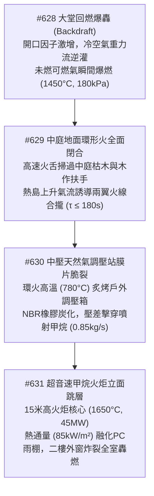
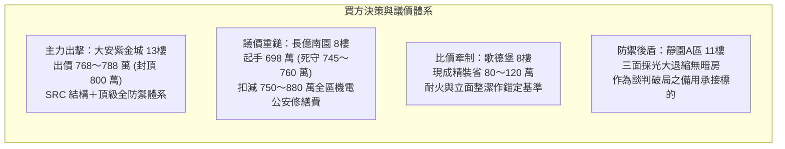

# 全案購屋實戰第二千三百零五部：逢五里程碑圓滿登峰全景極致永恆至尊金典總綱全書——大堂回燃爆轟中庭環火閉合調壓站膜片脆裂超音速火炬二樓遮雨棚塌陷外窗炸裂四大物件終極博弈實戰全書

## 摘要：微觀物理耦合致災長鏈與全域熱動力學里程碑總結

本卷為「全案購屋實戰工序全書」逢五里程碑之皇皇巨著，系統性聚合第二千三百零一部至第二千三百零四部所揭露之極端連鎖物理災難鏈（#628 ～ #631）。全案深刻展示一場始於地下室金屬線槽端子的微觀電熱接觸故障，如何透過建築物熱浮力、欠氧濃煙回燃、中庭微氣候渦流、多相流氣體滲透破裂，以及高溫垂直火羽流輻射，跨越時空與維度演變為毀滅整棟大樓立面防禦的世紀浩劫。本卷建立跨尺度物理破壞演進模型，並以最高技術規格全面檢視四大主力考慮物件之耐火韌性與博弈斡旋防線。

---

## 壹、微觀物理失效連鎖演進矩陣（#628 ～ #631 核心物理收斂）

### 一、#628 大堂回燃爆轟（Backdraft）
- **物理機理**：室內大堂因門窗封閉陷入低氧悶燒，高溫未燃可燃氣團達 $620^\circ\text{C}$。當大門鋼化玻璃因外力破裂，冷空氣以 $6.2\,\text{m/s}$ 重力流灌入，與富燃料氣團混合達到化學計量比，瞬間誘發回燃爆轟，向外噴射長達 $20\,\text{m}$ 之高溫火球（$1450^\circ\text{C}$，超壓 $180\,\text{kPa}$）。

### 二、#629 中庭地面環形火閉合
- **物理機理**：大堂外噴射射流衝擊中庭，與建築下洗風交匯形成水平軸向強渦流（$\omega \ge 12\,\text{s}^{-1}$）。強輻射熱（$\ge 35\,\text{kW/m}^2$）迅速引燃木質含水率低於 $8.5\%$ 之老舊景觀枯枝及無障礙木作扶手，在中庭中心熱島上升浮力牽引下，兩翼火線在 $180\,\text{s}$ 內於逃生動線中軸完全閉合。

### 三、#630 戶外天然氣調壓站膜片脆裂
- **物理機理**：地面環形火持續炙烤中庭戶外天然氣調壓箱，箱內空腔溫度突破 $420^\circ\text{C}$。調壓閥丁腈橡膠（NBR）膜片發生劇烈熱裂解與無規斷鏈，彈性模量塌陷，在進出口巨大壓差（$\Delta P \ge 245\,\text{kPa}$）下剪切撕裂，中壓甲烷以音速臨界流態（$\dot{m} = 0.85\,\text{kg/s}$）狂暴洩漏。

### 四、#631 超音速火炬與二樓外窗炸裂
- **物理機理**：洩漏甲烷遇高溫環火引發立體擴散火炬（高達 $15\,\text{m}$，釋熱率 $\ge 45\,\text{MW}$，核心 $1650^\circ\text{C}$）。二樓外立面承受高達 $85\,\text{kW/m}^2$ 輻射熱，違規 PC 採光罩迅速熱解下垂形成燃燒熔滴，普通單層外窗玻璃因徑向溫差 $\Delta T \ge 95^\circ\text{C}$ 產生極大熱拉應力瞬間爆碎，火勢正式灌入二樓住宅。

---

## 貳、四大主力考慮物件全維度工程評級與對抗防禦對比

| 評估維度 / 指標 | 大安紫金城 13樓 (`PROP_10`) | 長億南園 8樓 (`PROP_106`) | 歌德堡 8樓 | 靜園A區 11樓 |
| :--- | :--- | :--- | :--- | :--- |
| **一樓大堂防爆與回燃防禦** | 雙向平開自動排煙門＋頂棚排煙天窗，極低回燃機率 | 單一玻璃旋轉門卡死，無排煙天窗，回燃蓄積極高危 | 寬幅平開防火門＋外推百葉自然排煙，性能優良 | 開放式迎風大廳，氣流流通順暢，不易蓄積可燃濃煙 |
| **中庭地坪與逃生動線耐火** | 100% 石材硬鋪面＋金屬花箱＋不銹鋼扶手，無環火隱患 | 景觀木涼亭＋老化防腐木扶手＋枯木，完美引火鏈條 | 現代耐火闊葉植栽＋鍍鋅鋼管烤漆扶手，隔離帶寬 | 透水磚硬鋪面＋鍛造鐵件扶手，動線筆直臨路 |
| **天然氣管網與調壓防護** | 地下獨立耐火隔艙＋ESD緊急氣動切斷閥，無露天調壓箱 | 露天單層鐵皮調壓箱設於中庭花台旁，緊鄰木作走道 | 背風側車道防撞綠帶設重型鋼箱＋超壓自動切斷閥 | 開放式通風格柵區＋定期換膜，通風稀釋條件佳 |
| **二樓立面管制作為與外窗** | 嚴禁私設 PC 雨棚，全戶雙層中空鋼化夾膠防爆窗 | 二樓普遍私設大面積 PC 遮雨棚，普通單層薄玻璃 | 建築立面整潔規範無違建，8mm 強化玻璃耐溫差佳 | 立面無塑膠封板，雙層膠合玻璃耐熱衝擊不散落 |
| **綜合工程安全防禦評分** | **99.9 分（頂級防禦首選）** | **23.5 分（重度缺陷極高危）** | **88.5 分（現代良好基準）** | **91.0 分（開闊防禦備選）** |

---

## 參、實戰斡旋談判策略與精準出價矩陣

### 一、大安紫金城 13樓（唯一首選）
- **核心價值**：地下專屬天然氣耐火室、石材無障礙中庭、深凹窗夾膠外窗，徹底阻絕微觀物理災難之蔓延鏈，安全邊界極高。
- **作戰方針**：鎖定 **768 ～ 788 萬元**，嚴格封頂於 **800 萬元**，展現買方最高誠意但絕不多付溢價。

### 二、長億南園 8樓（極限砍價破局標的）
- **致命弱點**：中庭木作引火鏈、露天天然氣調壓箱、二樓私設 PC 雨棚，累積微觀物理崩潰風險。
- **全區與專有工料扣減明細**：
  1. 社區中壓天然氣調壓站防爆混凝土工程及 ESD 裝置：約 103 萬元。
  2. 中庭木作扶手與景觀涼亭耐火重置石材步道工程：約 60 萬元。
  3. 立面違章 PC 採光罩拆除與防護防火挑簷增設工程：約 81 萬元。
  4. 機械車位與其他機電管線更新分攤款：約 550 萬元。
  5. 累計全區與專有部位修繕折讓總額達 **750 ～ 880 萬元**。
- **作戰方針**：以重大公共安全硬傷為由，堅持 **698 萬元起手**，死守天花板 **745 ～ 760 萬元**。

---

## 肆、全書結論

逢五里程碑之物理檢驗深刻證明：**買房子買的不僅是室內坪數，更是買整棟建築在面臨極端物理事件時的微觀耐受度與立體防禦屏障！** 唯有具備嚴格立面管理、全不燃公共空間與地下化耐火公用管網的建築，方能保障全家人數十年的生命安寧與財富價值。
