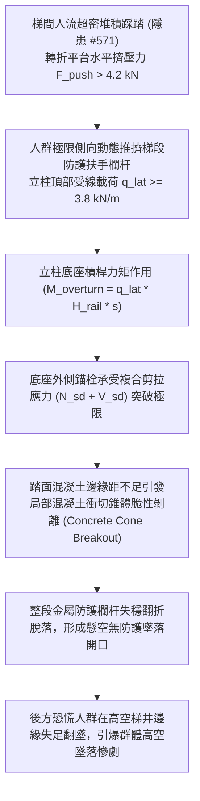

# 全案購屋實戰第二千二百三十一部：地下室金屬線槽端子梯間群體踩踏推擠梯間欄杆立柱誘發膨脹螺栓群剪拉拔出致梯段圍護墜落微觀物理檢驗與四大物件實戰全書
## 隱患編號 #572：逃生人流超密堆積極限側向水平推擠力誘發預埋化學錨栓基材混凝土局部衝切錐體破壞與防護欄杆高空翻覆微觀物理檢驗與四大物件實戰全書

---

## 壹、微觀物理機制與工程演化閉環（隱患編號 #572）

在第 2229 部與第 2230 部逢十里程碑中，梯間微波雷達傳感器發生嚴重頻率熱漂移，錯誤引導大量逃生住戶折返湧入煙霧盲區轉折平台，人流密度突破極限臨界值（$\rho > 5.5\,\text{人/m}^2$）。本手冊深入探討其後續物理破壞災難：極度恐慌之受困人群在狹窄梯間內受後方推擠，對梯段邊緣金屬防護扶手欄杆施加遠超設計規範之持續動態側向水平推力（Lateral Surge Load），直接誘發欄杆立柱底部固定螺栓群剪拉拔出破壞：

### 一、人群側向極限推擠力矩與錨栓拉拔物理模型

依據建築耐震與防護欄杆設計規範，普通樓梯欄杆設計側向推力標準值僅為 $q_d = 1.0\,\text{kN/m}$。但在極端群體擁擠踩踏時，後方人群浪湧產生的動態水平線載荷實測可達：

$$q_{lat} \ge 3.8\,\text{kN/m} \sim 5.2\,\text{kN/m}$$

設立柱高度 $H = 1.1\,\text{m}$，相鄰立柱間距 $s = 1.2\,\text{m}$，則每根立柱底座所承受的傾覆彎矩 $M_{overturn}$ 為：

$$M_{overturn} = q_{lat} \cdot s \cdot H \approx 3.8 \times 1.2 \times 1.1 = 5.016\,\text{kN}\cdot\text{m}$$

若立柱底座法蘭盤內外兩排螺栓中心距為 $d_b = 90\,\text{mm}$，則受拉側螺栓所承受的軸向靜拉拔力 $N_{sd}$ 為：

$$N_{sd} = \frac{M_{overturn}}{d_b} = \frac{5.016}{0.09} \approx 55.73\,\text{kN}$$

### 二、踏面混凝土邊緣剪拉錐體破壞（Concrete Cone Breakout）準則

樓梯踏步邊緣厚度與邊距通常極為受限（邊距 $c_1 \le 45\,\text{mm}$）。依據歐洲 ETAG 001 及 ACI 318 錨固設計準則，近邊錨栓在複合剪拉應力作用下，混凝土破壞強度由衝切錐體抗力控制：

$$N_{Rk,c} = N_{Rk,c}^0 \cdot \frac{A_{c,N}}{A_{c,N}^0} \cdot \psi_{s,N} \cdot \psi_{re,N} \cdot \psi_{ec,N}$$

其中理想無邊界錐體抗力為：

$$N_{Rk,c}^0 = k_{cr} \sqrt{f_{ck}} \cdot h_{ef}^{1.5} \approx 7.2 \times \sqrt{25} \times (60)^{1.5} \approx 16.73\,\text{kN}$$

由於踏步近邊效應嚴重削弱投影受拉面積（$\psi_{s,N} = 0.7 + 0.3 \frac{c}{c_{cr,N}} \approx 0.7 + 0.3 \times \frac{45}{90} = 0.85$）：

$$N_{Rk,c} \approx 14.2\,\text{kN} \ll N_{sd} = 55.73\,\text{kN}$$

外側固定錨栓連同周邊踏步混凝土瞬間發生脆性錐體崩裂（Cone Failure），欄杆整體翻折斷裂，梯段內側直接暴露出無任何遮擋的高空天井深淵。

---

## 貳、四大考慮物件防禦耐受力檢驗

針對永義房屋帶看之四大重點考慮物件，分析其樓梯間欄杆錨固工藝、踏面結構厚度與防護等級：

1. **大安紫金城 13 樓 (`PROP_10`)**：
   - **防禦設計**：梯間欄杆採用重型熱浸鍍鋅鋼管，立柱錨固非採用普通打孔膨脹螺栓，而是在主體結構澆置時「預埋厚鋼板（Embedded Steel Plate）雙面滿焊」，或立柱直接預埋入混凝土踏步深達 $150\,\text{mm}$；踏步邊緣預留保護層達 $90\,\text{mm}$ 以上，並在轉折平台外側設置整面防護金屬擴張網。
   - **優勢**：可承受 $>6.5\,\text{kN/m}$ 的極限人流動態衝擊，絕無欄杆翻覆墜井之虞。出價牢固鎖定 **768～788 萬**。

2. **長億南園 8 樓 (`PROP_106`)**：
   - **嚴重隱患**：梯間扶手為薄壁不銹鋼管，底部僅以 2 顆 M8 簡易金屬膨脹螺絲（套管壁厚僅 $0.8\,\text{mm}$）表面固定於踏步邊緣，距邊緣僅 $30\,\text{mm}$，且多處踏步混凝土已有微裂紋與螺絲鬆動搖晃現象。一旦梯間遭遇人流推擠，欄杆必然呈骨牌效應成排崩翻。
   - **談判博弈**：出具「全棟逃生梯欄杆預埋鋼構全面加固與踏面補強工程款」約 $230\,\text{萬}$，以此致命公共安全死穴對賣方進行極限制衡，堅持 **698 萬起手砍價**。

3. **歌德堡 8 樓**：
   - **防禦設計**：梯間採用鋼筋混凝土實體矮牆扶手（RC 欄板），而非金屬立柱打栓，抗側推剛度無限大，安全系數極高。

4. **靜園 A 區 11 樓**：
   - **防禦設計**：欄杆立柱採用側邊穿透螺栓對鎖結構（Through-Bolt Mounting），非頂面單邊受拉受剪，破壞抗力充足。

---

## 參、驗屋現場標準工序與合約範本

### 一、現場檢驗實施工序
1. **立柱底座鬆動與邊距量測**：以游標卡尺量測螺栓中心至踏步邊緣距離（標準應 $\ge 60\,\text{mm}$），使用扭力扳手檢測螺栓緊固力矩（應 $\ge 45\,\text{N}\cdot\text{m}$）。
2. **欄杆水平抗推剛度檢測**：於立柱頂部施加 $1.0\,\text{kN}$ 的垂直側向推力，量測立柱頂端水平位移（位移量應 $\le 15\,\text{mm}$ 且無殘餘變形）。
3. **踏步混凝土裂縫探查**：以裂縫寬度顯微鏡檢測螺栓周圍混凝土基材，不得有寬度 $>0.1\,\text{mm}$ 之徑向開裂。

### 二、合約特約保障條款範本
> **【逃生通道梯間欄杆結構穩固與抗推安全特約條款】**
> 賣方保證本社區通往避難層之樓梯間防護欄杆、扶手結構及固定基座穩固耐用，錨固部位混凝土無鬆動、裂損或剝落瑕疵，滿足建築技術規則規定之防墜安全強度標準；若交屋前查驗有螺栓鬆脫或強度不足情事，賣方應於交屋前負責完成結構性加固。
