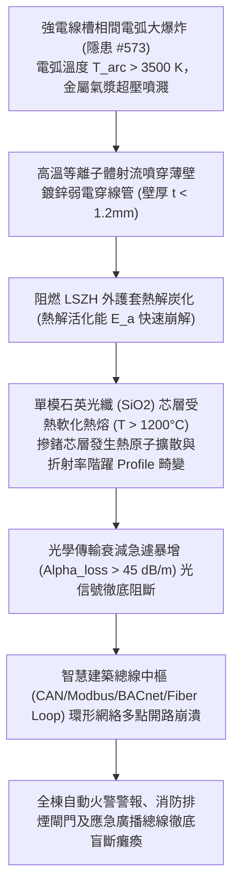

# 全案購屋實戰第二千二百三十三部：地下室金屬線槽端子電氣豎井短路電弧高溫誘發鄰近弱電智慧消防光纖熱融斷致全棟火警連動中樞徹底盲斷微觀物理檢驗與四大物件實戰全書
## 隱患編號 #574：強電線槽金屬電弧噴濺高溫氣漿 (T_arc > 3500K) 熔穿弱電金屬穿線管誘發單模石英光纖芯層熱熔擴散與全區消防信號總線硬性中斷微觀物理檢驗與四大物件實戰全書

---

## 壹、微觀物理機制與工程演化閉環（隱患編號 #574）

在第 2232 部中，高空欄杆砸斷 PVC 雨水立管引發瀑布沖刷，造成強電線槽三相相間金屬電弧短路大爆炸（$T_{arc} > 3500\,\text{K}$）。本手冊深入探討其後續物理破壞災難：電弧放電引發的金屬蒸氣等離子體氣漿與超高溫熱輻射射流，直接衝擊鄰近未受實體 RC 隔牆保護之弱電消防通信線槽與光纖金屬穿線管，造成單模石英光纖（Single Mode Fiber, SMF）內部二氧化矽（$\text{SiO}_2$）芯層非晶態玻璃轉化及光熱熔斷：

### 一、電弧熱等離子體傳熱穿透金屬穿線管物理模型

電弧產生之瞬態能量通量 $q_{arc}''$ 可達 $10^7 \sim 10^8\,\text{W/m}^2$。薄壁鍍鋅弱電鋼管（外徑 $D = 25\,\text{mm}$，厚度 $t = 1.2\,\text{mm}$）之瞬態熱傳導滿足一維非定常導熱方程：

$$\rho C_p \frac{\partial T}{\partial t} = k \frac{\partial^2 T}{\partial r^2}$$

在電弧噴濺持續時間 $\Delta t = 0.25\,\text{s}$ 內，管壁外側迅速熔穿（鍍鋅層沸點 $907^\circ\text{C}$，碳鋼熔點 $1538^\circ\text{C}$），高溫熱量直接穿透至內部光纜外護套。

低煙無鹵（LSZH）護套聚合物在 $T > 380^\circ\text{C}$ 下迅速發生高分子鍵熱解斷裂，釋放易燃揮發分，內部緩衝層（Aramid Yarn / Kevlar）在 $T > 500^\circ\text{C}$ 發生炭化收縮，保護結構瞬間瓦解。

### 二、石英玻璃光纖芯層熱熔擴散與光衰減準則

光纖芯層材料為高純度摻鍺二氧化矽（$\text{SiO}_2\text{-GeO}_2$），包層為純 $\text{SiO}_2$。當環境溫度上升至玻璃轉化溫度 $T_g \approx 1175^\circ\text{C} \sim 1250^\circ\text{C}$ 時，石英晶格結構發生軟化流動，摻雜鍺原子（$\text{Ge}$）在包層邊界發生高溫原子自擴散：

$$D_{Ge}(T) = D_0 \exp\left( -\frac{Q_d}{R T} \right)$$

擴散導致芯層邊界折射率差 $\Delta n = n_1 - n_2$ 迅速降解為零，全反射導模傳輸條件被徹底破壞。光傳輸損耗 $\alpha_{loss}$ 與彎曲熱應力微裂紋散射損耗耦合：

$$\alpha_{loss} = \alpha_{Rayleigh} + \alpha_{defect} + \alpha_{thermal} \ge 45\,\text{dB/m}$$

原設計信號衰減預算（Link Margin）僅為 $15\,\text{dB} \sim 20\,\text{dB}$，在斷裂或熔融點處信號損耗瞬間達到無窮大（Optical Open Circuit），大樓消防環形光網（Redundant Optical Ring）兩端同時中斷，火災連動控制信號全面失效。

---

## 貳、四大考慮物件防禦耐受力檢驗

針對四大重點考慮物件之弱電消防光網路由、穿線保護及水電共井配置進行工程檢驗：

1. **大安紫金城 13 樓 (`PROP_10`)**：
   - **防禦設計**：強電豎井與弱電消防通信豎井完全獨立分設，實體 RC 隔牆厚度達 $150\,\text{mm}$，物理間距大於 $3.5\,\text{m}$；弱電光纜採用重型金屬厚壁螺紋鋼管暗敷（壁厚 $t = 2.8\,\text{mm}$），並配備耐火陶瓷化矽橡膠防火鎧裝光纜（耐溫 $1000^\circ\text{C}$ 持續 180 分鐘）；光纖網絡採不同物理路由的雙環網備援（Dual-Ring Topology）。
   - **優勢**：強電電弧完全無法波及弱電消防中樞，火警信號鏈路穩如泰山。出價堅決鎖定 **768～788 萬**。

2. **長億南園 8 樓 (`PROP_106`)**：
   - **嚴重隱患**：弱電消防通信線路、光纖與 380V 動力強電電纜同擠在一個未分倉之狹小豎井中，弱電採用薄壁穿線金屬蛇皮軟管（甚至局部外露無穿管）；消防總線採單一星狀拓撲（Single Star），無任何環網備援。一旦強電短路電弧爆發，弱電消防光纜首當其衝被熔斷，全棟瞬間陷入「火警啞巴、排煙失聰」的徹底盲斷狀態。
   - **談判博弈**：出具「弱電消防獨立豎井開闢、耐火鎧裝光網重置與雙環網改造工程估價單」約 $290\,\text{萬}$，列為不可妥協的重大折價項目，持續堅守 **698 萬起手砍價**。

3. **歌德堡 8 樓**：
   - **防禦設計**：弱電管線配置專用密封金屬線槽，線槽表面塗布厚型防火膨脹塗料，且與強電線槽保持 $300\,\text{mm}$ 實體空氣間隙，具備良好抗熱衝擊能力。

4. **靜園 A 區 11 樓**：
   - **防禦設計**：戶數單純，消防信號採用傳統耐熱阻燃雙絞線穿厚壁鍍鋅鋼管敷設，非脆弱光纖系統，熱耐受性可靠。

---

## 參、驗屋現場標準工序與合約範本

### 一、現場檢驗實施工序
1. **強弱電豎井物理間距核查**：檢視強弱電線槽是否處於同一豎井內，同井敷設時實體間距應 $\ge 300\,\text{mm}$ 或具備不燃性實體隔板。
2. **弱電穿線管材質與壁厚檢查**：檢測弱電金屬管是否為螺紋厚壁水煤氣鋼管（厚度應 $\ge 2.0\,\text{mm}$），嚴禁採用易熔穿之金屬軟管裸露。
3. **光纖時域反射儀（OTDR）鏈路巡檢**：使用 OTDR 測試大樓消防主幹光纖之衰減曲線與接頭損耗，確認全線無微彎高損耗熱點（損耗應 $\le 0.3\,\text{dB/km}$）。

### 二、合約特約保障條款範本
> **【弱電智慧消防通信總線與強電實體隔離保障特約條款】**
> 賣方保證本社區弱電智慧消防監控、光纖傳輸線路及火警總線系統運作正常，其路由與強電幹線具備法定實體防火隔離，穿線防護金屬管壁完整無破損；無因強電電弧噴濺或短路高溫導致火災聯動信號癱瘓盲斷之潛在重大公安瑕疵。
