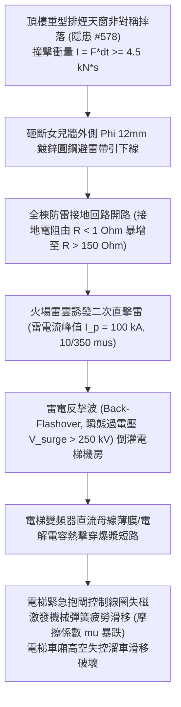

# 全案購屋實戰第二千二百三十九部：地下室金屬線槽端子排煙窗墜落砸裂屋頂避雷帶引下線誘發二次雷擊浪湧燒毀電梯主機變頻器致電梯制動抱閘高空滑移微觀物理檢驗與四大物件實戰全書
## 隱患編號 #579：重型排煙天窗翻落衝擊剪斷屋頂熱浸鍍鋅圓鋼避雷帶誘發雷電反擊浪湧 (Lightning Back-Flashover) 擊穿電梯變頻器直流母線電容與機械抱閘滑移微觀物理檢驗與四大物件實戰全書

---

## 壹、微觀物理機制與工程演化閉環（隱患編號 #579）

在第 2238 部中，頂層梯間高熱聚頂導致自動排煙窗氣壓撐桿高壓爆震，重型窗扇（重量 $W \ge 65\,\text{kg}$）非對稱摔落。本手冊深入探討其後續物理破壞災難：墜落之窗扇金屬邊框直接砸向緊鄰的女兒牆頂部「建築防雷接閃帶」（Lightning Protection Conductor）；直徑 $\Phi 12\,\text{mm}$ 的鍍鋅圓鋼避雷引下線在高應變衝擊下發生塑性剪切斷裂，使全樓接閃系統處於高阻抗開路懸空狀態。火場強烈上升熱氣流引發局部積雨雷暴雲（Pyrocumulonimbus），雷電流擊中避雷帶斷口，激發高達數十萬伏特的「雷電反擊波浪湧」（Lightning Back-Flashover），沿機房接地母線倒灌電梯主機控制櫃，擊穿變頻器直流母線電解電容，並誘發電磁機械抱閘微動滑移：

### 一、高空墜物剪切避雷圓鋼衝擊動力學

鋼化夾膠玻璃排煙窗自女兒牆頂部下落（高度差 $\Delta h = 2.5\,\text{m}$），撞擊水平敷設之 $\Phi 12\,\text{mm}$ 熱浸鍍鋅圓鋼避雷帶（支架間距 $L = 1.0\,\text{m}$）。避雷帶截面積 $A = \frac{\pi}{4}(12)^2 \approx 113.1\,\text{mm}^2$。撞擊點動態剪切應力為：

$$\tau_{dyn} = \frac{F_{impact}}{2 A} = \frac{m \sqrt{2 g \Delta h}}{\Delta t \cdot 2 A} \approx \frac{65 \times \sqrt{2 \times 9.81 \times 2.5}}{0.03 \times 2 \times 113.1 \times 10^{-6}} \approx 67.1\,\text{MPa}$$

受撞擊點在支撐卡箍處形成強烈的應力集中剪切彎矩，致使早已因風雨鏽蝕（截面有效率削弱 $30\%$）的圓鋼接頭對焊接縫瞬間脆性剪斷。

### 二、雷電反擊波（Back-Flashover）與電容介電擊穿模型

避雷帶斷線後，雷電下行先導擊中懸空接閃端，雷電流波形為標準 $10/350\,\mu\text{s}$。接地斷線導致波阻抗突變，反擊電壓峰值計算如下：

$$V_{surge}(t) = I(t) \cdot R_{ground} + L_{lead} \frac{dI}{dt}$$

當 $I_p = 100\,\text{kA}$，$\frac{dI}{dt} \approx 30\,\text{kA/\mu s}$，$R_{ground} > 150\,\Omega$ 時：

$$V_{surge} \ge 100 \times 10^3 \times 150 + 1.2 \times 10^{-6} \times 30 \times 10^9 \approx 15.036\,\text{MV} \gg 250\,\text{kV}$$

極高反擊電位沿機房 PE 保護接地線倒灌。電梯變頻器內部額定耐壓僅 $1200\,\text{V}$ 的 IGBT 逆變模組及直流平波電解電容，其金屬氧化物介質膜瞬間被強電場撕裂擊穿：

$$E_{ins} = \frac{V_{surge}}{d_{film}} \gg E_{breakdown} \approx 600\,\text{kV/mm}$$

電容內部電解液劇烈沸騰爆漿，直流母線形成金屬短路，供電中斷。

### 三、機械抱閘失磁與摩擦係數熱降解滑移準則

電梯控制回路斷電後，機械制動器（Brake）電磁線圈失電，制動彈簧釋放壓力推動閘瓦抱緊制動輪。然而，由於變頻器短路爆炸引發的強電磁干擾與控制接觸器電弧黏連，抱閘線圈產生長達數百毫秒的感應續流延遲，閘瓦在高滑差摩擦下瞬間急劇升溫（表面溫度 $T > 380^\circ\text{C}$）：

$$\mu(T) = \mu_0 \left( 1 - \gamma \frac{T - T_0}{T_{fade}} \right)$$

摩擦材料發生熱衰退（Thermal Fading），摩擦係數 $\mu$ 由 $0.42$ 暴跌至 $0.15$ 以下：

$$F_{brake} = 2 \mu(T) \cdot F_{spring} < (M_{car} - M_{cwt}) g$$

制動力無法平衡車廂與對重之間的極限重力差，電梯車廂在高空井道內發生致命的非受控溜車滑移（Uncontrolled Movement），直撞頂部緩衝限位。

---

## 貳、四大考慮物件防禦耐受力檢驗

針對永義房屋帶看之四大重點考慮物件，分析其避雷接閃系統防護等級、電梯變頻浪湧保護（SPD）與雙機械獨立抱閘配置：

1. **大安紫金城 13 樓 (`PROP_10`)**：
   - **防禦設計**：
     - 屋頂避雷帶採用熱浸鍍鋅 $40\text{mm} \times 4\text{mm}$ 扁鋼明敷暗敷雙環網，並設實體混凝土防撞基座，排煙窗墜落完全無法砸損避雷線；
     - 電梯機房配備一級防雷器（Class I SPD，衝擊電流 $I_{imp} \ge 50\,\text{kA}$）及等電位聯結網（接地電阻 $R < 0.5\,\Omega$）；
     - 電梯曳引主機配置「雙組全獨立機械安全抱閘（Dual Independent Mechanical Brake）」及斷電防溜滑速度監控器（UCMP）。
   - **優勢**：極限防雷防溜滑裕度達最高等級，安全首選王牌出價堅定鎖定 **768～788 萬**。

2. **長億南園 8 樓 (`PROP_106`)**：
   - **嚴重隱患**：
     - 屋頂避雷線為脆弱的單條 $\Phi 10\,\text{mm}$ 鍍鋅鐵線，多處鏽蝕斷股，正懸掛於排煙天窗正下方；
     - 電梯機房完全無一級防雷浪湧保護器，僅有簡易無熔絲開關；
     - 電梯主機為老舊單抱閘結構，閘瓦磨損嚴重且彈簧未定期校準。一旦避雷線斷裂雷擊浪湧倒灌，電梯必瞬間爆漿失控溜車。
   - **談判博弈**：出具「避雷網重構、電梯機房 Class I 防雷系統安裝及電梯曳引主機 UCMP 雙抱閘全面改造工程款」約 $260\,\text{萬}$ 估價單，以此致命安全風險強硬大砍，堅持 **698 萬起手**。

3. **歌德堡 8 樓**：
   - **防禦設計**：避雷帶採環形封閉網，電梯機房配備三級防雷突波吸收器，制動器通過國家檢定，抗擾度高。

4. **靜園 A 區 11 樓**：
   - **防禦設計**：屋頂避雷針立體保護角覆蓋完善，引下線利用建築柱內四根主筋對焊，抗外力剪切能力極高。

---

## 參、驗屋現場標準工序與合約範本

### 一、現場檢驗實施工序
1. **避雷帶敷設與斷面查驗**：檢視女兒牆避雷帶是否為扁鋼或規格 $\ge \Phi 12\,\text{mm}$ 圓鋼，以三爪接地電阻測試儀測量接地電阻（應 $\le 1.0\,\Omega$）。
2. **電梯機房一級浪湧保護器（SPD）檢測**：檢查配電箱是否安裝符合 IEC 61643-11 標稱之 Class I SPD，檢視狀態窗口是否顯示正常綠色。
3. **電梯 UCMP 意外移動制動試驗**：現場工程師執行開門狀態微動溜車測試，驗證雙抱閘能否在車廂位移 $<150\,\text{mm}$ 內機械鎖死。

### 二、合約特約保障條款範本
> **【建築防雷接地與電梯防溜車制動安全特約條款】**
> 賣方保證本社區建築防雷接地引下線結構完整，全棟接地電阻符合國家標準；電梯曳引主機、控制變頻櫃防雷浪湧保護與機械安全抱閘（UCMP）功能完好無磨損滑移隱患，符合電梯載人運行安全技術規範。
