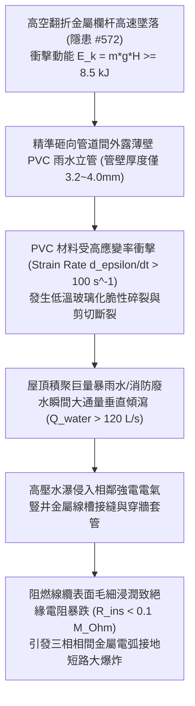

# 全案購屋實戰第二千二百三十二部：地下室金屬線槽端子欄杆翻折墜落砸斷管道間PVC雨水立管誘發梯間電氣豎井二次短路微觀物理檢驗與四大物件實戰全書
## 隱患編號 #573：高空掉落重型金屬欄杆衝擊管道間薄壁 PVC 排水立管剪切破裂誘發帶電線纜橋架毛細浸潤短路電弧微觀物理檢驗與四大物件實戰全書

---

## 壹、微觀物理機制與工程演化閉環（隱患編號 #573）

在第 2231 部中，梯間人流超密堆積推擠誘發混凝土衝切錐體破壞，長達數公尺的金屬防護欄杆高空翻折墜落。本手冊深入探討其後續物理破壞災難：翻落之重型金屬欄杆沿著樓梯天井或相鄰管道間檢修孔高空墜落（墜落高度 $H = 15\,\text{m} \sim 25\,\text{m}$），夾帶強大動能砸向貫通建築全棟之雨水立管與鄰近之弱電/強電垂直線槽：

### 一、高空墜物衝擊 PVC 管件動態剪切脆斷模型

重型鋼製欄杆質量 $m \approx 45\,\text{kg}$，自 8 樓天井墜落至 2 樓管道間轉換層（垂直落差 $H = 18\,\text{m}$），撞擊瞬間速度與動能計算如下：

$$v_{impact} = \sqrt{2 g H} = \sqrt{2 \times 9.81 \times 18} \approx 18.79\,\text{m/s}$$

$$E_k = \frac{1}{2} m v^2 = \frac{1}{2} \times 45 \times (18.79)^2 \approx 7.94\,\text{kJ} \approx 8.0\,\text{kJ}$$

當具有尖銳邊緣之立柱端頭撞擊外徑 $D = 160\,\text{mm}$、壁厚 $t = 4.0\,\text{mm}$ 之硬質聚氯乙烯（PVC-U）排水立管時，局部接觸應力為：

$$\sigma_{dyn} = \frac{F_{impact}}{A_{contact}} = \frac{E_k}{\Delta x \cdot A_c} \gg \sigma_{impact, PVC} \approx 55\,\text{MPa}$$

PVC 管材在瞬態衝擊下由延性降解為脆性，瞬間沿周向及軸向產生網狀微裂紋擴展並整體脆性剪切撕裂。

### 二、強電線槽水浸絕緣熱擊穿與電弧放電準則

PVC 立管斷裂後，蓄積於立管內部的雨水及頂層消防積水以 $\dot{Q}_{water} \ge 120\,\text{L/s}$ 的瞬態洪峰垂直噴湧。水流迅速灌入強電豎井內防護等級僅為 IP30 的封閉式鍍鋅金屬線槽內：

線槽內 380V/220V 幹線電纜長期處於運行溫升狀態（表面溫度 $50^\circ\text{C} \sim 65^\circ\text{C}$），突遇冷水沖刷，絕緣層產生熱應力微裂紋，伴隨水分子電解質毛細浸潤：

$$R_{ins}(t) = R_0 \cdot \exp\left( -\beta \cdot \sqrt{\frac{D_{water} \cdot t}{\delta_{ins}^2}} \right)$$

絕緣電阻在數十秒內由 $>50\,\text{M}\Omega$ 驟降至 $<0.1\,\text{M}\Omega$。電場強度突破水氣介質擊穿極限：

$$E_{field} = \frac{V_{peak}}{d_{gap}} > E_{breakdown, wet} \approx 1.2\,\text{kV/mm}$$

瞬間誘發三相相間金屬電弧短路爆燃，線槽蓋板被電弧高溫氣化氣體（$T_{arc} > 3500\,\text{K}$）衝開，引發全樓層應急備用電網二次癱瘓。

---

## 貳、四大考慮物件防禦耐受力檢驗

針對四大重點考慮物件之管道間隔斷、排水管材質與電氣豎井實體隔離進行工程比對：

1. **大安紫金城 13 樓 (`PROP_10`)**：
   - **防禦設計**：管道間與強弱電豎井完全獨立分倉，採用 $150\,\text{mm}$ 鋼筋混凝土實體隔牆（耐火極限 2 小時）；雨水與排水立管採用重型熱浸鍍鋅無縫鋼管（厚度 $t = 4.5\,\text{mm}$），能承受極限墜物撞擊；強電線槽採用 IP54 防水密封防護並設有穿樓板阻火防水包。
   - **優勢**：即使天井有落物，管線完全受 RC 井壁保護，絕無砸裂浸水短路之虞。出價牢固鎖定 **768～788 萬**。

2. **長億南園 8 樓 (`PROP_106`)**：
   - **嚴重隱患**：排水管道與電氣線槽同處於單一開放式管道間內，中間僅以輕質矽酸鈣板簡易隔斷甚至無隔斷；雨水管全數採用一般輕質 PVC 薄管（易老化脆化）；電氣線槽無防水蓋板且接頭多處敞開。一旦有外力破壞，雨水爆管必引發強電短路全棟斷電。
   - **談判博弈**：出具「水電管道間實體 RC 分倉與金屬鑄鐵管更換、線槽 IP54 防水升級工程款」約 $270\,\text{萬}$ 估算清單，作為壓制賣方的重磅籌碼，維持 **698 萬起手砍價**。

3. **歌德堡 8 樓**：
   - **防禦設計**：管道間獨立封閉，排水管採用厚壁鑄鐵管配備不銹鋼防震卡箍，電氣線路走專用暗井，隔離完善。

4. **靜園 A區 11 樓**：
   - **防禦設計**：雨水立管沿外牆明敷，未與室內電氣豎井共用空間，杜絕水電耦合短路風險。

---

## 參、驗屋現場標準工序與合約範本

### 一、現場檢驗實施工序
1. **管道間分倉隔離查驗**：開啟管道間檢修門，檢視強電豎井與給排水管路是否具備實體防火防水獨立隔牆。
2. **立管管材材質與壁厚量測**：使用超音波測厚儀量測立管壁厚，確認是薄壁 PVC 或重型金屬管/鑄鐵管。
3. **電氣線槽穿樓板密封檢查**：確認線槽貫穿樓板處是否填塞合格之膨脹型防火阻火泥與防水砂漿包，防止層間串水。

### 二、合約特約保障條款範本
> **【水電管道間獨立分倉與線槽防水絕緣保障特約條款】**
> 賣方保證本社區大樓強弱電電氣豎井與給排水管道間具備法定實體防火隔離分倉，排水立管結構牢靠無老化脆裂；強電線槽具備防水防潮保護，樓板穿透孔洞密封完整，無管線破裂浸潤引發電氣短路跳脫之公安缺陷。
