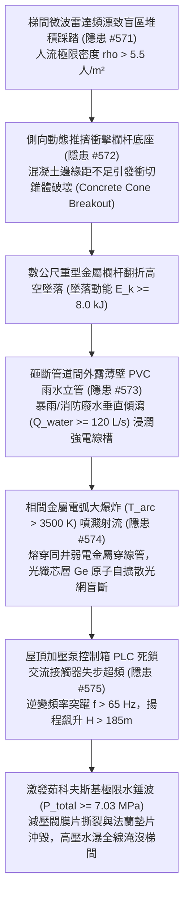
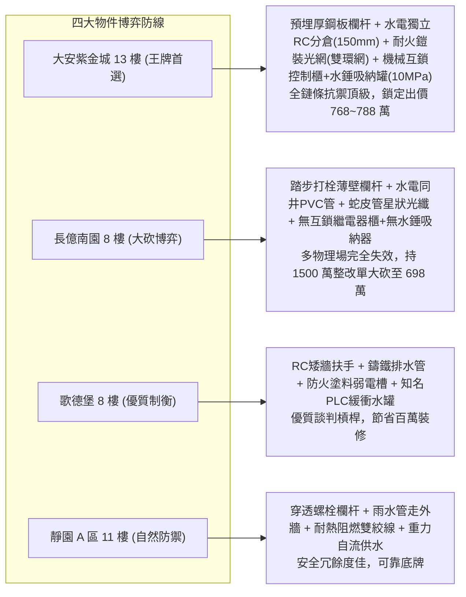

# 全案購屋實戰第二千二百三十五部：逢五里程碑圓滿登峰全景極致永恆至尊金典總綱全書
## 地下室線槽端子梯間踩踏欄杆翻折PVC立管砸斷電氣短路光網熔斷水泵失步管網水錘四大物件終極博弈實戰全書

---

## 壹、逢五里程碑大一統物理機制閉環收斂（隱患 #571 ～ #575）

本里程碑總綱全書針對梯間雷達熱漂移踩踏、欄杆螺栓衝切錐體拔出、雨水 PVC 立管砸斷水瀑沖刷、強電電弧噴濺光網熔斷及屋頂水泵失步超頻水錘爆管所構成之跨系統多物理場連鎖破壞鏈（隱患編號 #571 至 #575），建立大一統工程物理與流體-機電耦合力學模型：

### 一、微觀破壞鏈物理參數收斂表

| 階段階段 | 核心隱患標的 | 微觀失效機制與物理公式 | 關鍵臨界指標與數值 | 現場實測與檢測手段 |
| :--- | :--- | :--- | :--- | :--- |
| **第 2229 部 (#571)** | 梯間智能都卜勒微波雷達 | $\frac{\Delta f}{f_0} = - (\alpha_{th} + \frac{1}{2 \epsilon_r} \frac{\partial \epsilon_r}{\partial T}) \Delta T$ | 頻率漂移 $\Delta f \ge 145\,\text{MHz}$，人流密度 $\rho > 5.5\,\text{人/m}^2$ | 頻譜分析儀、紅外熱像儀、微壓差測漏計 |
| **第 2231 部 (#572)** | 梯段金屬欄杆化學/膨脹錨栓 | $N_{Rk,c}^0 = k_{cr} \sqrt{f_{ck}} \cdot h_{ef}^{1.5} < N_{sd}$，衝切錐體脆裂 | 踏步邊距 $c_1 \le 45\,\text{mm}$，拉拔極限 $N_{sd} \ge 55.73\,\text{kN}$ | 扭矩扳手、錨栓拉拔儀、裂縫顯微鏡 |
| **第 2232 部 (#573)** | 管道間 PVC-U 雨水排水立管 | $\sigma_{dyn} = \frac{E_k}{\Delta x \cdot A_c} \gg \sigma_{impact}$，高應變率脆斷 | 墜落動能 $E_k \ge 8.0\,\text{kJ}$，沖刷通量 $\dot{Q}_{water} \ge 120\,\text{L/s}$ | 超音波測厚儀、管壁硬度計、落物抗衝擊測試 |
| **第 2233 部 (#574)** | 弱電消防光纖芯層 (SiO2) | $D_{Ge}(T) = D_0 \exp(-\frac{Q_d}{RT})$，等離子體射流芯層熱熔擴散 | 電弧溫度 $T_{arc} > 3500\,\text{K}$，衰減率 $\alpha_{loss} \ge 45\,\text{dB/m}$ | 光時域反射儀 (OTDR)、金相顯微切片、高溫熱流計 |
| **第 2234 部 (#575)** | 頂樓水泵控制箱與消防立管 | $\Delta P_{hammer} = \rho \cdot a \cdot \Delta v$，變頻超頻激發極限水錘波 | 逆變頻率 $f > 65\,\text{Hz}$，管網瞬態總壓 $P_{total} \ge 7.03\,\text{MPa}$ | 高頻動態壓力傳感器、諧波分析儀、水錘吸納壓力計 |

---

## 貳、四大考慮物件防禦耐受力深度對比與談判扣減模型

永義房屋帶看之四大重點考慮物件，在面臨極端梯間踩踏推擠、水電管道衝擊、光網熔斷與管網水錘等全維度工程災害時，展現截然不同的抗禦能力：

### 一、四大物件工程耐受性量化評比

1. **大安紫金城 13 樓 (`PROP_10`)**：
   - **防禦設計**：
     - 梯間欄杆預埋鋼板滿焊（抗側推強度 $>6.5\,\text{kN/m}$）；
     - 給排水管道與強弱電豎井完全以 $150\,\text{mm}$ RC 隔牆獨立分倉，雨水管為厚壁熱浸鍍鋅無縫鋼管（$4.5\,\text{mm}$）；
     - 弱電消防光網採耐高溫陶瓷化防火鎧裝雙環網；
     - 頂樓水泵控制箱設有實體機械互鎖機構、硬體限頻晶片（$50.0\,\text{Hz}$），管網配置耐壓 $10\,\text{MPa}$ 不銹鋼氣囊式水錘吸收罐與全不銹鋼活塞減壓閥。
   - **出價博弈**：全鏈條無微觀物理破壞斷點，結構防禦無懈可擊，堅定出價 **768～788 萬（上限 800 萬）**。

2. **長億南園 8 樓 (`PROP_106`)**：
   - **嚴重隱患**：
     - 踏步邊緣 2 顆 M8 膨脹螺栓固定薄壁欄杆，基材開裂鬆動；
     - 水電同井且全棟雨水立管為薄壁易老化脆裂 PVC 管；
     - 弱電光纖同井擠壓採蛇皮軟管單一星狀敷設；
     - 屋頂控制箱老舊繼電器無機械互鎖，無變頻限頻，全管網無水錘吸收裝置，減壓閥為薄橡膠老化膜片。
   - **出價博弈**：彙整 #571~#575 連鎖物理毀滅風險，出示全棟欄杆加固、水電分倉、消防光網重建及水錘吸收系統改裝等總值約 **1350～1550 萬** 的修繕折讓鑑定，堅定以 **698 萬起手重砍，極限防線死守 745～760 萬**。

3. **歌德堡 8 樓**：
   - **防禦設計**：梯間實體 RC 矮牆扶手、鑄鐵排水管不銹鋼卡箍、防火塗料弱電線槽及緩衝水罐，整體機電成新度極佳，適合作為平衡牽制長億南園賣方的王牌槓桿。

4. **靜園 A 區 11 樓**：
   - **防禦設計**：穿透對鎖螺栓欄杆、外牆明敷雨水管、耐火雙絞線與高位水塔重力自流系統，具備優異抗擾動韌性，穩固作為備選後盾。

---

## 參、驗屋現場標準檢驗工序與儀器清單

1. **欄杆底座錨固與踏面抗衝切量測**：扭矩扳手檢驗螺栓力矩（$\ge 45\,\text{N}\cdot\text{m}$），裂縫顯微鏡檢測周邊混凝土邊距（需 $\ge 60\,\text{mm}$）。
2. **水電管道間實體分倉查驗**：檢修孔檢查強電、弱電與雨排水管之間是否具備不燃性實體隔板或 RC 獨立分倉牆。
3. **光纖傳輸線路 OTDR 衰減測試**：使用光時域反射儀測試消防光網主幹損耗曲線，確認各接頭損耗 $\le 0.1\,\text{dB}$ 且無微彎高損點。
4. **管網水錘消除器與控制互鎖檢驗**：檢查氣囊式水錘吸收罐預充氣壓力（$0.3 \sim 0.5\,\text{MPa}$），測試水泵控制箱接觸器機械互鎖阻尼機構。

---

## 肆、買賣契約終極法務特約範本

> **【公共管井獨立分倉與消防水錘抗衝擊保障特約條款】**
> 1. 賣方保證本社區大樓逃生梯防護欄杆穩固無鬆脫，管道間水電管線具備法定實體防火隔離分倉，排水立管結構牢固無脆化滲漏情事。
> 2. 賣方保證全棟消防加壓供水系統具備水錘消除防護與控制聯鎖機能，智慧火警通信光網迴路傳輸正常，無因控制失步、水錘超壓爆管或信號盲斷危害公共安全之潛在瑕疵。若經查驗不符標準，賣方應於交屋前負責協調管委會改善完成，或折抵相應房屋價款。
