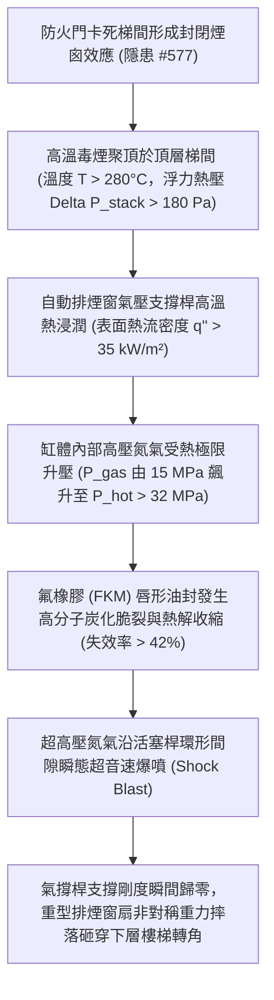

# 全案購屋實戰第二千二百三十八部：地下室金屬線槽端子防火門卡死毒煙悶頂高熱衝擊誘發梯間排煙窗氣壓支撐桿密封圈炭化爆裂致窗扇墜落微觀物理檢驗與四大物件實戰全書
## 隱患編號 #578：梯間垂直煙囪高熱聚頂 (T > 280°C) 誘發自動排煙窗氣動撐桿氟橡膠油封高溫炭化失效與氮氣高壓爆震微觀物理檢驗與四大物件實戰全書

---

## 壹、微觀物理機制與工程演化閉環（隱患編號 #578）

在第 2237 部中，梯間防火門因人群推撞產生鉸鏈剪切冷焊咬死（Galling Lockup），導致逃生動線絕對閉鎖，梯間形成致命的封閉式垂直煙囪效應（Stack Effect）。本手冊深入探討其後續物理破壞災難：地下室與中低樓層火災產生之高溫劇毒煙氣（$T \ge 280^\circ\text{C} \sim 350^\circ\text{C}$）沿著封閉豎井迅速向上蓄積並悶頂於頂樓梯間；頂層所配置之「自動消防自然排煙推窗系統」之氣壓支撐桿（Gas Spring Actuator），因承受劇烈高溫熱浸潤，內部高壓氮氣腔密封圈發生熱炭化破壞與氣動爆震，致使整面排煙窗扇結構失穩墜落：

### 一、封閉梯間煙囪浮力熱壓與頂層高熱聚頂熱力學

梯間垂直高度 $H \approx 45\,\text{m}$，當內部平均煙氣溫度 $T_{smoke} = 300^\circ\text{C} = 573\,\text{K}$，外部環境溫度 $T_0 = 25^\circ\text{C} = 298\,\text{K}$ 時，煙囪效應浮力熱壓 $\Delta P_{stack}$ 由流體靜力學推導：

$$\Delta P_{stack} = (\rho_0 - \rho_s) g H = \rho_0 g H \left( 1 - \frac{T_0}{T_s} \right) \approx 1.20 \times 9.81 \times 45 \times \left( 1 - \frac{298}{573} \right) \approx 254.4\,\text{Pa}$$

巨量熱煙在頂層形成高熱悶頂氣墊，局部熱氣層厚度迅速累積超過 $2.5\,\text{m}$，氣流對頂層外牆排煙窗產生極限熱輻射與對流換熱：

$$q_{total}'' = h_c (T_{smoke} - T_{surface}) + \epsilon \sigma (T_{smoke}^4 - T_{surface}^4) \ge 35\,\text{kW/m}^2$$

### 二、氣壓支撐桿等容升壓與密封圈熱炭化爆裂準則

自動排煙窗廣泛採用高壓氮氣撐桿（缸筒直徑 $D_c = 28\,\text{mm}$，桿徑 $d_r = 14\,\text{mm}$）。常溫下充氣壓力為 $P_0 = 15.0\,\text{MPa}$。根據理想氣體狀態方程，當缸體受熱至 $T_1 = 280^\circ\text{C} = 553\,\text{K}$ 時，缸內等容壓力劇增：

$$P_{hot} = P_0 \left( \frac{T_1}{T_0} \right) = 15.0 \times \left( \frac{553}{298} \right) \approx 27.84\,\text{MPa} \approx 28.0\,\text{MPa}$$

活塞桿端部的氟橡膠（FKM）密封圈長期耐溫極限僅為 $200^\circ\text{C}$。在高溫熱浸潤下，橡膠分子鏈發生熱氧交聯與降解炭化（Glass Transition Shift），硬度由邵氏 75A 暴增至 95A 以上，彈性模量完全喪失，徑向回彈率 $\Delta R_{seal}$ 跌破零點：

$$\sigma_{contact} < P_{hot}$$

高壓氮氣瞬間衝破密封唇口，形成微型氣相爆震（Jet Shock Wave），高壓氣體伴隨潤滑矽油噴射燃燒。失去氣壓支撐的重型中空鋼化玻璃排煙窗扇（重量 $W \ge 65\,\text{kg}$）失去雙邊平衡支撐，以非對稱角速度 $\omega$ 向內或向外摔落砸碎，不僅排煙功能全面喪失，更引發高空落物砸傷正於轉折平台掙扎逃生之人群。

---

## 貳、四大考慮物件防禦耐受力檢驗

針對永義房屋帶看之四大重點考慮物件，分析其梯間頂部自然排煙天窗結構、開窗驅動形式與抗高溫耐火等級：

1. **大安紫金城 13 樓 (`PROP_10`)**：
   - **防禦設計**：頂層排煙天窗採用重型「機械螺桿式電動開窗器（Linear Actuator with Stainless Steel Lead Screw）」，全金屬傳動齒輪箱，完全無任何易受高溫熱解之氣壓密封腔；開窗機具備耐高溫 $300^\circ\text{C}$ 持續 60 分鐘之消防排煙認證；窗扇外側配置物理防墜安全鉸鏈與重型鋼絲防墜繩（抗拉強度 $>12\,\text{kN}$）。
   - **優勢**：耐熱機構堅若磐石，排煙通道順暢排出高熱煙氣，出價堅定鎖定 **768～788 萬**。

2. **長億南園 8 樓 (`PROP_106`)**：
   - **嚴重隱患**：頂樓排煙窗為最廉價之單氣壓撐桿推窗（無電機、僅靠一根薄壁氣彈簧維持推開角度）；撐桿出廠已逾 15 年，外殼鏽蝕且無防墜鏈條；一旦高溫毒煙聚頂，氣壓桿密封圈必瞬間炭化爆噴，窗扇翻落墜毀。
   - **談判博弈**：出具「頂樓排煙天窗螺桿式電動開窗機改裝、消防連動電控箱與不銹鋼防墜鋼索工程款」約 $180\,\text{萬}$ 估算單，以此公共排煙重大隱患對屋主持續大砍，堅守 **698 萬起手**。

3. **歌德堡 8 樓**：
   - **防禦設計**：排煙窗配置機械鏈條式開窗器，具備手動機械應急拉索，抗熱變形性能佳。

4. **靜園 A 區 11 樓**：
   - **防禦設計**：梯間為開放式採光通風井結構，天然對流暢通，無煙氣高熱悶頂條件，安全性優良。

---

## 參、驗屋現場標準工序與合約範本

### 一、現場檢驗實施工序
1. **排煙開窗驅動機構查驗**：檢視排煙窗是採用金屬螺桿/鏈條驅動，或普通氣動氣彈簧，確認是否具備防熱爆認證標籤。
2. **防墜安全鋼絲繩規格量測**：檢查窗扇是否配備直徑 $\ge 4.0\,\text{mm}$ 的不銹鋼防墜鋼索及其錨固牢固度。
3. **高溫排煙手動緊急開窗拉索測試**：手動拉動距地面 $1.5\,\text{m}$ 處之機械排煙應急箱，檢測窗扇能否在 $10\,\text{秒}$ 內平順開啟至 $\ge 70^\circ$ 夾角。

### 二、合約特約保障條款範本
> **【頂樓安全梯間排煙天窗結構防墜與耐高溫特約條款】**
> 賣方保證本社區頂層逃生梯間排煙天窗、電動開窗機構及防墜安全保護設施運作正常，驅動機構符合建築消防排煙耐溫技術規範，無氣壓爆裂、窗扇失穩墜落或排煙斷絕情事。
