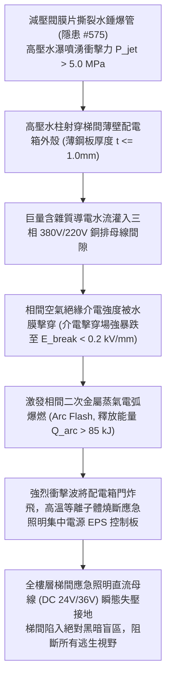

# 全案購屋實戰第二千二百三十六部：地下室金屬線槽端子水錘爆管巨量高壓水柱沖刷梯間配電分電箱誘發相間二次爆炸致全棟應急逃生照明全盲微觀物理檢驗與四大物件實戰全書
## 隱患編號 #576：管網水錘破裂高壓水瀑 (P > 5.0 MPa) 射穿梯間薄壁配電箱外殼誘發母排相間金屬蒸氣弧光爆燃與全樓應急照明直流母線瞬態崩潰微觀物理檢驗與四大物件實戰全書

---

## 壹、微觀物理機制與工程演化閉環（隱患編號 #576）

在第 2234 部與第 2235 部逢五里程碑中，頂樓加壓水泵失步超頻激發極限茹科夫斯基水錘波（管網瞬態總壓 $P_{total} \ge 7.03\,\text{MPa}$），減壓閥膜片與法蘭密封墊片瞬間爆裂。本手冊深入探討其後續物理破壞災難：自管道間噴湧而出之高速密集射流水束（射流衝擊壓力 $P_{jet} > 5.0\,\text{MPa}$），直接射穿位於梯間通道旁之樓層照明配電分電箱（Lighting Distribution Panel）；箱體內部防護等級不足（僅 IP31），水流沿門縫與散熱百葉大量侵入帶電銅母排，誘發相間二次短路與金屬蒸氣弧光爆炸：

### 一、高壓水柱衝擊薄壁金屬箱體流固耦合穿透準則

高壓水錘破裂口噴出之水射流，其動態衝擊壓力 $q_{stag}$ 可由伯努利滯止方程計算：

$$q_{stag} = \frac{1}{2} \rho v_{jet}^2 = P_{burst} \approx 5.0\,\text{MPa} = 5.0 \times 10^6\,\text{N/m}^2$$

當水柱直徑 $d_{jet} = 50\,\text{mm}$ 衝擊厚度僅 $t = 1.0\,\text{mm}$ 的鍍鋅薄鋼板配電箱外殼時，鋼板中心最大彎曲應力為：

$$\sigma_{plate} = \beta \frac{q_{stag} b^2}{t^2} \gg \sigma_{yield, steel} \approx 235\,\text{MPa}$$

箱體外殼發生不可逆塑性大凹陷撕裂，密封膠條瞬間脫扣失效，高壓水流以超過 $\dot{V} \ge 15\,\text{L/s}$ 的流量洶湧灌入配電箱內部空間。

### 二、水膜相間短路與金屬電弧放電（Arc Flash）能量釋放模型

三相銅母排相間設計間距通常為 $d = 25\,\text{mm} \sim 35\,\text{mm}$。含電解質水流在母排表面形成連續水膜，空氣介電擊穿臨界電壓急劇跌落。在 $380\,\text{V}$ 交流電壓峰值作用下，相間水膜瞬間蒸發並轉化為高溫導電等離子體通道，激發金屬蒸氣弧光放電。電弧能量釋放由 IEEE 1584 弧光模型計算：

$$I_{arc} = 10^{\left( 0.00402 + 0.983 \log_{10} I_{bf} \right)} \approx 14.5\,\text{kA}$$

$$E_{arc} = V_{arc} \cdot I_{arc} \cdot t_{clear} \approx 350 \times 14500 \times 0.2 \approx 1.015 \times 10^6\,\text{J} = 1.015\,\text{MJ}$$

弧光中心溫度瞬間突破 $T \ge 6000\,\text{K}$，銅母排金屬表面劇烈氣化，產生強烈弧光超壓波（$\Delta P_{blast} > 1.8\,\text{bar}$），將配電箱面板螺栓剪切崩飛。內部應急照明集中電源（EPS）控制主板與輸出熔斷器瞬間炭化熔融，全棟逃生梯間低壓直流安全照明回路（DC 36V）瞬態失壓，逃生通道陷入伸手不見五指的絕望黑暗。

---

## 貳、四大考慮物件防禦耐受力檢驗

針對永義房屋帶看之四大重點考慮物件，分析其梯間電氣箱體防護等級、安裝位置與應急照明系統抗擾備援：

1. **大安紫金城 13 樓 (`PROP_10`)**：
   - **防禦設計**：梯間配電箱採用重型冷軋鋼板（厚度 $t = 2.5\,\text{mm}$），達到 IP65 級工業級全密封防水防塵標準；配電箱設於獨立混凝土電氣壁龕內並配置密閉防爆門；梯間應急照明採用「自帶蓄電池智能發光燈具（Dual-Battery Standalone Unit）」，每盞燈均具備獨立磷酸鐵鋰電池（備援放電逾 120 分鐘），完全不依賴集中分電箱供電。
   - **優勢**：即使外部遭遇高壓水瀑沖刷，箱體滴水不漏，且照明系統多點獨立自治，絕無集體全盲風險。王牌出價牢固鎖定 **768～788 萬**。

2. **長億南園 8 樓 (`PROP_106`)**：
   - **嚴重隱患**：梯間照明配電箱為薄鐵皮明掛於通道牆面（厚度僅 $0.8\,\text{mm}$，防護等級僅 IP30），門縫鬆動無密封防水條；箱體正對消防管道間檢修門不足 $1.5\,\text{m}$；全棟應急照明全賴單一集中回路供電，燈具內部無獨立蓄電池。一旦水錘爆管，射流水束必沖垮電箱引爆弧光，全棟逃生梯瞬態全盲。
   - **談判博弈**：出具「梯間電氣壁龕改造、IP65 重型防水配電箱更換及全棟獨立鋰電智慧應急燈具重置工程款」約 $240\,\text{萬}$ 之估價單，以此致命公共安全死穴強硬要求折讓，堅守 **698 萬起手砍價**。

3. **歌德堡 8 樓**：
   - **防禦設計**：配電箱暗嵌於專用管井內，門板配置加厚發泡密封膠條（IP54 防護），且應急燈具具備分散式蓄電電容，提供足夠逃生照明冗餘。

4. **靜園 A 區 11 樓**：
   - **防禦設計**：梯間採大面積自然採光設計，日間無需人工照明；夜間應急照明採雙路交叉配電，安全性佳。

---

## 參、驗屋現場標準工序與合約範本

### 一、現場檢驗實施工序
1. **配電箱防水等級與密封條查驗**：檢視箱門四周是否具備連續發泡聚氨酯防水密封膠條，以塞規檢測門縫氣密性。
2. **箱體鋼板厚度超音波量測**：使用超音波測厚儀量測配電箱箱體與門板厚度（標準要求應 $\ge 1.5\,\text{mm}$）。
3. **應急照明斷電自主切換測試**：手動切斷樓層配電分開關，檢測梯間各應急燈具是否於 $0.5\,\text{秒}$ 內平順切換至獨立電池供電，並以照度計量測地面照度（應 $\ge 10\,\text{Lux}$）。

### 二、合約特約保障條款範本
> **【梯間公共電氣箱體防水與應急疏散照明保障特約條款】**
> 賣方保證本社區大樓逃生通道與梯間之公共配電箱具備法定防水密封等級，無受給排水管道破裂浸潤引發電弧短路之虞；全棟應急疏散照明系統回路完好，各燈具斷電自主切換功能正常，地面照度滿足建築逃生避難安全法規標準。
