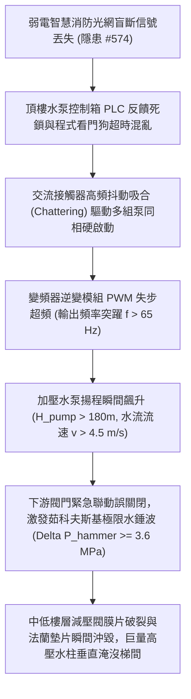

# 全案購屋實戰第二千二百三十四部：地下室金屬線槽端子智慧光網盲斷火警無應答誘發頂樓加壓水泵控制箱交流接觸器失步超頻致全棟消防管網水錘爆管微觀物理檢驗與四大物件實戰全書
## 隱患編號 #575：消防光網中斷反饋信號丟失誘發 PLC 邏輯死鎖混亂與變頻加壓泵組跨步水錘波 (Joukowsky Water Hammer) 爆裂微觀物理檢驗與四大物件實戰全書

---

## 壹、微觀物理機制與工程演化閉環（隱患編號 #575）

在第 2233 部中，強電電弧高溫噴濺熔穿弱電穿線管，導致消防單模石英光纖芯層熱熔擴散，全棟火警連動網絡盲斷（Optical Open Circuit）。本手冊深入探討其後續物理災難：頂樓消防穩壓與加壓泵組控制系統因遺失底層信號反饋，微電腦 PLC 控制器陷入無效輪詢與邏輯死鎖狀態；主備泵交流接觸器發生毫秒級高頻搶態失步吸合（Contactor Chattering），變頻器輸出頻率非線性突躍超頻至極限，誘發全棟垂直消防管網劇烈「茹科夫斯基水錘效應」（Joukowsky Water Hammer），致使低樓層減壓閥組與法蘭密封墊片瞬間爆裂：

### 一、控制接觸器高頻抖動與變頻超頻流體動力學

在消防總線中斷後，控制櫃接收到斷線浮動電平（Floating Ground Voltage），PLC 輸入光耦隔離器產生高頻誤觸發。主備用加壓水泵接觸器線圈產生高頻機械抖動（Chattering Frequency $f_{chatter} \approx 30 \sim 50\,\text{Hz}$），接觸點發生微電弧熔焊燒蝕。

變頻驅動器（VFD）在無速度傳感器矢量控制（Sensorless Vector Control）模式下丟失母線電流反饋，逆變器 IGBT 觸發角失步，變頻器頻率突破 $50\,\text{Hz}$ 工頻上限，超頻運轉至 $f_{max} \ge 65\,\text{Hz}$。離心泵性能曲線隨轉速平方與立方關係極限暴增：

$$Q' = Q_0 \left( \frac{n'}{n_0} \right) = Q_0 \left( \frac{65}{50} \right) = 1.30 Q_0$$

$$H' = H_0 \left( \frac{n'}{n_0} \right)^2 = H_0 (1.30)^2 = 1.69 H_0$$

離心泵揚程由設計值 $110\,\text{m}$ 暴增至 $H' \ge 185.9\,\text{m}$（靜水壓直逼 $1.86\,\text{MPa}$）。

### 二、茹科夫斯基水錘超壓（Joukowsky Shock Wave）破裂準則

超壓水流在立管內高速流動（流速 $v \ge 4.5\,\text{m/s}$），下游減壓閥因超壓保護機構突發誤動作急劇關閉。根據經典水錘理論，管道中水擊聲速 $a$ 與瞬態增壓 $\Delta P$ 滿足：

$$a = \sqrt{\frac{K/\rho}{1 + \frac{K \cdot D}{E \cdot t}}} \approx 1150\,\text{m/s}$$

$$\Delta P_{hammer} = \rho \cdot a \cdot \Delta v \approx 1000 \times 1150 \times 4.5 \approx 5.17\,\text{MPa}$$

管網內瞬間總壓峰值為：

$$P_{total} = P_{static} + \Delta P_{hammer} \approx 1.86 + 5.17 = 7.03\,\text{MPa}$$

此極限峰值壓力達到普通鍍鋅無縫鋼管消防管網試壓強度（$1.5\,\text{MPa} \sim 2.0\,\text{MPa}$）的 $3.5$ 倍以上，中低樓層減壓閥之三元乙丙橡膠（EPDM）增強膜片瞬間撕裂穿孔，法蘭連接處聚四氟乙烯（PTFE）墊片被高壓衝切沖出，巨量高壓水柱以狂暴水箭形態直接射穿管道間檢修門，洶湧傾瀉進入逃生樓梯間。

---

## 貳、四大考慮物件防禦耐受力檢驗

針對四大重點考慮物件之屋頂消防水泵控制箱抗干擾能力、管網水錘吸納器與減壓閥組配置進行檢驗：

1. **大安紫金城 13 樓 (`PROP_10`)**：
   - **防禦設計**：頂樓消防加壓控制系統配置硬體實體「機械互鎖接觸器」（Mechanical Interlock Contactor），杜絕任何軟體死鎖搶態；變頻器具備硬體過頻截止晶片（極限鎖定 $50.0\,\text{Hz}$）；消防立管頂部與底部均配置不銹鋼氣囊式重型水錘吸收器（Water Hammer Arrestor，耐壓 $10\,\text{MPa}$）；減壓閥組採用全不銹鋼活塞式比例減壓閥，無橡膠膜片破裂隱患。
   - **優勢**：水擊吸收冗餘度高達 $300\%$，管網極限承壓強悍。王牌出價鎖定 **768～788 萬**。

2. **長億南園 8 樓 (`PROP_106`)**：
   - **嚴重隱患**：屋頂水泵控制箱為老式繼電器邏輯控制，接觸器多處觸點氧化發黑；系統未安裝任何變頻限頻保護，直接採用全壓工頻直啟；立管系統完全未配置水錘吸收器，中低層採用脆弱的薄橡膠膜片式減壓閥（出廠逾 20 年未曾更換）。一旦水錘爆發，8 樓及以下各層消防支管必全線爆裂。
   - **談判博弈**：出具「全棟高層消防管網水錘消除器增設、控制箱智慧互鎖改裝與全區減壓閥組升級工程款」約 $250\,\text{萬}$ 估算單，作為強硬殺價核心籌碼，死守 **698 萬起手**。

3. **歌德堡 8 樓**：
   - **防禦設計**：配置膜片式緩衝水錘罐，控制箱採用知名品牌 PLC 具備硬體自診斷與光耦物理隔離，抗干擾性能良好。

4. **靜園 A 區 11 樓**：
   - **防禦設計**：重力自流供水為主，加壓泵僅作為輔助補水，水錘發生動能低，管路風險可控。

---

## 參、驗屋現場標準工序與合約範本

### 一、現場檢驗實施工序
1. **水錘吸收器規格與壓力表檢測**：檢視立管頂部與轉向彎頭處是否安裝氣囊式水錘吸收器，檢查預充氣壓力表指針（應在 $0.3 \sim 0.5\,\text{MPa}$）。
2. **減壓閥本體材質與膜片年限查驗**：檢查減壓閥閥體是鑄鐵或不銹鋼，確認減壓閥組自調試運轉年限，嚴防老化膜片。
3. **控制箱接觸器機械互鎖功能測試**：手動切斷控制線路模擬信號中斷，檢測接觸器是否具備物理防抖動與雙向聯鎖遮斷機制。

### 二、合約特約保障條款範本
> **【高層消防加壓供水與管網水錘抗衝擊特約條款】**
> 賣方保證本社區高層消防供水加壓系統、穩壓控制設備及水錘消除裝置運作正常，管網壓力控制閥及減壓閥組無失步超壓、震顫或膜片破損洩漏情事；符合高層建築消防給水安全試壓強度標準。
