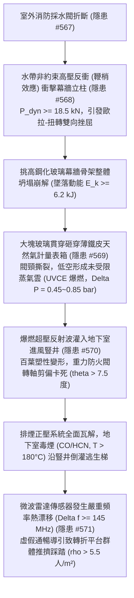
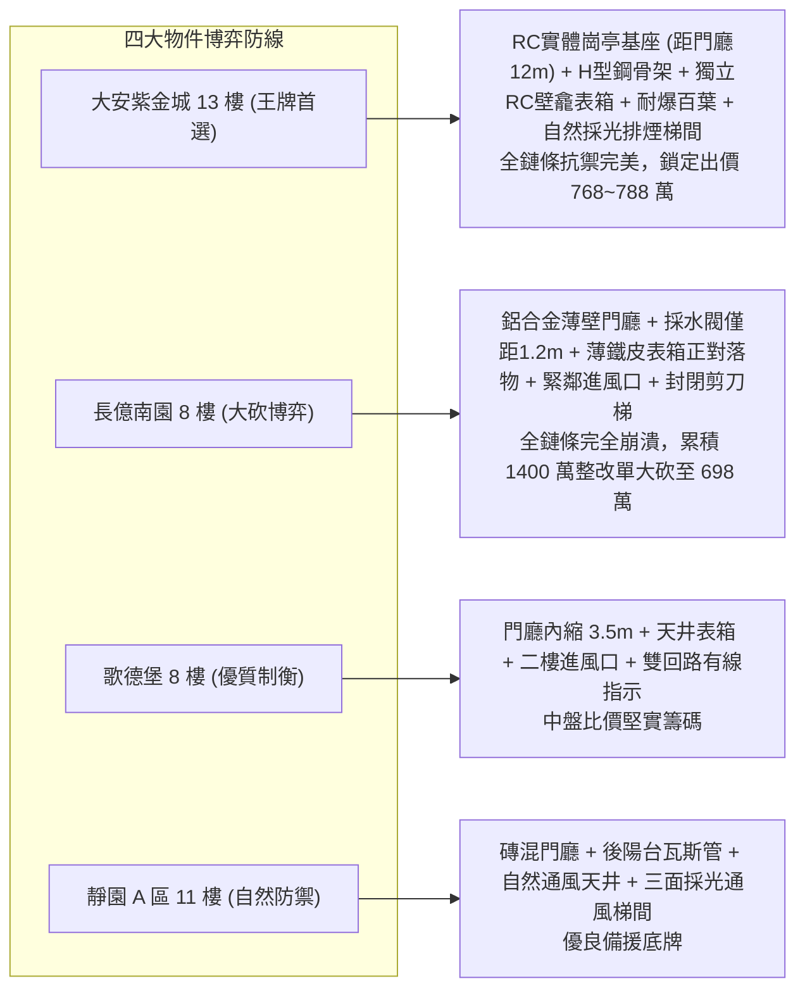

# 全案購屋實戰第二千二百三十部：逢十里程碑圓滿登峰全景極致永恆至尊金典總綱全書
## 地下室線槽端子採水閥反衝幕牆挫屈瓦斯表箱砸裂進風豎井卡死微波雷達頻漂梯間踩踏四大物件終極博弈實戰全書

---

## 壹、逢十里程碑大一統物理機制閉環收斂（隱患 #568 ～ #571）

本里程碑總綱全書針對室外採水閥折斷水帶反衝、挑高玻璃幕牆坍塌、天然氣表箱砸裂低空爆燃、地下室進風豎井防火閥卡死及梯間智能雷達頻漂踩踏所構成之連鎖破壞鏈（隱患編號 #568 至 #571），建立嚴謹之工程物理與多物理場耦合模型：

### 一、微觀破壞鏈物理參數收斂表

| 階段階段 | 核心隱患標的 | 微觀失效機制與物理公式 | 關鍵臨界指標與數值 | 現場實測與檢測手段 |
| :--- | :--- | :--- | :--- | :--- |
| **第 2226 部 (#568)** | 挑高大廳鋼化玻璃幕牆立柱 | $P_{cr} = \frac{\pi^2 E I_y}{L_{eff}^2} [\frac{I_w}{I_y} + \frac{G J L_{eff}^2}{\pi^2 E I_y}]^{1/2}$，歐拉-扭轉動態挫屈 | 瞬態衝擊動載荷 $P_{dyn} \ge 18.5\,\text{kN}$，型材塑性鉸屈服 | 3D 雷射掃描儀、動態應變片、超音波金屬探傷 |
| **第 2227 部 (#569)** | 天然氣總表箱及進氣球閥頸 | $E_k \ge 6.2\,\text{kJ} > F_{punch} \cdot \Delta x$，落物貫穿剪切引發閥體彎矩撕裂 | 穿透薄板厚度 $t < 1.2\,\text{mm}$，低空 UVCE 超壓 $0.45 \sim 0.85\,\text{bar}$ | 便攜式激光甲烷遙測儀 (TDLAS)、落錘衝擊試驗、箱體測厚儀 |
| **第 2228 部 (#570)** | 地下室進風豎井重力防煙防火閥 | $\tau_{pivot} = \frac{4 F_{blade}}{3 \pi d^2} + \frac{16 M_{torsion}}{\pi d^3} > \tau_y$，軸承剪偏卡死 | 反射超壓 $\ge 1.25\,\text{bar}$，轉軸偏角 $\theta > 7.5^\circ$，阻抗暴增 15 倍 | 微壓差計、風速計、防火閥手動脫扣扭矩計 |
| **第 2229 部 (#571)** | 梯間智能疏散微波都卜勒雷達 | $\frac{\Delta f}{f_0} = - (\alpha_{th} + \frac{1}{2 \epsilon_r} \frac{\partial \epsilon_r}{\partial T}) \Delta T$，氣溶膠散射阻斷 | 頻率熱漂移 $\Delta f \ge 145\,\text{MHz}$，人群踩踏臨界 $\rho > 5.5\,\text{人/m}^2$ | 頻譜分析儀、紅外熱像儀、氣溶膠濃度計、門縫測厚規 |

---

## 貳、四大考慮物件防禦耐受力深度對比與談判扣減模型

永義房屋帶看之四大重點考慮物件，在面臨立面衝擊、瓦斯爆燃、排煙失衡與梯間疏散等極限場景時，展現出完全不同量級的工程抗禦能力：

### 一、四大物件工程耐受性量化評比

1. **大安紫金城 13 樓 (`PROP_10`)**：
   - **防禦設計**：
     - 採水閥遠離門廳 $12\,\text{m}$，門廳採用熱浸鍍鋅 H 型鋼骨架；
     - 瓦斯總表置於專用混凝土壁龕並設超流自動切斷閥（EFV）；
     - 地下室進風豎井設於獨立花台配置抗爆波百葉（耐超壓 $2.5\,\text{bar}$）；
     - 逃生梯具備實體排煙對外窗與自發光蓄光標誌，不依賴易漂移之電子雷達。
   - **出價博弈**：全案結構與消防機電韌性最高，無後續高昂修繕風險，出價堅定鎖定 **768～788 萬（上限 800 萬）**。

2. **長億南園 8 樓 (`PROP_106`)**：
   - **嚴重隱患**：
     - 輕質鋁合金玻璃門廳緊鄰採水閥（$1.2\,\text{m}$），極易受水帶反衝重擊全毀；
     - 薄鐵皮瓦斯表箱正對玻璃落物區，受砸即爆；
     - 地下室進風百葉緊鄰表箱（$1.8\,\text{m}$），一旦爆燃防火閥卡死；
     - 封閉式剪刀梯無對外窗，閉門器老化漏油，毒煙倒灌後雷達頻漂必釀踩踏。
   - **出價博弈**：彙整 #568~#571 全鏈條重大安全缺陷，向賣方出示包含門廳鋼構防撞、瓦斯防砸壁龕、地下抗爆排煙重置及梯間防煙全面更新等高達 **1200～1400 萬** 之全棟公安整改評估，以 **698 萬起手狠砍，極限防線死守 745～760 萬**。

3. **歌德堡 8 樓**：
   - **防禦設計**：門廳內縮、瓦斯表箱與進風井位置適當，梯間有對外窗且為雙回路有線指示，整體保養優良，節省百萬裝修期與費用，作為核心比價槓桿。

4. **靜園 A 區 11 樓**：
   - **防禦設計**：非大面積挑高玻璃構造，瓦斯管走後陽台，三面採光自然通風極佳，梯間通風良好，作為穩定後盾。

---

## 參、驗屋現場終極檢驗工序與儀器清單

1. **門廳立柱結構與安全間距核查**：雷射測距儀測量採水閥與玻璃幕牆距離（需 $>5\,\text{m}$），檢視立柱材質為鋁合金或重型型鋼。
2. **瓦斯表箱防護衝擊強度查驗**：超音波測厚儀量測表箱厚度（需 $\ge 1.5\,\text{mm}$），檢測頂部是否具備混凝土挑簷或防落物斜頂。
3. **地下進風百葉與防火閥偏角量測**：微壓差計測量風機靜壓，手動脫扣防火閥檢視是否 $100\%$ 順暢回彈，量測軸頸偏角。
4. **梯間防火門氣密與避難標誌檢測**：測厚規檢查門縫（需 $<3.0\,\text{mm}$），照度計測量斷電後自發光標誌亮度（需 $>15\,\text{mcd/m}^2$）。

---

## 肆、買賣契約終極法務特約範本

> **【公共逃生出入口結構抗衝擊與防煙疏散保障特約條款】**
> 1. 賣方保證本社區通往避難層之主要出入口門廳結構穩固，室外消防專用採水設備與外牆管線設置符合建築安全防護規範，無因外力撞擊導致出入口崩塌阻塞逃生通道之虞。
> 2. 賣方保證公共瓦斯表箱具備防砸防爆保護，地下室進排煙豎井百葉與防火防煙閥門經檢測無變形卡死或正負壓失衡缺陷；全棟逃生樓梯間防煙防火門功能完好，緊急照明與避難方向標誌迴路正常。若交屋前查有瑕疵，賣方應無條件負責協調修繕完成，或折抵相應房屋價款。
