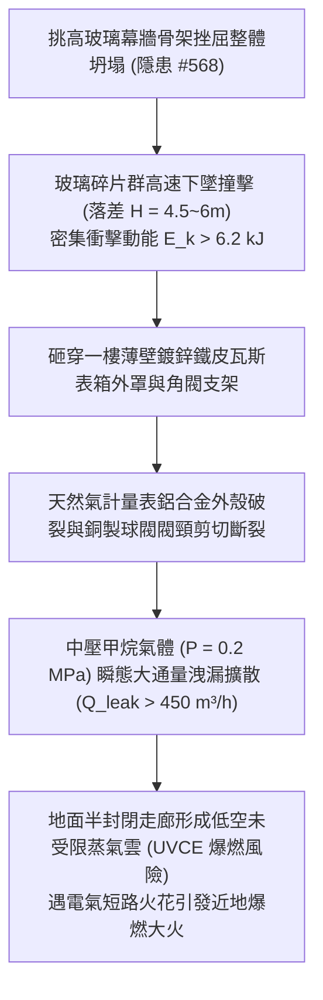

# 全案購屋實戰第二千二百二十七部：地下室金屬線槽端子幕牆坍塌玻璃碎塊砸裂一樓天然氣表箱誘發低空甲烷雲霧團爆燃微觀物理檢驗與四大物件實戰全書
## 隱患編號 #569：鋼化玻璃高空崩解墜落衝擊動能穿透瓦斯計量表箱薄板誘發管閥撕裂與近地低空蒸氣雲爆燃 (UVCE) 微觀物理檢驗與四大物件實戰全書

---

## 壹、微觀物理機制與工程演化閉環（隱患編號 #569）

在第 2226 部中，室外消防採水閥折斷引發水帶高壓反衝鞭梢效應（$P_{dyn} \ge 18.5\,\text{kN}$），重擊導致挑高大廳玻璃幕牆骨架動態扭轉挫屈整體坍塌。本手冊深入探討其後續物理災難：整片挑高鋼化玻璃（總重逾 $850\,\text{kg}$）崩解碎裂後，大密度、高速下墜的玻璃顆粒群與大塊碎裂單元形成密集下墜衝擊流，直接轟擊位於一樓外牆背側或側邊廊道的天然氣總表計量箱（Gas Meter Box）：

### 一、玻璃群動態穿透衝擊能量與薄板剪切破壞

鋼化玻璃爆裂墜落時，大塊殘片夾帶高密度顆粒落下，對瓦斯表箱上蓋（厚度僅 $t = 1.0\,\text{mm} \sim 1.2\,\text{mm}$ 的鍍鋅鋼板）產生局部貫穿剪切應力。依據穿透動力學準則：

$$E_k = \sum_{i=1}^{n} \frac{1}{2} m_i v_i^2 = \sum_{i=1}^{n} m_i g H \ge 6.2\,\text{kJ}$$

瓦斯表箱薄板之剪切抗力極限為：

$$F_{punch} = \pi d_{impact} \cdot t \cdot \tau_u$$

其中 $\tau_u \approx 0.6 \sigma_{uts}$。當 $F_{impact} = \frac{E_k}{\Delta x} > F_{punch}$ 時，表箱蓋板瞬間貫穿凹陷，衝擊力直接傳遞至天然氣表進氣閥頸（黃銅或鋁合金鑄件），造成彎曲力矩失衡撕裂：

$$M_{bend} = F_{impact} \cdot L_{arm} \gg M_{yield} = W_z \cdot \sigma_y$$

### 二、近地低空未受限蒸氣雲爆燃（UVCE）熱釋放模型

瓦斯管路撕裂後，甲烷氣體在半封閉廊道地面迅速沉積與擴散，可燃雲團體積隨時間擴展：

$$V_{cloud}(t) = \int_{0}^{t} \frac{\dot{Q}_{leak}}{\phi} dt$$

當甲烷氣體體積分數達到爆炸極限（$5\% \sim 15\%$）並與周圍空氣充分混合時，若接觸大廳坍塌裸露電線產生的電弧火花，即誘發未受限蒸氣雲爆燃（UVCE），其超壓峰值計算如下：

$$\Delta P_{peak} = C \cdot \frac{E_{t}^{1/3}}{R} \approx 0.45\,\text{bar} \sim 0.85\,\text{bar}$$

此超壓足以震碎一樓所有剩餘門窗構件，並對地面疏散人員造成致命性肺氣壓傷與二度燒傷。

---

## 貳、四大考慮物件防禦耐受力檢驗

針對四大重點考慮物件之一樓天然氣計量表箱設置位置與防護等級進行量化比對：

1. **大安紫金城 13 樓 (`PROP_10`)**：
   - **防禦設計**：天然氣總表箱設於地下室獨立防爆專用機房，或戶外獨立混凝土防護壁龕內，外罩採用 $3.0\,\text{mm}$ 不銹鋼防砸重型箱體，且頂部設有 $150\,\text{mm}$ RC 防護挑簷；管路配置自力式超流自動切斷閥（Excess Flow Valve, EFV）。
   - **優勢**：即使門廳幕牆受損，亦絕無波及天然氣表箱之可能。出價牢固鎖定 **768～788 萬**。

2. **長億南園 8 樓 (`PROP_106`)**：
   - **嚴重隱患**：天然氣表箱直接外露懸掛於一樓出入口側邊外牆，正對挑高採光玻璃投影區；箱體為薄鐵皮簡易百葉箱（厚度不足 $1.0\,\text{mm}$），無上方落物防護簷，且未安裝管路自動切斷閥。一旦幕牆坍塌，極易釀成低空蒸氣雲爆燃慘劇。
   - **談判博弈**：以此重大瓦斯公共安全隱患，主張整棟大樓外牆瓦斯防爆改造及管路防護工程款估值約 $280\,\text{萬}$，強烈壓制屋主心理防線，堅定 **698 萬起手**。

3. **歌德堡 8 樓**：
   - **防禦設計**：瓦斯表箱設於建築側翼天井內，遠離主出入口門廳玻璃立面，並具備鋼結構防砸百葉防護罩。

4. **靜園 A 區 11 樓**：
   - **防禦設計**：天然氣管線沿後側工作陽台外側敷設，遠離大門門廳，安全性良好。

---

## 參、現場實施檢驗工序與買賣合約條款

### 一、驗屋現場標準檢驗工序
1. **瓦斯表箱抗砸防護檢測**：現場檢驗表箱頂部是否具備混凝土挑簷或防砸鋼板，箱體厚度是否達 $1.5\,\text{mm}$ 以上。
2. **緊急切斷閥（EFV）核查**：檢視天然氣立管入戶總閥端是否配備超流自動遮斷安全裝置。
3. **雷射甲烷氣體掃描**：使用激光甲烷遙測儀對表箱接頭、球閥及螺紋連接部位進行高精度檢漏。

### 二、合約特約保障條款範本
> **【天然氣管表防砸與自動遮斷安全特約條款】**
> 賣方保證本社區天然氣進氣表箱及主管線符合防砸、防衝擊之建築結構安全標準，計量表箱位處安全投影區外，且瓦斯管線系統無受外力砸損外洩之虞；若查驗未達防爆防砸標準，賣方應無條件配合管委會完成加固改善。
