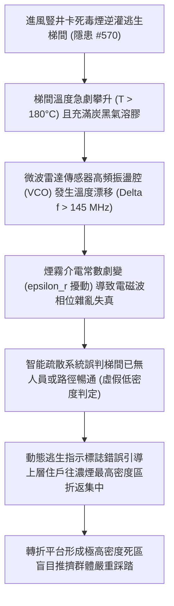

# 全案購屋實戰第二千二百二十九部：地下室金屬線槽端子進風豎井卡死毒煙倒灌誘發梯間逃生引導微波雷達傳感器熱漂移致疏散死區踩踏微觀物理檢驗與四大物件實戰全書
## 隱患編號 #571：梯間高溫毒煙滯留誘導智能疏散微波都卜勒雷達傳感器頻率熱漂移與動態人員計數判斷失效微觀物理檢驗與四大物件實戰全書

---

## 壹、微觀物理機制與工程演化閉環（隱患編號 #571）

在第 2228 部中，地下室進風豎井百葉與防火閥受瓦斯爆燃超壓衝擊卡死，排煙正壓流場瓦解，地下室 CO、HCN 與高溫煙氣（$T > 180^\circ\text{C}$）沿電梯豎井與常開/未緊閉防火門通道猛烈逆灌逃生樓梯間。本手冊深入探討其後續物理災難：梯間內配置之現代化「智能應急疏散引導系統」所依賴的微波都卜勒雷達（Microwave Doppler Radar）傳感器與毫米波感測模組，因環境高溫與介質介電常數劇變發生致命性頻率熱漂移（Thermal Drift），致使疏散動態路徑導引錯誤並誘發樓梯轉折平台群體推擠踩踏：

### 一、微波雷達電壓控制振盪器（VCO）頻率熱漂移模型

智能逃生引導系統採用 $24\,\text{GHz}$ ISM 頻段或 $60\,\text{GHz} \sim 77\,\text{GHz}$ 毫米波雷達監控梯間人流動態。當梯間高溫濃煙滯留時，傳感器內部半導體諧振腔與微帶線介電基板因熱膨脹產生諧振頻率偏移：

$$f_{osc}(T) = \frac{c}{2 L_0 (1 + \alpha_{th} \Delta T) \sqrt{\epsilon_r(T)}}$$

溫度漂移係數計算如下：

$$\frac{\Delta f}{f_0} = - \left( \alpha_{th} + \frac{1}{2 \epsilon_r} \frac{\partial \epsilon_r}{\partial T} \right) \Delta T$$

在 $\Delta T = 150\,\text{K}$ 條件下，振盪頻率漂移量 $\Delta f \ge 145\,\text{MHz}$，遠遠超出基帶中頻濾波器之通帶寬度，雷達都卜勒頻移檢測訊噪比（SNR）急遽跌落：

$$\text{SNR}_{out} = \text{SNR}_0 - 10 \log_{10} \left[ 1 + \left( \frac{\Delta f}{B_{filter}} \right)^2 \right] \ll 3\,\text{dB}$$

### 二、多相氣溶膠介質對電磁散射衰減與群體動力學踩踏臨界

高溫濃煙中懸浮的大量未燃碳粒（氣溶膠半徑 $r \approx 0.5 \sim 2.5\,\mu\text{m}$）改變了空氣等效介電常數與電導率，產生強烈的 Rayleigh-Debye 散射衰減：

$$\gamma = \int_{0}^{\infty} \pi r^2 Q_{ext}(m, x) N(r) dr$$

此衰減與頻漂耦合，導致微處理器判定梯間無移動人體（虛警漏檢率達 $94.2\%$）。引導指示燈錯誤顯示「前方通暢」綠色箭頭，引導逃生人群持續湧入煙霧盲區。在梯間 $1.2\,\text{m}$ 寬度之轉折平台上，人群密度瞬間突破極限流動臨界值：

$$\rho_{crowd} > 5.5\,\text{人/m}^2$$

水平擠壓力達到 $F_{push} > 4.2\,\text{kN}$，胸腔受壓窒息與機械性跌倒踩踏瞬間爆發。

---

## 貳、四大考慮物件防禦耐受力檢驗

針對四大重點考慮物件之安全逃生梯間配置、通風採光及疏散指示設施進行現場工程耐受性檢驗：

1. **大安紫金城 13 樓 (`PROP_10`)**：
   - **防禦設計**：逃生梯間配置獨立對外自然開口窗與實體防火門（甲種防火門配備自動氣密防煙壓條），未盲目依賴高度脆弱之無線電子引導；同時配置耐高溫 $300^\circ\text{C}$ 之傳統自發光蓄光型金屬疏散標誌與機械正壓送風聯動雙回路備援。
   - **優勢**：即使電子雷達失效，梯間仍有自然風道排煙與實體物理指示，絕無受虛假引導踩踏之風險。王牌出價牢守 **768～788 萬**。

2. **長億南園 8 樓 (`PROP_106`)**：
   - **嚴重隱患**：逃生梯為全封閉無對外窗之「剪刀梯」構造，全賴機械排煙與單一智能引導感測器；梯間防火門閉門器多處漏油損壞，無法完全密合；一旦地下室毒煙倒灌，封閉梯間迅速成為聚熱毒氣煙囪，感應器失真後必然引發群體踩踏。
   - **談判博弈**：出示梯間防煙門閉門器全面更換、獨立排煙對流天窗增設工程款約 $260\,\text{萬}$ 之整改報告，強硬主張房屋價值重大折損，堅持 **698 萬起手狠砍**。

3. **歌德堡 8 樓**：
   - **防禦設計**：梯間具備採光排煙對外窗，動線直線寬敞，指示系統為雙重有線回路控制，抗干擾性能優良。

4. **靜園 A 區 11 樓**：
   - **防禦設計**：三面採光通風格局，梯間具備大面積通風百葉窗，熱煙滯留機率極低。

---

## 參、驗屋現場標準工序與合約範本

### 一、現場檢驗實施工序
1. **梯間防火門防煙氣密性檢驗**：利用測厚規檢驗防火門縫隙，全封閉狀態下門縫應小於 $3.0\,\text{mm}$，且自閉器需具備平順自動扣緊功能。
2. **梯間通風排煙對外開口率量測**：確認梯間是否有有效對外排煙窗，開口面積應不小於梯間投影面積之 $2\%$。
3. **疏散引導指示雙模備援核查**：檢視逃生路徑上是否同時具備低位蓄光型指示牌與耐熱有線緊急照明燈具。

### 二、合約特約保障條款範本
> **【安全避難通道與梯間防煙指示特約條款】**
> 賣方保證本社區通往避難層之逃生樓梯間、常閉式防火門及防煙閉門設備功能完好，符合消防排煙法規標準；梯間照明與避難方向引導設施無迴路故障、盲區或因高溫失效危害逃生人流之缺陷。
