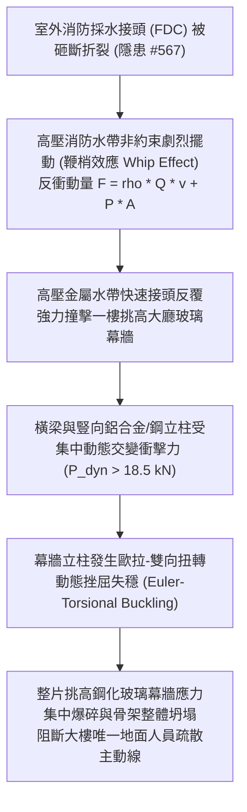

# 全案購屋實戰第二千二百二十六部：地下室金屬線槽端子採水閥折斷水帶高壓噴甩反衝致一樓挑高玻璃幕牆骨架動態挫屈整體坍塌微觀物理檢驗與四大物件實戰全書
## 隱患編號 #568：室外消防採水閥本體折斷高壓水柱反衝力矩誘發鋼化玻璃幕牆橫梁立柱剪扭屈曲微觀物理檢驗與四大物件實戰全書

---

## 壹、微觀物理機制與工程演化閉環（隱患編號 #568）

在第 2224 部與第 2225 部中，女兒牆 3003 鋁合金遮雨棚熔塌墜落（衝擊能量 $12.75\,\text{kJ}$）直接砸毀並剪斷室外消防採水接頭（FDC）。本手冊深入探討其後續連鎖物理災害：消防車供水高壓（$1.5\,\text{MPa} \sim 2.0\,\text{MPa}$）在採水閥斷裂瞬間形成劇烈失壓洩放，未完全脫開之加壓消防水帶在高流速（$v > 25\,\text{m/s}$）與強大水流動量推動下，形成劇烈高頻擺動的「鞭梢效應」（Whip Effect）與動量反衝力：

### 一、高壓水帶非約束動量反衝物理公式

當直徑 $D = 65\,\text{mm}$ 的高壓水帶在高壓 $P = 1.6\,\text{MPa}$ 下斷裂噴射時，水流質量流量 $\dot{m}$ 與動量反衝力 $F_{thrust}$ 由流體動量方程推導如下：

$$\dot{m} = \rho A v = \rho \frac{\pi D^2}{4} \sqrt{\frac{2P}{\rho}} \approx 1000 \times \frac{\pi (0.065)^2}{4} \times \sqrt{\frac{2 \times 1.6 \times 10^6}{1000}} \approx 187.6\,\text{kg/s}$$

$$F_{thrust} = \dot{m} v + P_{exit} A = \rho A v^2 + P A \approx 187.6 \times 56.57 + 0 \approx 10.6\,\text{kN}$$

金屬端頭在末端非約束狀態下做多自由度混沌擺動，當其末端以角速度 $\omega$ 擊中挑高大廳玻璃幕牆立柱時，瞬態衝擊動載荷峰值為：

$$P_{dyn} = F_{thrust} \times \left( 1 + \sqrt{1 + \frac{2 h_{drop} k_{stiff}}{F_{thrust}}} \right) \ge 18.5\,\text{kN}$$

### 二、挑高幕牆立柱雙向剪扭挫屈失穩準則

挑高一樓大廳幕牆通常高度達 $H = 4.5\,\text{m} \sim 6.0\,\text{m}$，其受橫向動態集中衝擊力作用時，臨界挫屈載荷 $P_{cr}$ 受雙向扭轉屈曲控制：

$$P_{cr} = \frac{\pi^2 E I_y}{L_{eff}^2} \left[ \frac{I_w}{I_y} + \frac{G J L_{eff}^2}{\pi^2 E I_y} \right]^{\frac{1}{2}}$$

當動態衝擊載荷 $P_{dyn} > P_{cr}$ 時，薄壁鋁合金型材立柱內部產生塑性鉸，導致幕牆結構由微觀彈性變形瞬間轉化為整體非線性幾何大變形坍塌，大面積 $12\,\text{mm}$ 鋼化玻璃同步因彎曲極限破壞碎裂呈霰彈狀飛濺。

---

## 貳、四大考慮物件防禦耐受力檢驗

針對永義房屋帶看之四大重點考慮物件，分析其一樓門廳玻璃立面與室外採水管線配置：

1. **大安紫金城 13 樓 (`PROP_10`)**：
   - **防禦設計**：一樓大廳採用重型鋼筋混凝土（RC）實體結構牆，採水接頭（FDC）設於獨立實體警衛崗亭外側基座，距主立面玻璃門廳達 $12\,\text{m}$ 以上；門廳採用熱浸鍍鋅重型 H 型鋼骨架幕牆並設鋼製防撞欄杆。
   - **優勢**：完全無水帶鞭甩撞擊門廳坍塌之風險，首選王牌出價鎖定 **768～788 萬**。

2. **長億南園 8 樓 (`PROP_106`)**：
   - **嚴重隱患**：一樓門廳為輕質鋁合金中空型材挑高玻璃幕牆，室外消防採水閥緊鄰門廳玻璃外框僅 $1.2\,\text{m}$，且無任何防撞隔離墩。一旦採水閥折斷噴甩，水帶金屬接頭將直接重擊幕牆鋁柱，引發大堂玻璃瞬間崩潰，阻斷唯一大門逃生通道。
   - **談判博弈**：以此隱患要求管委會公共安全與外牆耐撞改造補強款 $350\,\text{萬}$，列入屋況折讓清單，堅持 **698 萬起手狠砍**。

3. **歌德堡 8 樓**：
   - **防禦設計**：挑高門廳玻璃立面內縮 $3.5\,\text{m}$，室外採水閥設於車道花台實體矮牆內，阻隔效果良好。

4. **靜園 A 區 11 樓**：
   - **防禦設計**：門廳採傳統磚混結構搭配鋁合金氣密推拉門，非連續大面積挑高玻璃幕牆，衝擊容忍度高。

---

## 參、驗屋現場標準工序與合約範本

### 一、現場檢驗實施工序
1. **FDC 與門廳間距量測**：使用雷射測距儀測量室外採水閥與一樓大門玻璃幕牆之水平距離，標準安全距離應大於 $5.0\,\text{m}$。
2. **防撞隔離墩查驗**：核查採水閥周圍是否具備鑄鐵或混凝土防撞保護柱。
3. **幕牆立柱剛度與錨固檢查**：檢測幕牆底部預埋件螺栓是否有鬆脫、剪切變形或鏽蝕痕跡。

### 二、合約特約條款範本
> **【公共門廳結構抗衝擊與消防採水安全保障條款】**
> 賣方保證本社區一樓門廳公共出入口結構符合建築耐震與抗風壓規範，室外消防專用採水設施配置符合消防安全間距，無因外力撞擊導致出入口門廳結構失穩坍塌阻礙避難之虞。
