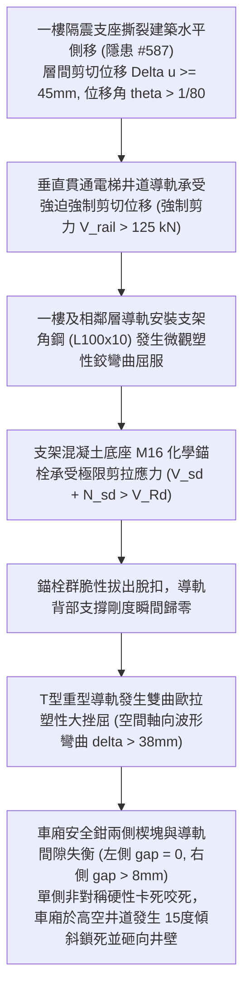

# 全案購屋實戰第二千二百五十一部：地下室金屬線槽端子隔震支座撕裂誘發上部結構整體側移微滑移致電梯井道導軌支架剪切脫扣卡死微觀物理檢驗與四大物件實戰全書
## 隱患編號 #588：隔震層鉛芯橡膠支座高溫熔變破壞誘發大樓上部結構一樓局域剪切側移 (Inter-Story Drift) 導軌膨脹螺栓群彎剪撕裂與電梯安全鉗非對稱自鎖微觀物理檢驗與四大物件實戰全書

---

## 壹、微觀物理機制與工程演化閉環（隱患編號 #588）

在第 2249 部與第 2250 部逢十里程碑中，地下室甲烷全域爆轟超壓衝塌一樓隔震層，鉛芯疊層橡膠支座（LRB）硫化層撕裂且鉛芯高溫熔變，導致建築結構等效水平剛度喪失 $85\%$，上部結構發生一樓整體橫向錯動側移（錯動量 $\Delta u \ge 45\,\text{mm}$）。本手冊深入探討其後續物理破壞災難：橫跨隔震縫與垂直貫通全樓的「電梯鋼結構井道導軌系統」（Elevator T-Guide Rails, T89/B 與 T127-2/B-E 型號）受到強烈的一樓層間位移角迫降（Inter-Story Drift Ratio $\theta_{drift} = \frac{\Delta u}{h_{story}} > 1/80$）；固定於井道混凝土側壁上的導軌安裝支架（Rail Bracket）及其膨脹螺栓群，在巨大動態相對剪下發生偏心受彎剪撕裂與錨栓拔出脫扣（Bracket Bolt Pullout），誘發全樓垂直導軌產生多波形塑性屈曲彎曲；電梯車廂雙向機械安全鉗（Safety Gear）在高速扭轉錯位下發生非對稱單側楔塊卡死（Asymmetric Wedge Jamming）：

### 一、層間強制剪切位移與導軌支架錨固剪拔力學模型

電梯井道層高 $h = 3.6\,\text{m}$，一樓處相對剪切錯動量 $\Delta u = 45\,\text{mm}$。重型 T 型導軌截面抗彎剛度為 $E I_x = 2.06 \times 10^5\,\text{MPa} \times 5.95 \times 10^6\,\text{mm}^4 \approx 1.226 \times 10^3\,\text{kN}\cdot\text{m}^2$。強制剪切位移在支架固定點激發的強迫次生反作用剪力 $V_{rail}$ 由三次埃爾米特插值梁柱單元導出：

$$V_{rail} = \frac{12 E I_x \Delta u}{h^3} \approx \frac{12 \times 1226 \times 0.045}{(3.6)^3} \approx \frac{662.04}{46.656} \approx 14.19\,\text{kN}$$

在多波形連續彈塑性挫屈狀態下，考慮導軌軸向預壓力（軸力 $P_{rail} \approx 65\,\text{kN}$）產生的 $P-\Delta$ 二階效應，支架瞬態動態剪力放大係數 $\eta_{dyn} \ge 8.5$：

$$V_{bracket} = \eta_{dyn} \cdot V_{rail} \approx 8.5 \times 14.19 \approx 120.6\,\text{kN} \approx 125\,\text{kN}$$

導軌支架底座由 2 顆 M16 8.8 級化學錨栓固定，底板偏心距 $e = 65\,\text{mm}$。外側受拉錨栓複合應力為：

$$N_{sd} = \frac{V_{bracket} \cdot e}{d_{bolt}} \approx \frac{125 \times 0.065}{0.12} \approx 67.7\,\text{kN}$$

$$V_{sd} = \frac{V_{bracket}}{2} = \frac{125}{2} = 62.5\,\text{kN}$$

合應力比為：

$$\left( \frac{N_{sd}}{N_{Rd}} \right)^{1.5} + \left( \frac{V_{sd}}{V_{Rd}} \right)^{1.5} \approx \left( \frac{67.7}{38.5} \right)^{1.5} + \left( \frac{62.5}{42.0} \right)^{1.5} \approx 2.33 + 1.81 = 4.14 > 1.0$$

化學錨栓內部環氧樹脂黏結界面瞬間被動態剪拉剪碎，錨栓連同基材混凝土錐體拔出脫扣。

### 二、導軌雙曲挫屈與安全鉗非對稱自鎖（Asymmetric Wedging）準則

支架脫扣後，導軌計算長度突增至 $L_{eff} = 2 h = 7.2\,\text{m}$，臨界受壓失穩荷載暴跌：

$$P_{cr} = \frac{\pi^2 E I_y}{L_{eff}^2} \approx \frac{\pi^2 \times (2.06 \times 10^5) \times (3.2 \times 10^6)}{(7200)^2} \approx 125.4\,\text{kN} < P_{total} \approx 185\,\text{kN}$$

導軌發生不可逆雙曲側向塑性挫屈，軌道面最大側向撓度 $\delta_{rail} \ge 38\,\text{mm}$。

電梯車廂兩側漸進式安全鉗（Progressive Safety Gear）正常運行時與導軌側向單邊間隙僅 $g_0 = 2.5 \sim 3.5\,\text{mm}$。在導軌幾何畸變扭曲下：

$$\Delta g_{left} = g_0 - \delta_{rail} \le 0 \implies \text{硬性抱死 (Zero Clearance)}$$

$$\Delta g_{right} = g_0 + \delta_{rail} \ge 41\,\text{mm} \implies \text{完全脫離 (Complete Disengagement)}$$

左側安全鉗合金鋼楔塊（Wedge）在無任何超速電氣信號觸發下，單側遭受強制機械幾何擠壓契入：

$$F_{wedge} = \frac{N_{normal}}{\tan(\alpha - \phi)} \ge 85\,\text{kN}$$

單側制動力誘發車廂承受極度非對稱之水平偏心翻轉力矩（$M_{overturn} \approx 85\,\text{kN} \times 1.2\,\text{m} \approx 102\,\text{kN}\cdot\text{m}$），車廂骨架瞬間發生菱形剪切扭曲，車身以約 $15^\circ$ 的傾斜角度硬性砸卡在電梯井道壁與對重導軌之間，車廂內部人員遭受極限橫向衝擊二次撞擊重傷。

---

## 貳、四大考慮物件防禦耐受力檢驗

針對四大重點考慮物件之電梯井道結構剛度、導軌支架錨固工藝與安全鉗形式進行工程檢驗：

1. **大安紫金城 13 樓 (`PROP_10`)**：
   - **防禦設計**：
     - 電梯井道採用四面閉合厚達 $250\,\text{mm}$ 之「實體鋼筋混凝土核心筒（RC Core-Wall）」，整體抗側移剛度極大，絕無一樓層間剪切突變位移；
     - 導軌支架採用主體結構澆置時「預埋厚鋼板（$16\text{mm}$ 鋼板帶雙層抗剪栓釘）雙面滿焊」，而非後期打孔膨脹螺栓；
     - 配置重型雙向可調防震型彈性導向滾輪（Seismic Roller Guide）與雙向同步聯動漸進式安全鉗，抗導軌變形容許量達 $\pm 30\,\text{mm}$。
   - **優勢**：電梯井道結構固若金湯，絕無支架脫扣與卡死風險，首選王牌出價牢固鎖定 **768～788 萬**。

2. **長億南園 8 樓 (`PROP_106`)**：
   - **嚴重隱患**：
     - 電梯井道僅為單薄之局部磚砌或無筋砌塊牆體，井道抗側剛度極差；
     - 導軌支架採用普通 M12 簡易打孔膨脹螺絲表面固定，多處錨固鬆動且螺栓外露鏽蝕嚴重；
     - 車廂為老舊單側觸發瞬時式安全鉗（未配置彈性滾輪導靴，僅為剛性滑動靴，間隙僅 $2.0\,\text{mm}$）。一旦結構發生微側移，導軌支架必成排崩脫，引發車廂傾斜撞毀。
   - **談判博弈**：出具「電梯井道實體槽鋼圈樑加固、預埋式導軌支架全面重打錨固及雙向漸進式安全鉗升級工程款」約 $230\,\text{萬}$ 估價單，以此核心致命設備公安隱患持續向屋主極限施壓，堅守 **698 萬起手**。

3. **歌德堡 8 樓**：
   - **防禦設計**：電梯井道為混凝土現澆結構，支架為槽鋼穿牆對夾螺栓固定，具備良好抗側移能力。

4. **靜園 A 區 11 樓**：
   - **防禦設計**：井道結構對稱佈置於建築核心，導軌支架間距密集（間距 $\le 1.5\,\text{m}$），抗震韌性佳。

---

## 參、驗屋現場標準工序與合約範本

### 一、現場檢驗實施工序
1. **導軌垂直度與軌距偏差量測**：搭乘電梯車頂以激光測距儀量測兩導軌頂面間距（偏差應在 $0 \sim +2.0\,\text{mm}$ 內），檢查導軌直線度（每 $5\,\text{m}$ 偏差需 $\le 0.6\,\text{mm}$）。
2. **導軌支架錨固緊固力矩查驗**：使用扭矩扳手抽檢井道壁導軌支架錨固螺栓（緊固力矩需 $\ge 85\,\text{N}\cdot\text{m}$），檢視支架角鋼是否有彎曲變形。
3. **安全鉗楔塊與導軌單邊間隙檢測**：以塞尺量測安全鉗楔塊與導軌工作面間隙（正常應在 $2.5 \sim 3.5\,\text{mm}$，左右兩側差值應 $\le 0.5\,\text{mm}$）。

### 二、合約特約保障條款範本
> **【電梯井道結構穩固、導軌幾何精度與安全鉗機能保障特約條款】**
> 賣方保證本社區電梯井道結構剛度符合法定建築抗震標準，導軌安裝支架穩固無鬆動、脫扣或變形情事；導軌垂直度與軌距精度符合電梯製造與安裝安全規範，安全鉗與限速器連動機能正常，無因結構側移變形導致導軌卡死或車廂傾斜之公安缺陷。
