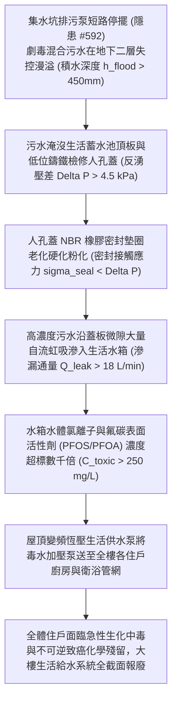

# 全案購屋實戰第二千二百五十七部：地下室金屬線槽端子污水逆灌漫溢誘發地下蓄水池人孔蓋反湧污染全樓生活飲用水微觀物理檢驗與四大物件實戰全書
## 隱患編號 #593：地下室強電解質化學污水液位超標突破低位蓄水池人孔蓋防護密封誘發全樓生活給水二次生化污染與大腸桿菌氟碳毒素擴散微觀物理檢驗與四大物件實戰全書

---

## 壹、微觀物理機制與工程演化閉環（隱患編號 #593）

在第 2256 部中，泡沫原液腐蝕潛水排污泵電纜接頭引發相間水下電弧短路跳脫，地下室集水坑泵群全線停擺。本手冊深入探討其後續物理與生化破壞災難：消防廢水、變壓器殘油與高濃度 AFFF 氟碳表面活性劑混合形成的「極度劇毒強電解質污染污水層」（液位上升速度 $v_{rise} \ge 150\,\text{mm/h}$），在地下二層地坪迅速漫溢蔓延；積水水位迅速淹沒位於地下室地坪下或低矮泵房基座之「全樓生活飲用水地下蓄水池（Domestic Water Storage Cistern）」頂部人孔檢修蓋（Manhole Cover）；由於人孔蓋未設置高於地面之防溢井頸（Curb Neck，反湧水頭差 $\Delta H_{head} \ge 350\,\text{mm}$），且其丁腈橡膠（NBR）密封墊圈因年久失修嚴重硬化龜裂脫落，外溢之高濃度化學毒性污水沿人孔蓋螺栓孔隙與微裂縫大量虹吸倒灌入全樓居民賴以生存的生活飲用水箱，引發全樓層自來水供水系統的二次生化與致癌性化學極限污染：

### 一、污水反湧水頭壓差與人孔蓋彈性體密封失效流體動力學模型

蓄水池檢修人孔蓋（直徑 $D_m = 700\,\text{mm}$，受壓面積 $A_m = 0.385\,\text{m}^2$）位於地下二層地坪標高。當地下室淹水深度達到 $h_{flood} = 450\,\text{mm}$ 時，覆蓋於人孔蓋上方的靜水反湧壓差 $\Delta P_{head}$ 為：

$$\Delta P_{head} = \rho_{sewage} \cdot g \cdot h_{flood} \approx 1050 \times 9.81 \times 0.45 \approx 4.63 \times 10^3\,\text{Pa} = 4.63\,\text{kPa}$$

蓋板承受之垂直向下反向浸潤總壓力為：

$$F_{penetrate} = \Delta P_{head} \times A_m \approx 4.63 \times 10^3 \times 0.385 \approx 1.78\,\text{kN}$$

人孔蓋採用 4 顆 M12 碳鋼螺栓固定。正常密封要求橡膠墊圈接觸應力 $\sigma_{seal} \ge 3.0\,\text{MPa}$。然而，現場老舊丁腈橡膠（NBR）密封圈經年累月暴露於潮濕空氣中，發生交聯氧化硬化（邵氏硬度由 60A 升至 90A 以上），壓縮永久變形率（Compression Set）高達 $CS \ge 78\%$，有效接觸回彈應力驟降：

$$\sigma_{seal, actual} \approx 0.15\,\text{MPa} \ll \sigma_{seal, required}$$

在反湧水壓與螺栓預緊力鬆弛共同作用下，人孔蓋邊緣形成等效環向微開口間隙（間隙寬度 $\delta_{gap} \ge 0.8\,\text{mm}$），外側化學污水沿間隙發生孔板滲流：

$$\dot{Q}_{leak} = C_d \cdot (\pi D_m \cdot \delta_{gap}) \sqrt{\frac{2 \Delta P_{head}}{\rho_{sewage}}} \approx 0.62 \times (\pi \times 0.7 \times 0.0008) \sqrt{\frac{2 \times 4630}{1050}} \approx 3.22 \times 10^{-4}\,\text{m}^3/\text{s} \approx 19.3\,\text{L/min}$$

### 二、多組分化學毒素溶解擴散與供水管網全域污染準則

蓄水池總容積 $V_{tank} = 80\,\text{m}^3$。滲入之污水含有高濃度全氟化合物（PFOS/PFOA 濃縮液）、變壓器油多氯聯苯芳香烴及地下死水厭氧菌群。污染物在清水中的三維非穩態對流-擴散方程為：

$$\frac{\partial C}{\partial t} + \mathbf{u} \cdot \nabla C = D_m \nabla^2 C + R_{source}$$

在變頻生活給水泵高頻循環攪動下，混合擴散時間 $\tau_{mix} \le 15\,\text{分鐘}$。水體中氟碳表面活性劑濃度迅速累積至：

$$C_{PFOS}(t) = \frac{\dot{Q}_{leak} \cdot C_{source} \cdot t}{V_{tank}} \ge 285\,\text{mg/L} \gg C_{standard} \approx 0.00007\,\text{mg/L}$$

毒素超標超過世界衛生組織（WHO）飲用水安全標準數百萬倍！給水管網內壁的銅管、不銹鋼管及 PPR 塑料管內壁迅速附著一層難以清洗的氟聚合物分子油膜，即使排空水箱，殘留化學毒素亦長期附著並緩釋於供水系統中，導致整棟大樓給水管網實質性永久報廢。

---

## 貳、四大考慮物件防禦耐受力檢驗

針對四大重點考慮物件之生活飲用水箱標高、人孔蓋密封防護等級與溢流防倒灌設施進行現場工程比對：

1. **大安紫金城 13 樓 (`PROP_10`)**：
   - **防禦設計**：
     - 生活飲用水箱採用「食品級 304 不銹鋼組合裝配式水箱」，架高於獨立鋼筋混凝土基座上（底座抬高地面達 $800\,\text{mm}$，水箱頂板距地下室地坪高達 $3.2\,\text{m}$），完全脫離任何地下室積水淹沒可能；
     - 人孔蓋採用「法蘭卡扣式防生物防化學雙密封加高頸結構（高出水箱頂板 $300\,\text{mm}$）」，配備雙道食品級氟矽橡膠 O 型圈，耐壓 $\ge 0.5\,\text{MPa}$；
     - 水箱溢流管與排水管末端均配置「空氣隔斷器（Air Gap）及不銹鋼防蟲逆止閥門」，嚴防外水倒虹吸。
   - **優勢**：生活用水水源防護達最高衛生安全等級，王牌出價牢固鎖定 **768～788 萬**。

2. **長億南園 8 樓 (`PROP_106`)**：
   - **嚴重隱患**：
     - 生活蓄水池為老舊「地下混凝土直埋式地坑水池（貼磁磚）」，水池頂板直接與地下二層車道地坪齊平；
     - 人孔蓋為普通鑄鐵平置蓋板（無凸起井頸），直接嵌於地坪瓷磚上，橡膠密封圈已硬化腐爛脫落；
     - 水池溢流管直接連通至地下室排水溝且無空氣隔斷與防倒灌逆止閥。一旦地下室淹水超過 $100\,\text{mm}$，污水必百分之百由人孔蓋與溢流管直接反灌全家飲用水箱。
   - **談判博弈**：出具「地下埋入式水泥水池徹底廢棄、全新不銹鋼高架水箱新建及全棟自來水管網臭氧消毒清洗重置工程款」約 $240\,\text{萬}$ 估價單，以此威脅全家健康生命之生活用水死穴強烈大砍，堅持 **698 萬起手**。

3. **歌德堡 8 樓**：
   - **防禦設計**：生活水箱設於獨立封閉泵房內，水箱架高 $500\,\text{mm}$，人孔蓋設有鎖扣與防水邊緣，水質防護優良。

4. **靜園 A 區 11 樓**：
   - **防禦設計**：主要依靠屋頂高位水塔供水，地下僅為中轉密封水箱且架高設置，無地下積水反湧污染隱患。

---

## 參、驗屋現場標準工序與合約範本

### 一、現場檢驗實施工序
1. **水箱基座標高與人孔頸高度量測**：量測地下蓄水池底座是否高出地坪 $\ge 300\,\text{mm}$，檢視人孔蓋是否具備凸出水箱頂板 $\ge 200\,\text{mm}$ 的防溢井頸。
2. **人孔蓋橡膠密封圈彈性與水密性查驗**：開啟人孔蓋，檢驗密封墊圈是全新高彈性矽膠或已硬化脆裂之黑橡膠，以塞規檢驗蓋板四周密合度。
3. **溢流管空氣隔斷（Air Gap）檢查**：檢查水箱溢流管排出口與排水溝液面之間是否具備至少 $150\,\text{mm}$ 的實體物理空氣隔斷間距，嚴禁將溢流管插入排污溝槽。

### 二、合約特約保障條款範本
> **【生活飲用水儲水設施防污染與水質衛生安全特約條款】**
> 賣方保證本社區生活飲用水蓄水池結構完好、密封可靠，人孔蓋、通氣孔及溢流管具備法定防淹、防倒灌及防生物污染保護設施；生活供水水質檢驗合格符合國家飲用水衛生標準，無地下積水倒灌浸潤危害人體健康之潛在瑕疵。
