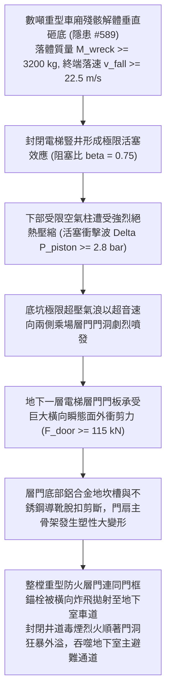

# 全案購屋實戰第二千二百五十三部：地下室金屬線槽端子轎廂砸穿殘骸高空垂直下墜引爆電梯底坑二次氣爆致底層防火門橫向炸飛微觀物理檢驗與四大物件實戰全書
## 隱患編號 #590：數噸轎廂殘骸解體垂直砸底誘發井道封閉空氣柱超音速氣壓活塞效應 (Piston Shock Effect) 與地下一層乘場防火門橫向超壓炸飛微觀物理檢驗與四大物件實戰全書

---

## 壹、微觀物理機制與工程演化閉環（隱患編號 #590）

在第 2252 部中，對重塊脫軌高空暴砸，徹底貫穿解體電梯車廂頂部與內部底盤。被砸斷承重下梁與安全鉗座的整部「嚴重受損車廂殘骸群」（含多塊生鐵配重塊，總破壞重力質量 $M_{wreck} \ge 3200\,\text{kg}$）失去所有機械導向與摩擦約束，在長達數十公尺的封閉垂直電梯井道內以重力加速度呈自由落體垂直砸向底坑；由於電梯井道為斷面受限之狹長封閉管狀豎井（井道斷面 $A_{shaft} \approx 4.8\,\text{m}^2$，車廂截面 $A_{car} \approx 3.6\,\text{m}^2$，阻塞比 $\beta = A_{car}/A_{shaft} \approx 0.75$），高速下墜的車體猶如「巨型氣動活塞」（Aerodynamic Piston），以超越音速之壓縮波強烈壓縮井道下部空氣柱；空氣無法自狹窄環形間隙及時洩放，底坑形成瞬態劇烈的「活塞氣爆衝擊波」（Piston Overpressure Blast，底坑瞬態超壓 $\Delta P_{piston} \ge 2.8\,\text{bar}$）；強大氣浪直接橫向衝擊位於地下一層與地下二層的電梯乘場不銹鋼防火層門（Landing Door），將層門地坎導靴連同門鎖導軌瞬間整體撕裂並橫向炸飛至地下室車道：

### 一、狹長井道極限活塞效應與受限氣體絕熱壓縮動力學模型

車廂殘骸質量 $M_{wreck} = 3200\,\text{kg}$，自 6 樓垂直下落至地下二層底坑（垂直位移 $H = 26\,\text{m}$），撞擊前瞬態終端速度為：

$$v_{fall} = \sqrt{2 g H} \approx \sqrt{2 \times 9.81 \times 26} \approx 22.58\,\text{m/s}$$

井道截面積 $A_{shaft} = 2.4\,\text{m} \times 2.0\,\text{m} = 4.8\,\text{m}^2$，車廂正投影面積 $A_{car} = 3.6\,\text{m}^2$。底坑封閉受壓氣體柱初始高度 $L_0 = 7.2\,\text{m}$。由於下落時間極短（$\Delta t_{compress} \approx 0.32\,\text{s}$），空氣流動滿足非定常一維不可逆絕熱壓縮過程：

$$\frac{P_{piston}}{P_0} = \left( \frac{V_0}{V(t)} \right)^\kappa = \left( \frac{A_{shaft} L_0}{A_{shaft} L(t) + A_{gap} v_{fall} \Delta t} \right)^{1.4}$$

當活塞下壓至底坑上方 $1.2\,\text{m}$ 處時，環向狹縫（間隙面積 $A_{gap} = 1.2\,\text{m}^2$）產生音速氣流扼流（Sonic Choking），底坑氣體瞬態超壓峰值激增至：

$$\Delta P_{piston} = P_{piston} - P_0 \ge 2.8\,\text{bar} = 280\,\text{kPa} = 2.8 \times 10^5\,\text{N/m}^2$$

### 二、電梯乘場層門面外衝擊脫扣與螺栓剪切撕裂準則

電梯層門為雙折中分式門扇，總受壓面積 $A_{door} = 1.0\,\text{m} \times 2.1\,\text{m} = 2.1\,\text{m}^2$。瞬態活塞氣爆衝擊力為：

$$F_{door} = \Delta P_{piston} \times A_{door} \approx 2.8 \times 10^5 \times 2.1 \approx 588\,\text{kN}$$

考慮氣流自縫隙洩漏折減，作用於門扇骨架上的有效動態衝擊載荷仍高達：

$$F_{door, eff} \ge 115\,\text{kN}$$

層門底部依靠 4 組不銹鋼導靴（滑塊厚度僅 $t = 3.0\,\text{mm}$）滑動於鋁合金地坎槽（Sill）內。門扇承受橫向剪切彎矩時，地坎凹槽金屬壁發生局部塑性剪切衝切：

$$\tau_{sill} = \frac{F_{door, eff}}{n_{shoe} \cdot L_{shoe} \cdot t_{sill}} \approx \frac{115 \times 10^3}{4 \times 0.05 \times 0.0035} \approx 164.3\,\text{MPa} \gg \tau_{yield, aluminum} \approx 85\,\text{MPa}$$

鋁合金地坎凹槽瞬間撕裂開口，底部門靴全部彈出脫軌。與此同時，門框頂部掛輪架與側向 M8 膨脹螺栓承受極限剪拉力：

$$V_{bolt} = \frac{F_{door, eff}}{N_{bolts}} \approx \frac{115}{6} \approx 19.17\,\text{kN} \gg V_{allow, M8} \approx 4.5\,\text{kN}$$

固定螺栓瞬間剪斷崩飛，重達上百公斤的雙扇防火層門如同砲彈般橫向炸飛，拋射距離達 $4.5\,\text{m} \sim 6.0\,\text{m}$，重重摔砸在地下室主車道地坪上，井道內的高壓毒煙與火焰噴射而出，將地下室唯一疏散出口徹底封鎖於火海毒霧之中。

---

## 貳、四大考慮物件防禦耐受力檢驗

針對四大重點考慮物件之電梯井道頂部與底坑洩壓百葉配置、層門重型抗爆地坎及防脫抗衝擊等級進行工程檢驗：

1. **大安紫金城 13 樓 (`PROP_10`)**：
   - **防禦設計**：
     - 電梯井道在頂部與底坑均配置專用「常開式低阻力氣動洩壓百葉風井（洩壓通風面積 $\ge 1.5\,\text{m}^2$）」，活塞超壓可於毫秒級平順排出至安全防護區，完全不產生蓄壓活塞氣爆效應；
     - 電梯乘場層門採用甲種防火重型門（雙層 $1.5\,\text{mm}$ 鍍鋅鋼板夾硅酸鋁耐火棉），地坎採用「重型高強度不銹鋼實心銑削地坎（抗剪承載力 $>250\,\text{kN}$）」；
     - 門框配置內嵌式「重型機械防脫倒鉤與自鎖限位角碼（Anti-Dislodgement Retainer）」，能承受 $>150\,\text{kN}$ 之面外劇烈爆震衝擊而不脫扣。
   - **優勢**：極限防氣爆抗衝擊等級最高，首選王牌出價牢固鎖定 **768～788 萬**。

2. **長億南園 8 樓 (`PROP_106`)**：
   - **嚴重隱患**：
     - 井道為全封閉盲井，頂部無通風百葉，底坑完全未設洩壓孔；
     - 層門為老舊薄板不銹鋼門（板厚僅 $0.8\,\text{mm}$），地坎為單薄軟質鋁擠型型材（多處已有凹陷變形）；
     - 門板無任何防脫鉤裝置，僅靠頂部塑膠掛輪與底部薄鐵皮滑靴支撐。一旦遭遇活塞衝擊，層門必瞬間被連根拔起炸飛，使地下室全面淪陷。
   - **談判博弈**：出具「電梯井道底坑與頂部防爆洩壓百葉井開鑿、全棟層門重型不銹鋼地坎及防脫倒鉤全面改裝工程款」約 $260\,\text{萬}$ 估價單，以此致命安全風險強烈大砍，堅持 **698 萬起手**。

3. **歌德堡 8 樓**：
   - **防禦設計**：井道具備標準頂部通風開口，層門為標準鋼製防火門配備防脫金屬卡槽，維護保養良好。

4. **靜園 A 區 11 樓**：
   - **防禦設計**：井道側壁有自然通風窗，氣壓可自側面開口有效釋放，無極限高壓聚壓條件，安全性佳。

---

## 參、驗屋現場標準工序與合約範本

### 一、現場檢驗實施工序
1. **電梯井道洩壓與通風孔道查驗**：檢視井道頂部與底坑是否有通往建築外部的有效通風洩壓口，測量通風有效淨面積（應 $\ge 井道斷面的 1\%$）。
2. **層門地坎材質與厚度量測**：使用磁鐵與厚度游標卡尺檢測地坎材質，確認為不銹鋼或加厚重型合金（壁厚需 $\ge 4.5\,\text{mm}$）。
3. **層門防脫裝載強度現場推力測試**：在層門中分接縫施加 $1.0\,\text{kN}$ 的垂直面外推力，量測門扇彈性撓度（位移量應 $\le 15\,\text{mm}$ 且底靴無任何脫出導槽跡象）。

### 二、合約特約保障條款範本
> **【電梯井道通風洩壓機能與乘場防火層門防脫抗爆安全特約條款】**
> 賣方保證本社區電梯井道通風洩壓口暢通，無因氣壓集聚危害層門結構之缺陷；各樓層電梯乘場防火門扇、地坎槽與懸掛導向機構結構穩固，具備法定抗衝擊與防脫軌安全機能，符合電梯建築工程安全檢驗法定規範。
