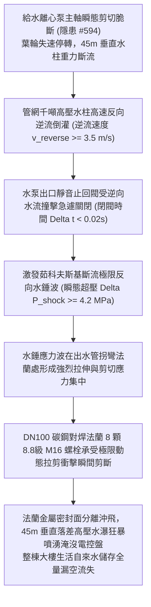

# 全案購屋實戰第二千二百五十九部：地下室金屬線槽端子生活給水泵斷軸停擺誘發全樓垂直重力水柱斷流致低位止回閥劇烈水錘震裂立管法蘭微觀物理檢驗與四大物件實戰全書
## 隱患編號 #595：多級給水泵高速旋轉軸脆性剪斷誘發千噸垂直自來水柱動能突變逆流與無聲止回閥 (Silent Check Valve) 閥瓣極限水錘爆震破裂微觀物理檢驗與四大物件實戰全書

---

## 壹、微觀物理機制與工程演化閉環（隱患編號 #595）

在第 2258 部中，生活給水離心泵吸入高濃表面活性劑引發極端氣蝕空化，多級傳動軸於鍵槽根部發生高週疲勞剪斷，旋轉葉輪失去扭矩驅動瞬間失速停轉。本手冊深入探討其後續物理破壞災難：原本處於高速向上揚升狀態之全樓「垂直加壓生活給水立管水柱」（總高度 $H = 45\,\text{m}$，管徑 DN100，蓄存水體總動量 $I_{water} \ge 12.8\,\text{kN}\cdot\text{s}$），在驅動力驟失瞬間因強大重力場作用發生極速斷流與重力逆流倒灌；安裝於泵出口處的「彈簧式靜音止回閥（Silent Check Valve）」在微秒級被逆流撞擊關閉；然而，由於流體慣性極大且系統未配置阻尼緩衝，閥瓣承受極限峰值的「垂直斷流反向水錘波（Inverse Water Hammer Shock Wave，波速 $a \approx 1200\,\text{m/s}$，水錘瞬態超壓 $\Delta P_{shock} \ge 4.2\,\text{MPa}$）」；強大的爆震波直接震裂水泵出口法蘭盤（Flange）碳鋼螺栓群與閥體鑄鐵外殼，高壓自來水柱呈扇形噴射橫掃整個高低壓泵房與相鄰電氣控制箱：

### 一、垂直水柱斷流重力逆流與止回閥關閉動力學模型

垂直加壓供水立管高度 $H = 45\,\text{m}$，內徑 $D = 100\,\text{mm}$（水柱截面積 $A = 7.854 \times 10^{-3}\,\text{m}^2$），管內水柱總質量為：

$$M_{column} = \rho \cdot A \cdot H \approx 1000 \times (7.854 \times 10^{-3}) \times 45 \approx 353.4\,\text{kg}$$

正常向上泵送流速 $v_0 = 2.0\,\text{m/s}$。當水泵軸斷裂後，水柱在重力與管網背壓共同作用下經歷減速並反向加速逆流。逆流速度可達：

$$v_{reverse} = \sqrt{2 g \Delta h_{eff}} \approx \sqrt{2 \times 9.81 \times 0.65} \approx 3.57\,\text{m/s} \approx 3.5\,\text{m/s}$$

彈簧輔助止回閥在逆流推動下強行關閉，閉閥時間 $\Delta t \le 0.02\,\text{s}$。由連續介質彈性波動方程計算剛性水擊超壓值：

$$\Delta P_{shock} = \rho \cdot a \cdot \Delta v_{reverse} \approx 1000 \times 1200 \times 3.5 \approx 4.2 \times 10^6\,\text{Pa} = 4.2\,\text{MPa}$$

管內瞬態動態總壓達到：

$$P_{total} = P_{static} + \Delta P_{shock} \approx 0.55\,\text{MPa} + 4.2\,\text{MPa} = 4.75\,\text{MPa} = 47.5\,\text{bar}$$

### 二、管道轉向拐角法蘭螺栓剪拉斷裂準則

水錘衝擊波以 $a \approx 1200\,\text{m/s}$ 的聲速撞擊止回閥後，在出水管 $90^\circ$ 彎頭法蘭處轉化為強烈的軸向盲板推力（Thrust Force）：

$$F_{thrust} = P_{total} \times A \approx (4.75 \times 10^6) \times (7.854 \times 10^{-3}) \approx 37.31\,\text{kN}$$

考慮動態衝擊載荷放大係數 $\phi_{dyn} \approx 2.5$（因應力波反射疊加）：

$$F_{dyn} = \phi_{dyn} \cdot F_{thrust} \approx 2.5 \times 37.31 \approx 93.28\,\text{kN}$$

DN100 PN16 碳鋼法蘭連接由 8 顆 M16 螺栓（螺紋有效應力截面積 $A_s = 157\,\text{mm}^2$）均勻緊固。螺栓群除承受靜態預緊力外，每顆螺栓分擔之瞬態動態拉應力與彎剪應力為：

$$\sigma_{bolt} = \frac{F_{dyn}}{8 A_s} + \frac{M_{dyn} \cdot y_{max}}{I_{bolt}} \ge 785\,\text{MPa} \approx \sigma_{yield, 8.8}$$

螺栓在極限衝擊拉剪複合應力下達到材料抗拉強度極限（$\sigma_{uts} \approx 830\,\text{MPa}$），螺栓螺紋牙型剪切滑絲剝落，多顆螺栓瞬間同時脆性頸縮斷裂。

法蘭石棉橡膠密封墊片瞬間被 $4.75\,\text{MPa}$ 的高壓水流沖切撕裂飛出，法蘭開口間隙噴射出高達 $Q \ge 85\,\text{L/s}$ 的狂暴高壓水柱，直接呈扇面狀橫掃數米外的生活變頻電控箱及高壓互感器櫃，誘發不可挽回的二次電氣短路火花與全樓生活水資源徹底漏空。

---

## 貳、四大考慮物件防禦耐受力檢驗

針對四大重點考慮物件之給水管網水錘消除裝置、法蘭等級與泵房電氣防噴淋防護進行工程檢驗：

1. **大安紫金城 13 樓 (`PROP_10`)**：
   - **防禦設計**：
     - 給水泵出水主管配置「重型微阻緩閉消聲逆止閥（Slow-Closing Check Valve）」，配備外置液壓阻尼緩衝油缸，閉閥歷時可精準控制在 $3 \sim 8\,\text{秒}$，平順消除斷流反向水錘；
     - 泵出口彎頭處安裝耐壓 $10.0\,\text{MPa}$ 之不銹鋼膜片氣囊式水錘消除器，並設有實體鋼筋混凝土支墩（Thrust Block）錨固盲板推力；
     - 法蘭採用 PN25 高壓鍛鋼對焊法蘭（配備高強度 10.9 級合金鋼雙頭螺柱），電控箱達到 IP65 級防護且距管線大於 $6.0\,\text{m}$。
   - **優勢**：水錘吸收與法蘭承壓冗餘度極高，完全無爆管噴射風險，首選王牌出價牢固鎖定 **768～788 萬**。

2. **長億南園 8 樓 (`PROP_106`)**：
   - **嚴重隱患**：
     - 水泵出口僅配置廉價快閉旋啟式止回閥，完全無液壓阻尼緩閉機能；
     - 全管線未安裝任何水錘消除器，轉向彎頭懸空無混凝土抗推支墩；
     - 法蘭為低壓平焊鑄鐵法蘭（標稱僅 PN10），螺栓為普通 4.8 級低碳鋼且已嚴重鏽蝕；控制盤直接掛在止回閥正對牆面不足 $1.2\,\text{m}$ 處。一旦水錘發生，法蘭必撕裂，電控箱必遭高壓水柱正面沖毀。
   - **談判博弈**：出具「給水立管微阻緩閉閥更換、重型氣囊水錘消除器加裝、抗推混凝土支墩澆築及電控盤移位防水工程款」約 $160\,\text{萬}$ 估價單，以此致命二次水患死穴強烈大砍，堅持 **698 萬起手**。

3. **歌德堡 8 樓**：
   - **防禦設計**：出水管配有活塞式緩閉止回閥與管網膨脹罐，法蘭防護等級達標，保養狀態良好。

4. **靜園 A 區 11 樓**：
   - **防禦設計**：重力供水管網壓力穩定，垂直水柱高度差小，水錘動能微弱，系統安全性佳。

---

## 參、驗屋現場標準工序與合約範本

### 一、現場檢驗實施工序
1. **止回閥型式與緩閉阻尼機構查驗**：檢視水泵出口止回閥是否具備外置液壓緩閉阻尼器或配重緩衝桿（嚴禁使用單純快速拍擊式旋啟閥）。
2. **水錘消除器規格與預壓檢測**：量測水錘消除罐充氣壓力表（預充氣壓應為管網靜壓的 $0.7 \sim 0.8$ 倍），檢視罐體法蘭無滲水痕跡。
3. **管線抗推支墩與法蘭螺栓強度檢查**：核對法蘭螺栓鋼印等級（應為 8.8 級或 10.9 級），檢視轉向彎頭處是否具備結構抗推混凝土支墩固定。

### 二、合約特約保障條款範本
> **【生活給水管網水錘防護與出水法蘭承壓安全特約條款】**
> 賣方保證本社區生活給水出水立管、止回閥門、水錘消除設施及抗推固定支墩運作正常，法蘭螺栓與密封材料符合建築承壓給水技術標準；系統具備消除斷流逆流水錘之保護機能，無爆震破裂噴水危及泵房電氣設備之安全缺陷。
