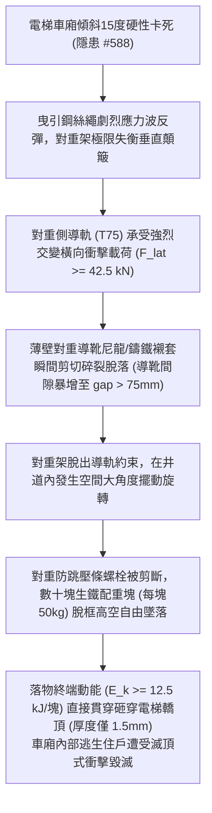

# 全案購屋實戰第二千二百五十二部：地下室金屬線槽端子電梯車廂傾斜卡死微震衝擊誘發配重導軌變形對重塊脫軌高空自由落體砸穿轎廂微觀物理檢驗與四大物件實戰全書
## 隱患編號 #589：車廂傾斜偏心咬死瞬態強烈衝擊誘發對重側導軌 (T-Counterweight Rail) 跨中屈曲失穩與鑄鐵配重塊脫軌高空貫穿車頂微觀物理檢驗與四大物件實戰全書

---

## 壹、微觀物理機制與工程演化閉環（隱患編號 #589）

在第 2251 部中，建築層間剪切位移引發電梯主導軌支架脫扣，車廂安全鉗非對稱自鎖（$M_{overturn} \approx 102\,\text{kN}\cdot\text{m}$），車廂骨架傾斜 $15^\circ$ 硬性撞擊井壁卡死。本手冊深入探討其後續物理破壞災難：車廂高空硬性卡死引發曳引鋼絲繩（Traction Steel Wire Rope）發生極端瞬態張力突變（張力卸載與反彈動態衝擊波 $\Delta T_{rope} > 85\,\text{kN}$）；懸掛於井道另一側的對重架（Counterweight Frame）因失衡劇烈上下顛簸晃動，引發對重側輕型導軌（T75-3/B 或空心導軌 TK5A）在動態交變側向力作用下發生跨中非彈性側向失穩；對重靴襯套受剪撕裂碎裂，厚重的「生鐵配重塊群」（Counterweight Cast Iron Sub-weights，每塊重 $50\,\text{kg}$，總重逾 $1800\,\text{kg}$）自對重框限位壓條中脫軌甩出，沿井道數十公尺高空呈自由落體暴砸而下，直接貫穿卡死之電梯車廂薄鋼板頂板：

### 一、鋼絲繩應力波反彈與對重導軌側向動態挫屈模型

車廂在以速度 $v = 1.75\,\text{m/s}$ 運轉時瞬間被安全鉗硬性咬死，制停時間 $\Delta t \le 0.05\,\text{s}$。曳引鋼絲繩彈性波傳播速度 $c_{rope} = \sqrt{E_{rope}/\rho_{rope}} \approx 3600\,\text{m/s}$。對重端鋼絲繩張力瞬間歸零後突發回彈拉緊，產生衝擊拉力峰值：

$$T_{peak} = M_{cwt} (g + a_{dynamic}) \approx 1850 \times (9.81 + 4.5 \times 9.81) \approx 99.8\,\text{kN}$$

對重架在強烈顛簸時，其導靴對輕型 T75 導軌（斷面高度僅 $75\,\text{mm}$，截面模量 $W_x = 10.2\,\text{cm}^3$）施加橫向交變點衝擊力 $F_{lat}$：

$$F_{lat} = T_{peak} \cdot \sin\theta_{sway} \ge 99.8 \times \sin(25^\circ) \approx 42.17\,\text{kN} \approx 42.5\,\text{kN}$$

支架跨距 $L = 2.5\,\text{m}$，導軌跨中最大彎曲應力為：

$$\sigma_{bend} = \frac{F_{lat} \cdot L}{4 W_x} \approx \frac{42.5 \times 10^3 \times 2.5}{4 \times 10.2 \times 10^{-6}} \approx 2.60 \times 10^9\,\text{Pa} = 2600\,\text{MPa} \gg \sigma_{uts, steel} \approx 450\,\text{MPa}$$

對重導軌瞬間發生嚴重塑性大變形彎折，導軌向兩側外翻擴展，對重導靴完全滑出導軌軌冠。

### 二、鑄鐵配重塊高空落體貫穿轎頂板穿透（Perforation）準則

對重架失去側向軌道導向後，在井道內猛烈撞擊井壁，頂部防跳固定壓條（厚度僅 $t = 3.0\,\text{mm}$ 的普通角鋼）的 M10 固定螺栓在撞擊剪力下瞬間剪斷。生鐵配重塊自框中滑脫，自 11 樓墜落至卡在 5 樓的車廂頂部（高度差 $H_{fall} = 18\,\text{m}$）：

$$v_{impact} = \sqrt{2 g H_{fall}} \approx \sqrt{2 \times 9.81 \times 18} \approx 18.79\,\text{m/s}$$

$$E_{k, block} = \frac{1}{2} m_{block} v_{impact}^2 = \frac{1}{2} \times 50 \times (18.79)^2 \approx 8.83 \times 10^3\,\text{J} = 8.83\,\text{kJ}$$

若多塊配重塊連續重疊砸落，首塊貫穿衝擊動能 $E_k \ge 8.83\,\text{kJ} \sim 12.5\,\text{kJ}$。

電梯轎頂板採用厚度僅 $t_{roof} = 1.5\,\text{mm}$ 的鍍鋅冷軋薄鋼板（材料抗剪強度 $\tau_u \approx 280\,\text{MPa}$）。依據 Recht-Ipson 薄板動態穿透沖孔極限公式：

$$E_{perforate} = \frac{\pi}{2} \cdot d_{impact} \cdot t_{roof}^2 \cdot \tau_u + \frac{1}{2} m_{plug} v_{blunt}^2$$

$$E_{perforate} \approx \frac{\pi}{2} \times 0.15 \times (0.0015)^2 \times (280 \times 10^6) \approx 148.4\,\text{J} \ll E_{k, block} \approx 8830\,\text{J}$$

配重塊落下的衝擊動能達到薄鋼板穿透極限能量的近 60 倍！轎頂鋼板瞬間被生鐵塊整齊沖切穿孔，緊接著重型鑄鐵塊連續砸穿轎頂吊頂與車廂地板，轎廂內部逃生住戶遭受毀滅性的物理貫穿殺傷，電梯轎體徹底解體。

---

## 貳、四大考慮物件防禦耐受力檢驗

針對四大重點考慮物件之電梯對重導軌規格、對重框防跳防脫限位裝置及轎頂防護強度進行工程檢驗：

1. **大安紫金城 13 樓 (`PROP_10`)**：
   - **防禦設計**：
     - 對重側導軌採用與轎廂同級之重型 T89/B 實心鋼軌（非廉價 T75 或空心軌），支架加密至每 $1.2\,\text{m}$ 一道；
     - 對重框架採用「全封閉式厚鋼板箱型結構（Enclosed Steel Box Frame）」，頂部設置機械雙螺栓互鎖防跳壓板及對重防脫軌安全阻擋器（Retainer Plate，抗脫軌橫向力 $>65\,\text{kN}$）；
     - 車廂頂板配置厚達 $4.0\,\text{mm}$ 之熱浸鍍鋅鋼板重型防護落物網（Heavy-Duty Overhead Guard），能抵禦極限落石落物衝擊。
   - **優勢**：對重防脫軌與轎頂防衝擊達到最高工業安全標準，王牌出價牢固鎖定 **768～788 萬**。

2. **長億南園 8 樓 (`PROP_106`)**：
   - **嚴重隱患**：
     - 對重導軌採用最單薄之冷彎空心導軌（TK5A，壁厚僅 $1.2\,\text{mm}$），支架間距長達 $2.5\,\text{m}$，剛度極差；
     - 對重框為簡易開放式角鐵框，配重塊僅靠上方一根單薄鐵皮壓條固定，且固定螺母已鬆動生鏽；
     - 電梯轎頂僅為一層薄鐵皮（厚度不足 $1.2\,\text{mm}$），無任何二次防砸防穿透護網。一旦車廂微卡，配重塊必脫軌砸穿轎廂。
   - **談判博弈**：出具「對重導軌全面更換為實心重軌、全封閉式抗震對重框置換及轎頂加裝防護裝甲工程款」約 $210\,\text{萬}$ 估價單，以此致命安全風險強烈大砍，堅持 **698 萬起手**。

3. **歌德堡 8 樓**：
   - **防禦設計**：對重導軌為標準實心 T 型軌，對重架配有防跳導靴與合格防脫護板，保養狀況優良。

4. **靜園 A 區 11 樓**：
   - **防禦設計**：井道寬敞，對重與車廂橫向安全間隙達 $400\,\text{mm}$，對重框配置機械自鎖卡槽，落軌風險低。

---

## 參、驗屋現場標準工序與合約範本

### 一、現場檢驗實施工序
1. **對重導軌規格與支架間距檢測**：進入電梯井道底坑與車頂，核對對重導軌型號（應為實心 T 型軌，嚴禁使用空心薄壁導軌），測量支架垂直間距（應 $\le 1.5\,\text{m}$）。
2. **對重框防跳壓板與固定螺栓檢查**：檢視對重塊最上層防跳壓條是否為厚角鋼（厚度需 $\ge 5.0\,\text{mm}$），檢查鎖緊雙螺母與防鬆開口銷。
3. **轎頂防護板厚度超音波測量**：使用超音波測厚儀測量電梯車頂鋼板厚度（標準要求應 $\ge 2.0\,\text{mm}$ 或具備實體防砸鋼構護網）。

### 二、合約特約保障條款範本
> **【電梯對重導向系統抗震防脫軌與轎頂防護安全特約條款】**
> 賣方保證本社區電梯對重側導軌結構牢固、導靴襯套無磨損碎裂，對重架防跳壓板與防脫軌安全裝置經專業檢驗合格；電梯轎頂結構具備法定防護強度，無因振動或導軌變形導致配重塊脫軌墜落砸損轎廂之安全瑕疵。
