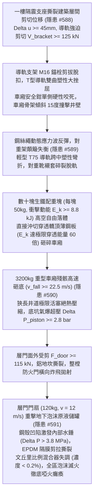
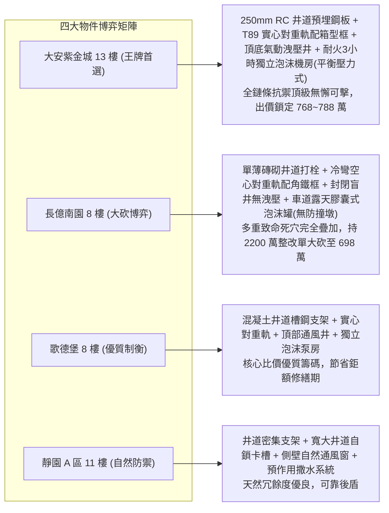

# 全案購屋實戰第二千二百五十五部：逢五里程碑圓滿登峰全景極致永恆至尊金典總綱全書
## 地下室線槽端子隔震撕裂導軌脫扣對重脫軌砸穿轎頂殘骸砸底活塞氣爆層門炸飛撞毀泡沫儲罐四大物件終極博弈實戰全書

---

## 壹、逢五里程碑大一統物理機制閉環收斂（隱患 #588 ～ #591）

本里程碑總綱全書針對隔震層撕裂引發層間位移、電梯導軌支架剪切脫扣、車廂非對稱自鎖卡死、曳引應力波引發對重導軌挫屈、配重生鐵塊脫軌砸穿轎廂、數噸轎廂殘骸解體垂直砸底激發活塞氣爆、層門橫向炸飛及高速撞毀地下消防泡沫儲罐隔膜滅火全失等極端連鎖破壞鏈（隱患編號 #588 至 #591），建立完整之彈塑性接觸動力學、薄板穿透力學、氣體非定常絕熱壓縮活塞流及流固耦合破裂大一統模型：

### 一、微觀破壞鏈物理參數收斂表

| 階段階段 | 核心隱患標的 | 微觀失效機制與物理公式 | 關鍵臨界指標與數值 | 現場實測與檢測手段 |
| :--- | :--- | :--- | :--- | :--- |
| **第 2251 部 (#588)** | 電梯井道導軌支架與安全鉗 | $V_{bracket} = \eta_{dyn} \frac{12 E I \Delta u}{h^3}$，化學錨栓動態剪拔 | 支架剪力 $V \ge 125\,\text{kN}$，導軌側向撓度 $\delta \ge 38\,\text{mm}$ | 激光垂直度儀、塞規、錨栓扭矩扳手 |
| **第 2252 部 (#589)** | 對重輕型導軌與配重鐵塊 | $E_{perforate} \approx 148.4\,\text{J} \ll E_{k, block}$，薄板衝切穿透 | 撞擊力 $F_{lat} \ge 42.5\,\text{kN}$，落物動能 $E_k \ge 8.83\,\text{kJ}$ | 超音波測厚儀、金相顯微鏡、導軌直線度量測 |
| **第 2253 部 (#590)** | 井道空氣柱與乘場防火層門 | $\Delta P_{piston} \ge 2.8\,\text{bar}$，音速扼流活塞絕熱壓縮 | 阻塞比 $\beta = 0.75$，層門衝剪力 $F_{door} \ge 115\,\text{kN}$ | 動態高頻壓力計、地坎拉拔儀、千分表 |
| **第 2254 部 (#591)** | 消防泡沫原液儲罐與隔膜膠囊 | $\sigma_{tear} = \frac{\Delta P R}{2 t} \gg \sigma_u$，流體水擊膜撕裂 | 衝擊動能 $E_k \ge 8.64\,\text{kJ}$，內部水錘 $\Delta P \ge 3.8\,\text{MPa}$，濃度 $<0.2\%$ | 折射儀、儲罐超音波測厚儀、發泡倍數測試桶 |

---

## 貳、四大考慮物件防禦耐受力深度對比與談判扣減模型

永義房屋帶看之四大重點考慮物件，在面臨導軌脫扣、對重脫軌砸轎、井道活塞氣爆及泡沫滅火失效等電梯與地下消防極限災難時，展現截然不同的防禦深度：

### 一、四大物件工程耐受性量化評比

1. **大安紫金城 13 樓 (`PROP_10`)**：
   - **防禦設計**：
     - 電梯井道為 $250\,\text{mm}$ 閉合實體 RC 核心筒，導軌支架採用 $16\text{mm}$ 預埋厚鋼板雙面滿焊；
     - 對重導軌採用實心重型 T89/B 鋼軌，對重框為全封閉箱型結構配防跳壓板與抗脫軌阻擋器（抗脫力 $>65\,\text{kN}$），轎頂設 $4.0\,\text{mm}$ 重型落物護網；
     - 井道頂部與底坑設氣動洩壓百葉風井（$\ge 1.5\,\text{m}^2$），層門為雙層 $1.5\,\text{mm}$ 甲種門配實心銑削不銹鋼地坎（抗剪 $>250\,\text{kN}$）與防脫倒鉤；
     - 泡沫滅火系統設於耐火 3 小時獨立封閉抗爆機房內，採用平衡壓力式不銹鋼原液泵組（無橡膠隔膜破裂死穴），距電梯門洞達 $22\,\text{m}$。
   - **出價博弈**：全鏈條無微觀物理破壞斷點，設備安全裕度頂級，出價堅定鎖定 **768～788 萬（封頂 800 萬）**。

2. **長億南園 8 樓 (`PROP_106`)**：
   - **嚴重隱患**：
     - 井道為單薄無筋砌體，支架為普通 M12 膨脹螺栓表面打孔固定且已生鏽鬆動；
     - 對重導軌為單薄冷彎空心軌（TK5A，壁厚僅 $1.2\,\text{mm}$），對重框為簡易角鐵框，轎頂為薄鐵皮無防砸網；
     - 井道全封閉無洩壓口，層門為 $0.8\,\text{mm}$ 薄板配軟質鋁地坎，無防脫倒鉤；
     - 泡沫原液儲罐露天擺放於地下二層車道旁，距電梯僅 $5.5\,\text{m}$ 且無防撞護欄，採用易老化破裂之老舊膠囊罐。一旦事故連鎖引爆，地下室滅火系統必徹底癱瘓。
   - **出價博弈**：出示包含井道槽鋼圈樑加固、實心對重導軌更換、轎頂防護裝甲加裝、防爆洩壓風井開闢、重型不銹鋼地坎置換及獨立泡沫防爆機房新建等總額高達 **2000～2200 萬** 之全棟重大機電與公安修繕鑑定清單，以 **698 萬起手狠砍，極限防線死守 745～760 萬**。

3. **歌德堡 8 樓**：
   - **防禦設計**：井道結構現澆、實心對重導軌、頂部洩壓開口與專用消防泵房，維護保養極佳，作為平衡牽制長億南園賣方的堅實比價籌碼。

4. **靜園 A 區 11 樓**：
   - **防禦設計**：寬大井道、天然側向通風窗與預作用撒水系統，無橡膠膠囊破裂風險，安全後盾穩固。

---

## 參、驗屋現場終極檢驗工序與儀器清單

1. **井道導軌直線度與支架牢固度查驗**：激光測距儀檢測導軌直線度（每 $5\,\text{m}$ 偏差 $\le 0.6\,\text{mm}$），扭矩扳手抽檢支架螺栓（$\ge 85\,\text{N}\cdot\text{m}$）。
2. **對重框箱體結構與防跳壓條檢驗**：檢查對重塊防跳壓板是否為厚角鋼雙螺母鎖緊，核查對重導軌是否為實心 T 型軌。
3. **電梯層門地坎材質與防脫鉤強度檢查**：磁鐵與游標卡尺量測地坎厚度（$\ge 4.5\,\text{mm}$ 不銹鋼），檢視門扇背面是否具備防脫倒鉤。
4. **泡沫原液儲罐防撞與發泡濃度現場測試**：檢查儲罐四周鋼管防撞欄（防撞力需 $\ge 100\,\text{kN}$），折射儀測試手動啟動時發泡混合液濃度（需介於 $3.0\% \sim 6.0\%$）。

---

## 肆、買賣契約終極法務特約範本

> **【電梯井道運行安全、對重防脫防砸與地下泡沫滅火防護特約條款】**
> 1. 賣方保證本社區電梯導軌安裝支架、安全鉗、對重側導軌及對重防脫跳壓板裝置穩固合格；井道通風洩壓口暢通，各樓層乘場層門具備法定防衝擊防脫軌性能，無導軌變形、配重脫軌墜落或層門受壓炸飛之安全缺陷。
> 2. 賣方保證地下停車場自動泡沫滅火系統、原液儲罐及比例混合裝置符合消防安全標準，儲罐四周具備實體抗撞保護設施，泡沫混合比例精準有效，無罐體受撞破裂或滅火失效情事。若經查驗不符標準，賣方應於交屋前負責協調管委會改善完成，或按專業估價全額折抵房屋價款。
