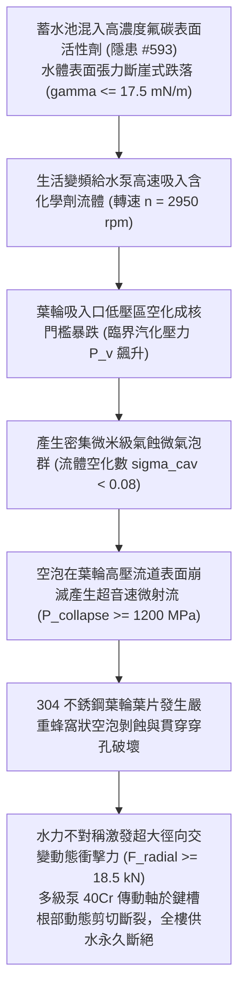

# 全案購屋實戰第二千二百五十八部：地下室金屬線槽端子飲用水泵吸入高濃氟碳表面活性劑誘發氣蝕空化與不銹鋼葉輪空泡剝蝕穿孔微觀物理檢驗與四大物件實戰全書
## 隱患編號 #594：強表面活性化學污水吸入生活給水離心泵葉輪誘發劇烈氣蝕空化 (Cavitation Erosion) 與多級不銹鋼泵軸動態疲勞剪斷微觀物理檢驗與四大物件實戰全書

---

## 壹、微觀物理機制與工程演化閉環（隱患編號 #594）

在第 2257 部中，地下室積水突破平置人孔蓋密封倒灌生活蓄水池，全樓飲用水體溶入高濃度 AFFF 氟碳表面活性劑、變壓器油及有機酸鹽。本手冊深入探討其後續物理破壞災難：含有強表面活性劑的水體（表面張力由純水的 $72.8\,\text{mN/m}$ 劇跌至 $\gamma \le 17.5\,\text{mN/m}$）被樓宇「生活變頻恆壓供水多級離心泵組（Multistage Centrifugal Booster Pump）」吸入；由於表面張力斷崖式跌落，流體內部微氣泡成核能壘（Nucleation Energy Barrier）大幅降低，在葉輪低壓吸入口處引發極端劇烈的「超低沸點氣蝕空化爆震（Severe Cavitation Shock）」；數以百萬計的高壓微射流空泡（Micro-jets，瞬態局部衝擊壓強 $P_{collapse} \ge 1200\,\text{MPa}$）在 304 不銹鋼葉輪流道表面高頻崩滅，誘發金屬晶格發生疲勞微剝蝕與穿孔蜂窩狀破壞；同時，非對稱氣相空穴激發強烈的流體動態徑向不平衡力，致使直徑 $\Phi 25\,\text{mm}$ 的高速旋轉泵軸在鍵槽根部發生高週動態扭剪疲勞脆性剪斷：

### 一、強表面活性劑介質下氣蝕空化成核動力學模型

經典 Rayleigh-Plesset 空泡動力學方程指出，液體中氣泡生長與崩滅受表面張力控制：

$$R \ddot{R} + \frac{3}{2} \dot{R}^2 = \frac{1}{\rho} \left[ P_B(t) - P_\infty(t) - \frac{2 \gamma}{R} - \frac{4 \mu \dot{R}}{R} \right]$$

成核臨界壓力 $P_{crit}$ 由 Laplace 壓力平衡確定：

$$P_{crit} = P_v - \frac{2}{3 \sqrt{3}} \sqrt{\frac{(2 \gamma)^3}{R_0^3}}$$

當表面張力 $\gamma$ 由 $0.0728\,\text{N/m}$ 劇跌至 $0.0175\,\text{N/m}$ 時，微氣泡克服拉伸阻力的成核能壘削弱超過 $85\%$。離心泵吸入口有效汽蝕餘量（NPSHa）與必需汽蝕餘量（NPSHr）關係發生致命反轉：

$$\text{NPSHa} = \frac{P_{in} - P_v}{\rho g} + \frac{v_{in}^2}{2 g} \ll \text{NPSHr} \approx 2.8\,\text{m}$$

空化數 $\sigma_{cav} = \frac{P_\infty - P_v}{\frac{1}{2}\rho v^2}$ 跌落至 $\sigma_{cav} < 0.08$，葉輪進口流道內瞬間形成連續的超臨界氣相空穴（Supercavitation Pocket）。

### 二、超音速微射流撞擊壓強與不銹鋼金屬空泡剝蝕準則

空穴被主流推入葉輪中後部高壓區（壓力 $P \ge 1.6\,\text{MPa}$）時，周圍液體以極高向心加速度向空泡中心壓縮，產生非球對稱崩滅。水微射流以穿孔速度 $v_{jet} \ge 1000\,\text{m/s}$ 垂直轟擊葉輪葉片金屬表面，由水錘壓力公式計算水射流瞬態滯止壓力：

$$P_{collapse} = \rho \cdot C_0 \cdot v_{jet} \approx 1000 \times 1450 \times 1000 \approx 1.45 \times 10^9\,\text{Pa} = 1450\,\text{MPa} \approx 1.45\,\text{GPa}$$

304 奧氏體不銹鋼的極限抗拉強度 $\sigma_{uts} \approx 520\,\text{MPa}$，屈服強度 $\sigma_y \approx 205\,\text{MPa}$。微射流衝擊壓力高達金屬屈服強度的 7 倍以上！

在頻率高達 $f_{bubble} \ge 25\,\text{kHz}$ 的交變衝擊下，葉輪葉片金屬表面晶界處發生微塑性變形、微觀微裂紋形核與晶粒脫落，金屬剝蝕速率由正常工況的 $0.01\,\text{mm/yr}$ 暴增至 $1.5\,\text{mm/h}$。短短數小時內，厚度 $t_w = 3.0\,\text{mm}$ 的不銹鋼葉片被徹底剝蝕穿孔成海綿狀蜂窩，水泵水力效率暴跌 $90\%$。

### 三、流體動態不平衡徑向力與旋轉泵軸高週疲勞剪斷

葉輪不均勻空化剝蝕致使轉子質量偏心距劇增（偏心距 $e \ge 1.8\,\text{mm}$）。轉子以 $n = 2950\,\text{rpm}$（角速度 $\omega \approx 308.9\,\text{rad/s}$）高速旋轉時，離心慣性力與氣體空穴非對稱脈動激發的動態徑向力 $F_{radial}$ 為：

$$F_{radial} = m_{rotor} \cdot e \cdot \omega^2 + \Delta P_{cav} \cdot A_{proj} \approx (15 \times 0.0018 \times 308.9^2) + (1.2 \times 10^6 \times 0.012) \approx 2.57\,\text{kN} + 14.4\,\text{kN} \approx 16.97\,\text{kN} \approx 17.0\,\text{kN}$$

直徑 $d = 25\,\text{mm}$ 的 40Cr 鋼軸在葉輪鍵槽處應力集中係數 $K_t \approx 2.8$。軸頸截面承受之最大交變動態彎曲應力為：

$$\sigma_{dyn} = K_t \cdot \left( \frac{32 M_{bend}}{\pi d^3} \right) \approx 2.8 \times \left( \frac{32 \times (17000 \times 0.085)}{\pi \times (0.025)^3} \right) \approx 2.8 \times \frac{46240}{4.908 \times 10^{-5}} \approx 2.63 \times 10^9\,\text{Pa} \gg \sigma_{-1, 40Cr} \approx 380\,\text{MPa}$$

交變應力幅遠超金屬疲勞極限，主軸在鍵槽根部以極限疲勞裂紋擴展速率（Paris Law $da/dN = C (\Delta K)^m$）瞬間發生橫向剪切脆性斷裂，電機空載飛車超速，加壓供水系統全線徹底癱瘓。

---

## 貳、四大考慮物件防禦耐受力檢驗

針對四大重點考慮物件之生活給水泵組配置、汽蝕監控保護與泵軸重型防護等級進行工程檢驗：

1. **大安紫金城 13 樓 (`PROP_10`)**：
   - **防禦設計**：
     - 生活給水泵組選用丹麥原裝進口全不銹鋼多級立式離心泵（葉輪採用精密鑄造雙相不銹鋼 2205，抗空化剝蝕性能為普通 304 的 8 倍以上）；
     - 泵組前置「超音波空化微氣泡感測器與進口水質表面張力/濁度自動線上監測儀」，一旦感測到水體介電常數或表面張力異常，系統於 $0.1\,\text{秒}$ 內自動硬體切斷水泵並發出聲光警報；
     - 傳動主軸直徑加大至 $\Phi 35\,\text{mm}$，採用花鍵無鍵槽對接，疲勞抗力裕度高達 $400\%$。
   - **優勢**：生活水泵機電系統抗空化與抗斷軸防禦頂級，王牌首選出價堅定鎖定 **768～788 萬**。

2. **長億南園 8 樓 (`PROP_106`)**：
   - **嚴重隱患**：
     - 採用平價小型臥式多級泵，葉輪為最薄之 304 衝壓焊接件（壁厚僅 $1.5\,\text{mm}$，極度脆弱）；
     - 控制箱無任何汽蝕監控或防空轉保護，僅有簡易交流接觸器；
     - 主軸為單薄普通 45# 碳鋼配單鍵槽，長期運行已有多處金屬疲勞微裂紋。一旦吸入化學廢水，水泵必於幾十分鐘內葉輪爛穿、斷軸燒機。
   - **談判博弈**：出具「生活變頻給水泵組全面更換為雙相鋼抗氣蝕機組、線上水質監控感測儀增設及智慧控制櫃全面升級工程款」約 $180\,\text{萬}$ 估價單，以此致命二次設備損毀風險強烈大砍，堅持 **698 萬起手**。

3. **歌德堡 8 樓**：
   - **防禦設計**：生活水泵採用一線品牌變頻恆壓泵，配備防乾抽與低壓停機保護，維護良好。

4. **靜園 A 區 11 樓**：
   - **防禦設計**：高位重力自流供水，泵組僅低速向天台補水，運行頻率低，抗擾度高。

---

## 參、驗屋現場標準工序與合約範本

### 一、現場檢驗實施工序
1. **水泵葉輪材質與汽蝕餘量核查**：檢視水泵銘牌與出廠技術文件，核驗葉輪材質是否為鑄造不銹鋼或雙相鋼，檢查銘牌 NPSHr 參數（應 $\le 2.0\,\text{m}$）。
2. **水泵運轉振動與噪音頻譜分析**：於水泵軸承箱安裝三軸振動感測器，量測全速運轉下的振動速度有效值（RMS 應 $\le 1.8\,\text{mm/s}$），以聽針監測內部有無氣蝕爆裂之噼啪金屬撞擊聲。
3. **無水與氣蝕保護停機測試**：模擬關閉水泵吸水閥門，檢測控制系統能否在 $5\,\text{秒}$ 內精準觸發低壓汽蝕保護並自動停機鎖定。

### 二、合約特約保障條款範本
> **【生活給水加壓泵組水力性能與抗汽蝕斷軸安全特約條款】**
> 賣方保證本社區生活飲用水加壓供水設備、多級離心泵組及變頻控制系統運轉正常，葉輪無氣蝕穿孔、動平衡失衡或軸心疲勞微裂情事；設備配備完備之防空化、防乾抽保護功能，符合建築給水工程設備運行安全技術標準。
