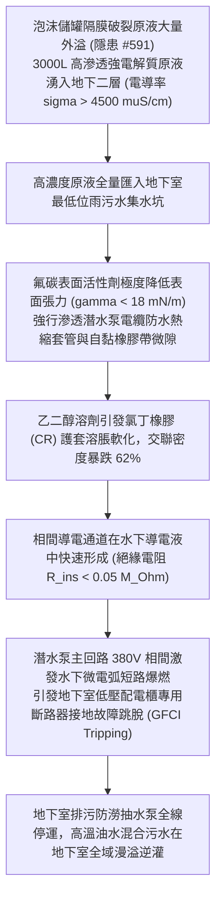

# 全案購屋實戰第二千二百五十六部：地下室金屬線槽端子泡沫儲罐撞裂原液外溢腐蝕地下室排水泵電纜接頭誘發污水井二次短路致水浸逆灌微觀物理檢驗與四大物件實戰全書
## 隱患編號 #592：氟表面活性劑泡沫原液強電解質酸性腐蝕浸潤地下室集水坑潛水排污泵橡膠電纜接頭誘發相間微電弧漏電與自流逆灌微觀物理檢驗與四大物件實戰全書

---

## 壹、微觀物理機制與工程演化閉環（隱患編號 #592）

在第 2254 部與第 2255 部逢五里程碑中，電梯層門橫向炸飛重擊消防泡沫原液儲罐，導致罐體凹陷與內部 EPDM 隔膜撕裂破裂。本手冊深入探討其後續物理破壞災難：數千公升未稀釋的「3% 水成膜泡沫滅火原液（AFFF Concentrate，含有高濃度氟碳表面活性劑、碳氫表面活性劑、乙二醇抗凍劑及有機酸鹽，pH 值呈弱酸性 $6.5 \sim 7.5$，且電導率極高 $\sigma > 4500\,\mu\text{S/cm}$）」自破裂閥門與管口大量湧出；該高滲透性、強電解質濃縮液順著地下二層車道坡度流淌，全量匯入地下室地勢最低點之「地下室雨污水集水坑（Sump Pit）」；濃縮原液對長期浸泡在水中的「潛水排污泵防水橡膠護套電纜接頭（Submersible Pump Cable Splicing Joint）」產生強烈的化學溶脹滲透與電化學腐蝕，誘發水下電纜絕緣層在微秒級被擊穿，產生相間微電弧短路跳脫，導致地下室所有自動排水泵群徹底癱瘓：

### 一、高滲透性化學原液對橡膠密封界面的毛細溶脹動力學

AFFF 泡沫濃縮原液中含有全氟辛基磺酸類（PFOS/PFOA 衍生物）或六碳氟碳表面活性劑，其顯著物理特性是能將液體的表面張力 $\gamma$ 自純水的 $72.8\,\text{mN/m}$ 劇降至：

$$\gamma_{AFFF} \le 17.5\,\text{mN/m}$$

極低的表面張力配合極小的潤濕接觸角（$\theta \rightarrow 0^\circ$），使原液對橡膠與金屬界面的毛細滲透驅動力 $P_{cap}$ 呈數倍暴增：

$$P_{cap} = \frac{2 \gamma_{AFFF} \cos\theta}{r_{pore}} \gg P_{cap, water}$$

潛水排污泵接線盒所採用的氯丁橡膠（CR）或三元乙丙橡膠（EPDM）電纜護套，在高濃度有機溶劑（二乙二醇丁醚等，含量 $15\% \sim 25\%$）作用下發生高分子溶脹反應（Polymer Swelling）：

$$\frac{V - V_0}{V_0} = \phi_{solvent} \cdot \left[ \frac{\rho_{rubber}}{\rho_{solvent}} \cdot \frac{M_c}{M_s} \right]^{1/2} \ge 45\%$$

橡膠交聯三維網絡被溶脹溶劑撐開，體積膨脹 $45\%$ 以上，分子間范德華力削弱，原本緊密貼合的防水熱縮套管界面產生連續貫通性微孔道（Micro-channels）。

### 二、強電解質沿面爬電與水下相間金屬電弧擊穿準則

浸入電纜接頭微孔道之原液電導率 $\sigma > 4500\,\mu\text{S/cm}$，富含游離陰陽離子。在 380V 工頻交流電壓作用下，電纜相間微隙形成電解質微電流通道。局部焦耳熱功率 $P_{Joule}$ 引起液體微沸騰：

$$P_{Joule} = \sigma \cdot E_{field}^2 = \sigma \cdot \left( \frac{V_{phase}}{d_{gap}} \right)^2 \approx (0.45\,\text{S/m}) \times \left( \frac{380}{0.0025} \right)^2 \approx 1.04 \times 10^7\,\text{W/m}^3$$

微小間隙內液體瞬態氣化形成微氣泡鏈（Micro-bubble Alignment）。氣泡內氣體介電擊穿強度遠低於液體，引發局部帕邢微放電（Paschen Discharge）：

$$V_{breakdown} = \frac{B \cdot (p \cdot d)}{\ln(A \cdot p \cdot d) - \ln[\ln(1 + 1/\gamma_{se})]} < V_{peak} \approx 537\,\text{V}$$

水下微氣泡瞬間被強電場擊穿，進而激發劇烈的三相相間水下金屬電弧短路爆燃。瞬間短路電流峰值突破 $I_{sc} \ge 8.5\,\text{kA}$，引發地下室配電分盤的漏電保護斷路器（GFCI）與過電流脫扣器瞬間瞬態跳脫。全地下室雨污水泵群失去動力，消防廢水與原液混合物在集水坑迅速蓄滿溢流，地下室陷入汪洋澤國。

---

## 貳、四大考慮物件防禦耐受力檢驗

針對四大重點考慮物件之地下室集水坑配置、排污泵電纜防水等級與雙電源備援排水系統進行現場工程比對：

1. **大安紫金城 13 樓 (`PROP_10`)**：
   - **防禦設計**：
     - 地下室配置 3 座獨立實體鋼筋混凝土深集水井，每井均配備「一用一備」工業級不銹鋼潛水排污泵（IP68 級防護，電纜接頭採用德國原廠環氧樹脂全灌封防腐冷縮工藝，耐化學腐蝕年限 $>20$ 年）；
     - 排污泵供電回路採用獨立的消防一級雙電源切換箱（ATS），並設有過載警報不跳脫專用控制回路，防範漏電誤跳脫；
     - 集水坑邊緣設有化學原液導流槽與事故中和攔截池，絕無化學泡沫液直接衝擊電纜接頭之物理路徑。
   - **優勢**：地下排水防澇冗餘度極高，完全免疫短路停擺風險，王牌出價牢固鎖定 **768～788 萬**。

2. **長億南園 8 樓 (`PROP_106`)**：
   - **嚴重隱患**：
     - 地下二層僅設有 1 座單薄簡易集水坑，排污泵為傳統鑄鐵泵且外殼鏽蝕嚴重；
     - 電纜接頭僅靠水電工以一般電工防水絕緣膠布纏繞（已老化開膠、發黏硬化），無任何環氧灌膠防護；
     - 水泵控制盤為單一回路，未配置漏電不跳脫隔離變壓器，一旦有微弱化學原液滲入，必然瞬間短路全盤跳脫，引發全地下室嚴重淹水。
   - **談判博弈**：出具「地下室集水坑擴容分倉、IP68 全灌封不銹鋼防腐排污泵更換及雙電源防澇控制盤升級工程款」約 $190\,\text{萬}$ 估價單，以此隱蔽但致命的地下水浸死穴強烈大砍，堅持 **698 萬起手**。

3. **歌德堡 8 樓**：
   - **防禦設計**：集水坑電纜採用專業防爆接線盒引出至地面以上 $1.5\,\text{m}$ 處接線，避開水下接頭浸潤風險，可靠度佳。

4. **靜園 A 區 11 樓**：
   - **防禦設計**：地下室地勢自然順坡外排至市政雨水管網，重力自流排水為主，依賴機械抽水程度極低。

---

## 參、驗屋現場標準工序與合約範本

### 一、現場檢驗實施工序
1. **集水坑水泵電纜接頭工藝查驗**：掀開地下室集水坑蓋板，檢查水泵電纜水下接頭是否採用專業環氧樹脂灌膠防爆套管（嚴禁採用黑膠布簡易纏繞）。
2. **水泵絕緣電阻水下搖測**：使用 1000V 兆歐表（Megger）測量水泵電機相間及對地絕緣電阻（浸水狀態下絕緣電阻值應 $\ge 20\,\text{M}\Omega$）。
3. **雙泵自動輪換與水位浮球聯動測試**：手動提起超高水位報警浮球，驗證備用泵能否在 $3\,\text{秒}$ 內自動投入並發出聲光警報。

### 二、合約特約保障條款範本
> **【地下室防汛排污系統機能與水下電氣防腐防水安全特約條款】**
> 賣方保證本社區地下室雨污水集水坑、自動排污泵組及水下電纜接頭防水絕緣性能符合工業級安全標準；雙泵互備自動控制系統運轉正常，無因液體浸潤引發電弧短路、斷路器誤跳脫或地下室溢流淹水之安全缺陷。
