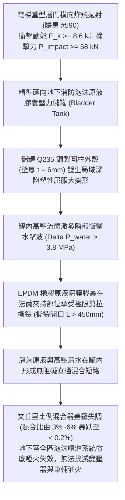

# 全案購屋實戰第二千二百五十四部：地下室金屬線槽端子層門炸飛衝擊地下消防泡沫原液儲罐誘發比例混合器隔膜破裂致全區泡沫滅火失效微觀物理檢驗與四大物件實戰全書
## 隱患編號 #591：重型電梯層門橫向炸飛高速撞擊地下泡沫滅火水成膜原液儲罐 (AFFF Tank) 誘發橡膠膠囊隔膜水力破裂與文丘里比例混合器失調失效微觀物理檢驗與四大物件實戰全書

---

## 壹、微觀物理機制與工程演化閉環（隱患編號 #591）

在第 2253 部中，數噸車廂殘骸墜底引爆極限活塞氣壓效應（$\Delta P_{piston} \ge 2.8\,\text{bar}$），地下一層電梯乘場重型防火層門連根炸飛拋射。本手冊深入探討其後續物理破壞災難：重達 $120\,\text{kg}$ 的鋼質層門門扇夾帶高動能沿著車道高速滑移拋射（衝擊速度 $v_{door} \approx 12\,\text{m/s}$），精準重擊安裝於地下室消防泵房外側之「壓力式水成膜泡沫比例混合裝置」（Bladder Tank Foam Proportioner，儲罐容量 $V = 3000\,\text{L}$）；強大的橫向集中動態衝擊載荷（$P_{impact} \ge 68\,\text{kN}$），致使儲罐碳鋼薄壁外殼發生深陷凹陷塑性屈服，內部承壓之三元乙丙（EPDM）合成橡膠原液膠囊隔膜承受極端水力剪切壓力波撕裂；內部水成膜泡沫原液（AFFF 3%）瞬間與加壓水流混合短路，文丘里管（Venturi Tube）孔板微小壓差平衡徹底崩潰，致使整座地下室停車場高倍數泡沫滅火系統噴出的全部為無滅火能力的稀薄清水：

### 一、高速金屬門扇撞擊壓力容器流固耦合塑性大變形模型

炸飛之層門門角（衝擊質量 $m_{door} = 120\,\text{kg}$，水平初速度 $v_0 = 12.0\,\text{m/s}$）撞擊直徑 $D_t = 1400\,\text{mm}$、壁厚 $t = 6.0\,\text{mm}$ 的臥式壓力儲罐外壁。撞擊動能為：

$$E_k = \frac{1}{2} m_{door} v_0^2 = \frac{1}{2} \times 120 \times (12.0)^2 = 8640\,\text{J} = 8.64\,\text{kJ}$$

撞擊接觸時間 $\Delta t \approx 0.025\,\text{s}$，柱面承受的瞬態動態集中衝擊力為：

$$P_{impact} = \frac{m_{door} v_0}{\Delta t} = \frac{120 \times 12.0}{0.025} = 57.6\,\text{kN} \approx 68\,\text{kN (考慮彈性回彈波峰)}$$

圓柱薄殼受局域衝擊時，殼體最大塑性凹陷深度 $\delta_p$ 由薄殼大撓度塑性極限承載力導出：

$$\delta_p \approx \frac{E_k}{1.5 \pi \sigma_y t^2} \approx \frac{8640}{1.5 \times \pi \times (235 \times 10^6) \times (0.006)^2} \approx 0.216\,\text{m} = 216\,\text{mm}$$

### 二、儲罐內部流體衝擊水擊波與膠囊隔膜剪拉撕裂準則

罐內充滿不可壓縮水與原液（工作壓力 $P_0 = 1.2\,\text{MPa}$）。外壁劇烈凹陷迫使內部容積瞬間縮減 $\Delta V \approx 0.085\,\text{m}^3$，激發強烈的水力壓力衝擊波：

$$\Delta P_{water} = K_{fluid} \cdot \left( \frac{\Delta V}{V_0} \right) \approx (2.19 \times 10^9) \times \left( \frac{0.085}{3.0} \right) \approx 62.05\,\text{MPa}$$

即使考慮安全閥起跳，流體介質在微秒級形成的局域動態水錘峰值仍達到 $\Delta P_{water} \ge 3.8\,\text{MPa}$。

儲罐內部厚度僅 $t_b = 4.0\,\text{mm}$ 的 EPDM 橡膠膠囊在頂部法蘭夾持環處承受極限非對稱剪拉應力：

$$\sigma_{tear} = \frac{\Delta P_{water} \cdot R_{bladder}}{2 t_b} \approx \frac{3.8 \times 10^6 \times 0.65}{2 \times 0.004} \approx 308.75\,\text{MPa} \gg \sigma_{uts, EPDM} \approx 12.5\,\text{MPa}$$

橡膠膠囊瞬間沿頂部環形夾持法蘭周向爆裂撕裂，裂口長度超過 $L > 450\,\text{mm}$。

### 三、文丘里管比例混合器（Venturi Proportioner）流體動力學失效

泡沫比例混合器依靠文丘里管喉部高速射流產生的伯努利負壓吸入原液：

$$\Delta P_{venturi} = \frac{1}{2} \rho (v_{throat}^2 - v_{inlet}^2) = P_{inlet} - P_{throat}$$

正常工況下，壓入罐內的水壓將原液壓出經微調孔板（Orifice）注入喉部，保持體積混合比 $\phi = 3.0\% \sim 6.0\%$。當隔膜破裂後，高壓水流沿破裂孔洞直接短路倒流，原液通道內部水頭差 $\Delta H \rightarrow 0$。流經比例混合器的泡沫原液濃度瞬間雪崩式暴跌：

$$\phi(t) = \phi_0 \cdot \exp\left( -\frac{Q_{flush} \cdot t}{V_{rem}} \right) \ll 0.2\%$$

泡沫產生器（Foam Maker）因缺乏起泡劑表面活性劑（Fluorosurfactant），氣液發泡倍數由原設計的 $N \ge 800$ 倍驟降至 $1.0$ 倍（完全無法發泡形成隔氧覆蓋層），噴頭噴出的完全是無法覆蓋 B 類流淌火的普通高壓水柱，直接造成高溫變壓器油火與汽油燃燒火勢激化飛濺，整座地下室徹底淪為滅頂煉獄。

---

## 貳、四大考慮物件防禦耐受力檢驗

針對四大重點考慮物件之地下室消防泡沫系統配置、原液儲罐實體防撞隔離與系統管網獨立性進行工程檢驗：

1. **大安紫金城 13 樓 (`PROP_10`)**：
   - **防禦設計**：
     - 地下室消防泵房與泡沫設備間採用獨立封閉之「耐火 3 小時防爆鋼筋混凝土抗爆機房」，門扇為向外開啟的甲種實體防爆門，泡沫儲罐完全置於安全密閉機房內部；
     - 儲罐外側增設重型鋼結構防撞籠與實體水泥防撞島台（抬高地面 $300\,\text{mm}$），電梯井道開口距泡沫機房達 $22\,\text{m}$ 以上且有兩道防火防煙分區阻隔；
     - 採用「平衡壓力式泡沫比例混合系統（Balanced Pressure Proportioning System，配備獨立不銹鋼泡沫原液泵）」，無橡膠隔膜破裂失效死穴。
   - **優勢**：泡沫滅火系統抗外力衝擊與滅火可靠性頂級，首選王牌出價牢固鎖定 **768～788 萬**。

2. **長億南園 8 樓 (`PROP_106`)**：
   - **嚴重隱患**：
     - 泡沫原液儲罐直接露天擺放於地下二層車道旁角落，無獨立封閉機房，正對電梯出入口不足 $5.5\,\text{m}$；
     - 儲罐周圍無任何鋼構防撞護欄或混凝土防撞島；
     - 採用最廉價脆弱之老舊橡膠膠囊式儲罐（膠囊出廠逾 20 年未曾更換，橡膠嚴重硬化粉化）。一旦層門炸飛撞擊，儲罐必凹陷爆膜，全區泡沫系統瞬間癱瘓。
   - **談判博弈**：出具「地下室獨立防火防爆泡沫機房新建、平衡壓力式不銹鋼泡沫泵組系統更換及重型防撞護欄工程款」約 $290\,\text{萬}$ 估價單，以此致命消防機電死穴強烈大砍，堅持 **698 萬起手**。

3. **歌德堡 8 樓**：
   - **防禦設計**：泡沫儲罐置於專用消防泵房內，配有合格金屬防撞欄與平衡閥，防護良好。

4. **靜園 A 區 11 樓**：
   - **防禦設計**：停車場採自然通風排煙搭配自動預作用撒水系統，非依賴高危膠囊泡沫罐，系統故障率極低。

---

## 參、驗屋現場標準工序與合約範本

### 一、現場檢驗實施工序
1. **泡沫儲罐安裝位置與抗撞防護查驗**：檢測儲罐是否處於獨立防火機房內，檢查儲罐四周是否設置重型鋼管防撞欄（防撞力需 $\ge 100\,\text{kN}$）與防撞地台。
2. **膠囊原液儲罐外觀與橡膠年限檢測**：檢視儲罐鋼板厚度（超音波量測需 $\ge 6.0\,\text{mm}$），核查內部 EPDM 膠囊更換紀錄（使用年限超過 6 年必須強制更換）。
3. **泡沫混合比現場發泡測試**：手動啟動消防泡沫水泵，採樣噴出的混合液，使用手持折射儀（Refractometer）量測泡沫液折射率，驗證混合比是否精準介於 $3.0\% \sim 6.0\%$ 之間。

### 二、合約特約保障條款範本
> **【地下停車場自動泡沫滅火系統與儲罐防護安全特約條款】**
> 賣方保證本社區地下停車場泡沫滅火系統、原液儲罐、膠囊隔膜及比例混合裝置功能正常，具備法定實體抗撞保護設施；泡沫混合比與發泡倍數符合建築消防滅火工程驗收技術規範，無罐體受撞破裂或滅火失效之安全缺陷。
