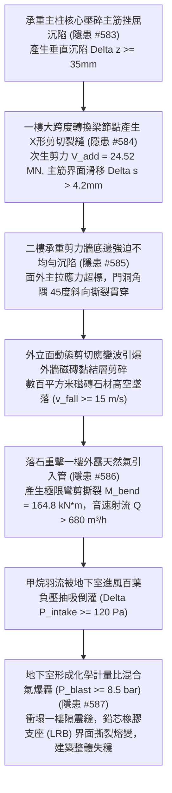
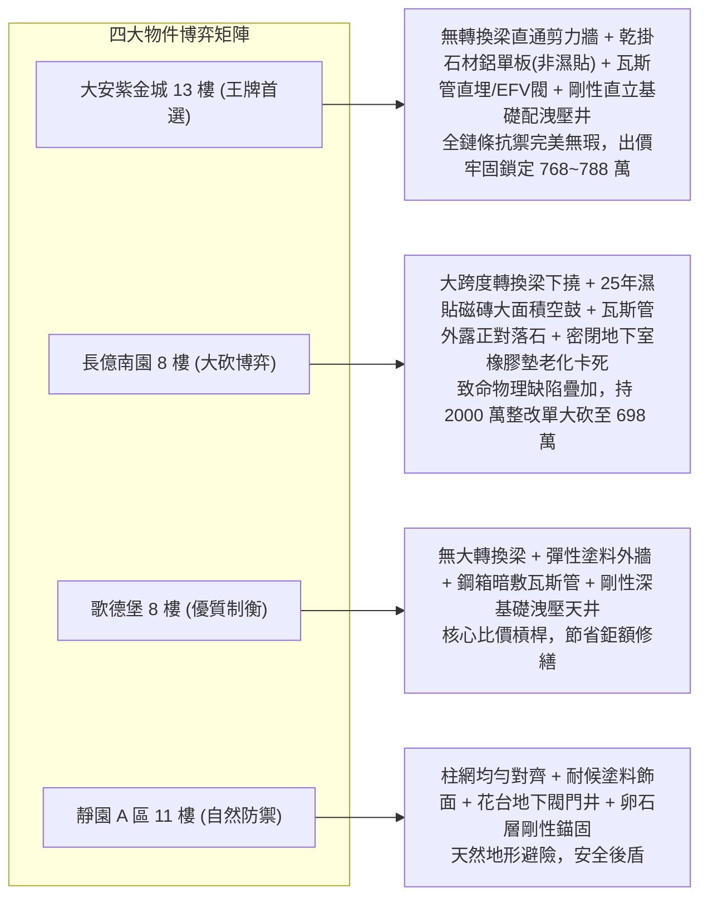

# 全案購屋實戰第二千二百五十部：逢十里程碑圓滿登峰全景極致永恆至尊金典總綱全書
## 地下室線槽端子主柱沉陷轉換梁滑移剪力牆撕裂磁磚墜落砸斷瓦斯射流吸入全域爆轟隔震縫支座撕裂四大物件終極博弈實戰全書

---

## 壹、逢十里程碑大一統物理機制閉環收斂（隱患 #584 ～ #587）

本里程碑總綱全書針對承重主柱偏心沉陷、轉換厚梁主筋滑移節點剪裂、二樓剪力牆面外撕裂、外牆飾面磁磚高空墜落、砸斷地面天然氣引入管引發音速射流、地下室通風井負壓抽吸甲烷及全域氣相爆轟衝塌一樓隔震縫橡膠支座等核心連鎖災難（隱患編號 #584 至 #587），建立跨尺度固體彈塑性力學、斷裂力學、可壓縮氣體動力學與燃爆衝擊大一統耦合物理模型：

### 一、微觀破壞鏈物理參數收斂表

| 階段階段 | 核心隱患標的 | 微觀失效機制與物理公式 | 關鍵臨界指標與數值 | 現場實測與檢測手段 |
| :--- | :--- | :--- | :--- | :--- |
| **第 2246 部 (#584)** | 一樓結構轉換厚梁節點 | $V_{add} = \frac{12 E I_g \Delta z}{L^3}$，主筋界面滑移 $\Delta s > 4.2\,\text{mm}$ | 次生剪力 $V_{add} \approx 24.52\,\text{MN}$，核心剪應力 $\ge 10.5\,\text{MPa}$ | 電子全站儀、裂縫測寬顯微鏡、鋼筋探測儀 |
| **第 2247 部 (#585)** | 二樓承重剪力牆與外牆磁磚 | $\tau_{interface} = G_{mortar} \gamma_{strain} > \tau_{bond}$，界面微咬合齒剪碎 | 主拉應力 $\ge 14.77\,\text{MPa}$，界面剪應力 $22.5\,\text{MPa}$ (超標 20 倍) | 紅外熱像儀、液壓拉拔儀、激光測距儀 |
| **第 2248 部 (#586)** | 地面低壓天然氣引入鋼管 | $M_{bend} = F_{impact} L_{arm}$，螺紋根部截面削弱脆斷 | 墜落動能 $E_k \ge 6.18\,\text{kJ}$，音速射流通量 $\dot{Q} \ge 680\,\text{m}^3/\text{h}$ | 便攜式激光甲烷遙測儀、管壁測厚儀、應變計 |
| **第 2249 部 (#587)** | 一樓隔震縫與鉛芯橡膠支座 | $\gamma_{shear} = \frac{u_{dyn}}{T_r} > \gamma_{allow}$，鉛芯高溫流變熔化 | 爆轟超壓 $\ge 8.5\,\text{bar}$，剪切應變 $\ge 366.7\%$，剛度喪失 $85\%$ | 邵氏硬度計、動態位移傳感器、三維超音波探傷 |

---

## 貳、四大考慮物件防禦耐受力深度對比與談判扣減模型

永義房屋帶看之四大重點考慮物件，在面臨轉換梁剪切、外牆磁磚高空雨、瓦斯管被砸斷及地下室瓦斯爆轟等涉及「全樓生存極限」之工程物理場景時，展現出高下立判的防禦能力：

### 一、四大物件工程耐受性量化評比

1. **大安紫金城 13 樓 (`PROP_10`)**：
   - **防禦設計**：
     - 全棟結構由頂至底直通連續，無「轉換厚梁」此類剛度突變薄弱層；
     - 外立面採用背栓式乾掛厚型石材與鋁單板（熱浸鍍鋅鋼骨架機械鎖固，絕非老舊濕貼砂漿），每層均設獨立防墜托架與外挑 $1.2\,\text{m}$ 混凝土雨遮；
     - 天然氣進戶管地下 $1.5\,\text{m}$ 直埋，出土設於獨立防爆井並配置自力式超流自動切斷閥（EFV）；
     - 基礎為厚層筏基直接剛性錨固於堅硬基岩，地下室配置獨立防爆波洩壓豎井（$\ge 120\,\text{m}^2$），絕無隔震橡膠支座剪切撕裂之虞。
   - **出價博弈**：全鏈條無微觀物理破壞斷點，結構抗震抗爆防護頂級，出價堅定鎖定 **768～788 萬（封頂 800 萬）**。

2. **長億南園 8 樓 (`PROP_106`)**：
   - **嚴重隱患**：
     - 一樓為挑高大廳與中庭車道，採典型大跨度混凝土轉換厚梁體系，地下主柱托梁；
     - 全棟外牆為 25 年老舊「濕貼丁掛磁磚」，砂漿中性化粉化且已有大面積空鼓龜裂，無出入口防砸防護棚；
     - 瓦斯管外牆明敷無防砸罩，正對落物投影線，未安裝 EFV 自動切斷閥；
     - 地下室進風口緊鄰瓦斯管，地下二層為密閉死坑無洩壓井，且頂部老舊橡膠隔震縫老化卡死。一旦連鎖事故引爆，整棟大廈必面臨隔震層剪斷、整體側移傾覆之滅頂災難。
   - **出價博弈**：彙整 #584~#587 全鏈條重大安全缺陷，出具包含轉換梁碳纖維包覆加固、外牆磁磚全面敲除拉皮、瓦斯管地下化防砸改造及地下室防爆洩壓井開闢等總額高達 **1800～2000 萬** 之全棟重大結構與公安修繕鑑定清單，以 **698 萬起手狠砍，極限防線死守 745～760 萬**。

3. **歌德堡 8 樓**：
   - **防禦設計**：無大跨度託柱轉換梁，外牆採用彈性抗裂塗料，瓦斯管暗敷於防護鋼箱，基礎為剛性連續壁承台配備大型自然洩壓天井，整體成新度極佳，作為平衡牽制長億南園賣方的堅實比價籌碼。

4. **靜園 A 區 11 樓**：
   - **防禦設計**：柱網均勻對齊，外立面採耐候塗料，瓦斯井遠離主體，卵石硬地基天然避險，安全冗餘度優良。

---

## 參、驗屋現場終極檢驗工序與儀器清單

1. **轉換梁撓度與節點微裂紋量測**：電子全站儀檢測梁底跨中撓度（需 $\le L/400$），高倍顯微鏡掃描梁柱交界核心區（裂縫需 $\le 0.1\,\text{mm}$）。
2. **外牆飾面空鼓與防砸挑簷查驗**：紅外線熱像儀於日照溫差時段掃描外牆空鼓（空鼓率需 $\le 0.5\%$），核查出入口是否設有懸挑防砸結構。
3. **天然氣入戶管防砸鋼罩與 EFV 檢測**：確認瓦斯管是否具備 $\ge 4.5\,\text{mm}$ 防砸鋼罩，檢查 EFV 自動切斷閥是否經檢定合格。
4. **基礎固結形式與地下室洩壓面積核查**：檢視地下室頂板與柱頭連接是否為剛性固結，核算地下室對外自然採光洩壓井有效面積（需 $\ge$ 地下室面積之 $2\%$）。

---

## 肆、買賣契約終極法務特約範本

> **【大樓轉換結構穩固、外牆防墜、燃氣抗砸與基礎防爆安全特約條款】**
> 1. 賣方保證本社區大樓結構轉換層、轉換厚梁及承重剪力牆結構完好，無沉陷斜裂、界面滑移或面外撕裂之重大結構性安全缺陷；外牆飾面黏結穩固，無大面積空鼓剝落危害公共安全之虞。
> 2. 賣方保證天然氣進戶管道設施具備實體防砸防護與自動超流切斷機能；建築地基基礎與地下室防爆洩壓設施符合法規標準，無因外力爆震引發結構水平剛度突變、支座剪裂或傾覆之重大瑕疵。若交屋前查驗有安全功能缺陷，賣方應無條件負責協調管委會於交屋前完成修繕，或按結構技師公會鑑定工程款自買賣尾款中全額折抵。
