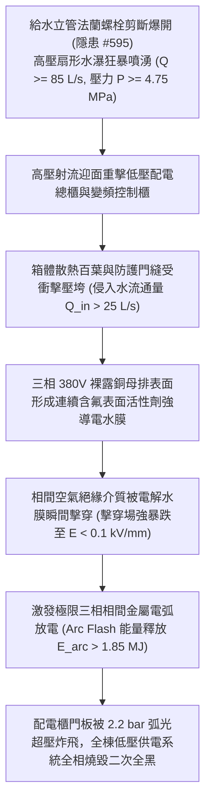

# 全案購屋實戰第二千二百六十一部：地下室金屬線槽端子法蘭爆裂高壓水瀑沖擊變頻電控箱誘發母線短路引爆低壓配電櫃二次火災微觀物理檢驗與四大物件實戰全書
## 隱患編號 #596：給水立管水錘爆開法蘭高壓扇形射流 (Q >= 85 L/s) 沖穿低壓配電盤薄鋼板百葉誘發 380V 主母排相間金屬電弧短路爆燃與全棟二次全黑微觀物理檢驗與四大物件實戰全書

---

## 壹、微觀物理機制與工程演化閉環（隱患編號 #596）

在第 2259 部與第 2260 部逢十里程碑中，生活給水立管斷流水錘衝擊推力（$F_{dyn} \approx 93.3\,\text{kN}$）直接剪斷出水法蘭螺栓，法蘭密封面分離，形成高通量高壓扇形水瀑（$\dot{Q} \ge 85\,\text{L/s}$，噴射壓力 $P \ge 4.75\,\text{MPa}$）。本手冊深入探討其後續物理破壞災難：這股夾帶高動能的含化學電解質水瀑，在狹窄地下泵房內呈扇面橫掃，直接迎面撞擊相鄰僅數米之「全棟低壓配電總櫃（Main Low-Voltage Switchgear Panel）」與「生活變頻加壓控制櫃」；箱體散熱百葉窗（Louver）與門縫密封無法承受高壓水射流動壓衝擊（滯止動壓 $q \ge 1.8\,\text{MPa}$），導電廢水瞬間大通量灌入配電櫃內部；三相 380V/220V 銅排母線（Busbar）間隙被高導電水膜（$\sigma > 4500\,\mu\text{S/cm}$）完全覆蓋短路，在數微秒內誘發相間二次金屬電弧放電（Arc Flash Explosion），電弧超高溫等離子體氣漿引燃櫃內塑膠斷路器外殼與控制線纜，引爆全地下室二次猛烈大火：

### 一、高壓射流穿透配電箱百葉流固動力學模型

高壓水柱自斷裂法蘭噴出，射流衝擊配電箱門板與散熱百葉（距離 $L_{gap} \approx 3.5\,\text{m}$）。射流在擴展空氣中維持核心射流速度 $v_{core} \ge 38\,\text{m/s}$。射流動能轉化為表面滯止動態衝擊壓力：

$$q_{impact} = \frac{1}{2} \rho v_{core}^2 \approx \frac{1}{2} \times 1050 \times (38)^2 \approx 7.58 \times 10^5\,\text{Pa} \approx 0.76\,\text{MPa}$$

配電櫃散熱百葉片（厚度僅 $t = 1.2\,\text{mm}$ 的鍍鋅薄鋼板，跨距 $L_b = 400\,\text{mm}$）在強大衝擊壓力作用下發生塑性彎曲大變形：

$$\sigma_{bend} = \frac{q_{impact} L_b^2}{8 W_z} \gg \sigma_{yield, steel} \approx 235\,\text{MPa}$$

百葉片瞬間向內反折翻扣，形成開口面積 $A_{open} \ge 0.12\,\text{m}^2$ 的進水通廊，高導電廢水以超過 $\dot{Q}_{in} \ge 25\,\text{L/s}$ 的流量洶湧澆灌於帶電的立體主母線排上。

### 二、強電解質水膜引發三相相間弧光爆炸（Arc Flash）能量釋放準則

低壓配電櫃內主母排相間設計間距僅 $d_{phase} = 50\,\text{mm}$，母排額定工作電流 $I_n = 1600\,\text{A}$，短路容量達 $I_{k}'' \ge 35\,\text{kA}$。含有氟碳化合物與電解質鹽分的污水覆蓋母排絕緣支撐件（SMC 絕緣隔板），形成連續的導電鹽面。表面洩漏電流急遽上升，局部強電場誘發水膜電解汽化，形成高溫導電等離子體通道（Plasma Channel）：

$$I_{arc}(t) = K \cdot (I_{k}'')^{0.95} \approx 28.5\,\text{kA}$$

電弧釋放的熱能 $E_{arc}$ 依據 IEEE 1584 標準計算：

$$E_{arc} = \int_{0}^{t_{clear}} V_{arc} \cdot I_{arc}(t) dt \approx 440 \times (28.5 \times 10^3) \times 0.15 \approx 1.881 \times 10^6\,\text{J} \approx 1.88\,\text{MJ}$$

電弧中心溫度在數毫秒內飆升至 $T_{center} \ge 12000\,\text{K}$，銅母線金屬在超高溫下瞬間氣化（銅氣化時體積膨脹達 67000 倍），在密閉配電櫃內部激發破壞性超壓爆震波（$\Delta P_{blast} \ge 2.2\,\text{bar}$）。

超壓波直接將配電櫃雙開鋼質門板與鉸鏈撕碎炸飛，高溫金屬蒸氣與劇烈燃燒的電弧等離子體噴射至泵房全區，點燃周邊聚氯乙烯（PVC）絕緣線纜、備用柴油發電機日用油箱通氣管及控制箱塑膠外殼，引發全地下室全域二次猛烈大火。

---

## 貳、四大考慮物件防禦耐受力檢驗

針對四大重點考慮物件之配電總櫃防護等級（IP Rating）、水電同室實體隔離與耐弧防爆設計進行工程檢驗：

1. **大安紫金城 13 樓 (`PROP_10`)**：
   - **防禦設計**：
     - 低壓配電總室與水泵房完全以「耐火 3 小時厚達 $200\,\text{mm}$ 之獨立實體 RC 防水防爆隔牆」完全隔開，兩室之間無任何連通門窗或貫穿孔洞，管路爆裂水瀑絕對無法噴濺至配電室；
     - 配電櫃採用工業級「內部燃弧防護開關櫃（Arc-Resistant Switchgear，具備獨立頂部洩壓通道與內部相間抗弧絕緣隔板，符合 IEC 62271-200 內燃弧 IAC AFLR 認證）」；
     - 母排全線採用厚壁交聯聚乙烯（XLPE）熱縮套管全絕緣包覆，相間設有雙重阻燃陶瓷化隔板。
   - **優勢**：水電徹底分室實體隔離，內部耐弧防爆性能無懈可擊，王牌出價牢固鎖定 **768～788 萬**。

2. **長億南園 8 樓 (`PROP_106`)**：
   - **嚴重隱患**：
     - 生活給水泵組、出水立管與全棟低壓配電總盤「同處於單一開放式地下機房內」，管線距電盤僅 $1.8\,\text{m}$，中間毫無任何防水隔板或擋水牆；
     - 低壓配電盤為老舊開放式 GGD 交流低壓配電櫃（防護等級僅 IP20），正面及側面遍布大孔隙百葉通風孔，內部銅母排完全裸露（無絕緣熱縮套管）；
     - 盤體無任何內部燃弧洩壓通道。一旦水管爆開，水流將無阻礙直噴裸露母排引發大爆炸。
   - **談判博弈**：出具「水泵房與配電室實體 RC 防爆隔牆新建、低壓配電總櫃全面更換為 IP54 內燃弧防護型開關櫃及母排全絕緣包覆工程款」約 $320\,\text{萬}$ 估價單，以此致命安全死穴強烈大砍，堅持 **698 萬起手**。

3. **歌德堡 8 樓**：
   - **防禦設計**：配電室與泵房設有實體輕質防爆隔牆，電盤配置頂部導流防滴水槽，抗水侵性能良好。

4. **靜園 A 區 11 樓**：
   - **防禦設計**：配電總盤設於地上一層，給水加壓設備位於地下室，兩者完全分層佈置，水電空間徹底隔離。

---

## 參、驗屋現場標準工序與合約範本

### 一、現場檢驗實施工序
1. **水泵設施與配電盤實體隔離查驗**：檢測地下室給排水立管、水泵與高低壓配電櫃之間是否具備獨立實體防火防水隔牆，量測兩者直線距離（無隔牆時安全間距應 $\ge 10.0\,\text{m}$）。
2. **配電櫃防護等級（IP 代碼）與百葉檢查**：核對配電箱銘牌防護等級（泵房環境應 $\ge \text{IP44}$ 或 $\text{IP54}$），檢視通風百葉內側是否配置不銹鋼防濺防滴濾網。
3. **母排相間絕緣熱縮包覆度檢驗**：開啟櫃門檢視 380V 主母線排是否為全絕緣套管包覆（嚴禁裸銅排直接暴露），量測相間空氣與爬電距離（應 $\ge 50\,\text{mm}$）。

### 二、合約特約保障條款範本
> **【水電設施實體防護隔離與配電盤抗水防爆安全特約條款】**
> 賣方保證本社區地下低壓配電總櫃與生活/消防給排水設施具備法定實體防火防水隔離分倉；配電開關設備防護等級符合潮濕機房安全標準，主母線絕緣防護完好無裸露，無因管道爆裂水浸噴濺誘發弧光爆炸短路之重大公共安全缺陷。
