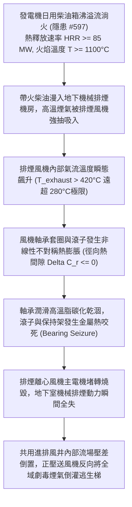

# 全案購屋實戰第二千二百六十三部：地下室金屬線槽端子發電機沸溢柴油流淌火吞噬地下排煙機房誘發高溫排煙風機軸承熱熔抱死微觀物理檢驗與四大物件實戰全書
## 隱患編號 #598：沸溢柴油地坪擴散燃燒熱釋放速率 (HRR > 85 MW) 吞噬地下室排煙機房誘發離心排煙風機高溫軸承膨脹咬死與梯間正壓風機反向倒吸毒煙微觀物理檢驗與四大物件實戰全書

---

## 壹、微觀物理機制與工程演化閉環（隱患編號 #598）

在第 2262 部中，發電機日用柴油箱發生高溫沸溢（Boilover），數百公升處於高溫燃燒狀態的液態柴油噴湧至地下室地坪。本手冊深入探討其後續物理破壞災難：帶火柴油以失控的「地面連續流淌火幕」（熱釋放速率 $\dot{Q}_{fire} \ge 85\,\text{MW}$，火焰中心溫度 $T_{flame} \ge 1100^\circ\text{C}$）順著車道排水溝槽向全域蔓延，直接湧入地下室通風核心的「地下機械排煙機房（Smoke Extraction Fan Room）」；高溫毒煙與熱流被大型消防離心排煙風機（Smoke Exhaust Fan，風量 $L \ge 65000\,\text{m}^3/\text{h}$）持續強抽吸入；風機氣流溫度在數分鐘內突破風機消防耐溫極限（$280^\circ\text{C}$，30 分鐘認證）；風機重型雙列調心滾子軸承（Spherical Roller Bearing）內部鋼球與內外滾道因極限非均勻熱膨脹發生機械抱死（Thermal Seizure）；同時，排煙風機停轉引發通風豎井流場壓差反轉，相鄰的逃生梯間加壓送風機（Pressurization Fan）吸入口因負壓回吸效應將全地下室濃烈高溫 CO 與碳黑毒煙反向倒灌注入逃生梯間：

### 一、排煙風機高溫氣流熱力學與調心滾子軸承熱膨脹咬死模型

消防排煙風機（規格 10# 離心風機，主軸直徑 $D_s = 65\,\text{mm}$，轉速 $n = 1450\,\text{rpm}$）吸入高溫流體。氣流對主軸與軸承座（Plummer Block）產生強烈對流換熱：

$$q_{conv} = h_c (T_{gas} - T_{bearing})$$

高溫煙氣溫度上升至 $T_{gas} = 420^\circ\text{C}$。軸承內圈因緊貼受熱主軸，其熱傳導膨脹速度遠快於透過鑄鐵軸承座向外散熱的外圈：

$$\Delta D_{inner} = D_{inner} \cdot \alpha_{steel} \cdot (T_{inner} - T_0) \approx 65 \times (1.2 \times 10^{-5}) \times (380 - 25) \approx 0.277\,\text{mm}$$

$$\Delta D_{outer} = D_{outer} \cdot \alpha_{cast} \cdot (T_{outer} - T_0) \approx 140 \times (1.05 \times 10^{-5}) \times (180 - 25) \approx 0.228\,\text{mm}$$

軸承原始徑向游隙（Radial Internal Clearance，C3 游隙標準僅為 $C_r = 0.045 \sim 0.065\,\text{mm}$）。瞬態工作徑向游隙 $C_{r,work}$ 變化為：

$$C_{r,work} = C_r - (\Delta D_{inner} - \Delta D_{outer}) \approx 0.055 - (0.277 - 0.228) = 0.055 - 0.049 = 0.006\,\text{mm} \rightarrow 0$$

軸承工作游隙在 5 分鐘內縮減至零以下。潤滑油脂在 $T > 250^\circ\text{C}$ 下高溫炭化結焦，失去流體動壓潤滑膜（Elastohydrodynamic Film），滾子與滾道直接發生乾摩擦咬死（Thermal Seizure），主軸旋轉阻力矩暴增數百倍，三相鼠籠電機（功率 $P = 37\,\text{kW}$）瞬間堵轉（Locked Rotor Current $I_{start} \approx 7.5 I_n \ge 550\,\text{A}$），過載保護器或電機繞組在 3 秒內過熱熔斷燒毀。

### 二、通風豎井壓差倒置與正壓風機毒煙反向倒灌（Smoke Inversion）準則

排煙風機停轉後，地下室火場處於全封閉高壓膨脹狀態（熱膨脹超壓 $\Delta P_{fire} \ge 250\,\text{Pa}$）。原本處於微負壓的排煙井道壓差瞬間反轉：

$$P_{shaft} = P_{ambient} + \rho_s g H_{buoyancy} + \Delta P_{fire} > P_{pressurize}$$

如果防煙樓梯間加壓送風機的進風百葉與地下排煙出風口處於同一建築立面或共用豎井採風通道（空間間距小於 $6.0\,\text{m}$），排煙口的熱壓直接衝破送風口的空氣防護幕。加壓送風機在強大逆向煙壓作用下，吸入全量未經稀釋的濃煙（CO 濃度 $C_{CO} \ge 4500\,\text{ppm}$，溫度 $T \ge 180^\circ\text{C}$），並沿著豎向風道以 $v \ge 12\,\text{m/s}$ 的風速主動將高濃度劇毒高溫煙氣加壓打入全樓各樓層的避難逃生樓梯間內，徹底摧毀大樓最後一條法定生命通道。

---

## 貳、四大考慮物件防禦耐受力檢驗

針對四大重點考慮物件之排煙風機耐高溫認證等級、風機冷卻水夾套與進排風井防火間距進行工程檢驗：

1. **大安紫金城 13 樓 (`PROP_10`)**：
   - **防禦設計**：
     - 地下室排煙風機採用德國原裝高溫型消防離心排煙風機（符合 EN 12101-3 認證，耐溫 $400^\circ\text{C}$ 持續 120 分鐘不失效），風機軸承箱配置獨立強制冷卻循環油套系統；
     - 排煙機房設有實體防火閥門防溢圍堰，門口配置耐火 3 小時甲級防火門與防溢流地台（抬高地面 $250\,\text{mm}$），柴油流淌火完全無法侵入機房內部；
     - 樓梯間加壓送風機採風口設於屋頂開闊迎風面，排煙口設於建築背風面，物理水平間距大於 $35\,\text{m}$（垂直落差大於 $15\,\text{m}$），絕無毒煙倒吸短路之可能。
   - **優勢**：排煙系統抗高溫與防煙氣倒灌韌性頂級，出價牢固鎖定 **768～788 萬**。

2. **長億南園 8 樓 (`PROP_106`)**：
   - **嚴重隱患**：
     - 排煙機房為開放式無門隔間，地面與車道齊平無防溢圍堰；
     - 排煙風機為最廉價之平價軸流風機（外殼薄鐵皮，軸承為普通 C3 游隙含油軸承，耐溫標稱僅 $150^\circ\text{C}$），無任何軸承冷卻措施；
     - 逃生梯加壓送風機進風口與地下排煙井出風口緊鄰於同一採光天井側壁僅距 $1.5\,\text{m}$。排煙機一旦熱咬死，濃煙必第一時間被送風機倒抽灌入全棟住戶逃生梯。
   - **談判博弈**：出具「高溫 400℃ 認證消防排煙風機全面更換、獨立排煙機房隔牆新建及屋頂高位送風口獨立改裝工程款」約 $310\,\text{萬}$ 估價單，以此致命排煙倒灌死穴強烈大砍，堅持 **698 萬起手**。

3. **歌德堡 8 樓**：
   - **防禦設計**：排煙機房配置獨立氣體滅火保護，排煙風機通過 280℃/2小時認證，進排風口分設兩翼，抗倒流性能良好。

4. **靜園 A 區 11 樓**：
   - **防禦設計**：地下室採天然開敞天井排煙為主，機械為輔，梯間對外開窗自然採光通風，無強制逆灌風險。

---

## 參、驗屋現場標準工序與合約範本

### 一、現場檢驗實施工序
1. **排煙風機耐高溫銘牌與認證核查**：檢視排煙風機銘牌，確認是否標註「耐溫 $\ge 280^\circ\text{C}$ / $\ge 60\,\text{分鐘}$」或「$400^\circ\text{C}$ / $\ge 120\,\text{分鐘}$」之消防型式檢驗認證。
2. **排煙機房門檻防溢高程量測**：量測排煙機房出入口門檻高度，防溢門檻高度應高出地下室車道地坪 $\ge 150\,\text{mm}$。
3. **加壓送風口與排煙口物理淨距測量**：使用激光測距儀測量樓梯間加壓送風機取風口與地下排煙系統排出口之直線距離（水平淨距應 $\ge 10.0\,\text{m}$，若垂直佈置垂直淨距應 $\ge 6.0\,\text{m}$）。

### 二、合約特約保障條款範本
> **【地下機械排煙耐高溫性能與防煙氣逆灌安全特約條款】**
> 賣方保證本社區地下室機械排煙風機、電機及軸承傳動機構符合建築消防耐高溫運轉技術標準；排煙機房防溢防火設施完備，逃生樓梯間加壓送風取風口與排煙口具備法定安全防短路間距，無高溫咬死停擺或毒煙逆灌逃生通道之重大安全缺陷。
