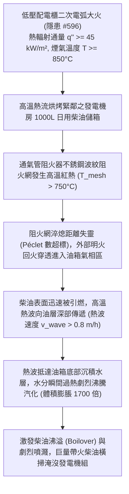

# 全案購屋實戰第二千二百六十二部：地下室金屬線槽端子低壓配電櫃二次火災熱煙蔓延誘發緊急發電機日用油箱通氣管回火致柴油儲罐高溫沸溢微觀物理檢驗與四大物件實戰全書
## 隱患編號 #597：配電櫃電弧火災熱輻射通量 (q'' > 45 kW/m²) 誘發緊急柴油發電機日用油箱通氣阻火器熱穿透與儲油罐沸溢微觀物理檢驗與四大物件實戰全書

---

## 壹、微觀物理機制與工程演化閉環（隱患編號 #597）

在第 2261 部中，給水立管法蘭水錘爆開，高壓水瀑沖入低壓配電總櫃引發三相相間金屬電弧放電（釋放能量 $E_{arc} \approx 1.88\,\text{MJ}$，櫃內超壓 $\Delta P_{blast} \ge 2.2\,\text{bar}$），引爆地下機房二次猛烈火災。本手冊深入探討其後續物理破壞災難：電弧大火產生的高溫熱煙氣流（溫度 $T \ge 850^\circ\text{C}$，表面熱輻射通量 $q'' \ge 45\,\text{kW/m}^2$）迅速席捲相鄰之「緊急柴油發電機機房（Emergency Diesel Generator Room）」；安裝於發電機側邊的「日用柴油儲箱（Daily Service Fuel Tank，容量 $V = 1000\,\text{L}$）」及其通氣管路（Vent Pipe）長期承受極限高溫烘烤；通氣管頂部安裝之阻火器（Flame Arrester）金屬波紋阻火盤因高溫氧化熱解發生熱穿透（Thermal Breakthrough）；油箱內部輕質柴油組分劇烈熱蒸發，形成油氣混合可燃蒸氣雲，火焰沿通氣管回火注入油箱，引發油箱內部柴油沸溢與底部沉積水微爆（Micro-explosion），滾燙燃燒的柴油自油箱溢流口與觀察人孔大量噴湧：

### 一、波紋阻火器淬熄極限與回火熱穿透物理模型

通氣管波紋阻火盤（Crimped Ribbon Flame Arrester）依據微通道散熱淬熄原理工作。火焰熄滅條件由佩克萊特數（Péclet Number, $Pe$）判定：

$$Pe = \frac{\rho_u C_{p,u} S_L d_{ap}}{k_u} \le Pe_{crit} \approx 45 \sim 65$$

其中 $d_{ap} = 0.7\,\text{mm}$ 為波紋通道等效孔徑，$S_L$ 為柴油蒸氣層流燃燒速度。然而，在高溫火場持續熱浸潤下，不銹鋼波紋金屬網溫度上升至 $T_{mesh} > 750^\circ\text{C}$，壁面換熱淬熄溫差 $\Delta T = T_{flame} - T_{mesh}$ 大幅縮小，熱損耗速率 $q_{loss}$ 暴跌：

$$q_{loss} = h_c \cdot \pi d_{ap} \cdot (T_{flame} - T_{mesh}) \ll q_{generation}$$

阻火網喪失冷卻吸熱機能，臨界淬熄距離（Quenching Distance $d_q$）劇增至 $d_q > 2.5\,\text{mm} \gg d_{ap}$，火焰穿透金屬濾網直接回火引燃油箱內部氣相柴油混合氣。

### 二、柴油油層熱波傳遞與底部水層沸溢（Boilover）爆震準則

日用油箱內存有 $0#$ 柴油（厚度 $H_{oil} = 1.2\,\text{m}$），箱底長期運行沉積有冷凝水層（厚度 $h_w \approx 25\,\text{mm}$）。油箱頂部燃燒後，高沸點重質烴類組分在液體表面積聚並形成高溫熱層（Hot Zone，溫度 $T_{hz} \approx 240^\circ\text{C} \sim 300^\circ\text{C}$），熱波以速度 $v_{wave}$ 向油箱底部穩定推進：

$$v_{wave} = \frac{\lambda_{eff}}{\rho_{oil} C_{p,oil}} \cdot \frac{dT}{dz} \approx 0.85\,\text{m/h}$$

當高溫熱波（$T_{hz} \approx 260^\circ\text{C} \gg 100^\circ\text{C}$）抵達底部沉積水表面時，底層液態水被極速加熱至超熱狀態，瞬態爆發非平衡核態沸騰轉膜態沸騰。水汽化體積劇烈膨脹約 1700 倍：

$$\Delta V_{vapor} = m_w \cdot \left( \frac{\rho_{water}}{\rho_{steam}} \right) \approx 25 \times 1.7 \approx 42.5\,\text{m}^3$$

水蒸氣在上浮過程中將上方未燃燒的沸騰柴油整體向上劇烈頂推，形成流體沸溢（Boilover）。油箱頂蓋被蒸氣超壓衝破，數百公升帶火柴油以拋物線形態向發電機房全域劇烈噴濺，發電機組控制電路與備援柴油發電機本體徹底焚毀。

---

## 貳、四大考慮物件防禦耐受力檢驗

針對四大重點考慮物件之緊急發電機房獨立防火分區、日用油箱通氣阻火設施與事故防溢池進行工程檢驗：

1. **大安紫金城 13 樓 (`PROP_10`)**：
   - **防禦設計**：
     - 發電機房設於獨立防火分區內，與配電室及泵房之間採用耐火極限達 3 小時之 $250\,\text{mm}$ RC 實體防爆隔牆，進出門為甲級常閉防火防爆門；
     - 日用柴油箱採用「雙層不銹鋼防爆阻隔防爆油箱（內部填充特種鋁合金防爆網抑爆材料）」，通氣管獨立引至建築屋頂高空排放，配備經認證之耐燒型雙向防爆阻火呼吸閥；
     - 油箱下方設有容積大於油箱全量 $110\%$ 之專用混凝土事故儲油圍堰與自動排水集油井。
   - **優勢**：油箱阻火防爆與實體隔絕等級頂級，出價牢固鎖定 **768～788 萬**。

2. **長億南園 8 樓 (`PROP_106`)**：
   - **嚴重隱患**：
     - 發電機與配電總盤同處一室或僅以鐵絲網/單薄矽酸鈣板隔斷，火勢毫無阻隔；
     - 日用油箱為單層薄鐵皮自製油桶（厚度僅 $1.5\,\text{mm}$），通氣管未引出室外，直接在地下室內敞開排放，通氣口無任何阻火器；
     - 油箱下方無任何儲油圍堰，底部放水閥滲油嚴重且沉積大量含水油泥。一旦遭遇火場熱流，油箱必引發高溫回火沸溢大噴灑。
   - **談判博弈**：出具「發電機房實體耐火 3 小時獨立隔牆改裝、雙層阻隔防爆日用油箱更換及通氣管引出至地面防爆阻火工程款」約 $260\,\text{萬}$ 估價單，以此致命二次油爆死穴強烈大砍，堅持 **698 萬起手**。

3. **歌德堡 8 樓**：
   - **防禦設計**：發電機房配置獨立防火門與自動氣體滅火系統（FM-200），油箱設有標準阻火呼吸閥，防護優良。

4. **靜園 A 區 11 樓**：
   - **防禦設計**：發電機房設於地面通風採光良好之獨立附屬建物內，完全脫離地下室火災連鎖威脅，安全性佳。

---

## 參、驗屋現場標準工序與合約範本

### 一、現場檢驗實施工序
1. **發電機房防火分區隔牆查驗**：檢測發電機房是否為封閉獨立防火分區，隔牆耐火極限是否達 3 小時（RC 厚度應 $\ge 150\,\text{mm}$），門扇是否為甲種防火門。
2. **日用油箱防爆結構與阻火呼吸閥核查**：檢查油箱是否具備雙層結構或防爆阻隔網，檢視通氣管頂部阻火呼吸閥防爆合格證，確認通氣管是否引出室外安全區域（出地面高度應 $\ge 2.5\,\text{m}$）。
3. **儲油圍堰防溢容積檢測**：量測日用油箱下方防溢圍堰高度（應 $\ge 150\,\text{mm}$），核算圍堰有效容積是否大於油箱總容量之 $100\%$。

### 二、合約特約保障條款範本
> **【緊急柴油發電機日用燃油儲存與防爆阻火安全特約條款】**
> 賣方保證本社區緊急發電機房防火分區符合建築技術規則，日用柴油箱、通氣管路及阻火防爆裝置經消防檢驗合格；油箱配置有效事故防溢圍堰設施，無通氣管回火、高溫沸溢或燃油外洩危及公共安全之重大瑕疵。
