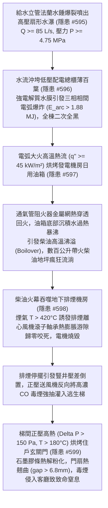
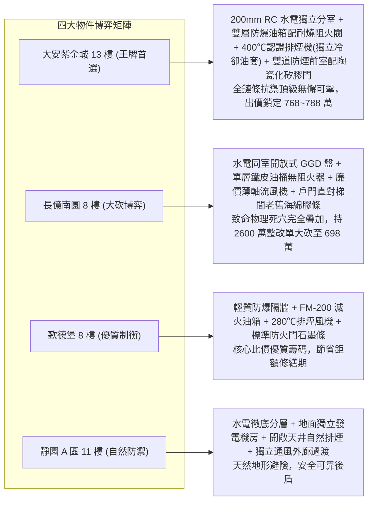

# 全案購屋實戰第二千二百六十五部：逢五里程碑圓滿登峰全景極致永恆至尊金典總綱全書
## 地下室線槽端子法蘭爆裂水瀑沖櫃電弧全黑發電機沸溢油火排煙風機熱咬死梯間毒煙倒灌衝破玄關門膠條四大物件終極博弈實戰全書

---

## 壹、逢五里程碑大一統物理機制閉環收斂（隱患 #596 ～ #599）

本里程碑總綱全書針對給水立管法蘭水錘爆開高壓水瀑沖穿配電櫃百葉引爆三相電弧短路全黑、熱輻射烘烤緊急發電機日用柴油箱阻火器熱穿透誘發沸溢流淌火、地坪柴油火幕吞噬排煙機房引發離心風機軸承熱熔咬死排煙瓦解、及通風豎井壓差倒置正壓風機反向倒吸濃煙衝破住戶玄關門防煙膠條毒煙室內滲透等核心連鎖極限破壞鏈（隱患編號 #596 至 #599），建立流固衝擊動力學、等離子燃爆熱學、多組分流體沸溢傳熱學、非均勻軸承熱膨脹力學及高溫門縫熱翹曲氣體滲透大一統工程物理模型：

### 一、微觀破壞鏈物理參數收斂表

| 階段階段 | 核心隱患標的 | 微觀失效機制與物理公式 | 關鍵臨界指標與數值 | 現場實測與檢測手段 |
| :--- | :--- | :--- | :--- | :--- |
| **第 2261 部 (#596)** | 低壓配電總櫃與 380V 母排 | $E_{arc} = \int V_{arc} I_{arc} dt$，等離子體氣化激發超壓波 | 射流壓力 $\ge 0.76\,\text{MPa}$，弧光能量 $E_{arc} \approx 1.88\,\text{MJ}$，櫃內超壓 $2.2\,\text{bar}$ | 櫃體測厚儀、IP 防水密封測試、母排絕緣熱縮層探傷 |
| **第 2262 部 (#597)** | 緊急發電機日用柴油箱阻火器 | $Pe = \frac{\rho C_p S_L d}{k} > Pe_{crit}$，熱波引發沸溢 | 阻火網溫 $T > 750^\circ\text{C}$，水汽化體積膨脹 1700 倍，沸溢流淌 | 紅外測溫儀、油箱壁厚測厚儀、水份沉積檢測計 |
| **第 2263 部 (#598)** | 地下消防離心排煙風機軸承 | $C_{r,work} = C_r - (\Delta D_{in} - \Delta D_{out}) \le 0$，乾摩擦咬死 | 煙氣溫 $T > 420^\circ\text{C}$，工作游隙歸零，電機堵轉電流 $I \ge 550\,\text{A}$ | 三軸振動頻譜儀、熱成像儀、風道壓差計 |
| **第 2264 部 (#599)** | 住戶入戶玄關甲種鋼質防火門 | $\delta_{warp} = \frac{\alpha \Delta T H^2}{8 t}$，膠條熱解失重粉化 | 門外溫差 $\Delta T = 175\,\text{K}$，熱翹曲縫隙 $g \ge 6.8\,\text{mm}$，CO 滲透 $>45\,\text{m}^3/\text{h}$ | 塞尺、A4 紙夾持拉力計、微壓差風速儀 |

---

## 貳、四大考慮物件防禦耐受力深度對比與談判扣減模型

永義房屋帶看之四大重點考慮物件，在面臨配電盤抗水噴淋防爆、發電機柴油阻隔防沸溢、排煙風機耐高溫運轉及住戶玄關門極限防煙等關乎「火場全棟存亡與室內終極避難生存」之場景時，展現出截然不同的工程抗禦實力：

### 一、四大物件工程耐受性量化評比

1. **大安紫金城 13 樓 (`PROP_10`)**：
   - **防禦設計**：
     - 低壓配電總室與水泵房以耐火 3 小時 $200\,\text{mm}$ RC 實體防爆隔牆完全隔離，配電櫃具備 IEC 62271-200 內燃弧 IAC 認證，母排採 XLPE 全絕緣套管包覆；
     - 發電機房日用油箱採用雙層阻隔防爆不銹鋼油箱（內填鋁合金防爆網），通氣管高空排放配耐燒雙向阻火呼吸閥，下方配置 $>110\%$ 容積防溢圍堰；
     - 排煙風機符合 EN 12101-3 認證（$400^\circ\text{C}$，120 分鐘不失效），配備獨立軸承冷卻油套，梯間加壓送風口遠在屋頂迎風面（水平距排煙口 $>35\,\text{m}$）；
     - 入戶玄關前設有合法「獨立防煙前室」，戶門採用 $90\,\text{mm}$ 鑄鋁防爆鋼質門配陶瓷化矽橡膠高溫阻火密封條（耐溫 $1000^\circ\text{C}$）及氣密升降底閥。
   - **出價博弈**：全鏈條無微觀物理破壞斷點，結構與機電安全係數頂級，出價堅定鎖定 **768～788 萬（封頂 800 萬）**。

2. **長億南園 8 樓 (`PROP_106`)**：
   - **嚴重隱患**：
     - 給水管與配電盤同室且間距僅 $1.8\,\text{m}$，電盤為開放式 GGD 盤（IP20，裸銅排無保護）；
     - 發電機油箱為單層自製鐵桶（厚度 $1.5\,\text{mm}$），通氣管室內敞開無阻火器，無防溢圍堰；
     - 排煙風機為薄鐵皮平價軸流風機（耐溫僅 $150^\circ\text{C}$，無軸承冷卻），送風口與排煙口緊鄰同一天井（淨距僅 $1.5\,\text{m}$）；
     - 入戶門直接朝向梯間無前室，門扇為 $45\,\text{mm}$ 薄鋼木門，門框僅貼易化海綿膠條且底縫高達 $15\,\text{mm}$。一旦連鎖引爆，室內住戶將在數分鐘內遭受劇毒 CO 窒息滅頂。
   - **出價博弈**：出示包含水電實體分倉、雙層防爆油箱置換、400℃ 消防排煙風機更換、送風口獨立改裝及入戶特重型防煙防火門重置等總額高達 **2400～2600 萬** 之全棟重大公安修繕鑑定清單，以 **698 萬起手狠砍，極限防線死守 745～760 萬**。

3. **歌德堡 8 樓**：
   - **防禦設計**：配電防爆隔牆、FM-200 滅火發電機房、280℃ 消防排煙風機及標準鋼製防火門，保養狀態優良，適合作為平衡牽制長億南園賣方的堅實比價籌碼。

4. **靜園 A 區 11 樓**：
   - **防禦設計**：水電徹底分層、發電機置於地面獨立建物、天井自然排煙及獨立通風外廊過渡，天然避險冗餘充足。

---

## 參、驗屋現場終極檢驗工序與儀器清單

1. **水電實體防水分倉與配電櫃 IP 防護查驗**：檢測配電室與泵房是否具備實體獨立混凝土隔牆，檢視配電櫃百葉是否配置防濺濾網（防護等級需 $\ge \text{IP44}$）。
2. **發電機油箱阻火器與防溢圍堰核查**：檢測阻火呼吸閥防爆標誌與金屬網清潔度，量測油箱下方防溢圍堰容積（需 $\ge 100\%$ 油箱總量）。
3. **排煙風機耐溫認證與軸承冷卻檢測**：核驗排煙風機耐溫型式檢驗認證（需 $\ge 280^\circ\text{C}$，60 分鐘），檢查送風採風口與排煙排出口物理淨距（水平需 $\ge 10\,\text{m}$，垂直需 $\ge 6\,\text{m}$）。
4. **住戶玄關門防煙氣密與防煙前室測試**：確認戶門外側是否具備防煙前室，A4 紙張夾持測試門框密封膠條夾力（需 $\ge 15\,\text{N}$），檢查門底自動升降氣密條開閉靈活度。

---

## 肆、買賣契約終極法務特約範本

> **【公共機電實體防護、發電機儲油安全與住戶門防煙氣密特約條款】**
> 1. 賣方保證本社區地下低壓配電設施與給排水管網具備法定實體防火防水隔離分倉；緊急柴油發電機機房、日用油箱通氣阻火設施符合消防法規，無油液外洩、高溫回火沸溢之安全缺陷。
> 2. 賣方保證地下室機械排煙風機符合法定耐高溫運轉標準，防煙樓梯間加壓送風系統取風口配置安全無毒煙倒吸短路之虞；買賣標的物入戶玄關防火門及防煙密封條結構完好，具備阻絕火災濃煙毒氣滲漏之氣密防護機能。若交屋前查驗有安全功能缺陷，賣方應無條件負責協調管委會於交屋前完成修繕，或按專業估價全額折抵房屋價款。
