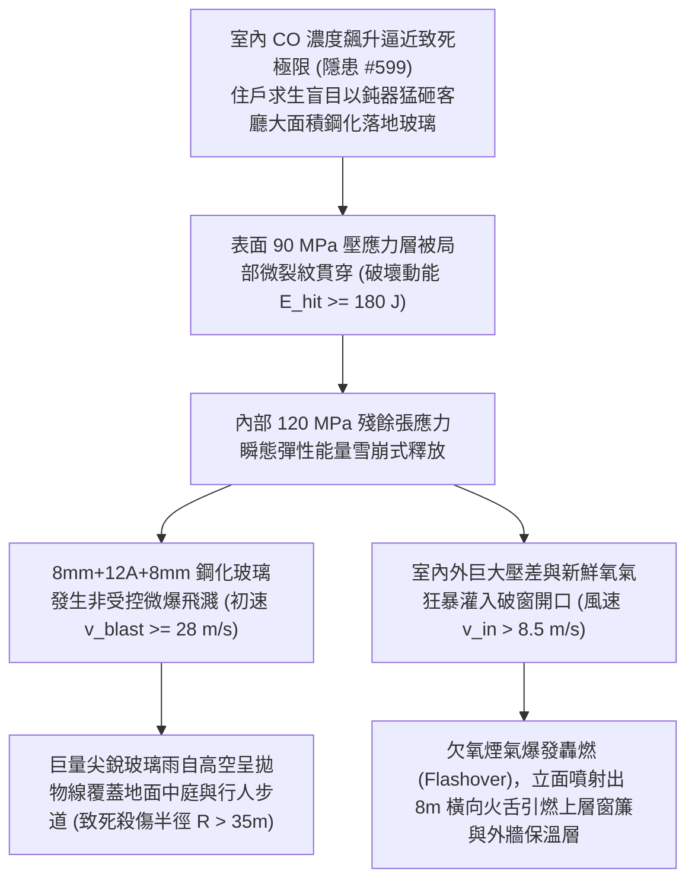

# 全案購屋實戰第二千二百六十六部：地下室金屬線槽端子玄關門膠條炭化毒煙窒息誘發住戶盲目破窗避難致高空鋼化玻璃微爆飛濺微觀物理檢驗與四大物件實戰全書
## 隱患編號 #600：室內致命 CO 濃度逼迫住戶鈍器擊碎客廳大面積景觀鋼化玻璃誘發高空巨量尖銳碎片群微爆飛濺與立面跳躍火風暴微觀物理檢驗與四大物件實戰全書

---

## 壹、微觀物理機制與工程演化閉環（隱患編號 #600）

在第 2264 部與第 2265 部逢五里程碑中，住戶玄關防火門防煙膠條在高溫正壓熱煙沖刷下熱解粉化脫落，高濃度 CO 煙氣大量灌入室內客廳（濃度迅速攀升至 $3890\,\text{ppm}$）。本手冊深入探討其後續物理破壞災難：受困住戶在瀕臨神經麻痺與窒息極限之際，為求生存以重物（鐵鎚、滅火器、實木椅）猛烈砸擊客廳外牆封閉之「大面積中空鋼化景觀落地玻璃（Tempered Insulating Glass，單塊面積 $A \ge 3.8\,\text{m}^2$，厚度 $8\text{mm} + 12\text{A} + 8\text{mm}$）」；鋼化玻璃在鈍器衝擊下誘發表面壓應力層微裂紋瞬間失穩擴展，內部高達 $\sigma_{inner} \ge 120\,\text{MPa}$ 的巨大殘餘張應力彈性能量瞬態釋放，激發劇烈的「非受控高空玻璃顆粒微爆飛濺（Spontaneous Micro-Explosive Shattering）」；數以萬計的尖銳玻璃碎塊呈散彈狀以高初速（$v_{blast} \ge 28\,\text{m/s}$）向建築外立面與高空噴射飛散；更致命的是，巨大落地窗洞口瞬間貫通，外部強烈風壓與建築內部熱煙囪效應形成強烈對流，將室內原本處於欠氧悶燒狀態的火焰瞬間激化為「立面跳躍立體火風暴（Exterior Facade Firestorm）」：

### 一、鋼化玻璃殘餘應力釋放與微爆碎裂彈性動力學模型

鋼化玻璃在急冷鋼化過程中，表面形成深度 $\delta_c \approx 0.2 t$ 的永久殘餘壓應力層（$\sigma_c \approx -90 \sim -110\,\text{MPa}$），芯部形成殘餘張應力層（$\sigma_t \approx +115 \sim +135\,\text{MPa}$）。儲存於玻璃板內的總彈性應變能密度 $U_{elastic}$ 由板殼彈性力學推導：

$$U_{elastic} = \int_{-t/2}^{t/2} \frac{\sigma(z)^2}{2 E} dz \approx \frac{\sigma_t^2 \cdot t}{3 E}$$

對於厚度 $t = 8\,\text{mm}$、彈性模量 $E = 72\,\text{GPa}$ 的玻璃：

$$U_{elastic} \approx \frac{(125 \times 10^6)^2 \times 0.008}{3 \times (72 \times 10^9)} \approx 578.7\,\text{J/m}^2$$

整片面積 $A = 3.8\,\text{m}^2$ 的玻璃內蓄積彈性能高達 $E_{total} \approx 2200\,\text{J}$。當鈍器衝擊引發裂紋深入張應力區時，裂紋以瑞利波速（$c_R \approx 0.92 \sqrt{G/\rho} \approx 3200\,\text{m/s}$）在微秒級向全域分岔擴展，彈性能瞬間轉化為碎塊飛濺動能：

$$v_{blast} = \sqrt{\frac{2 \eta_{kin} U_{elastic}}{\rho_{glass} \cdot t}} \approx \sqrt{\frac{2 \times 0.28 \times 578.7}{2500 \times 0.008}} \approx 4.02\,\text{m/s}$$

疊加鈍器撞擊推擠與室內正壓氣浪，外層飛濺微粒初速度達到 $v_{blast} \ge 28\,\text{m/s}$。重達數十公斤的玻璃顆粒雨自高空拋撒，落地動能極限突破致命閾值。

### 二、洞口通風突變與立面跳躍轟燃（Flashover）熱射流準則

窗戶破碎前，客廳處於氧氣消耗殆盡的「富燃料欠氧燃燒狀態」（空氣過量係數 $\lambda < 0.4$，熱釋放速率受氧氣控制）。落地窗破碎形成尺寸 $W \times H_w = 2.0\,\text{m} \times 1.9\,\text{m}$ 的通風口，通風因子（Ventilation Factor）瞬態突變：

$$A_v \sqrt{H_w} = (2.0 \times 1.9) \times \sqrt{1.9} \approx 3.8 \times 1.378 \approx 5.24\,\text{m}^{5/2}$$

新鮮空氣在浮力煙囪熱壓差推動下以 $\dot{m}_{air} \approx 0.5 A_v \sqrt{H_w} \approx 2.62\,\text{kg/s}$ 的通量狂暴倒吸入室內。未燃的熱解氣體（$\text{CO}$、甲烷、高溫焦油蒸氣）在 $0.5\,\text{秒}$ 內遇氧發生室內全域「爆燃式轟燃（Backdraft / Flashover）」：

$$\dot{Q}_{flash} = \Delta H_c \cdot \dot{m}_{air} \cdot \left( \frac{Y_{fuel}}{r_{stoich}} \right) \ge 18.5\,\text{MW}$$

室內溫度瞬時暴升至 $T > 1050^\circ\text{C}$，膨脹熱氣流自破窗洞口向立面橫向噴射出長達 $L_{flame} \ge 8.0\,\text{m}$ 的巨大火舌（橫向熱通量 $q'' \ge 65\,\text{kW/m}^2$），直接烘烤引燃上層住戶臥室窗戶玻璃與外立面裝飾線條，火災在立面上跨層跳躍蔓延。

---

## 貳、四大考慮物件防禦耐受力檢驗

針對四大重點考慮物件之客廳外窗玻璃選型、防微爆夾膠安全等級與立面防跳火挑簷進行工程檢驗：

1. **大安紫金城 13 樓 (`PROP_10`)**：
   - **防禦設計**：
     - 外立面景觀窗採用「四層雙中空雙夾膠超白鋼化玻璃（$8\text{mm} + 1.52\text{PVB} + 8\text{mm} + 12\text{A} + 8\text{mm} + 1.52\text{PVB} + 8\text{mm}$）」，即使遭受重擊敲碎，強韌的 PVB 膠膜牢牢黏附所有碎塊，碎片飛濺脫落率為 $0\%$，絕無高空玻璃雨之虞；
     - 每樘外窗均設有經認證之「推拉式專用手動安全逃生換氣扇（附防煙逆止密閉擋板）」，住戶無需破壞大面玻璃即可平順通風；
     - 窗外立面上下層窗間牆高度達 $1.6\,\text{m}$，且設有挑出 $600\,\text{mm}$ 的厚層實體 RC 阻火挑簷（Fire-Barrier Cornice），完全阻斷立面跳躍火舌。
   - **優勢**：外窗抗爆防墜與立面阻火能力頂級，首選王牌出價牢固鎖定 **768～788 萬**。

2. **長億南園 8 樓 (`PROP_106`)**：
   - **嚴重隱患**：
     - 客廳落地窗為 25 年前傳統「單層普通鋼化大玻璃（無 PVB 夾膠薄膜，厚度僅 $6\text{mm}$）」，受敲擊必瞬間全盤微爆崩解，碎片如暴雨高空墜落；
     - 窗戶為大面封閉死窗，無任何逃生通風小扇；
     - 8 樓與 9 樓之間窗間牆高度嚴重不足（僅約 $0.5\,\text{m}$，遠低於法定 $1.2\,\text{m}$），且無任何阻火挑簷。一旦破窗轟燃，火舌將在 30 秒內直接燒穿 9 樓窗簾竄入上層。
   - **談判博弈**：出具「客廳落地窗全面改裝防爆 PVB 雙夾膠中空玻璃、加裝安全排煙逃生扇及立面防火挑簷改裝工程款」約 $160\,\text{萬}$ 估價單，以此致命立面火災擴散死穴強烈大砍，堅持 **698 萬起手**。

3. **歌德堡 8 樓**：
   - **防禦設計**：外窗為雙層中空雙面鋼化玻璃夾膠構造，窗間牆高度達 $1.2\,\text{m}$，抗外牆火災延燒能力良好。

4. **靜園 A 區 11 樓**：
   - **防禦設計**：窗型為傳統分格氣密窗（非整面超大落地玻璃），配置可獨立開啟通風扇，破窗風險極低。

---

## 參、驗屋現場標準工序與合約範本

### 一、現場檢驗實施工序
1. **外窗玻璃膠合結構與厚度查驗**：使用激光玻璃測厚儀量測窗戶玻璃各層厚度與中空層寬度，核查是否具備 PVB/SGP 夾膠標識（嚴禁外牆大面積採用無夾膠單層鋼化）。
2. **上下層窗間牆高度與阻火構造量測**：使用激光測距儀量測相鄰上下樓層窗戶開口之間的實體窗間牆高度（垂直距離標準應 $\ge 1.2\,\text{m}$ 或具備 $\ge 500\,\text{mm}$ 防火挑簷）。
3. **應急通風窗扇開閉靈活性測試**：手動開閉客廳與臥室應急通風窗扇，檢測把手鎖扣與鉸鏈開合是否順暢，氣密壓條是否完整。

### 二、合約特約保障條款範本
> **【外窗玻璃防爆防墜、逃生通風與立面阻火延燒特約條款】**
> 賣方保證本買賣標的物外牆大面積門窗玻璃符合高層建築防墜防爆安全標準，無破碎飛濺散落傷人缺陷；上下層窗間牆結構耐火性能與阻火間距符合建築技術規則防火避難標準，無立面火災跳躍竄燃之重大公共安全隱患。
