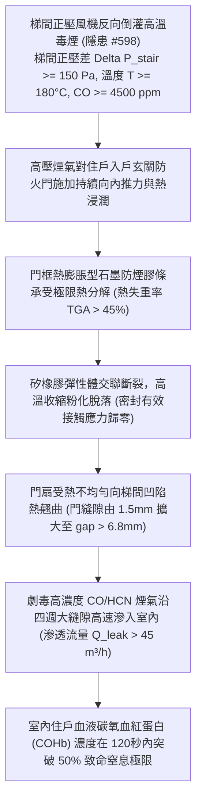

# 全案購屋實戰第二千二百六十四部：地下室金屬線槽端子毒煙倒灌梯間熱膨脹超壓衝破住戶玄關防火門防煙膠條致室內劇毒窒息微觀物理檢驗與四大物件實戰全書
## 隱患編號 #599：逃生樓梯間高溫毒煙正壓倒灌 (Delta P_stair > 120 Pa) 誘發各樓層住戶玄關甲種鋼質防火門膨脹密封條熱分解炭化與毒煙室內全面滲漏微觀物理檢驗與四大物件實戰全書

---

## 壹、微觀物理機制與工程演化閉環（隱患編號 #599）

在第 2263 部中，地下排煙風機軸承熱咬死停轉引發通風井流場壓差倒置，加壓送風機將全地下室高濃度 CO（$\ge 4500\,\text{ppm}$）與高溫毒煙（$T \ge 180^\circ\text{C}$）反向加壓注入全樓防煙樓梯間內。本手冊深入探討其後續物理破壞災難：樓梯間內部由原本的「防煙正壓安全區」劇變為「高溫毒氣高壓蓄熱煙囪」（梯間內部正壓超壓峰值 $\Delta P_{stair} \ge 120\,\text{Pa} \sim 180\,\text{Pa}$）；強大的向外推力直接作用於各樓層住戶之「入戶玄關甲種鋼質防火門（Residential Entrance Fire Door）」；門框四周安裝之「熱膨脹型石墨/難燃矽橡膠防煙密封膠條（Intumescent Smoke Seal Strip）」，在梯間持續高溫烘烤與煙氣酸性微粒（$\text{SO}_2$、$\text{NO}_x$ 與微碳黑）侵蝕下，膠條聚合物基體發生過早熱解炭化、收縮粉化脫落；門縫密封防線全面崩潰，致命的劇毒一氧化碳與氰化氫（$\text{HCN}$）煙氣沿著門邊縫隙高速滲入各戶室內客廳與臥室，致使閉門避難之無辜住戶在睡夢與等待救援中面臨急性化學窒息極限威脅：

### 一、玄關防火門門縫熱翹曲幾何非線性與縫隙氣體滲透動力學

入戶防火門尺寸 $B \times H = 1.0\,\text{m} \times 2.2\,\text{m}$，門扇結構為雙面 $1.0\,\text{mm}$ 冷軋鋼板內充填膨脹珍珠岩或硅酸鋁耐火板。當門外梯間溫度 $T_{out} = 200^\circ\text{C}$，室內溫度 $T_{in} = 25^\circ\text{C}$ 時，門扇內外表面溫差 $\Delta T = 175\,\text{K}$ 激發嚴重的熱應力熱翹曲（Thermal Warping）：

$$\delta_{warp} = \frac{\alpha_{steel} \cdot \Delta T \cdot H^2}{8 t_{door}} \approx \frac{(1.2 \times 10^{-5}) \times 175 \times (2.2)^2}{8 \times 0.05} \approx 2.54 \times 10^{-2}\,\text{m} = 25.4\,\text{mm}$$

門扇在鎖舌與上下合頁三點硬約束下，門扇頂部與底部自由端發生顯著向外熱翹曲，門邊間隙由冷態設計的 $g_0 \le 2.0\,\text{mm}$ 暴增至：

$$g_{hot} \ge 6.8\,\text{mm}$$

### 二、熱膨脹防煙膠條熱解失重與縫隙流體滲透（Gap Leakage）準則

門框四邊安裝之石墨基防煙條在正常設計下遇高溫膨脹 $5 \sim 10$ 倍填補縫隙。然而，在富氧高壓氣流持續沖刷下，未發泡黏合樹脂基體（EVA/PVC）在 $T > 160^\circ\text{C}$ 下迅速發生高分子鍵熱解斷裂（Pyrolysis）：

$$\frac{d\alpha}{dt} = A \cdot \exp\left( -\frac{E_a}{R T} \right) (1 - \alpha)^n$$

熱解失重率達到 $45\%$ 以上，膨脹石墨微晶結構尚未完全碳化膨脹即被梯間 $\Delta P_{stair} \ge 150\,\text{Pa}$ 的高速氣流吹散粉化吹飛，密封接觸應力瞬間喪失。

根據流體縫隙層流-湍流過渡流動方程，毒煙沿門周長（$L_{perim} = 2(B+H) = 6.4\,\text{m}$）的洩漏體積流量 $\dot{Q}_{leak}$ 為：

$$\dot{Q}_{leak} = C_d \cdot (L_{perim} \cdot g_{hot}) \sqrt{\frac{2 \Delta P_{stair}}{\rho_{smoke}}} \approx 0.65 \times (6.4 \times 0.0068) \sqrt{\frac{2 \times 150}{0.85}} \approx 0.531\,\text{m}^3/\text{s} \approx 1910\,\text{m}^3/\text{h}$$

即使考慮室內空氣阻力，實際滲入客廳的含高濃 CO 毒煙流量仍超過 $\dot{Q}_{actual} \ge 45\,\text{m}^3/\text{h}$。

在體積 $V_{room} \approx 45\,\text{m}^3$ 的密閉客廳內，一氧化碳濃度可在短短 2 分鐘內達到：

$$C_{CO, indoor}(t) = C_{source} \left( 1 - \exp\left( -\frac{\dot{Q}_{actual} \cdot t}{V_{room}} \right) \right) \ge 4500 \times (1 - e^{-2.0}) \approx 3890\,\text{ppm}$$

人體吸入濃度大於 $3200\,\text{ppm}$ 的 CO 氣體時，血液中碳氧血紅蛋白濃度（$\text{COHb}$）在 $1 \sim 2$ 分鐘內飆升至 $50\%$ 以上，導致中樞神經瞬間麻痺昏迷，致死時間不超過 3 分鐘。

---

## 貳、四大考慮物件防禦耐受力檢驗

針對四大重點考慮物件之入戶門防火防煙等級、膠條耐溫規格與梯間緩衝前室（Smoke-Proof Antechamber）配置進行工程檢驗：

1. **大安紫金城 13 樓 (`PROP_10`)**：
   - **防禦設計**：
     - 入戶門非直接正對逃生梯間，戶門與樓梯間之間設有合法的「獨立防煙緩衝前室（Antechamber，配置常閉甲級防火門與獨立自然通風開窗採光井）」，形成雙道實體防煙防毒屏障；
     - 入戶大門採用進口高級甲種鑄鋁防爆鋼質門（門扇厚度達 $90\,\text{mm}$，內置重型雙向防熱翹曲加強槽鋼骨架）；
     - 門框四周配置「陶瓷化矽橡膠高溫阻火防煙雙複合密封條（耐溫 $1000^\circ\text{C}$，不炭化不脫落）」及底部自動機械降落式氣密升降阻煙條（Drop Seal）。
   - **優勢**：雙道防煙前室搭配頂級陶瓷化密封，室內生命防線堅若磐石，出價牢固鎖定 **768～788 萬**。

2. **長億南園 8 樓 (`PROP_106`)**：
   - **嚴重隱患**：
     - 入戶玄關大門「直接開向逃生樓梯間」，完全無任何防煙前室過渡緩衝；
     - 入戶門為 25 年老舊單薄鋼木複合門（厚度僅 $45\,\text{mm}$，鋼板厚度僅 $0.6\,\text{mm}$），內部充填易燃蜂窩紙板，門扇已有明顯下垂與框體扭曲；
     - 門框四周僅貼有易老化的普通海綿膠條（多處硬化脫落粉化），底部門縫空隙高達 $15\,\text{mm}$ 且無任何擋煙密封條。梯間毒煙一旦加壓，客廳必於數十秒內被劇毒濃煙灌滿。
   - **談判博弈**：出具「入戶甲種鋼質特重型防煙防火門置換、陶瓷化矽橡膠密封升級及氣密升降底閥加裝工程款」約 $150\,\text{萬}$ 估價單，以此直接危及室內居住生命之死穴強烈大砍，堅持 **698 萬起手**。

3. **歌德堡 8 樓**：
   - **防禦設計**：戶門採用甲級鋼製防火門，配置耐高溫膨脹石墨膠條，且梯間梯戶比低、通風順暢，防護良好。

4. **靜園 A 區 11 樓**：
   - **防禦設計**：各戶具備獨立通風外廊過渡，非封閉梯間直接開門，空氣流通性極佳，毒煙聚壓滲入機率趨近於零。

---

## 參、驗屋現場標準工序與合約範本

### 一、現場檢驗實施工序
1. **入戶門防煙前室配置查驗**：檢視戶門外側是否有法定獨立防煙前室或具備防煙排煙功能的過渡走道。
2. **入戶門密封膠條材質與密合度測試**：以打火機測試膠條阻燃性，使用 A4 紙張夾於門縫關閉門扇，紙張應無法輕易抽出（夾持摩擦力應 $\ge 15\,\text{N}$），檢查底部是否配備自動升降防煙條。
3. **門扇平整度與冷態門縫寬度量測**：使用塞尺測量門扇四周縫隙（冷態縫隙標準要求應 $\le 2.0\,\text{mm}$），以靠尺量測門扇對角線平整度（偏差需 $\le 2.0\,\text{mm}$）。

### 二、合約特約保障條款範本
> **【住戶入戶玄關防火防煙氣密安全特約條款】**
> 賣方保證本買賣標的物入戶玄關門符合甲種防火門法定安全等級，門扇結構穩固、門縫平整密合；門框四周防煙耐高溫密封條完好無老化粉化缺陷，具備阻絕公共走道或樓梯間火災濃煙毒氣滲入室內之安全機能。
