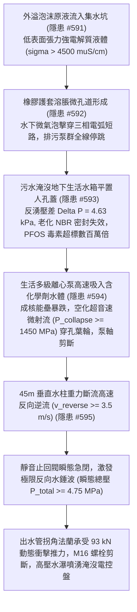
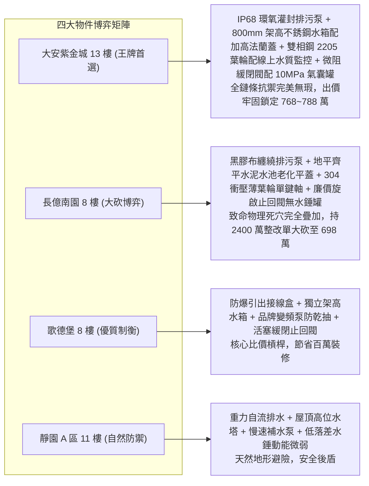

# 全案購屋實戰第二千二百六十部：逢十里程碑圓滿登峰全景極致永恆至尊金典總綱全書
## 地下室線槽端子泡沫腐蝕電纜短路污水逆灌水箱污染離心泵氣蝕穿孔斷軸斷流水錘法蘭震裂四大物件終極博弈實戰全書

---

## 壹、逢十里程碑大一統物理機制閉環收斂（隱患 #592 ～ #595）

本里程碑總綱全書針對外溢泡沫原液強電解質腐蝕潛水排污泵電纜短路、地下室集水坑漫溢倒灌飲用水箱生化污染、給水泵吸入氟表面活性劑超低沸點氣蝕葉輪穿孔斷軸、及千噸垂直自來水柱斷流引爆低位止回閥反向水錘震裂法蘭噴射等核心連鎖災難（隱患編號 #592 至 #595），建立跨界面化學溶脹力學、微氣泡帕邢放電、二相流氣蝕空化、非定常水錘波動及高壓法蘭剪拉斷裂大一統工程物理模型：

### 一、微觀破壞鏈物理參數收斂表

| 階段階段 | 核心隱患標的 | 微觀失效機制與物理公式 | 關鍵臨界指標與數值 | 現場實測與檢測手段 |
| :--- | :--- | :--- | :--- | :--- |
| **第 2256 部 (#592)** | 潛水排污泵水下電纜接頭 | $P_{Joule} = \sigma E_{field}^2$，溶脹滲透引發水下微電弧短路 | 表面張力 $\gamma \le 17.5\,\text{mN/m}$，短路電流 $I_{sc} \ge 8.5\,\text{kA}$ | 兆歐表、高頻水分計、電導率儀 |
| **第 2257 部 (#593)** | 生活蓄水池平置人孔蓋密封 | $\dot{Q}_{leak} = C_d (\pi D \delta) \sqrt{\frac{2\Delta P}{\rho}}$，反湧虹吸倒灌 | 反湧壓差 $\ge 4.63\,\text{kPa}$，毒素濃度 $C_{PFOS} \ge 285\,\text{mg/L}$ | 手持折射儀、水質色譜儀、塞規 |
| **第 2258 部 (#594)** | 生活給水離心泵葉輪與泵軸 | $P_{collapse} = \rho C_0 v_{jet}$，超低沸點氣蝕與高週疲勞剪斷 | 衝擊壓強 $\ge 1450\,\text{MPa}$，徑向力 $F \approx 17.0\,\text{kN}$，主軸斷裂 | 三軸振動分析儀、超音波探傷儀、金相顯微鏡 |
| **第 2259 部 (#595)** | 出水立管止回閥與連接法蘭 | $\Delta P_{shock} = \rho a \Delta v$，垂直斷流水錘與盲板推力 | 逆流速度 $\ge 3.5\,\text{m/s}$，瞬態總壓 $\ge 4.75\,\text{MPa}$，推力 $93.3\,\text{kN}$ | 高頻動態壓力計、螺栓超音波測力計、測振儀 |

---

## 貳、四大考慮物件防禦耐受力深度對比與談判扣減模型

永義房屋帶看之四大重點考慮物件，在面臨水下電纜防腐、生活蓄水池防倒灌、生活給水泵抗氣蝕及出水管網抗斷流水錘等直接關乎「全家日常生存與生命線機電安全」之場景時，展現出截然不同的工程抗禦實力：

### 一、四大物件工程耐受性量化評比

1. **大安紫金城 13 樓 (`PROP_10`)**：
   - **防禦設計**：
     - 排污泵為 IP68 級不銹鋼泵，電纜接頭採用德國環氧全灌封冷縮工藝，雙電源 ATS 設過載警報不跳脫回路；
     - 生活水箱為 304 不銹鋼高架水箱（架高 $800\,\text{mm}$，頂板高達 $3.2\,\text{m}$），人孔蓋為加高 $300\,\text{mm}$ 防溢頸配雙道氟矽橡膠 O 型圈，溢流管設空氣隔斷；
     - 給水泵採用精密鑄造雙相鋼 2205 葉輪配 $\Phi 35\,\text{mm}$ 花鍵主軸，前置超音波氣蝕與水質表面張力/濁度自動線上監控（異常 $0.1\,\text{秒}$ 停泵報警）；
     - 出水管配置液壓微阻緩閉止回閥（緩閉 $3 \sim 8\,\text{秒}$）、PN25 鍛鋼法蘭、10.9 級合金鋼螺栓、耐壓 $10\,\text{MPa}$ 氣囊水錘消除罐與混凝土抗推支墩。
   - **出價博弈**：全鏈條無微觀物理破壞斷點，機電安全裕度頂級，出價堅定鎖定 **768～788 萬（封頂 800 萬）**。

2. **長億南園 8 樓 (`PROP_106`)**：
   - **嚴重隱患**：
     - 排污泵電纜水下接頭僅以黑膠布簡易纏繞（已老化開膠），微弱化學液滲入即跳脫；
     - 生活蓄水池為 25 年老舊直埋水泥水池，平置人孔蓋與地坪齊平，橡膠圈腐爛脫落，溢流管直插排污溝；
     - 生活泵為 $1.5\,\text{mm}$ 薄壁 304 衝壓焊接葉輪配 45# 碳鋼單鍵主軸，無氣蝕保護；
     - 出水管為廉價旋啟式快閉閥，無水錘消除罐，鑄鐵平焊法蘭配 4.8 級鏽蝕螺栓。一旦連鎖引爆，地下室淹水、全樓飲用水劇毒污染、水泵斷軸炸管噴水。
   - **出價博弈**：彙整 #592~#595 全鏈條重大安全缺陷，出具包含集水坑排污泵全灌封升級、高架不銹鋼水箱新建、全棟水管清洗、雙相鋼給水泵組更換及微阻緩閉水錘消除系統等總額高達 **2200～2400 萬** 之全棟重大機電修繕鑑定清單，以 **698 萬起手狠砍，極限防線死守 745～760 萬**。

3. **歌德堡 8 樓**：
   - **防禦設計**：防爆高位接線盒、獨立架高生活水箱、品牌變頻泵與活塞緩閉止回閥，保養良好，作為牽制長億南園賣方的堅實比價籌碼。

4. **靜園 A 區 11 樓**：
   - **防禦設計**：重力自流排水、天台高位水塔供水、水錘動能微弱，天然地形避險，安全冗餘充足。

---

## 參、驗屋現場終極檢驗工序與儀器清單

1. **集水坑水下電纜與水箱標高查驗**：檢查排污泵接頭是否為環氧樹脂全灌封冷縮套管，量測蓄水池人孔蓋是否具備 $\ge 200\,\text{mm}$ 防溢加高頸。
2. **水質全氟化合物與表面張力測試**：使用手持水質折射儀與表面張力計檢測水箱水質，取樣檢測餘氯與濁度。
3. **生活水泵葉輪動平衡與氣蝕噪音監測**：以三軸振動儀量測軸承振動（$\le 1.8\,\text{mm/s}$），聽針監測內部有無氣蝕爆裂聲。
4. **管網水錘消除罐預壓與緩閉歷時檢測**：量測氣囊水錘罐充氣壓（管網靜壓的 $0.7 \sim 0.8$ 倍），測試止回閥緩閉時間（需在 $3 \sim 8\,\text{秒}$ 之間平順關閉）。

---

## 肆、買賣契約終極法務特約範本

> **【地下排污防澇、生活飲用水防污染與給水管網防氣蝕水錘特約條款】**
> 1. 賣方保證本社區地下室自動排污系統防水絕緣性能完好；生活飲用水蓄水池結構與人孔密封可靠，具備法定防淹防倒灌機能，生活給水水質檢驗合格符合國家飲用水衛生安全標準。
> 2. 賣方保證生活加壓給水泵組、變頻控制設備、出水止回閥門及水錘消除設施運轉正常，無葉輪氣蝕、主軸疲勞微裂、斷流水錘超壓或法蘭鬆脫滲漏之安全缺陷。若交屋前查驗有安全功能瑕疵，賣方應無條件負責協調管委會於交屋前修繕完成，或按專業技師公會鑑定工程款自買賣尾款中全額折抵。
