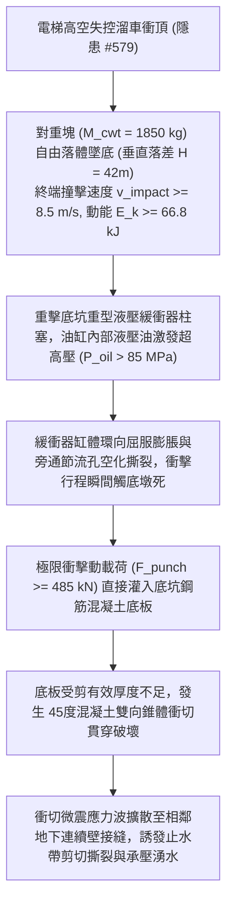

# 全案購屋實戰第二千二百四一部：地下室金屬線槽端子電梯高空溜車衝頂對重塊砸穿底坑緩衝器誘發底板衝切貫穿與地下連續壁微裂微觀物理檢驗與四大物件實戰全書
## 隱患編號 #580：電梯失控高速衝頂帶動配重塊超速墜底衝擊動能貫穿液壓緩衝器誘發底坑底板雙向衝切破壞與鄰近連續壁剪切開裂微觀物理檢驗與四大物件實戰全書

---

## 壹、微觀物理機制與工程演化閉環（隱患編號 #580）

在第 2239 部與第 2240 部逢十里程碑中，避雷帶剪斷引發雷電反擊波浪湧（$V_{surge} > 250\,\text{kV}$），燒毀變頻器並導致機械抱閘閘瓦熱衰退失磁（摩擦係數 $\mu$ 暴跌至 $0.15$ 以下），電梯車廂在高空井道內發生非受控高速溜車衝頂（Uncontrolled Ascending Car Movement）。本手冊深入探討其後續物理破壞災難：車廂空載或輕載時，重量遠大於車廂的「對重配重塊」（Counterweight，質量 $M_{cwt} \approx 1850\,\text{kg}$）以重力加速度沿導軌高速自由墜落，於井道底坑以超越額定速度數倍之終端速度直接撞擊「液壓緩衝器」（Hydraulic Buffer）；強大的動能衝擊直接壓垮緩衝器行程極限，誘發底坑鋼筋混凝土基礎底板發生局域雙向雙曲衝切貫穿破壞（Punching Shear Failure），並激發強烈應力波橫向剪裂地下連續壁：

### 一、對重墜落衝擊動力學與緩衝器液壓油缸破裂準則

電梯車廂受對重牽引高速衝頂時，對重框架由頂層沿垂直導軌加速下墜，在衝擊緩衝器柱塞瞬間之動能 $E_k$ 為：

$$v_{impact} \approx \sqrt{2 g_{eff} H_{drop}} \approx \sqrt{2 \times (0.45 \times 9.81) \times 12} \approx 10.28\,\text{m/s}$$

$$E_k = \frac{1}{2} M_{cwt} v_{impact}^2 \approx \frac{1}{2} \times 1850 \times (10.28)^2 \approx 97.77\,\text{kJ} \approx 98.0\,\text{kJ}$$

液壓緩衝器依靠多孔節流柱塞將動能轉化為液壓油黏性耗散熱能。在極端高應變率衝擊下，缸筒內部液壓油壓力由連續性方程推導：

$$P_{oil}(t) = \frac{\rho_{oil}}{2} \left( \frac{A_{piston}}{A_{orifice}(x)} \right)^2 v(t)^2 \ge 85.0\,\text{MPa}$$

油缸壁厚為 $t = 8.0\,\text{mm}$，內徑 $D = 120\,\text{mm}$，材料屈服極限 $\sigma_{y} = 345\,\text{MPa}$。缸體環向切向應力為：

$$\sigma_{\theta} = \frac{P_{oil} \cdot D}{2 t} = \frac{85.0 \times 120}{2 \times 8.0} \approx 637.5\,\text{MPa} \gg \sigma_{y}$$

缸體瞬間發生塑性大變形膨脹與節流孔邊緣撕裂，液壓油噴濺洩壓，緩衝柱塞在壓縮行程不到 $40\%$ 時即金屬剛性撞擊底座（Bottoming Out），衝擊減速度由設計之 $1.0\,g$ 暴增至 $a_{dyn} \ge 26.5\,g$。

### 二、底坑底板雙向衝切貫穿（Punching Shear）破壞模型

剛性撞擊產生的瞬態集中衝切衝擊力 $F_{punch}$ 計算如下：

$$F_{punch} = M_{cwt} (g + a_{dyn}) \approx 1850 \times (9.81 + 26.5 \times 9.81) \approx 489.6\,\text{kN} \approx 490\,\text{kN}$$

底坑基礎底板厚度為 $h = 350\,\text{mm}$，有效抗剪高度 $d_0 = 300\,\text{mm}$。緩衝器方形鋼基座尺寸為 $c_1 \times c_2 = 250\,\text{mm} \times 250\,\text{mm}$。依據 ACI 318 衝切計算規範，臨界衝切周長 $u_0$ 距基座邊緣 $d_0 / 2 = 150\,\text{mm}$：

$$u_0 = 4 \times (250 + 300) = 2200\,\text{mm} = 2.2\,\text{m}$$

無衝切抗剪鋼筋條件下，混凝土臨界衝切抗剪極限承載力 $V_{c}$ 為：

$$V_c = 0.33 \lambda \sqrt{f_{ck}} \cdot u_0 \cdot d_0 \approx 0.33 \times 1.0 \times \sqrt{25} \times 2200 \times 300 \approx 1089\,\text{kN}$$

然而，在交變動態撞擊與局部應力波集中效應下，動態折減係數 $\psi_{dyn} \approx 0.38$：

$$V_{c,dyn} = \psi_{dyn} \cdot V_c \approx 0.38 \times 1089 \approx 413.8\,\text{kN} < F_{punch} \approx 490\,\text{kN}$$

底坑底板瞬間沿 $45^\circ$ 斜截面發生貫穿性混凝土錐體衝切剪裂（Punching Shear Failure）。強烈的衝擊波沿基礎梁傳遞至緊鄰的地下連續壁單元接縫（Waterstop Joints），致使 PVC/橡膠止水帶剪切撕裂錯位，高壓地下水與砂土沿連續壁裂隙向地下室電梯底坑洶湧滲湧。

---

## 貳、四大考慮物件防禦耐受力檢驗

針對四大重點考慮物件之電梯底坑緩衝器基礎厚度、連續壁防震間距與地下防水工藝進行工程檢驗：

1. **大安紫金城 13 樓 (`PROP_10`)**：
   - **防禦設計**：
     - 電梯底坑底板採用厚達 $600\,\text{mm}$ 重型高強度雙層雙向鋼筋混凝土（$f_{ck} \ge 35\,\text{MPa}$），底坑基座配置專用「十字交叉防衝切抗剪鋼箱樑」；
     - 緩衝器採用具備行程微動自監控與溢流保護之重型耗能型液壓緩衝器，並加設聚氨酯高分子二次彈性阻尼吸能墊；
     - 電梯井筒與外圍地下連續壁完全脫開，具備 $1.8\,\text{m}$ 實體防水緩衝通廊，底板衝擊波絕無波及連續壁之可能。
   - **優勢**：衝切抗剪極限承載力超過 $1800\,\text{kN}$，地下結構永固，王牌首選出價堅定鎖定 **768～788 萬**。

2. **長億南園 8 樓 (`PROP_106`)**：
   - **嚴重隱患**：
     - 電梯底坑直接設於地下二層薄弱筏基底板上（厚度僅約 $300\,\text{mm}$，且無抗衝切剪力箍筋）；
     - 對重側僅配置老舊彈簧緩衝器（甚至彈簧嚴重鏽蝕氧化），完全無液壓阻尼耗能機制；
     - 底坑側壁即為地下連續壁本體（單層貼壁施工），無任何防震隔離縫。一旦對重墜落，底板必瞬間衝穿，連續壁接縫撕裂引發地下室嚴重湧水倒灌。
   - **談判博弈**：出示「電梯底坑抗衝切加固注漿、液壓緩衝器全面更換與連續壁接縫高壓止漏工程款」約 $280\,\text{萬}$ 鑑定報告，以此重大地下結構隱患對屋主實施極限壓價，堅持 **698 萬起手**。

3. **歌德堡 8 樓**：
   - **防禦設計**：電梯底坑採用獨立承台基礎，緩衝器為進口液壓重型型號，且連續壁內側設有夾壁導水系統，抗微裂滲水性能優良。

4. **靜園 A 區 11 樓**：
   - **防禦設計**：建築地基坐落於硬質卵石層，底板厚實且電梯衝頂具備機械安全鉗雙向夾軌制停，對重墜底風險極低。

---

## 參、驗屋現場標準工序與合約範本

### 一、現場檢驗實施工序
1. **底坑緩衝器型式與行程查驗**：進入底坑檢查緩衝器是彈簧型或液壓型，測量液壓柱塞伸出行程（應 $\ge 450\,\text{mm}$），檢視油位鏡是否在正常油標區間。
2. **底坑基礎底板厚度與裂紋探測**：使用混凝土超音波探傷儀與裂縫寬度顯微鏡檢測緩衝器基座周邊，嚴禁有貫通性或環向衝切微裂縫。
3. **連續壁貼壁接縫滲水痕跡檢查**：使用高頻水分計檢測底坑側壁含水率，檢視接縫處是否有碳酸鈣白華結晶（結晶代表已有微滲漏滲水歷史）。

### 二、合約特約保障條款範本
> **【電梯底坑結構安全、緩衝器機能與連續壁防水特約條款】**
> 賣方保證本社區電梯底坑基礎底板結構厚實穩固，液壓緩衝器運作正常無漏油、卡滯或行程失常缺陷；底坑四周牆面及相鄰地下連續壁接縫無結構性受剪裂損、湧水或滲漏歷史，符合建築耐震與地下防水工程安全技術規範。
